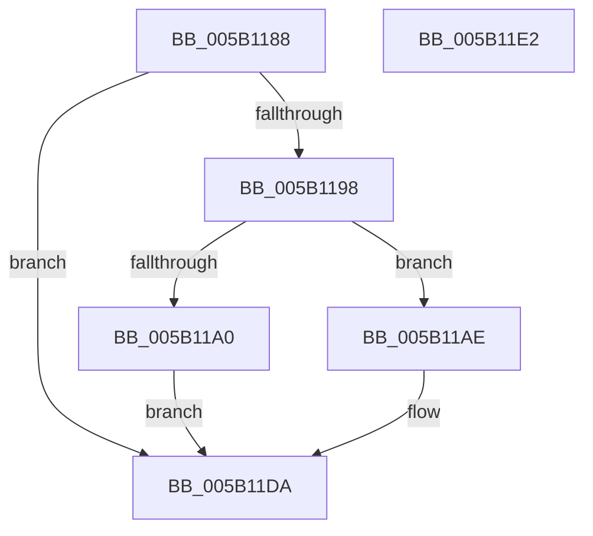

# KdpPollBreakInWithPortLock

- RVA: `0x005B1188`–`0x005B11E3` (길이 `91` bytes)
- VA: `0x00000001405B1188`
- 실행 섹션: `.text`
- PDB 이름 있음: `예`; PDB Function 태그: `아니요`
- unwind 정보 RVA: `0x00064C80`
- 디코드: `27`개 명령, `91/91` bytes 표시
- 미해석 바이트: `0` (있으면 어셈블리에 `.byte`로 보존)

> 이 문서는 커널 이미지의 기계어와 PDB 기호를 분석해 생성했습니다. 4번과 5번은 함수 원형과 자료형을 바이너리 사용 방식에서 추정한 C 해석이며 원본 소스 복구 결과는 아닙니다.

## 1. Dependencies

- 직접 호출 지점: **1**; 고유 호출 대상: **1**
- 직접 호출자로 확인된 함수: **1**
- RIP 상대 이미지 참조: **4**

### Outgoing calls
- `0x005B11BF` → `kdcom.dll!KdReceivePacket` (import, 간접 대상; import `kdcom.dll!KdReceivePacket`)

### Direct callers
- [KdpPrintString](../../pagekd/B8/KdpPrintString_function_00B89CE8.md) at `0x00B89DBA`

### Static image references
- `0x005B1190` → RVA `0x00F475F8` (`.data`; read)
- `0x005B1198` → RVA `0x00F475E4` (`.data`; read)
- `0x005B11A5` → RVA `0x00F475E4` (`.data`; write)
- `0x005B11BF` → RVA `0x001516B0` (`kdcom.dll!KdReceivePacket (IAT)`; read)

## 2. Other-region calls and transfers

- 다른 실행 섹션으로 향하는 call: **0**
- 별도 외부 분기/꼬리 이동을 확인하지 못했습니다.

## 3. Assembly (complete function range)

```asm
005B1188  40 53                           push rbx
005B118A  48 83 EC 30                     sub rsp, 0x30
005B118E  32 DB                           xor bl, bl
005B1190  38 1D 62 64 99 00               cmp byte ptr [rip + 0x996462], bl
005B1196  74 42                           je 0x1405b11da
005B1198  38 1D 46 64 99 00               cmp byte ptr [rip + 0x996446], bl
005B119E  74 0E                           je 0x1405b11ae
005B11A0  BB 01 00 00 00                  mov ebx, 1
005B11A5  C6 05 38 64 99 00 00            mov byte ptr [rip + 0x996438], 0
005B11AC  EB 2C                           jmp 0x1405b11da
005B11AE  48 83 64 24 20 00               and qword ptr [rsp + 0x20], 0
005B11B4  33 D2                           xor edx, edx
005B11B6  45 33 C9                        xor r9d, r9d
005B11B9  45 33 C0                        xor r8d, r8d
005B11BC  8D 4A 08                        lea ecx, [rdx + 8]
005B11BF  48 FF 15 EA 04 BA FF            call qword ptr [rip - 0x45fb16]
005B11C6  0F 1F 44 00 00                  nop dword ptr [rax + rax]
005B11CB  0F B6 CB                        movzx ecx, bl
005B11CE  BB 01 00 00 00                  mov ebx, 1
005B11D3  85 C0                           test eax, eax
005B11D5  0F 44 CB                        cmove ecx, ebx
005B11D8  8A D9                           mov bl, cl
005B11DA  8A C3                           mov al, bl
005B11DC  48 83 C4 30                     add rsp, 0x30
005B11E0  5B                              pop rbx
005B11E1  C3                              ret
005B11E2  CC                              int3
```

## 4. C-style interpretation (structured pseudocode)

```c
__int64 __fastcall KdpPollBreakInWithPortLock(__int64 a1, int a2, int a3, int a4)
{
    __int64 result;
    __int64 v_rbx;
    __int64 v_rsp;
    unsigned __int64 v_stack_m18;

    v_rsp = (v_rsp) - (48);
    v_rbx = 0;
    if ((*(unsigned __int8 *)(v_rip + 10052706)) == 0) goto loc_005B11DA;
    if ((*(unsigned __int8 *)(v_rip + 10052678)) == 0) goto loc_005B11AE;
    *(unsigned __int8 *)(v_rip + 10052664) = 0;
    goto loc_005B11DA;
loc_005B11AE:
    a2 = 0;
    a4 = 0;
    a3 = 0;
    result = kdcom_dll_KdReceivePacket(a2 + 8, a2, a3, a4);
    a1 = 1;
    if ((unsigned int)(result) == 0) { a1 = 1; }
loc_005B11DA:
    v_rsp = (v_rsp) + (48);
    return (unsigned __int8)((unsigned __int8)(a1));
}
```

## 5. (Beta) C Style

```c
int64_t KdpPollBreakInWithPortLock(int64_t Arg1, int32_t Arg2, int32_t Arg3, int32_t Arg4)
{
    int64_t result;
    int64_t local_rbx;
    int64_t local_rsp;
    uint64_t v_stack_m18;

    local_rsp = (local_rsp) - (48);
    local_rbx = 0;
    if ((*(uint8_t *)(v_rip + 0x996462)) == 0) goto loc_005B11DA;
    if ((*(uint8_t *)(v_rip + 0x996446)) == 0) goto loc_005B11AE;
    *(uint8_t *)(v_rip + 0x996438) = 0;
    goto loc_005B11DA;
loc_005B11AE:
    Arg2 = 0;
    Arg4 = 0;
    Arg3 = 0;
    result = kernel_indirect_call(Arg2 + 8, Arg2, Arg3, Arg4);
    Arg1 = 1;
    if ((uint32_t)(result) == 0) { Arg1 = 1; }
loc_005B11DA:
    local_rsp = (local_rsp) + (48);
    return (uint8_t)((uint8_t)(Arg1));
}
```

## 6. Execution-region graph

[열기: 2D/3D 그래프와 함수 탐색 컨트롤 패널](../../../control-panel.html?section=text&rva=0x005B1188&view=graph)

- 2D 그래프는 위에서 아래로 흐르고, 3D 그래프는 빈 공간을 드래그해 회전합니다. Shift+드래그는 이동, 휠은 확대·축소, 함수 노드 선택은 대상 보고서 이동입니다.

### Static fallback


