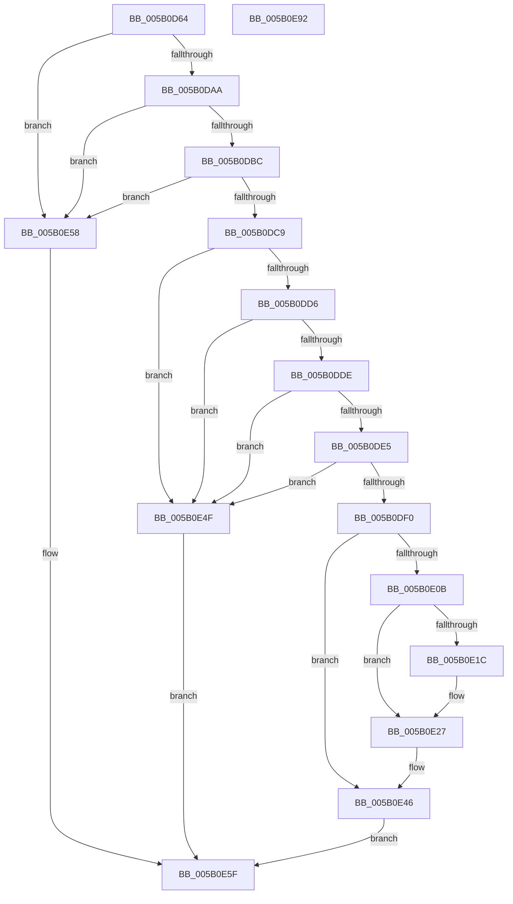

# KdpSetContextEx

- RVA: `0x005B0D64`–`0x005B0E93` (길이 `303` bytes)
- VA: `0x00000001405B0D64`
- 실행 섹션: `.text`
- PDB 이름 있음: `예`; PDB Function 태그: `아니요`
- unwind 정보 RVA: `0x000C9A0C`
- 디코드: `78`개 명령, `303/303` bytes 표시
- 미해석 바이트: `0` (있으면 어셈블리에 `.byte`로 보존)

> 이 문서는 커널 이미지의 기계어와 PDB 기호를 분석해 생성했습니다. 4번과 5번은 함수 원형과 자료형을 바이너리 사용 방식에서 추정한 C 해석이며 원본 소스 복구 결과는 아닙니다.

## 1. Dependencies

- 직접 호출 지점: **4**; 고유 호출 대상: **4**
- 직접 호출자로 확인된 함수: **1**
- RIP 상대 이미지 참조: **5**

### Outgoing calls
- `0x005B0E01` → [KdpQuickMoveMemory](../../pagekd/B8/KdpQuickMoveMemory_function_00B85490.md) (function, `0x00B85490`)
- `0x005B0E32` → [KdpSanitizeContextFlags](../../pagekd/B8/KdpSanitizeContextFlags_function_00B89498.md) (function, `0x00B89498`)
- `0x005B0E41` → [KdpCopyContext](../../pagekd/B8/KdpCopyContext_function_00B851E8.md) (function, `0x00B851E8`)
- `0x005B0E72` → `kdcom.dll!KdSendPacket` (import, 간접 대상; import `kdcom.dll!KdSendPacket`)

### Direct callers
- [KdpSendWaitContinue](../../pagekd/B8/KdpSendWaitContinue_function_00B8A32C.md) at `0x00B8A4F3`

### Static image references
- `0x005B0DAA` → RVA `0x00FC8C40` (`ALMOSTRO`; read)
- `0x005B0DBC` → RVA `0x00F475D0` (`.data`; read)
- `0x005B0DF4` → RVA `0x00E5EE48` (`.data`; read)
- `0x005B0E62` → RVA `0x00F475E0` (`.data`; read)
- `0x005B0E72` → RVA `0x001516C0` (`kdcom.dll!KdSendPacket (IAT)`; read)

## 2. Other-region calls and transfers

- 다른 실행 섹션으로 향하는 call: **3**
  - `0x005B0E01` → [KdpQuickMoveMemory](../../pagekd/B8/KdpQuickMoveMemory_function_00B85490.md) (`.text` → `PAGEKD`)
  - `0x005B0E32` → [KdpSanitizeContextFlags](../../pagekd/B8/KdpSanitizeContextFlags_function_00B89498.md) (`.text` → `PAGEKD`)
  - `0x005B0E41` → [KdpCopyContext](../../pagekd/B8/KdpCopyContext_function_00B851E8.md) (`.text` → `PAGEKD`)
- 별도 외부 분기/꼬리 이동을 확인하지 못했습니다.

## 3. Assembly (complete function range)

```asm
005B0D64  48 8B C4                        mov rax, rsp
005B0D67  48 89 58 10                     mov qword ptr [rax + 0x10], rbx
005B0D6B  48 89 70 18                     mov qword ptr [rax + 0x18], rsi
005B0D6F  57                              push rdi
005B0D70  41 56                           push r14
005B0D72  41 57                           push r15
005B0D74  48 83 EC 30                     sub rsp, 0x30
005B0D78  83 60 08 00                     and dword ptr [rax + 8], 0
005B0D7C  0F 57 C0                        xorps xmm0, xmm0
005B0D7F  0F 11 40 D8                     movups xmmword ptr [rax - 0x28], xmm0
005B0D83  B8 38 00 00 00                  mov eax, 0x38
005B0D88  48 89 4C 24 28                  mov qword ptr [rsp + 0x28], rcx
005B0D8D  66 89 44 24 20                  mov word ptr [rsp + 0x20], ax
005B0D92  48 8B D9                        mov rbx, rcx
005B0D95  0F B7 41 06                     movzx eax, word ptr [rcx + 6]
005B0D99  49 8B F0                        mov rsi, r8
005B0D9C  B9 00 08 00 00                  mov ecx, 0x800
005B0DA1  66 3B C1                        cmp ax, cx
005B0DA4  0F 83 AE 00 00 00               jae 0x1405b0e58
005B0DAA  4C 8D 35 8F 7E A1 00            lea r14, [rip + 0xa17e8f]
005B0DB1  49 83 3C C6 00                  cmp qword ptr [r14 + rax*8], 0
005B0DB6  0F 84 9C 00 00 00               je 0x1405b0e58
005B0DBC  80 3D 0D 68 99 00 00            cmp byte ptr [rip + 0x99680d], 0
005B0DC3  0F 84 8F 00 00 00               je 0x1405b0e58
005B0DC9  44 8B 4B 18                     mov r9d, dword ptr [rbx + 0x18]
005B0DCD  41 81 F9 00 30 00 00            cmp r9d, 0x3000
005B0DD4  77 79                           ja 0x1405b0e4f
005B0DD6  8B 43 10                        mov eax, dword ptr [rbx + 0x10]
005B0DD9  41 3B C1                        cmp eax, r9d
005B0DDC  73 71                           jae 0x1405b0e4f
005B0DDE  8B 7B 14                        mov edi, dword ptr [rbx + 0x14]
005B0DE1  85 FF                           test edi, edi
005B0DE3  74 6A                           je 0x1405b0e4f
005B0DE5  4C 8D 14 38                     lea r10, [rax + rdi]
005B0DE9  8B C8                           mov ecx, eax
005B0DEB  4D 3B D1                        cmp r10, r9
005B0DEE  77 5F                           ja 0x1405b0e4f
005B0DF0  48 8B 52 08                     mov rdx, qword ptr [rdx + 8]
005B0DF4  4C 8D 3D 4D E0 8A 00            lea r15, [rip + 0x8ae04d]
005B0DFB  49 03 CF                        add rcx, r15
005B0DFE  44 8B C7                        mov r8d, edi
005B0E01  E8 8A 46 5D 00                  call 0x140b85490
005B0E06  4D 3B D1                        cmp r10, r9
005B0E09  75 3B                           jne 0x1405b0e46
005B0E0B  0F B7 4B 06                     movzx ecx, word ptr [rbx + 6]
005B0E0F  65 8B 04 25 A4 01 00 00         mov eax, dword ptr gs:[0x1a4]
005B0E17  66 3B C8                        cmp cx, ax
005B0E1A  74 0B                           je 0x1405b0e27
005B0E1C  49 8B 04 CE                     mov rax, qword ptr [r14 + rcx*8]
005B0E20  48 8B B0 C0 8F 00 00            mov rsi, qword ptr [rax + 0x8fc0]
005B0E27  4C 8D 44 24 50                  lea r8, [rsp + 0x50]
005B0E2C  41 8B D1                        mov edx, r9d
005B0E2F  49 8B CF                        mov rcx, r15
005B0E32  E8 61 86 5D 00                  call 0x140b89498
005B0E37  8B 54 24 50                     mov edx, dword ptr [rsp + 0x50]
005B0E3B  48 8B CE                        mov rcx, rsi
005B0E3E  4D 8B C7                        mov r8, r15
005B0E41  E8 A2 43 5D 00                  call 0x140b851e8
005B0E46  83 63 08 00                     and dword ptr [rbx + 8], 0
005B0E4A  89 7B 18                        mov dword ptr [rbx + 0x18], edi
005B0E4D  EB 10                           jmp 0x1405b0e5f
005B0E4F  C7 43 08 0D 00 00 C0            mov dword ptr [rbx + 8], 0xc000000d
005B0E56  EB 07                           jmp 0x1405b0e5f
005B0E58  C7 43 08 01 00 00 C0            mov dword ptr [rbx + 8], 0xc0000001
005B0E5F  45 33 C0                        xor r8d, r8d
005B0E62  4C 8D 0D 77 67 99 00            lea r9, [rip + 0x996777]
005B0E69  48 8D 54 24 20                  lea rdx, [rsp + 0x20]
005B0E6E  41 8D 48 02                     lea ecx, [r8 + 2]
005B0E72  48 FF 15 47 08 BA FF            call qword ptr [rip - 0x45f7b9]
005B0E79  0F 1F 44 00 00                  nop dword ptr [rax + rax]
005B0E7E  48 8B 5C 24 58                  mov rbx, qword ptr [rsp + 0x58]
005B0E83  48 8B 74 24 60                  mov rsi, qword ptr [rsp + 0x60]
005B0E88  48 83 C4 30                     add rsp, 0x30
005B0E8C  41 5F                           pop r15
005B0E8E  41 5E                           pop r14
005B0E90  5F                              pop rdi
005B0E91  C3                              ret
005B0E92  CC                              int3
```

## 4. C-style interpretation (structured pseudocode)

```c
__int64 __fastcall KdpSetContextEx(__int64 a1, __int64 a2, __int64 a3)
{
    __int64 result;
    __int64 v_rsi;
    __int64 v_rsp;
    unsigned __int64 v_stack_m20;
    unsigned __int16 v_stack_m28;
    unsigned __int64 v_stack_p10;
    unsigned __int64 v_stack_p18;
    unsigned __int64 v_stack_p8;

    *(unsigned __int64 *)(v_rsp + 16) = v_rbx;
    *(unsigned __int64 *)(v_rsp + 24) = v_rsi;
    v_rsp = (v_rsp) - (48);
    *(unsigned __int64 *)(v_rsp - 40) = v_xmm0;
    v_stack_m20 = a1;
    v_stack_m28 = 56;
    if (((unsigned __int16)(*(unsigned __int16 *)(a1 + 6))) >= ((unsigned __int16)((unsigned int)(0x800ULL)))) goto loc_005B0E58;
    if ((*(unsigned __int64 *)(v_rip + 10583695 + *(unsigned __int16 *)(a1 + 6) * 8)) == 0) goto loc_005B0E58;
    if ((*(unsigned __int8 *)(v_rip + 10053645)) == 0) goto loc_005B0E58;
    if (((unsigned int)((unsigned int)(*(unsigned int *)(a1 + 24)))) > 0x3000ULL) goto loc_005B0E4F;
    if (((unsigned int)((unsigned int)(*(unsigned int *)(a1 + 16)))) >= ((unsigned int)((unsigned int)(*(unsigned int *)(a1 + 24))))) goto loc_005B0E4F;
    if ((unsigned int)((unsigned int)(*(unsigned int *)(a1 + 20))) == 0) goto loc_005B0E4F;
    if (((unsigned int)(*(unsigned int *)(a1 + 16)) + (unsigned int)(*(unsigned int *)(a1 + 20)) * 1) > ((unsigned int)(*(unsigned int *)(a1 + 24)))) goto loc_005B0E4F;
    a1 = ((unsigned int)((unsigned int)((unsigned int)(*(unsigned int *)(a1 + 16))))) + (v_rip + 9101389);
    result = KdpQuickMoveMemory(a1, *(unsigned __int64 *)(a2 + 8), (unsigned int)((unsigned int)((unsigned int)(*(unsigned int *)(a1 + 20)))), (unsigned int)(*(unsigned int *)(a1 + 24)));
    if (((unsigned int)(*(unsigned int *)(a1 + 16)) + (unsigned int)(*(unsigned int *)(a1 + 20)) * 1) != ((unsigned int)(*(unsigned int *)(a1 + 24)))) goto loc_005B0E46;
    result = (unsigned int)(*(unsigned int *)(gs_base + (0 + 420)));
    v_rsi = a3;
    if (((unsigned __int16)(*(unsigned __int16 *)(a1 + 6))) != ((unsigned __int16)((unsigned int)(*(unsigned int *)(gs_base + (0 + 420)))))) {
        result = *(unsigned __int64 *)(v_rip + 10583695 + *(unsigned __int16 *)(a1 + 6) * 8);
        v_rsi = *(unsigned __int64 *)(result + 36800);
    }
    result = KdpSanitizeContextFlags(v_rip + 9101389, (unsigned int)((unsigned int)((unsigned int)(*(unsigned int *)(a1 + 24)))), v_stack_p8, (unsigned int)(*(unsigned int *)(a1 + 24)));
    result = KdpCopyContext(v_rsi, (unsigned int)(v_stack_p8), v_rip + 9101389, (unsigned int)(*(unsigned int *)(a1 + 24)));
loc_005B0E46:
    *(unsigned int *)(a1 + 24) = (unsigned int)((unsigned int)(*(unsigned int *)(a1 + 20)));
    goto loc_005B0E5F;
loc_005B0E4F:
    *(unsigned int *)(a1 + 8) = 0xC000000DULL;
    goto loc_005B0E5F;
loc_005B0E58:
    *(unsigned int *)(a1 + 8) = 0xC0000001ULL;
loc_005B0E5F:
    a3 = 0;
    result = kdcom_dll_KdSendPacket(a3 + 2, v_stack_m28, a3, v_rip + 10053495);
    v_rsp = (v_rsp) + (48);
    return result;
}
```

## 5. (Beta) C Style

```c
int64_t KdpSetContextEx(void *Arg1, void *Arg2, int64_t Arg3)
{
    uint8_t *arg1 = (uint8_t *)Arg1;
    uint8_t *arg2 = (uint8_t *)Arg2;

    int64_t result;
    int64_t local_rsi;
    int64_t local_rsp;
    uint64_t v_stack_m20;
    uint16_t v_stack_m28;
    uint64_t v_stack_p10;
    uint64_t v_stack_p18;
    uint64_t v_stack_p8;

    *(uint64_t *)(local_rsp + 0x10) = local_rbx;
    *(uint64_t *)(local_rsp + 0x18) = local_rsi;
    local_rsp = (local_rsp) - (48);
    *(uint64_t *)(local_rsp - 0x28) = v_xmm0;
    v_stack_m20 = Arg1;
    v_stack_m28 = 56;
    if (((uint16_t)(*(uint16_t *)(arg1 + 0x6))) >= ((uint16_t)((uint32_t)(0x800ULL)))) goto loc_005B0E58;
    if ((*(uint64_t *)(v_rip + 0xA17E8F + *(uint16_t *)(arg1 + 0x6) * 8)) == 0) goto loc_005B0E58;
    if ((*(uint8_t *)(v_rip + 0x99680D)) == 0) goto loc_005B0E58;
    if (((uint32_t)((uint32_t)(*(uint32_t *)(arg1 + 0x18)))) > 0x3000ULL) goto loc_005B0E4F;
    if (((uint32_t)((uint32_t)(*(uint32_t *)(arg1 + 0x10)))) >= ((uint32_t)((uint32_t)(*(uint32_t *)(arg1 + 0x18))))) goto loc_005B0E4F;
    if ((uint32_t)((uint32_t)(*(uint32_t *)(arg1 + 0x14))) == 0) goto loc_005B0E4F;
    if (((uint32_t)(*(uint32_t *)(arg1 + 0x10)) + (uint32_t)(*(uint32_t *)(arg1 + 0x14)) * 1) > ((uint32_t)(*(uint32_t *)(arg1 + 0x18)))) goto loc_005B0E4F;
    Arg1 = ((uint32_t)((uint32_t)((uint32_t)(*(uint32_t *)(arg1 + 0x10))))) + (v_rip + 9101389);
    result = KdpQuickMoveMemory(Arg1, *(uint64_t *)(arg2 + 0x8), (uint32_t)((uint32_t)((uint32_t)(*(uint32_t *)(arg1 + 0x14)))), (uint32_t)(*(uint32_t *)(arg1 + 0x18)));
    if (((uint32_t)(*(uint32_t *)(arg1 + 0x10)) + (uint32_t)(*(uint32_t *)(arg1 + 0x14)) * 1) != ((uint32_t)(*(uint32_t *)(arg1 + 0x18)))) goto loc_005B0E46;
    result = (uint32_t)(*(uint32_t *)(gs_base + (0 + 0x1A4)));
    local_rsi = Arg3;
    if (((uint16_t)(*(uint16_t *)(arg1 + 0x6))) != ((uint16_t)((uint32_t)(*(uint32_t *)(gs_base + (0 + 0x1A4)))))) {
        result = *(uint64_t *)(v_rip + 0xA17E8F + *(uint16_t *)(arg1 + 0x6) * 8);
        local_rsi = *(uint64_t *)(result + 0x8FC0);
    }
    result = KdpSanitizeContextFlags(v_rip + 9101389, (uint32_t)((uint32_t)((uint32_t)(*(uint32_t *)(arg1 + 0x18)))), v_stack_p8, (uint32_t)(*(uint32_t *)(arg1 + 0x18)));
    result = KdpCopyContext(local_rsi, (uint32_t)(v_stack_p8), v_rip + 9101389, (uint32_t)(*(uint32_t *)(arg1 + 0x18)));
loc_005B0E46:
    *(uint32_t *)(arg1 + 0x18) = (uint32_t)((uint32_t)(*(uint32_t *)(arg1 + 0x14)));
    goto loc_005B0E5F;
loc_005B0E4F:
    *(uint32_t *)(arg1 + 0x8) = 0xC000000DULL;
    goto loc_005B0E5F;
loc_005B0E58:
    *(uint32_t *)(arg1 + 0x8) = 0xC0000001ULL;
loc_005B0E5F:
    Arg3 = 0;
    result = kernel_indirect_call(Arg3 + 2, v_stack_m28, Arg3, v_rip + 10053495);
    local_rsp = (local_rsp) + (48);
    return result;
}
```

### 관측된 메모리 오프셋

구조체 형식이 확인되지 않은 접근은 인자 기준의 오프셋으로만 기록했습니다.

| 기준 인자 | 오프셋 표현 | 폭 (bit) | 접근 |
|---|---:|---:|---|
| `Arg1` | `+ 0x6` | `16` | `R` |
| `Arg1` | `+ 0x8` | `32` | `R/W` |
| `Arg1` | `+ 0x8` | `32` | `W` |
| `Arg1` | `+ 0x10` | `32` | `R` |
| `Arg1` | `+ 0x14` | `32` | `R` |
| `Arg1` | `+ 0x18` | `32` | `R` |
| `Arg1` | `+ 0x18` | `32` | `W` |
| `Arg2` | `+ 0x8` | `64` | `R` |

## 6. Execution-region graph

[열기: 2D/3D 그래프와 함수 탐색 컨트롤 패널](../../../control-panel.html?section=text&rva=0x005B0D64&view=graph)

- 2D 그래프는 위에서 아래로 흐르고, 3D 그래프는 빈 공간을 드래그해 회전합니다. Shift+드래그는 이동, 휠은 확대·축소, 함수 노드 선택은 대상 보고서 이동입니다.

### Static fallback


