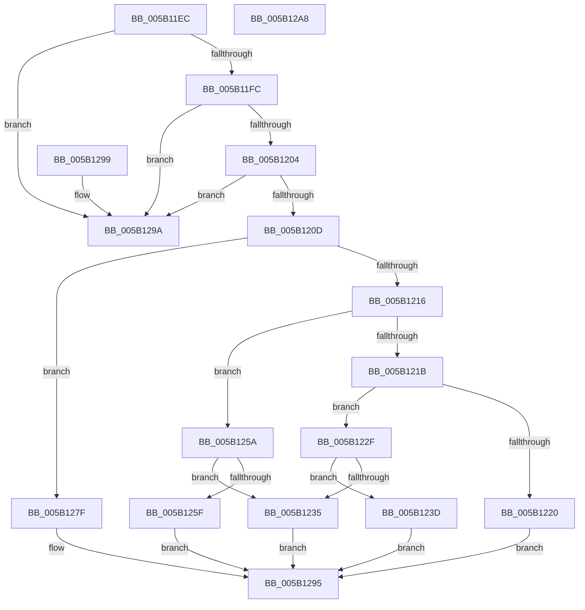

# KdpSysReadIoSpace

- RVA: `0x005B11EC`–`0x005B12A9` (길이 `189` bytes)
- VA: `0x00000001405B11EC`
- 실행 섹션: `.text`
- PDB 이름 있음: `예`; PDB Function 태그: `아니요`
- unwind 정보 RVA: `0x000DB714`
- 디코드: `61`개 명령, `189/189` bytes 표시
- 미해석 바이트: `0` (있으면 어셈블리에 `.byte`로 보존)

> 이 문서는 커널 이미지의 기계어와 PDB 기호를 분석해 생성했습니다. 4번과 5번은 함수 원형과 자료형을 바이너리 사용 방식에서 추정한 C 해석이며 원본 소스 복구 결과는 아닙니다.

## 1. Dependencies

- 직접 호출 지점: **0**; 고유 호출 대상: **0**
- 직접 호출자로 확인된 함수: **3**
- RIP 상대 이미지 참조: **0**

### Outgoing calls
- 직접 디코드된 call 명령이 없습니다.

### Direct callers
- [KdSystemDebugControl](../../page/74/KdSystemDebugControl_function_00744700.md) at `0x00744BF3`
- [KdpReadIoSpace](../../pagekd/B8/KdpReadIoSpace_function_00B87668.md) at `0x00B876B0`
- [KdpReadIoSpaceExtended](../../pagekd/B8/KdpReadIoSpaceExtended_function_00B876E4.md) at `0x00B8772D`

### Static image references
- 디코드된 RIP-relative 메모리 참조가 없습니다.

## 2. Other-region calls and transfers

- 다른 실행 섹션으로 향하는 call: **0**
- 별도 외부 분기/꼬리 이동을 확인하지 못했습니다.

## 3. Assembly (complete function range)

```asm
005B11EC  45 33 D2                        xor r10d, r10d
005B11EF  45 8D 5A 01                     lea r11d, [r10 + 1]
005B11F3  41 3B CB                        cmp ecx, r11d
005B11F6  0F 85 9E 00 00 00               jne 0x1405b129a
005B11FC  85 D2                           test edx, edx
005B11FE  0F 85 96 00 00 00               jne 0x1405b129a
005B1204  45 3B C3                        cmp r8d, r11d
005B1207  0F 85 8D 00 00 00               jne 0x1405b129a
005B120D  8B 44 24 30                     mov eax, dword ptr [rsp + 0x30]
005B1211  41 2B C3                        sub eax, r11d
005B1214  74 69                           je 0x1405b127f
005B1216  41 2B C3                        sub eax, r11d
005B1219  74 3F                           je 0x1405b125a
005B121B  83 F8 02                        cmp eax, 2
005B121E  74 0F                           je 0x1405b122f
005B1220  48 8B 44 24 38                  mov rax, qword ptr [rsp + 0x38]
005B1225  41 BA 0D 00 00 C0               mov r10d, 0xc000000d
005B122B  21 10                           and dword ptr [rax], edx
005B122D  EB 66                           jmp 0x1405b1295
005B122F  41 F6 C1 03                     test r9b, 3
005B1233  74 08                           je 0x1405b123d
005B1235  41 BA 02 00 00 80               mov r10d, 0x80000002
005B123B  EB 58                           jmp 0x1405b1295
005B123D  90                              nop
005B123E  41 0F B7 D1                     movzx edx, r9w
005B1242  ED                              in eax, dx
005B1243  8B C8                           mov ecx, eax
005B1245  90                              nop
005B1246  48 8B 44 24 28                  mov rax, qword ptr [rsp + 0x28]
005B124B  89 08                           mov dword ptr [rax], ecx
005B124D  48 8B 44 24 38                  mov rax, qword ptr [rsp + 0x38]
005B1252  C7 00 04 00 00 00               mov dword ptr [rax], 4
005B1258  EB 3B                           jmp 0x1405b1295
005B125A  45 84 CB                        test r11b, r9b
005B125D  75 D6                           jne 0x1405b1235
005B125F  90                              nop
005B1260  41 0F B7 D1                     movzx edx, r9w
005B1264  66 ED                           in ax, dx
005B1266  0F B7 C8                        movzx ecx, ax
005B1269  90                              nop
005B126A  48 8B 44 24 28                  mov rax, qword ptr [rsp + 0x28]
005B126F  66 89 08                        mov word ptr [rax], cx
005B1272  48 8B 44 24 38                  mov rax, qword ptr [rsp + 0x38]
005B1277  C7 00 02 00 00 00               mov dword ptr [rax], 2
005B127D  EB 16                           jmp 0x1405b1295
005B127F  48 8B 4C 24 28                  mov rcx, qword ptr [rsp + 0x28]
005B1284  90                              nop
005B1285  41 0F B7 D1                     movzx edx, r9w
005B1289  EC                              in al, dx
005B128A  90                              nop
005B128B  88 01                           mov byte ptr [rcx], al
005B128D  48 8B 4C 24 38                  mov rcx, qword ptr [rsp + 0x38]
005B1292  44 89 19                        mov dword ptr [rcx], r11d
005B1295  41 8B C2                        mov eax, r10d
005B1298  C3                              ret
005B1299  CC                              int3
005B129A  48 8B 44 24 38                  mov rax, qword ptr [rsp + 0x38]
005B129F  44 21 10                        and dword ptr [rax], r10d
005B12A2  B8 01 00 00 C0                  mov eax, 0xc0000001
005B12A7  C3                              ret
005B12A8  CC                              int3
```

## 4. C-style interpretation (structured pseudocode)

```c
__int64 __fastcall KdpSysReadIoSpace(int a1, int a2, int a3, unsigned __int16 a4, __int64 a5, unsigned int a6, __int64 a7)
{
    __int64 result;
    __int64 v_r10;

    v_r10 = 0;
    if (a1 != ((unsigned int)(v_r10 + 1))) goto loc_005B129A;
    if (a2 != 0) goto loc_005B129A;
    if (a3 != ((unsigned int)(v_r10 + 1))) goto loc_005B129A;
    result = (unsigned int)(((unsigned int)(a6)) - ((unsigned int)(v_r10 + 1)));
    if (condition_is_equal) goto loc_005B127F;
    result = (unsigned int)((result) - ((unsigned int)(v_r10 + 1)));
    if (condition_is_equal) goto loc_005B125A;
    if (((unsigned int)(result)) == 2) goto loc_005B122F;
    goto loc_005B1295;
loc_005B122F:
    if ((((unsigned __int8)(a4)) & (3)) == 0) goto loc_005B123D;
loc_005B1235:
    goto loc_005B1295;
loc_005B123D:
    *(unsigned int *)(a5) = (unsigned int)((unsigned int)((unsigned int)(a7)));
    *(unsigned int *)(a7) = 4;
    goto loc_005B1295;
loc_005B125A:
    if ((((unsigned __int8)(v_r10 + 1)) & ((unsigned __int8)(a4))) != 0) goto loc_005B1235;
    *(unsigned __int16 *)(a5) = (unsigned __int16)((unsigned __int16)(a7));
    *(unsigned int *)(a7) = 2;
    goto loc_005B1295;
loc_005B127F:
    *(unsigned __int8 *)(a5) = (unsigned __int8)(a7);
    *(unsigned int *)(a7) = (unsigned int)(v_r10 + 1);
loc_005B1295:
    return (unsigned int)((unsigned int)((unsigned int)(0x80000002ULL)));
loc_005B129A:
    return (unsigned int)(0xC0000001ULL);
}
```

## 5. (Beta) C Style

```c
int64_t KdpSysReadIoSpace(int32_t Arg1, int32_t Arg2, int32_t Arg3, uint16_t Arg4, void *Arg5, uint32_t Arg6, void *Arg7)
{
    uint8_t *arg5 = (uint8_t *)Arg5;
    uint8_t *arg7 = (uint8_t *)Arg7;

    int64_t result;
    int64_t local_r10;

    local_r10 = 0;
    if (Arg1 != ((uint32_t)(local_r10 + 1))) goto loc_005B129A;
    if (Arg2 != 0) goto loc_005B129A;
    if (Arg3 != ((uint32_t)(local_r10 + 1))) goto loc_005B129A;
    result = (uint32_t)(((uint32_t)(Arg6)) - ((uint32_t)(local_r10 + 1)));
    if (condition_is_equal) goto loc_005B127F;
    result = (uint32_t)((result) - ((uint32_t)(local_r10 + 1)));
    if (condition_is_equal) goto loc_005B125A;
    if (((uint32_t)(result)) == 2) goto loc_005B122F;
    goto loc_005B1295;
loc_005B122F:
    if ((((uint8_t)(Arg4)) & (3)) == 0) goto loc_005B123D;
loc_005B1235:
    goto loc_005B1295;
loc_005B123D:
    *(uint32_t *)(arg5) = (uint32_t)((uint32_t)((uint32_t)(Arg7)));
    *(uint32_t *)(arg7) = 4;
    goto loc_005B1295;
loc_005B125A:
    if ((((uint8_t)(local_r10 + 1)) & ((uint8_t)(Arg4))) != 0) goto loc_005B1235;
    *(uint16_t *)(arg5) = (uint16_t)((uint16_t)(Arg7));
    *(uint32_t *)(arg7) = 2;
    goto loc_005B1295;
loc_005B127F:
    *(uint8_t *)(arg5) = (uint8_t)(Arg7);
    *(uint32_t *)(arg7) = (uint32_t)(local_r10 + 1);
loc_005B1295:
    return (uint32_t)((uint32_t)((uint32_t)(0x80000002ULL)));
loc_005B129A:
    return (uint32_t)(0xC0000001ULL);
}
```

### 관측된 메모리 오프셋

구조체 형식이 확인되지 않은 접근은 인자 기준의 오프셋으로만 기록했습니다.

| 기준 인자 | 오프셋 표현 | 폭 (bit) | 접근 |
|---|---:|---:|---|
| `Arg5` | `+ 0x0` | `8` | `W` |
| `Arg5` | `+ 0x0` | `16` | `W` |
| `Arg5` | `+ 0x0` | `32` | `W` |
| `Arg7` | `+ 0x0` | `32` | `R/W` |
| `Arg7` | `+ 0x0` | `32` | `W` |

## 6. Execution-region graph

[열기: 2D/3D 그래프와 함수 탐색 컨트롤 패널](../../../control-panel.html?section=text&rva=0x005B11EC&view=graph)

- 2D 그래프는 위에서 아래로 흐르고, 3D 그래프는 빈 공간을 드래그해 회전합니다. Shift+드래그는 이동, 휠은 확대·축소, 함수 노드 선택은 대상 보고서 이동입니다.

### Static fallback


