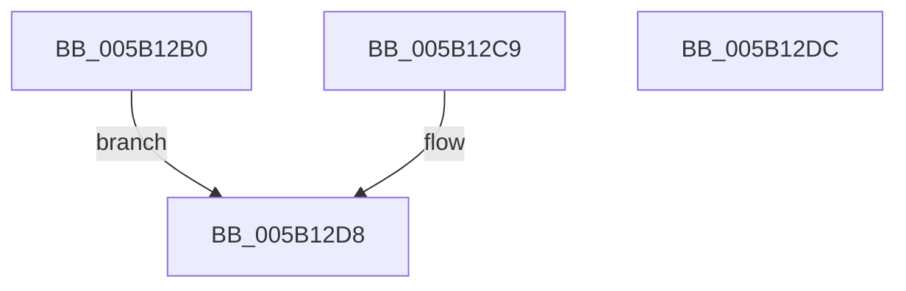

# KdpSysReadMsr

- RVA: `0x005B12B0`–`0x005B12DD` (길이 `45` bytes)
- VA: `0x00000001405B12B0`
- 실행 섹션: `.text`
- PDB 이름 있음: `예`; PDB Function 태그: `아니요`
- unwind 정보 RVA: `0x000C9B10`
- 디코드: `14`개 명령, `45/45` bytes 표시
- 미해석 바이트: `0` (있으면 어셈블리에 `.byte`로 보존)

> 이 문서는 커널 이미지의 기계어와 PDB 기호를 분석해 생성했습니다. 4번과 5번은 함수 원형과 자료형을 바이너리 사용 방식에서 추정한 C 해석이며 원본 소스 복구 결과는 아닙니다.

## 1. Dependencies

- 직접 호출 지점: **0**; 고유 호출 대상: **0**
- 직접 호출자로 확인된 함수: **2**
- RIP 상대 이미지 참조: **0**

### Outgoing calls
- 직접 디코드된 call 명령이 없습니다.

### Direct callers
- [KdSystemDebugControl](../../page/74/KdSystemDebugControl_function_00744700.md) at `0x00744DDE`
- [KdpReadMachineSpecificRegister](../../pagekd/B8/KdpReadMachineSpecificRegister_function_00B87764.md) at `0x00B87795`

### Static image references
- 디코드된 RIP-relative 메모리 참조가 없습니다.

## 2. Other-region calls and transfers

- 다른 실행 섹션으로 향하는 call: **0**
- 별도 외부 분기/꼬리 이동을 확인하지 못했습니다.

## 3. Assembly (complete function range)

```asm
005B12B0  48 89 54 24 10                  mov qword ptr [rsp + 0x10], rdx
005B12B5  4C 8B CA                        mov r9, rdx
005B12B8  45 33 C0                        xor r8d, r8d
005B12BB  0F 32                           rdmsr
005B12BD  48 C1 E2 20                     shl rdx, 0x20
005B12C1  48 0B C2                        or rax, rdx
005B12C4  49 89 01                        mov qword ptr [r9], rax
005B12C7  EB 0F                           jmp 0x1405b12d8
005B12C9  48 8B 44 24 10                  mov rax, qword ptr [rsp + 0x10]
005B12CE  48 83 20 00                     and qword ptr [rax], 0
005B12D2  41 B8 0E 00 00 C0               mov r8d, 0xc000000e
005B12D8  41 8B C0                        mov eax, r8d
005B12DB  C3                              ret
005B12DC  CC                              int3
```

## 4. C-style interpretation (structured pseudocode)

```c
__int64 __fastcall KdpSysReadMsr(__int64 a1, __int64 a2, int a3)
{
    __int64 result;
    unsigned __int64 v_stack_p10;

    v_stack_p10 = a2;
    a3 = 0;
    a2 = (a2) << (32);
    result = (result) | (a2);
    *(unsigned __int64 *)(a2) = result;
    goto loc_005B12D8;
loc_005B12D8:
    return 0;
}
```

## 5. (Beta) C Style

```c
int64_t KdpSysReadMsr(int64_t Arg1, void *Arg2, int32_t Arg3)
{
    uint8_t *arg2 = (uint8_t *)Arg2;

    int64_t result;
    uint64_t v_stack_p10;

    v_stack_p10 = Arg2;
    Arg3 = 0;
    Arg2 = (Arg2) << (32);
    result = (result) | (Arg2);
    *(uint64_t *)(arg2) = result;
    goto loc_005B12D8;
loc_005B12D8:
    return 0;
}
```

### 관측된 메모리 오프셋

구조체 형식이 확인되지 않은 접근은 인자 기준의 오프셋으로만 기록했습니다.

| 기준 인자 | 오프셋 표현 | 폭 (bit) | 접근 |
|---|---:|---:|---|
| `Arg2` | `+ 0x0` | `64` | `W` |

## 6. Execution-region graph

[열기: 2D/3D 그래프와 함수 탐색 컨트롤 패널](../../../control-panel.html?section=text&rva=0x005B12B0&view=graph)

- 2D 그래프는 위에서 아래로 흐르고, 3D 그래프는 빈 공간을 드래그해 회전합니다. Shift+드래그는 이동, 휠은 확대·축소, 함수 노드 선택은 대상 보고서 이동입니다.

### Static fallback


