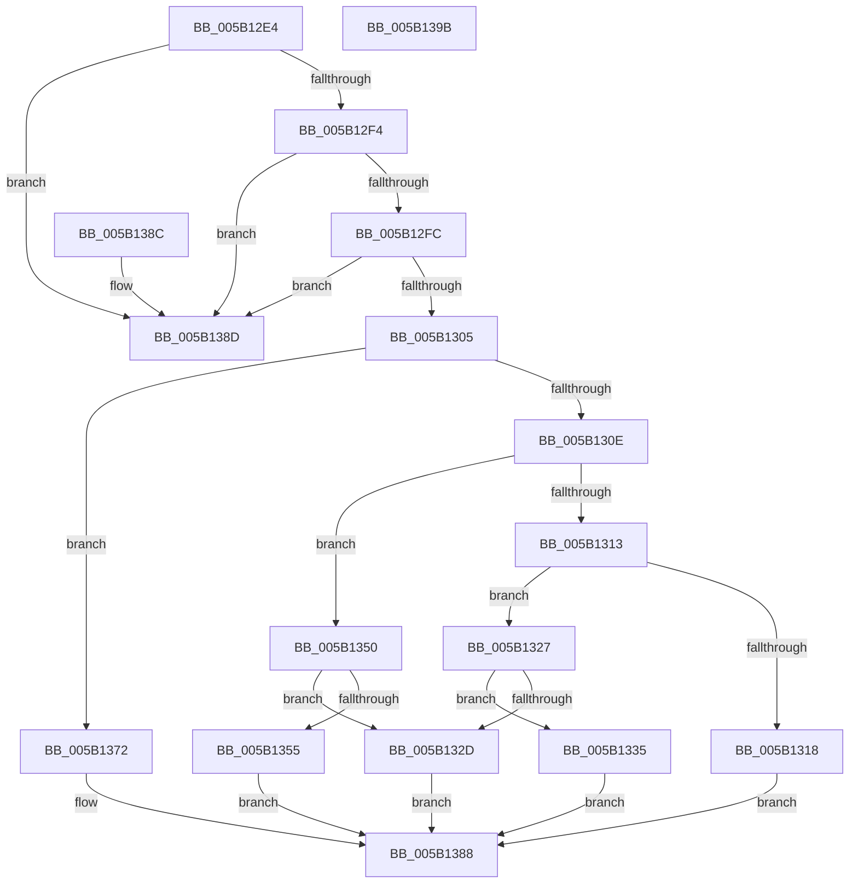

# KdpSysWriteIoSpace

- RVA: `0x005B12E4`–`0x005B139C` (길이 `184` bytes)
- VA: `0x00000001405B12E4`
- 실행 섹션: `.text`
- PDB 이름 있음: `예`; PDB Function 태그: `아니요`
- unwind 정보 RVA: `0x000DB714`
- 디코드: `59`개 명령, `184/184` bytes 표시
- 미해석 바이트: `0` (있으면 어셈블리에 `.byte`로 보존)

> 이 문서는 커널 이미지의 기계어와 PDB 기호를 분석해 생성했습니다. 4번과 5번은 함수 원형과 자료형을 바이너리 사용 방식에서 추정한 C 해석이며 원본 소스 복구 결과는 아닙니다.

## 1. Dependencies

- 직접 호출 지점: **0**; 고유 호출 대상: **0**
- 직접 호출자로 확인된 함수: **3**
- RIP 상대 이미지 참조: **0**

### Outgoing calls
- 직접 디코드된 call 명령이 없습니다.

### Direct callers
- [KdSystemDebugControl](../../page/74/KdSystemDebugControl_function_00744700.md) at `0x00744E89`
- [KdpWriteIoSpace](../../pagekd/B8/KdpWriteIoSpace_function_00B88998.md) at `0x00B889DD`
- [KdpWriteIoSpaceExtended](../../pagekd/B8/KdpWriteIoSpaceExtended_function_00B88A14.md) at `0x00B88A5A`

### Static image references
- 디코드된 RIP-relative 메모리 참조가 없습니다.

## 2. Other-region calls and transfers

- 다른 실행 섹션으로 향하는 call: **0**
- 별도 외부 분기/꼬리 이동을 확인하지 못했습니다.

## 3. Assembly (complete function range)

```asm
005B12E4  45 33 D2                        xor r10d, r10d
005B12E7  45 8D 5A 01                     lea r11d, [r10 + 1]
005B12EB  41 3B CB                        cmp ecx, r11d
005B12EE  0F 85 99 00 00 00               jne 0x1405b138d
005B12F4  85 D2                           test edx, edx
005B12F6  0F 85 91 00 00 00               jne 0x1405b138d
005B12FC  45 3B C3                        cmp r8d, r11d
005B12FF  0F 85 88 00 00 00               jne 0x1405b138d
005B1305  8B 44 24 30                     mov eax, dword ptr [rsp + 0x30]
005B1309  41 2B C3                        sub eax, r11d
005B130C  74 64                           je 0x1405b1372
005B130E  41 2B C3                        sub eax, r11d
005B1311  74 3D                           je 0x1405b1350
005B1313  83 F8 02                        cmp eax, 2
005B1316  74 0F                           je 0x1405b1327
005B1318  48 8B 44 24 38                  mov rax, qword ptr [rsp + 0x38]
005B131D  41 BA 0D 00 00 C0               mov r10d, 0xc000000d
005B1323  21 10                           and dword ptr [rax], edx
005B1325  EB 61                           jmp 0x1405b1388
005B1327  41 F6 C1 03                     test r9b, 3
005B132B  74 08                           je 0x1405b1335
005B132D  41 BA 02 00 00 80               mov r10d, 0x80000002
005B1333  EB 53                           jmp 0x1405b1388
005B1335  48 8B 44 24 28                  mov rax, qword ptr [rsp + 0x28]
005B133A  41 0F B7 D1                     movzx edx, r9w
005B133E  8B 00                           mov eax, dword ptr [rax]
005B1340  90                              nop
005B1341  EF                              out dx, eax
005B1342  48 8B 44 24 38                  mov rax, qword ptr [rsp + 0x38]
005B1347  90                              nop
005B1348  C7 00 04 00 00 00               mov dword ptr [rax], 4
005B134E  EB 38                           jmp 0x1405b1388
005B1350  45 84 CB                        test r11b, r9b
005B1353  75 D8                           jne 0x1405b132d
005B1355  48 8B 44 24 28                  mov rax, qword ptr [rsp + 0x28]
005B135A  41 0F B7 D1                     movzx edx, r9w
005B135E  0F B7 00                        movzx eax, word ptr [rax]
005B1361  90                              nop
005B1362  66 EF                           out dx, ax
005B1364  48 8B 44 24 38                  mov rax, qword ptr [rsp + 0x38]
005B1369  90                              nop
005B136A  C7 00 02 00 00 00               mov dword ptr [rax], 2
005B1370  EB 16                           jmp 0x1405b1388
005B1372  48 8B 4C 24 28                  mov rcx, qword ptr [rsp + 0x28]
005B1377  41 0F B7 D1                     movzx edx, r9w
005B137B  8A 01                           mov al, byte ptr [rcx]
005B137D  90                              nop
005B137E  48 8B 4C 24 38                  mov rcx, qword ptr [rsp + 0x38]
005B1383  EE                              out dx, al
005B1384  90                              nop
005B1385  44 89 19                        mov dword ptr [rcx], r11d
005B1388  41 8B C2                        mov eax, r10d
005B138B  C3                              ret
005B138C  CC                              int3
005B138D  48 8B 44 24 38                  mov rax, qword ptr [rsp + 0x38]
005B1392  44 21 10                        and dword ptr [rax], r10d
005B1395  B8 01 00 00 C0                  mov eax, 0xc0000001
005B139A  C3                              ret
005B139B  CC                              int3
```

## 4. C-style interpretation (structured pseudocode)

```c
__int64 __fastcall KdpSysWriteIoSpace(int a1, int a2, int a3, unsigned __int16 a4, __int64 a5, unsigned int a6, __int64 a7)
{
    __int64 result;
    __int64 v_r10;

    v_r10 = 0;
    if (a1 != ((unsigned int)(v_r10 + 1))) goto loc_005B138D;
    if (a2 != 0) goto loc_005B138D;
    if (a3 != ((unsigned int)(v_r10 + 1))) goto loc_005B138D;
    result = (unsigned int)(((unsigned int)(a6)) - ((unsigned int)(v_r10 + 1)));
    if (condition_is_equal) goto loc_005B1372;
    result = (unsigned int)((result) - ((unsigned int)(v_r10 + 1)));
    if (condition_is_equal) goto loc_005B1350;
    if (((unsigned int)(result)) == 2) goto loc_005B1327;
    goto loc_005B1388;
loc_005B1327:
    if ((((unsigned __int8)(a4)) & (3)) == 0) goto loc_005B1335;
loc_005B132D:
    goto loc_005B1388;
loc_005B1335:
    *(unsigned int *)(a7) = 4;
    goto loc_005B1388;
loc_005B1350:
    if ((((unsigned __int8)(v_r10 + 1)) & ((unsigned __int8)(a4))) != 0) goto loc_005B132D;
    *(unsigned int *)(a7) = 2;
    goto loc_005B1388;
loc_005B1372:
    *(unsigned int *)(a7) = (unsigned int)(v_r10 + 1);
loc_005B1388:
    return (unsigned int)((unsigned int)((unsigned int)(0x80000002ULL)));
loc_005B138D:
    return (unsigned int)(0xC0000001ULL);
}
```

## 5. (Beta) C Style

```c
int64_t KdpSysWriteIoSpace(int32_t Arg1, int32_t Arg2, int32_t Arg3, uint16_t Arg4, void *Arg5, uint32_t Arg6, void *Arg7)
{
    uint8_t *arg5 = (uint8_t *)Arg5;
    uint8_t *arg7 = (uint8_t *)Arg7;

    int64_t result;
    int64_t local_r10;

    local_r10 = 0;
    if (Arg1 != ((uint32_t)(local_r10 + 1))) goto loc_005B138D;
    if (Arg2 != 0) goto loc_005B138D;
    if (Arg3 != ((uint32_t)(local_r10 + 1))) goto loc_005B138D;
    result = (uint32_t)(((uint32_t)(Arg6)) - ((uint32_t)(local_r10 + 1)));
    if (condition_is_equal) goto loc_005B1372;
    result = (uint32_t)((result) - ((uint32_t)(local_r10 + 1)));
    if (condition_is_equal) goto loc_005B1350;
    if (((uint32_t)(result)) == 2) goto loc_005B1327;
    goto loc_005B1388;
loc_005B1327:
    if ((((uint8_t)(Arg4)) & (3)) == 0) goto loc_005B1335;
loc_005B132D:
    goto loc_005B1388;
loc_005B1335:
    *(uint32_t *)(arg7) = 4;
    goto loc_005B1388;
loc_005B1350:
    if ((((uint8_t)(local_r10 + 1)) & ((uint8_t)(Arg4))) != 0) goto loc_005B132D;
    *(uint32_t *)(arg7) = 2;
    goto loc_005B1388;
loc_005B1372:
    *(uint32_t *)(arg7) = (uint32_t)(local_r10 + 1);
loc_005B1388:
    return (uint32_t)((uint32_t)((uint32_t)(0x80000002ULL)));
loc_005B138D:
    return (uint32_t)(0xC0000001ULL);
}
```

### 관측된 메모리 오프셋

구조체 형식이 확인되지 않은 접근은 인자 기준의 오프셋으로만 기록했습니다.

| 기준 인자 | 오프셋 표현 | 폭 (bit) | 접근 |
|---|---:|---:|---|
| `Arg5` | `+ 0x0` | `8` | `R` |
| `Arg5` | `+ 0x0` | `16` | `R` |
| `Arg5` | `+ 0x0` | `32` | `R` |
| `Arg7` | `+ 0x0` | `32` | `R/W` |
| `Arg7` | `+ 0x0` | `32` | `W` |

## 6. Execution-region graph

[열기: 2D/3D 그래프와 함수 탐색 컨트롤 패널](../../../control-panel.html?section=text&rva=0x005B12E4&view=graph)

- 2D 그래프는 위에서 아래로 흐르고, 3D 그래프는 빈 공간을 드래그해 회전합니다. Shift+드래그는 이동, 휠은 확대·축소, 함수 노드 선택은 대상 보고서 이동입니다.

### Static fallback


