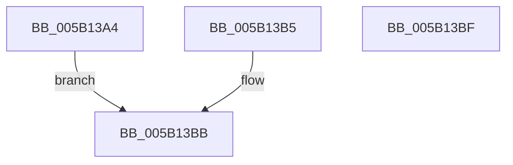

# KdpSysWriteMsr

- RVA: `0x005B13A4`–`0x005B13C0` (길이 `28` bytes)
- VA: `0x00000001405B13A4`
- 실행 섹션: `.text`
- PDB 이름 있음: `예`; PDB Function 태그: `아니요`
- unwind 정보 RVA: `0x000C9B2C`
- 디코드: `10`개 명령, `28/28` bytes 표시
- 미해석 바이트: `0` (있으면 어셈블리에 `.byte`로 보존)

> 이 문서는 커널 이미지의 기계어와 PDB 기호를 분석해 생성했습니다. 4번과 5번은 함수 원형과 자료형을 바이너리 사용 방식에서 추정한 C 해석이며 원본 소스 복구 결과는 아닙니다.

## 1. Dependencies

- 직접 호출 지점: **0**; 고유 호출 대상: **0**
- 직접 호출자로 확인된 함수: **2**
- RIP 상대 이미지 참조: **0**

### Outgoing calls
- 직접 디코드된 call 명령이 없습니다.

### Direct callers
- [KdSystemDebugControl](../../page/74/KdSystemDebugControl_function_00744700.md) at `0x00744DBD`
- [KdpWriteMachineSpecificRegister](../../pagekd/B8/KdpWriteMachineSpecificRegister_function_00B88A90.md) at `0x00B88ACA`

### Static image references
- 디코드된 RIP-relative 메모리 참조가 없습니다.

## 2. Other-region calls and transfers

- 다른 실행 섹션으로 향하는 call: **0**
- 별도 외부 분기/꼬리 이동을 확인하지 못했습니다.

## 3. Assembly (complete function range)

```asm
005B13A4  45 33 C0                        xor r8d, r8d
005B13A7  48 8B 12                        mov rdx, qword ptr [rdx]
005B13AA  48 8B C2                        mov rax, rdx
005B13AD  48 C1 EA 20                     shr rdx, 0x20
005B13B1  0F 30                           wrmsr
005B13B3  EB 06                           jmp 0x1405b13bb
005B13B5  41 B8 0E 00 00 C0               mov r8d, 0xc000000e
005B13BB  41 8B C0                        mov eax, r8d
005B13BE  C3                              ret
005B13BF  CC                              int3
```

## 4. C-style interpretation (structured pseudocode)

```c
__int64 __fastcall KdpSysWriteMsr(__int64 a1, __int64 a2, int a3)
{
    a3 = 0;
    a2 = (*(unsigned __int64 *)(a2)) >> (32);
    goto loc_005B13BB;
loc_005B13BB:
    return 0;
}
```

## 5. (Beta) C Style

```c
int64_t KdpSysWriteMsr(int64_t Arg1, void *Arg2, int32_t Arg3)
{
    uint8_t *arg2 = (uint8_t *)Arg2;

    Arg3 = 0;
    Arg2 = (*(uint64_t *)(arg2)) >> (32);
    goto loc_005B13BB;
loc_005B13BB:
    return 0;
}
```

### 관측된 메모리 오프셋

구조체 형식이 확인되지 않은 접근은 인자 기준의 오프셋으로만 기록했습니다.

| 기준 인자 | 오프셋 표현 | 폭 (bit) | 접근 |
|---|---:|---:|---|
| `Arg2` | `+ 0x0` | `64` | `R` |

## 6. Execution-region graph

[열기: 2D/3D 그래프와 함수 탐색 컨트롤 패널](../../../control-panel.html?section=text&rva=0x005B13A4&view=graph)

- 2D 그래프는 위에서 아래로 흐르고, 3D 그래프는 빈 공간을 드래그해 회전합니다. Shift+드래그는 이동, 휠은 확대·축소, 함수 노드 선택은 대상 보고서 이동입니다.

### Static fallback


