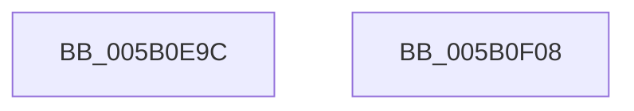

# KdpWriteCustomBreakpoint

- RVA: `0x005B0E9C`–`0x005B0F09` (길이 `109` bytes)
- VA: `0x00000001405B0E9C`
- 실행 섹션: `.text`
- PDB 이름 있음: `예`; PDB Function 태그: `아니요`
- unwind 정보 RVA: `0x00064C80`
- 디코드: `29`개 명령, `109/109` bytes 표시
- 미해석 바이트: `0` (있으면 어셈블리에 `.byte`로 보존)

> 이 문서는 커널 이미지의 기계어와 PDB 기호를 분석해 생성했습니다. 4번과 5번은 함수 원형과 자료형을 바이너리 사용 방식에서 추정한 C 해석이며 원본 소스 복구 결과는 아닙니다.

## 1. Dependencies

- 직접 호출 지점: **2**; 고유 호출 대상: **2**
- 직접 호출자로 확인된 함수: **1**
- RIP 상대 이미지 참조: **2**

### Outgoing calls
- `0x005B0ECC` → [KdpAddBreakpoint](../../pagekd/B8/KdpAddBreakpoint_function_00B897E8.md) (function, `0x00B897E8`)
- `0x005B0EF6` → `kdcom.dll!KdSendPacket` (import, 간접 대상; import `kdcom.dll!KdSendPacket`)

### Direct callers
- [KdpSendWaitContinue](../../pagekd/B8/KdpSendWaitContinue_function_00B8A32C.md) at `0x00B8A50F`

### Static image references
- `0x005B0ED4` → RVA `0x00F475E0` (`.data`; read)
- `0x005B0EF6` → RVA `0x001516C0` (`kdcom.dll!KdSendPacket (IAT)`; read)

## 2. Other-region calls and transfers

- 다른 실행 섹션으로 향하는 call: **1**
  - `0x005B0ECC` → [KdpAddBreakpoint](../../pagekd/B8/KdpAddBreakpoint_function_00B897E8.md) (`.text` → `PAGEKD`)
- 별도 외부 분기/꼬리 이동을 확인하지 못했습니다.

## 3. Assembly (complete function range)

```asm
005B0E9C  40 53                           push rbx
005B0E9E  48 83 EC 30                     sub rsp, 0x30
005B0EA2  44 8A 49 25                     mov r9b, byte ptr [rcx + 0x25]
005B0EA6  0F 57 C0                        xorps xmm0, xmm0
005B0EA9  44 8A 41 24                     mov r8b, byte ptr [rcx + 0x24]
005B0EAD  48 8B D9                        mov rbx, rcx
005B0EB0  48 8B 51 18                     mov rdx, qword ptr [rcx + 0x18]
005B0EB4  B8 38 00 00 00                  mov eax, 0x38
005B0EB9  0F 11 44 24 20                  movups xmmword ptr [rsp + 0x20], xmm0
005B0EBE  48 89 4C 24 28                  mov qword ptr [rsp + 0x28], rcx
005B0EC3  48 8B 49 10                     mov rcx, qword ptr [rcx + 0x10]
005B0EC7  66 89 44 24 20                  mov word ptr [rsp + 0x20], ax
005B0ECC  E8 17 89 5D 00                  call 0x140b897e8
005B0ED1  89 43 20                        mov dword ptr [rbx + 0x20], eax
005B0ED4  4C 8D 0D 05 67 99 00            lea r9, [rip + 0x996705]
005B0EDB  F7 D8                           neg eax
005B0EDD  48 8D 54 24 20                  lea rdx, [rsp + 0x20]
005B0EE2  1B C9                           sbb ecx, ecx
005B0EE4  45 33 C0                        xor r8d, r8d
005B0EE7  F7 D1                           not ecx
005B0EE9  81 E1 01 00 00 C0               and ecx, 0xc0000001
005B0EEF  89 4B 08                        mov dword ptr [rbx + 8], ecx
005B0EF2  41 8D 48 02                     lea ecx, [r8 + 2]
005B0EF6  48 FF 15 C3 07 BA FF            call qword ptr [rip - 0x45f83d]
005B0EFD  0F 1F 44 00 00                  nop dword ptr [rax + rax]
005B0F02  48 83 C4 30                     add rsp, 0x30
005B0F06  5B                              pop rbx
005B0F07  C3                              ret
005B0F08  CC                              int3
```

## 4. C-style interpretation (structured pseudocode)

```c
__int64 __fastcall KdpWriteCustomBreakpoint(__int64 a1)
{
    __int64 result;
    __int64 v_rsp;
    unsigned __int64 v_stack_m10;
    unsigned __int64 v_stack_m18;

    v_rsp = (v_rsp) - (48);
    v_stack_m18 = v_xmm0;
    v_stack_m10 = a1;
    v_stack_m18 = 56;
    result = KdpAddBreakpoint(*(unsigned __int64 *)(a1 + 16), *(unsigned __int64 *)(a1 + 24), *(unsigned __int8 *)(a1 + 36), *(unsigned __int8 *)(a1 + 37));
    *(unsigned int *)(a1 + 32) = (unsigned int)(result);
    result = (unsigned int)(-(result));
    a3 = 0;
    a1 = (unsigned int)(~(*(unsigned __int64 *)(a1 + 16)));
    a1 = (unsigned int)((a1) & (0xC0000001ULL));
    *(unsigned int *)(a1 + 8) = (unsigned int)(a1);
    result = kdcom_dll_KdSendPacket(a3 + 2, v_stack_m18, a3, v_rip + 10053381);
    v_rsp = (v_rsp) + (48);
    return result;
}
```

## 5. (Beta) C Style

```c
int64_t KdpWriteCustomBreakpoint(void *Arg1)
{
    uint8_t *arg1 = (uint8_t *)Arg1;

    int64_t result;
    int64_t local_rsp;
    uint64_t v_stack_m10;
    uint64_t v_stack_m18;

    local_rsp = (local_rsp) - (48);
    v_stack_m18 = v_xmm0;
    v_stack_m10 = Arg1;
    v_stack_m18 = 56;
    result = KdpAddBreakpoint(*(uint64_t *)(arg1 + 0x10), *(uint64_t *)(arg1 + 0x18), *(uint8_t *)(arg1 + 0x24), *(uint8_t *)(arg1 + 0x25));
    *(uint32_t *)(arg1 + 0x20) = (uint32_t)(result);
    result = (uint32_t)(-(result));
    a3 = 0;
    Arg1 = (uint32_t)(~(*(uint64_t *)(arg1 + 0x10)));
    Arg1 = (uint32_t)((Arg1) & (0xC0000001ULL));
    *(uint32_t *)(arg1 + 0x8) = (uint32_t)(Arg1);
    result = kernel_indirect_call(a3 + 2, v_stack_m18, a3, v_rip + 10053381);
    local_rsp = (local_rsp) + (48);
    return result;
}
```

### 관측된 메모리 오프셋

구조체 형식이 확인되지 않은 접근은 인자 기준의 오프셋으로만 기록했습니다.

| 기준 인자 | 오프셋 표현 | 폭 (bit) | 접근 |
|---|---:|---:|---|
| `Arg1` | `+ 0x8` | `32` | `W` |
| `Arg1` | `+ 0x10` | `64` | `R` |
| `Arg1` | `+ 0x18` | `64` | `R` |
| `Arg1` | `+ 0x20` | `32` | `W` |
| `Arg1` | `+ 0x24` | `8` | `R` |
| `Arg1` | `+ 0x25` | `8` | `R` |

## 6. Execution-region graph

[열기: 2D/3D 그래프와 함수 탐색 컨트롤 패널](../../../control-panel.html?section=text&rva=0x005B0E9C&view=graph)

- 2D 그래프는 위에서 아래로 흐르고, 3D 그래프는 빈 공간을 드래그해 회전합니다. Shift+드래그는 이동, 휠은 확대·축소, 함수 노드 선택은 대상 보고서 이동입니다.

### Static fallback


