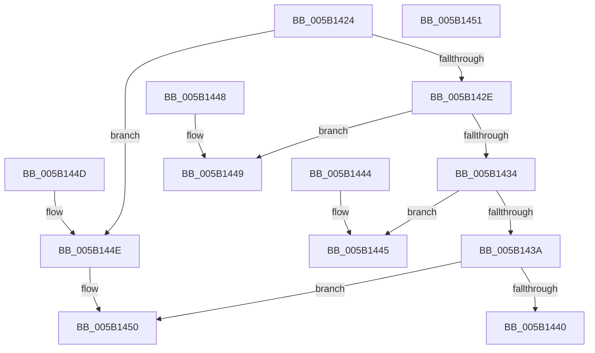

# KdpWriteInstructionBuffer

- RVA: `0x005B1424`–`0x005B1452` (길이 `46` bytes)
- VA: `0x00000001405B1424`
- 실행 섹션: `.text`
- PDB 이름 있음: `예`; PDB Function 태그: `아니요`
- unwind 정보 RVA: `0x000DB714`
- 디코드: `21`개 명령, `46/46` bytes 표시
- 미해석 바이트: `0` (있으면 어셈블리에 `.byte`로 보존)

> 이 문서는 커널 이미지의 기계어와 PDB 기호를 분석해 생성했습니다. 4번과 5번은 함수 원형과 자료형을 바이너리 사용 방식에서 추정한 C 해석이며 원본 소스 복구 결과는 아닙니다.

## 1. Dependencies

- 직접 호출 지점: **0**; 고유 호출 대상: **0**
- 직접 호출자로 확인된 함수: **2**
- RIP 상대 이미지 참조: **0**

### Outgoing calls
- 직접 디코드된 call 명령이 없습니다.

### Direct callers
- [KdpInsertBreakpoint](../../pagekd/B8/KdpInsertBreakpoint_function_00B899F0.md) at `0x00B89A08`
- [KdpRemoveBreakpoint](../../pagekd/B8/KdpRemoveBreakpoint_function_00B89BDC.md) at `0x00B89BF6`

### Static image references
- 디코드된 RIP-relative 메모리 참조가 없습니다.

## 2. Other-region calls and transfers

- 다른 실행 섹션으로 향하는 call: **0**
- 별도 외부 분기/꼬리 이동을 확인하지 못했습니다.

## 3. Assembly (complete function range)

```asm
005B1424  45 0F B6 C8                     movzx r9d, r8b
005B1428  41 83 E9 01                     sub r9d, 1
005B142C  74 20                           je 0x1405b144e
005B142E  41 83 E9 01                     sub r9d, 1
005B1432  74 15                           je 0x1405b1449
005B1434  41 83 E9 02                     sub r9d, 2
005B1438  74 0B                           je 0x1405b1445
005B143A  41 83 F9 04                     cmp r9d, 4
005B143E  75 10                           jne 0x1405b1450
005B1440  48 89 11                        mov qword ptr [rcx], rdx
005B1443  C3                              ret
005B1444  CC                              int3
005B1445  89 11                           mov dword ptr [rcx], edx
005B1447  C3                              ret
005B1448  CC                              int3
005B1449  66 89 11                        mov word ptr [rcx], dx
005B144C  C3                              ret
005B144D  CC                              int3
005B144E  88 11                           mov byte ptr [rcx], dl
005B1450  C3                              ret
005B1451  CC                              int3
```

## 4. C-style interpretation (structured pseudocode)

```c
void __fastcall KdpWriteInstructionBuffer(__int64 a1, __int64 a2, unsigned __int8 a3)
{
    a4 = (unsigned int)((a3) - (1));
    if (condition_is_equal) goto loc_005B144E;
    a4 = (unsigned int)((a4) - (1));
    if (condition_is_equal) goto loc_005B1449;
    a4 = (unsigned int)((a4) - (2));
    if (condition_is_equal) goto loc_005B1445;
    if (((unsigned int)(a4)) != 4) goto loc_005B1450;
    *(unsigned __int64 *)(a1) = a2;
    return;
loc_005B1445:
    *(unsigned int *)(a1) = (unsigned int)(a2);
    return;
loc_005B1449:
    *(unsigned __int16 *)(a1) = (unsigned __int16)(a2);
    return;
loc_005B144E:
    *(unsigned __int8 *)(a1) = (unsigned __int8)(a2);
loc_005B1450:
    return;
}
```

## 5. (Beta) C Style

```c
void KdpWriteInstructionBuffer(void *Arg1, int64_t Arg2, uint8_t Arg3)
{
    uint8_t *arg1 = (uint8_t *)Arg1;

    a4 = (uint32_t)((Arg3) - (1));
    if (condition_is_equal) goto loc_005B144E;
    a4 = (uint32_t)((a4) - (1));
    if (condition_is_equal) goto loc_005B1449;
    a4 = (uint32_t)((a4) - (2));
    if (condition_is_equal) goto loc_005B1445;
    if (((uint32_t)(a4)) != 4) goto loc_005B1450;
    *(uint64_t *)(arg1) = Arg2;
    return;
loc_005B1445:
    *(uint32_t *)(arg1) = (uint32_t)(Arg2);
    return;
loc_005B1449:
    *(uint16_t *)(arg1) = (uint16_t)(Arg2);
    return;
loc_005B144E:
    *(uint8_t *)(arg1) = (uint8_t)(Arg2);
loc_005B1450:
    return;
}
```

### 관측된 메모리 오프셋

구조체 형식이 확인되지 않은 접근은 인자 기준의 오프셋으로만 기록했습니다.

| 기준 인자 | 오프셋 표현 | 폭 (bit) | 접근 |
|---|---:|---:|---|
| `Arg1` | `+ 0x0` | `8` | `W` |
| `Arg1` | `+ 0x0` | `16` | `W` |
| `Arg1` | `+ 0x0` | `32` | `W` |
| `Arg1` | `+ 0x0` | `64` | `W` |

## 6. Execution-region graph

[열기: 2D/3D 그래프와 함수 탐색 컨트롤 패널](../../../control-panel.html?section=text&rva=0x005B1424&view=graph)

- 2D 그래프는 위에서 아래로 흐르고, 3D 그래프는 빈 공간을 드래그해 회전합니다. Shift+드래그는 이동, 휠은 확대·축소, 함수 노드 선택은 대상 보고서 이동입니다.

### Static fallback


