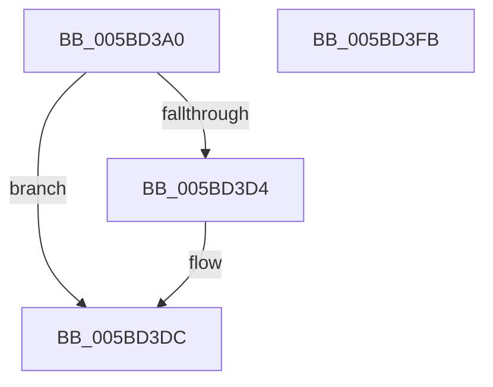

# KeAcquireInStackQueuedSpinLockRaiseToSynch

- RVA: `0x005BD3A0`–`0x005BD3FC` (길이 `92` bytes)
- VA: `0x00000001405BD3A0`
- 실행 섹션: `.text`
- PDB 이름 있음: `예`; PDB Function 태그: `아니요`
- unwind 정보 RVA: `0x00060BC4`
- 디코드: `26`개 명령, `92/92` bytes 표시
- 미해석 바이트: `0` (있으면 어셈블리에 `.byte`로 보존)

> 이 문서는 커널 이미지의 기계어와 PDB 기호를 분석해 생성했습니다. 4번과 5번은 함수 원형과 자료형을 바이너리 사용 방식에서 추정한 C 해석이며 원본 소스 복구 결과는 아닙니다.

## 1. Dependencies

- 직접 호출 지점: **2**; 고유 호출 대상: **2**
- 직접 호출자로 확인된 함수: **1**
- RIP 상대 이미지 참조: **1**

### Outgoing calls
- `0x005BD3D7` → [KiRaiseIrqlProcessIrqlFlags](../4F/KiRaiseIrqlProcessIrqlFlags_function_004F56FC.md) (function, `0x004F56FC`)
- `0x005BD3E6` → [KxAcquireQueuedSpinLock](../27/KxAcquireQueuedSpinLock_function_00273E20.md) (function, `0x00273E20`)

### Direct callers
- [DifKeAcquireInStackQueuedSpinLockRaiseToSynchWrapper](../62/DifKeAcquireInStackQueuedSpinLockRaiseToSynchWrapper_function_0062E590.md) at `0x0062E667`

### Static image references
- `0x005BD3CB` → RVA `0x00FC6D20` (`ALMOSTRO`; read)

## 2. Other-region calls and transfers

- 다른 실행 섹션으로 향하는 call: **0**
- 별도 외부 분기/꼬리 이동을 확인하지 못했습니다.

## 3. Assembly (complete function range)

```asm
005BD3A0  48 89 5C 24 08                  mov qword ptr [rsp + 8], rbx
005BD3A5  48 89 74 24 10                  mov qword ptr [rsp + 0x10], rsi
005BD3AA  57                              push rdi
005BD3AB  48 83 EC 20                     sub rsp, 0x20
005BD3AF  48 83 22 00                     and qword ptr [rdx], 0
005BD3B3  48 8B DA                        mov rbx, rdx
005BD3B6  48 89 4A 08                     mov qword ptr [rdx + 8], rcx
005BD3BA  48 8B F1                        mov rsi, rcx
005BD3BD  90                              nop
005BD3BE  44 0F 20 C7                     mov rdi, cr8
005BD3C2  BA 0C 00 00 00                  mov edx, 0xc
005BD3C7  44 0F 22 C2                     mov cr8, rdx
005BD3CB  83 3D 4E 99 A0 00 00            cmp dword ptr [rip + 0xa0994e], 0
005BD3D2  74 08                           je 0x1405bd3dc
005BD3D4  40 8A CF                        mov cl, dil
005BD3D7  E8 20 83 F3 FF                  call 0x1404f56fc
005BD3DC  48 8B D6                        mov rdx, rsi
005BD3DF  40 88 7B 10                     mov byte ptr [rbx + 0x10], dil
005BD3E3  48 8B CB                        mov rcx, rbx
005BD3E6  E8 35 6A CB FF                  call 0x140273e20
005BD3EB  48 8B 5C 24 30                  mov rbx, qword ptr [rsp + 0x30]
005BD3F0  48 8B 74 24 38                  mov rsi, qword ptr [rsp + 0x38]
005BD3F5  48 83 C4 20                     add rsp, 0x20
005BD3F9  5F                              pop rdi
005BD3FA  C3                              ret
005BD3FB  CC                              int3
```

## 4. C-style interpretation (structured pseudocode)

```c
__int64 __fastcall KeAcquireInStackQueuedSpinLockRaiseToSynch(__int64 a1, __int64 a2)
{
    __int64 result;
    __int64 v_rsp;
    unsigned __int64 v_stack_p10;
    unsigned __int64 v_stack_p8;

    v_stack_p8 = v_rbx;
    v_stack_p10 = v_rsi;
    v_rsp = (v_rsp) - (32);
    *(unsigned __int64 *)(a2 + 8) = a1;
    if ((*(unsigned int *)(v_rip + 10525006)) != 0) {
        a1 = (unsigned __int8)(v_cr8);
        result = KiRaiseIrqlProcessIrqlFlags(a1, 12, a3, a4);
    }
    *(unsigned __int8 *)(a2 + 16) = (unsigned __int8)(v_cr8);
    result = KxAcquireQueuedSpinLock(a2, a1, a3, a4);
    v_rsp = (v_rsp) + (32);
    return result;
}
```

## 5. (Beta) C Style

```c
int64_t KeAcquireInStackQueuedSpinLockRaiseToSynch(int64_t Arg1, void *Arg2)
{
    uint8_t *arg2 = (uint8_t *)Arg2;

    int64_t result;
    int64_t local_rsp;
    uint64_t v_stack_p10;
    uint64_t v_stack_p8;

    v_stack_p8 = local_rbx;
    v_stack_p10 = local_rsi;
    local_rsp = (local_rsp) - (32);
    *(uint64_t *)(arg2 + 0x8) = Arg1;
    if ((*(uint32_t *)(v_rip + 0xA0994E)) != 0) {
        Arg1 = (uint8_t)(v_cr8);
        result = KiRaiseIrqlProcessIrqlFlags(Arg1, 12, a3, a4);
    }
    *(uint8_t *)(arg2 + 0x10) = (uint8_t)(v_cr8);
    result = KxAcquireQueuedSpinLock(Arg2, Arg1, a3, a4);
    local_rsp = (local_rsp) + (32);
    return result;
}
```

### 관측된 메모리 오프셋

구조체 형식이 확인되지 않은 접근은 인자 기준의 오프셋으로만 기록했습니다.

| 기준 인자 | 오프셋 표현 | 폭 (bit) | 접근 |
|---|---:|---:|---|
| `Arg2` | `+ 0x0` | `64` | `R/W` |
| `Arg2` | `+ 0x8` | `64` | `W` |
| `Arg2` | `+ 0x10` | `8` | `W` |

## 6. Execution-region graph

[열기: 2D/3D 그래프와 함수 탐색 컨트롤 패널](../../../control-panel.html?section=text&rva=0x005BD3A0&view=graph)

- 2D 그래프는 위에서 아래로 흐르고, 3D 그래프는 빈 공간을 드래그해 회전합니다. Shift+드래그는 이동, 휠은 확대·축소, 함수 노드 선택은 대상 보고서 이동입니다.

### Static fallback


