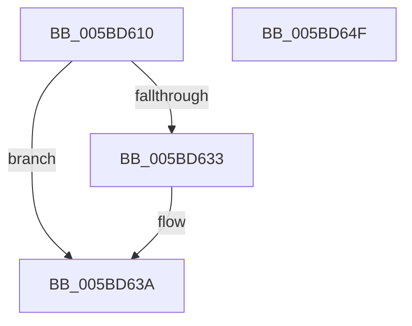

# KeAcquireSpinLockRaiseToSynch

- RVA: `0x005BD610`–`0x005BD650` (길이 `64` bytes)
- VA: `0x00000001405BD610`
- 실행 섹션: `.text`
- PDB 이름 있음: `예`; PDB Function 태그: `아니요`
- unwind 정보 RVA: `0x0005CAAC`
- 디코드: `19`개 명령, `64/64` bytes 표시
- 미해석 바이트: `0` (있으면 어셈블리에 `.byte`로 보존)

> 이 문서는 커널 이미지의 기계어와 PDB 기호를 분석해 생성했습니다. 4번과 5번은 함수 원형과 자료형을 바이너리 사용 방식에서 추정한 C 해석이며 원본 소스 복구 결과는 아닙니다.

## 1. Dependencies

- 직접 호출 지점: **2**; 고유 호출 대상: **2**
- 직접 호출자로 확인된 함수: **0**
- RIP 상대 이미지 참조: **1**

### Outgoing calls
- `0x005BD635` → [KiRaiseIrqlProcessIrqlFlags](../4F/KiRaiseIrqlProcessIrqlFlags_function_004F56FC.md) (function, `0x004F56FC`)
- `0x005BD63D` → [KeAcquireSpinLockAtDpcLevel](../20/KeAcquireSpinLockAtDpcLevel_function_00208430.md) (function, `0x00208430`)

### Direct callers
- 이 함수 시작 RVA로 연결되는 직접 call은 확인되지 않았습니다. 간접 호출은 완전히 역산할 수 없습니다.

### Static image references
- `0x005BD62A` → RVA `0x00FC6D20` (`ALMOSTRO`; read)

## 2. Other-region calls and transfers

- 다른 실행 섹션으로 향하는 call: **0**
- 별도 외부 분기/꼬리 이동을 확인하지 못했습니다.

## 3. Assembly (complete function range)

```asm
005BD610  48 89 5C 24 08                  mov qword ptr [rsp + 8], rbx
005BD615  57                              push rdi
005BD616  48 83 EC 20                     sub rsp, 0x20
005BD61A  48 8B F9                        mov rdi, rcx
005BD61D  44 0F 20 C3                     mov rbx, cr8
005BD621  BA 0C 00 00 00                  mov edx, 0xc
005BD626  44 0F 22 C2                     mov cr8, rdx
005BD62A  83 3D EF 96 A0 00 00            cmp dword ptr [rip + 0xa096ef], 0
005BD631  74 07                           je 0x1405bd63a
005BD633  8A CB                           mov cl, bl
005BD635  E8 C2 80 F3 FF                  call 0x1404f56fc
005BD63A  48 8B CF                        mov rcx, rdi
005BD63D  E8 EE AD C4 FF                  call 0x140208430
005BD642  8A C3                           mov al, bl
005BD644  48 8B 5C 24 30                  mov rbx, qword ptr [rsp + 0x30]
005BD649  48 83 C4 20                     add rsp, 0x20
005BD64D  5F                              pop rdi
005BD64E  C3                              ret
005BD64F  CC                              int3
```

## 4. C-style interpretation (structured pseudocode)

```c
__int64 __fastcall KeAcquireSpinLockRaiseToSynch(__int64 a1)
{
    __int64 result;
    __int64 v_rsp;
    unsigned __int64 v_stack_p8;

    v_stack_p8 = v_rbx;
    v_rsp = (v_rsp) - (32);
    if ((*(unsigned int *)(v_rip + 10524399)) != 0) {
        a1 = (unsigned __int8)(v_cr8);
        result = KiRaiseIrqlProcessIrqlFlags(a1, 12, a3, a4);
    }
    result = KeAcquireSpinLockAtDpcLevel(a1, 12, a3, a4);
    v_rsp = (v_rsp) + (32);
    return (unsigned __int8)(v_cr8);
}
```

## 5. (Beta) C Style

```c
int64_t KeAcquireSpinLockRaiseToSynch(int64_t Arg1)
{
    int64_t result;
    int64_t local_rsp;
    uint64_t v_stack_p8;

    v_stack_p8 = local_rbx;
    local_rsp = (local_rsp) - (32);
    if ((*(uint32_t *)(v_rip + 0xA096EF)) != 0) {
        Arg1 = (uint8_t)(v_cr8);
        result = KiRaiseIrqlProcessIrqlFlags(Arg1, 12, a3, a4);
    }
    result = KeAcquireSpinLockAtDpcLevel(Arg1, 12, a3, a4);
    local_rsp = (local_rsp) + (32);
    return (uint8_t)(v_cr8);
}
```

## 6. Execution-region graph

[열기: 2D/3D 그래프와 함수 탐색 컨트롤 패널](../../../control-panel.html?section=text&rva=0x005BD610&view=graph)

- 2D 그래프는 위에서 아래로 흐르고, 3D 그래프는 빈 공간을 드래그해 회전합니다. Shift+드래그는 이동, 휠은 확대·축소, 함수 노드 선택은 대상 보고서 이동입니다.

### Static fallback


