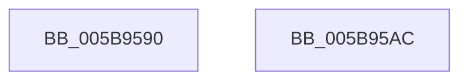

# KeAddProcessorGroupAffinity

- RVA: `0x005B9590`–`0x005B95AD` (길이 `29` bytes)
- VA: `0x00000001405B9590`
- 실행 섹션: `.text`
- PDB 이름 있음: `예`; PDB Function 태그: `아니요`
- unwind 정보 RVA: `0x000DB714`
- 디코드: `9`개 명령, `29/29` bytes 표시
- 미해석 바이트: `0` (있으면 어셈블리에 `.byte`로 보존)

> 이 문서는 커널 이미지의 기계어와 PDB 기호를 분석해 생성했습니다. 4번과 5번은 함수 원형과 자료형을 바이너리 사용 방식에서 추정한 C 해석이며 원본 소스 복구 결과는 아닙니다.

## 1. Dependencies

- 직접 호출 지점: **0**; 고유 호출 대상: **0**
- 직접 호출자로 확인된 함수: **0**
- RIP 상대 이미지 참조: **1**

### Outgoing calls
- 직접 디코드된 call 명령이 없습니다.

### Direct callers
- 이 함수 시작 RVA로 연결되는 직접 call은 확인되지 않았습니다. 간접 호출은 완전히 역산할 수 없습니다.

### Static image references
- `0x005B9590` → RVA `0x00F231B0` (`.data`; read)

## 2. Other-region calls and transfers

- 다른 실행 섹션으로 향하는 call: **0**
- 별도 외부 분기/꼬리 이동을 확인하지 못했습니다.

## 3. Assembly (complete function range)

```asm
005B9590  48 8B 05 19 9C 96 00            mov rax, qword ptr [rip + 0x969c19]
005B9597  8B D2                           mov edx, edx
005B9599  44 8B 04 90                     mov r8d, dword ptr [rax + rdx*4]
005B959D  48 8B 01                        mov rax, qword ptr [rcx]
005B95A0  41 83 E0 3F                     and r8d, 0x3f
005B95A4  4C 0F AB C0                     bts rax, r8
005B95A8  48 89 01                        mov qword ptr [rcx], rax
005B95AB  C3                              ret
005B95AC  CC                              int3
```

## 4. C-style interpretation (structured pseudocode)

```c
__int64 __fastcall KeAddProcessorGroupAffinity(__int64 a1, int a2)
{
    a3 = (unsigned int)(((unsigned int)(*(unsigned int *)(*(unsigned __int64 *)(v_rip + 9870361) + (unsigned int)(a2) * 4))) & (63));
    *(unsigned __int64 *)(a1) = *(unsigned __int64 *)(a1);
    return *(unsigned __int64 *)(a1);
}
```

## 5. (Beta) C Style

```c
int64_t KeAddProcessorGroupAffinity(void *Arg1, int32_t Arg2)
{
    uint8_t *arg1 = (uint8_t *)Arg1;

    a3 = (uint32_t)(((uint32_t)(*(uint32_t *)(*(uint64_t *)(v_rip + 0x969C19) + (uint32_t)(Arg2) * 4))) & (63));
    *(uint64_t *)(arg1) = *(uint64_t *)(arg1);
    return *(uint64_t *)(arg1);
}
```

### 관측된 메모리 오프셋

구조체 형식이 확인되지 않은 접근은 인자 기준의 오프셋으로만 기록했습니다.

| 기준 인자 | 오프셋 표현 | 폭 (bit) | 접근 |
|---|---:|---:|---|
| `Arg1` | `+ 0x0` | `64` | `R` |
| `Arg1` | `+ 0x0` | `64` | `W` |

## 6. Execution-region graph

[열기: 2D/3D 그래프와 함수 탐색 컨트롤 패널](../../../control-panel.html?section=text&rva=0x005B9590&view=graph)

- 2D 그래프는 위에서 아래로 흐르고, 3D 그래프는 빈 공간을 드래그해 회전합니다. Shift+드래그는 이동, 휠은 확대·축소, 함수 노드 선택은 대상 보고서 이동입니다.

### Static fallback


