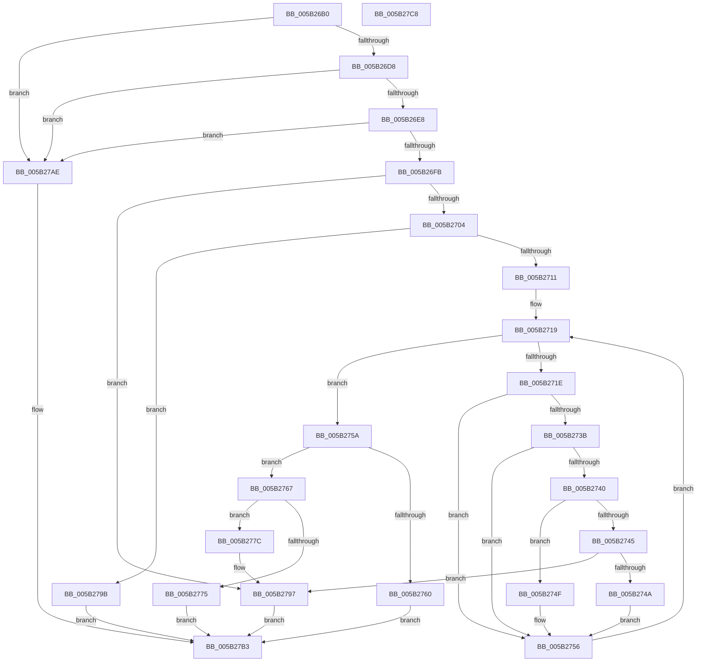

# KeAddTriageDumpDataBlock

- RVA: `0x005B26B0`–`0x005B27C9` (길이 `281` bytes)
- VA: `0x00000001405B26B0`
- 실행 섹션: `.text`
- PDB 이름 있음: `예`; PDB Function 태그: `아니요`
- unwind 정보 RVA: `0x0005C954`
- 디코드: `85`개 명령, `281/281` bytes 표시
- 미해석 바이트: `0` (있으면 어셈블리에 `.byte`로 보존)

> 이 문서는 커널 이미지의 기계어와 PDB 기호를 분석해 생성했습니다. 4번과 5번은 함수 원형과 자료형을 바이너리 사용 방식에서 추정한 C 해석이며 원본 소스 복구 결과는 아닙니다.

## 1. Dependencies

- 직접 호출 지점: **4**; 고유 호출 대상: **4**
- 직접 호출자로 확인된 함수: **3**
- RIP 상대 이미지 참조: **0**

### Outgoing calls
- `0x005B26DB` → [KiValidateTriageDumpDataArray](KiValidateTriageDumpDataArray_function_005B55E8.md) (function, `0x005B55E8`)
- `0x005B26EE` → [KiIsAddressRangeValid](../4B/KiIsAddressRangeValid_function_004B0278.md) (function, `0x004B0278`)
- `0x005B2704` → [Feature_TriageDumpDataExtension__private_IsEnabledDeviceUsageNoInline](Feature_TriageDumpDataExtension__private_IsEnabledDeviceUsageNoInline_function_005B2658.md) (function, `0x005B2658`)
- `0x005B27A7` → [KiAddTriageDumpDataBlock](KiAddTriageDumpDataBlock_function_005B3AB8.md) (function, `0x005B3AB8`)

### Direct callers
- [IoAddTriageDumpDataBlock](../42/IoAddTriageDumpDataBlock_function_00428374.md) at `0x004283DD`
- [PopWatchdogDumpControlRoutine](../5D/PopWatchdogDumpControlRoutine_function_005DFAA0.md) at `0x005DFB61`
- [IopInitializeTriageDumpData](../../page/71/IopInitializeTriageDumpData_function_0071A740.md) at `0x0071A7B4`

### Static image references
- 디코드된 RIP-relative 메모리 참조가 없습니다.

## 2. Other-region calls and transfers

- 다른 실행 섹션으로 향하는 call: **0**
- 별도 외부 분기/꼬리 이동을 확인하지 못했습니다.

## 3. Assembly (complete function range)

```asm
005B26B0  48 89 5C 24 08                  mov qword ptr [rsp + 8], rbx
005B26B5  48 89 6C 24 10                  mov qword ptr [rsp + 0x10], rbp
005B26BA  48 89 74 24 18                  mov qword ptr [rsp + 0x18], rsi
005B26BF  57                              push rdi
005B26C0  48 83 EC 20                     sub rsp, 0x20
005B26C4  33 FF                           xor edi, edi
005B26C6  49 8B E8                        mov rbp, r8
005B26C9  48 8B F2                        mov rsi, rdx
005B26CC  48 8B D9                        mov rbx, rcx
005B26CF  48 85 C9                        test rcx, rcx
005B26D2  0F 84 D6 00 00 00               je 0x1405b27ae
005B26D8  45 33 C0                        xor r8d, r8d
005B26DB  E8 08 2F 00 00                  call 0x1405b55e8
005B26E0  84 C0                           test al, al
005B26E2  0F 84 C6 00 00 00               je 0x1405b27ae
005B26E8  48 8B D5                        mov rdx, rbp
005B26EB  48 8B CE                        mov rcx, rsi
005B26EE  E8 85 DB EF FF                  call 0x1404b0278
005B26F3  84 C0                           test al, al
005B26F5  0F 84 B3 00 00 00               je 0x1405b27ae
005B26FB  48 85 ED                        test rbp, rbp
005B26FE  0F 84 93 00 00 00               je 0x1405b2797
005B2704  E8 4F FF FF FF                  call 0x1405b2658
005B2709  85 C0                           test eax, eax
005B270B  0F 85 8A 00 00 00               jne 0x1405b279b
005B2711  44 8B 4B 10                     mov r9d, dword ptr [rbx + 0x10]
005B2715  48 8D 14 2E                     lea rdx, [rsi + rbp]
005B2719  41 3B F9                        cmp edi, r9d
005B271C  73 3C                           jae 0x1405b275a
005B271E  8B CF                           mov ecx, edi
005B2720  48 8D 41 03                     lea rax, [rcx + 3]
005B2724  48 03 C9                        add rcx, rcx
005B2727  48 03 C0                        add rax, rax
005B272A  48 8B 4C CB 38                  mov rcx, qword ptr [rbx + rcx*8 + 0x38]
005B272F  4C 8B 04 C3                     mov r8, qword ptr [rbx + rax*8]
005B2733  49 03 C8                        add rcx, r8
005B2736  48 3B F1                        cmp rsi, rcx
005B2739  73 1B                           jae 0x1405b2756
005B273B  49 3B D0                        cmp rdx, r8
005B273E  76 16                           jbe 0x1405b2756
005B2740  49 3B F0                        cmp rsi, r8
005B2743  72 0A                           jb 0x1405b274f
005B2745  48 3B D1                        cmp rdx, rcx
005B2748  76 4D                           jbe 0x1405b2797
005B274A  48 8B F1                        mov rsi, rcx
005B274D  EB 07                           jmp 0x1405b2756
005B274F  48 3B D1                        cmp rdx, rcx
005B2752  49 0F 46 D0                     cmovbe rdx, r8
005B2756  FF C7                           inc edi
005B2758  EB BF                           jmp 0x1405b2719
005B275A  44 3B 4B 14                     cmp r9d, dword ptr [rbx + 0x14]
005B275E  75 07                           jne 0x1405b2767
005B2760  B8 23 00 00 C0                  mov eax, 0xc0000023
005B2765  EB 4C                           jmp 0x1405b27b3
005B2767  8B 43 1C                        mov eax, dword ptr [rbx + 0x1c]
005B276A  48 2B D6                        sub rdx, rsi
005B276D  2B 43 18                        sub eax, dword ptr [rbx + 0x18]
005B2770  48 3B D0                        cmp rdx, rax
005B2773  76 07                           jbe 0x1405b277c
005B2775  B8 9A 00 00 C0                  mov eax, 0xc000009a
005B277A  EB 37                           jmp 0x1405b27b3
005B277C  8B CF                           mov ecx, edi
005B277E  48 8D 41 03                     lea rax, [rcx + 3]
005B2782  48 03 C9                        add rcx, rcx
005B2785  48 03 C0                        add rax, rax
005B2788  48 89 54 CB 38                  mov qword ptr [rbx + rcx*8 + 0x38], rdx
005B278D  48 89 34 C3                     mov qword ptr [rbx + rax*8], rsi
005B2791  FF 43 10                        inc dword ptr [rbx + 0x10]
005B2794  01 53 18                        add dword ptr [rbx + 0x18], edx
005B2797  33 C0                           xor eax, eax
005B2799  EB 18                           jmp 0x1405b27b3
005B279B  45 33 C9                        xor r9d, r9d
005B279E  4C 8B C5                        mov r8, rbp
005B27A1  48 8B D6                        mov rdx, rsi
005B27A4  48 8B CB                        mov rcx, rbx
005B27A7  E8 0C 13 00 00                  call 0x1405b3ab8
005B27AC  EB 05                           jmp 0x1405b27b3
005B27AE  B8 0D 00 00 C0                  mov eax, 0xc000000d
005B27B3  48 8B 5C 24 30                  mov rbx, qword ptr [rsp + 0x30]
005B27B8  48 8B 6C 24 38                  mov rbp, qword ptr [rsp + 0x38]
005B27BD  48 8B 74 24 40                  mov rsi, qword ptr [rsp + 0x40]
005B27C2  48 83 C4 20                     add rsp, 0x20
005B27C6  5F                              pop rdi
005B27C7  C3                              ret
005B27C8  CC                              int3
```

## 4. C-style interpretation (structured pseudocode)

```c
__int64 __fastcall KeAddTriageDumpDataBlock(__int64 a1, __int64 a2, __int64 a3)
{
    __int64 result;
    __int64 v_rdi;
    __int64 v_rsp;
    unsigned __int64 v_stack_p10;
    unsigned __int64 v_stack_p18;
    unsigned __int64 v_stack_p8;

    v_stack_p8 = v_rbx;
    v_stack_p10 = v_rbp;
    v_stack_p18 = v_rsi;
    v_rsp = (v_rsp) - (32);
    v_rdi = 0;
    if (a1 == 0) goto loc_005B27AE;
    a3 = 0;
    result = KiValidateTriageDumpDataArray(a1, a2, a3, a4);
    if ((unsigned __int8)(result) == 0) goto loc_005B27AE;
    result = KiIsAddressRangeValid(a2, 0, a3, a4);
    if ((unsigned __int8)(result) == 0) goto loc_005B27AE;
    if (0 == 0) goto loc_005B2797;
    result = Feature_TriageDumpDataExtension__private_IsEnabledDeviceUsageNoInline(a2, 0, a3, a4);
    if ((unsigned int)(result) != 0) goto loc_005B279B;
loc_005B2719:
    if (0 >= ((unsigned int)((unsigned int)(*(unsigned int *)(a1 + 16))))) goto loc_005B275A;
    a1 = (0) + (0);
    result = (0 + 3) + (0 + 3);
    a1 = (*(unsigned __int64 *)(a1 + a1 * 8 + 56)) + (*(unsigned __int64 *)(a1 + result * 8));
    if (a2 >= a1) goto loc_005B2756;
    if ((a2 + a3 * 1) <= (*(unsigned __int64 *)(a1 + result * 8))) goto loc_005B2756;
    if (a2 < (*(unsigned __int64 *)(a1 + result * 8))) goto loc_005B274F;
    if ((a2 + a3 * 1) <= a1) goto loc_005B2797;
    goto loc_005B2756;
loc_005B274F:
    a2 = a2 + a3 * 1;
    if ((a2 + a3 * 1) <= a1) { a2 = *(unsigned __int64 *)(a1 + result * 8); }
loc_005B2756:
    v_rdi = (unsigned int)((v_rdi) + 1);
    goto loc_005B2719;
loc_005B275A:
    if (((unsigned int)((unsigned int)(*(unsigned int *)(a1 + 16)))) != (*(unsigned int *)(a1 + 20))) goto loc_005B2767;
    goto loc_005B27B3;
loc_005B2767:
    a2 = (a2) - (a1);
    result = (unsigned int)(((unsigned int)(*(unsigned int *)(a1 + 28))) - (*(unsigned int *)(a1 + 24)));
    if (a2 <= result) goto loc_005B277C;
    goto loc_005B27B3;
loc_005B277C:
    a1 = ((unsigned int)((unsigned int)(v_rdi))) + ((unsigned int)((unsigned int)(v_rdi)));
    result = ((unsigned int)((unsigned int)(v_rdi)) + 3) + ((unsigned int)((unsigned int)(v_rdi)) + 3);
    *(unsigned __int64 *)(a1 + a1 * 8 + 56) = a2;
    *(unsigned __int64 *)(a1 + result * 8) = a1;
loc_005B2797:
    result = 0;
    goto loc_005B27B3;
loc_005B279B:
    a4 = 0;
    result = KiAddTriageDumpDataBlock(a1, a1, 0, a4);
    goto loc_005B27B3;
loc_005B27AE:
loc_005B27B3:
    v_rsp = (v_rsp) + (32);
    return (unsigned int)(0xC000000DULL);
}
```

## 5. (Beta) C Style

```c
int64_t KeAddTriageDumpDataBlock(void *Arg1, void *Arg2, int64_t Arg3)
{
    uint8_t *arg1 = (uint8_t *)Arg1;
    uint8_t *arg2 = (uint8_t *)Arg2;

    int64_t result;
    int64_t local_rdi;
    int64_t local_rsp;
    uint64_t v_stack_p10;
    uint64_t v_stack_p18;
    uint64_t v_stack_p8;

    v_stack_p8 = local_rbx;
    v_stack_p10 = local_rbp;
    v_stack_p18 = local_rsi;
    local_rsp = (local_rsp) - (32);
    local_rdi = 0;
    if (Arg1 == NULL) goto loc_005B27AE;
    Arg3 = 0;
    result = KiValidateTriageDumpDataArray(Arg1, Arg2, Arg3, a4);
    if ((uint8_t)(result) == 0) goto loc_005B27AE;
    result = KiIsAddressRangeValid(Arg2, 0, Arg3, a4);
    if ((uint8_t)(result) == 0) goto loc_005B27AE;
    if (0 == 0) goto loc_005B2797;
    result = Feature_TriageDumpDataExtension__private_IsEnabledDeviceUsageNoInline(Arg2, 0, Arg3, a4);
    if ((uint32_t)(result) != 0) goto loc_005B279B;
loc_005B2719:
    if (0 >= ((uint32_t)((uint32_t)(*(uint32_t *)(arg1 + 0x10))))) goto loc_005B275A;
    Arg1 = (0) + (0);
    result = (0 + 3) + (0 + 3);
    Arg1 = (*(uint64_t *)(arg1 + arg1 * 8 + 0x38)) + (*(uint64_t *)(arg1 + result * 8));
    if (Arg2 >= Arg1) goto loc_005B2756;
    if ((Arg2 + Arg3 * 1) <= (*(uint64_t *)(arg1 + result * 8))) goto loc_005B2756;
    if (Arg2 < (*(uint64_t *)(arg1 + result * 8))) goto loc_005B274F;
    if ((Arg2 + Arg3 * 1) <= Arg1) goto loc_005B2797;
    goto loc_005B2756;
loc_005B274F:
    Arg2 = Arg2 + Arg3 * 1;
    if ((Arg2 + Arg3 * 1) <= Arg1) { Arg2 = *(uint64_t *)(arg1 + result * 8); }
loc_005B2756:
    local_rdi = (uint32_t)((local_rdi) + 1);
    goto loc_005B2719;
loc_005B275A:
    if (((uint32_t)((uint32_t)(*(uint32_t *)(arg1 + 0x10)))) != (*(uint32_t *)(arg1 + 0x14))) goto loc_005B2767;
    goto loc_005B27B3;
loc_005B2767:
    Arg2 = (Arg2) - (Arg1);
    result = (uint32_t)(((uint32_t)(*(uint32_t *)(arg1 + 0x1C))) - (*(uint32_t *)(arg1 + 0x18)));
    if (Arg2 <= result) goto loc_005B277C;
    goto loc_005B27B3;
loc_005B277C:
    Arg1 = ((uint32_t)((uint32_t)(local_rdi))) + ((uint32_t)((uint32_t)(local_rdi)));
    result = ((uint32_t)((uint32_t)(local_rdi)) + 3) + ((uint32_t)((uint32_t)(local_rdi)) + 3);
    *(void **)(arg1 + arg1 * 8 + 0x38) = Arg2;
    *(void **)(arg1 + result * 8) = Arg1;
loc_005B2797:
    result = 0;
    goto loc_005B27B3;
loc_005B279B:
    a4 = 0;
    result = KiAddTriageDumpDataBlock(Arg1, Arg1, 0, a4);
    goto loc_005B27B3;
loc_005B27AE:
loc_005B27B3:
    local_rsp = (local_rsp) + (32);
    return (uint32_t)(0xC000000DULL);
}
```

### 관측된 메모리 오프셋

구조체 형식이 확인되지 않은 접근은 인자 기준의 오프셋으로만 기록했습니다.

| 기준 인자 | 오프셋 표현 | 폭 (bit) | 접근 |
|---|---:|---:|---|
| `Arg1` | `+ 0x0 + rax*8` | `64` | `R` |
| `Arg1` | `+ 0x0 + rax*8` | `64` | `W` |
| `Arg1` | `+ 0x10` | `32` | `R` |
| `Arg1` | `+ 0x10` | `32` | `R/W` |
| `Arg1` | `+ 0x14` | `32` | `R` |
| `Arg1` | `+ 0x18` | `32` | `R` |
| `Arg1` | `+ 0x18` | `32` | `R/W` |
| `Arg1` | `+ 0x1C` | `32` | `R` |
| `Arg1` | `+ 0x38 + rcx*8` | `64` | `R` |
| `Arg1` | `+ 0x38 + rcx*8` | `64` | `W` |
| `Arg2` | `+ 0x0 + rbp*1` | `64` | `R` |

## 6. Execution-region graph

[열기: 2D/3D 그래프와 함수 탐색 컨트롤 패널](../../../control-panel.html?section=text&rva=0x005B26B0&view=graph)

- 2D 그래프는 위에서 아래로 흐르고, 3D 그래프는 빈 공간을 드래그해 회전합니다. Shift+드래그는 이동, 휠은 확대·축소, 함수 노드 선택은 대상 보고서 이동입니다.

### Static fallback


