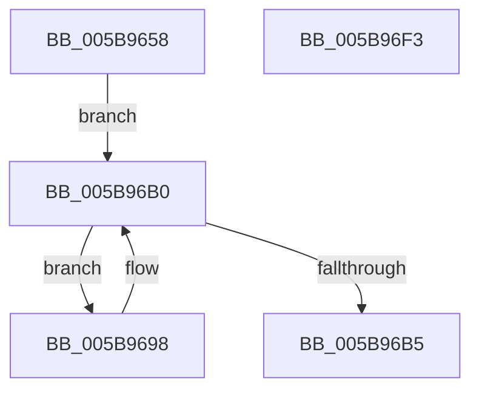

# KeAdjustTimerDelayProcess

- RVA: `0x005B9658`–`0x005B96F4` (길이 `156` bytes)
- VA: `0x00000001405B9658`
- 실행 섹션: `.text`
- PDB 이름 있음: `예`; PDB Function 태그: `아니요`
- unwind 정보 RVA: `0x000BDA48`
- 디코드: `45`개 명령, `156/156` bytes 표시
- 미해석 바이트: `0` (있으면 어셈블리에 `.byte`로 보존)

> 이 문서는 커널 이미지의 기계어와 PDB 기호를 분석해 생성했습니다. 4번과 5번은 함수 원형과 자료형을 바이너리 사용 방식에서 추정한 C 해석이며 원본 소스 복구 결과는 아닙니다.

## 1. Dependencies

- 직접 호출 지점: **4**; 고유 호출 대상: **4**
- 직접 호출자로 확인된 함수: **1**
- RIP 상대 이미지 참조: **0**

### Outgoing calls
- `0x005B968A` → [KiAcquireProcessLockExclusive](../3C/KiAcquireProcessLockExclusive_function_003C26B8.md) (function, `0x003C26B8`)
- `0x005B96A8` → [KiAdjustThreadTimer](../5C/KiAdjustThreadTimer_function_005C3A3C.md) (function, `0x005C3A3C`)
- `0x005B96BC` → [ExReleaseSpinLockExclusiveFromDpcLevel](../24/ExReleaseSpinLockExclusiveFromDpcLevel_function_002497E0.md) (function, `0x002497E0`)
- `0x005B96D5` → [KiExitDispatcher](../25/KiExitDispatcher_function_00251CF0.md) (function, `0x00251CF0`)

### Direct callers
- [PspSetProcessTimerDelayForKTimers](../5E/PspSetProcessTimerDelayForKTimers_function_005E3C40.md) at `0x005E3D85`

### Static image references
- 디코드된 RIP-relative 메모리 참조가 없습니다.

## 2. Other-region calls and transfers

- 다른 실행 섹션으로 향하는 call: **0**
- 별도 외부 분기/꼬리 이동을 확인하지 못했습니다.

## 3. Assembly (complete function range)

```asm
005B9658  48 8B C4                        mov rax, rsp
005B965B  48 89 58 08                     mov qword ptr [rax + 8], rbx
005B965F  48 89 68 10                     mov qword ptr [rax + 0x10], rbp
005B9663  48 89 70 20                     mov qword ptr [rax + 0x20], rsi
005B9667  57                              push rdi
005B9668  41 56                           push r14
005B966A  41 57                           push r15
005B966C  48 83 EC 30                     sub rsp, 0x30
005B9670  65 4C 8B 34 25 20 00 00 00      mov r14, qword ptr gs:[0x20]
005B9679  4C 8B FA                        mov r15, rdx
005B967C  48 8D 50 18                     lea rdx, [rax + 0x18]
005B9680  C6 40 18 00                     mov byte ptr [rax + 0x18], 0
005B9684  41 8B E8                        mov ebp, r8d
005B9687  48 8B F9                        mov rdi, rcx
005B968A  E8 29 90 E0 FF                  call 0x1403c26b8
005B968F  48 8D 77 30                     lea rsi, [rdi + 0x30]
005B9693  48 8B 1E                        mov rbx, qword ptr [rsi]
005B9696  EB 18                           jmp 0x1405b96b0
005B9698  48 8D 8B 08 FD FF FF            lea rcx, [rbx - 0x2f8]
005B969F  44 8B CD                        mov r9d, ebp
005B96A2  4D 8B C7                        mov r8, r15
005B96A5  49 8B D6                        mov rdx, r14
005B96A8  E8 8F A3 00 00                  call 0x1405c3a3c
005B96AD  48 8B 1B                        mov rbx, qword ptr [rbx]
005B96B0  48 3B DE                        cmp rbx, rsi
005B96B3  75 E3                           jne 0x1405b9698
005B96B5  48 8D 4F 40                     lea rcx, [rdi + 0x40]
005B96B9  89 6F 44                        mov dword ptr [rdi + 0x44], ebp
005B96BC  E8 1F 01 C9 FF                  call 0x1402497e0
005B96C1  8A 44 24 60                     mov al, byte ptr [rsp + 0x60]
005B96C5  45 33 C9                        xor r9d, r9d
005B96C8  33 D2                           xor edx, edx
005B96CA  88 44 24 20                     mov byte ptr [rsp + 0x20], al
005B96CE  49 8B CE                        mov rcx, r14
005B96D1  45 8D 41 01                     lea r8d, [r9 + 1]
005B96D5  E8 16 86 C9 FF                  call 0x140251cf0
005B96DA  48 8B 5C 24 50                  mov rbx, qword ptr [rsp + 0x50]
005B96DF  48 8B 6C 24 58                  mov rbp, qword ptr [rsp + 0x58]
005B96E4  48 8B 74 24 68                  mov rsi, qword ptr [rsp + 0x68]
005B96E9  48 83 C4 30                     add rsp, 0x30
005B96ED  41 5F                           pop r15
005B96EF  41 5E                           pop r14
005B96F1  5F                              pop rdi
005B96F2  C3                              ret
005B96F3  CC                              int3
```

## 4. C-style interpretation (structured pseudocode)

```c
__int64 __fastcall KeAdjustTimerDelayProcess(__int64 a1, __int64 a2, int a3)
{
    __int64 result;
    __int64 v_rsp;
    unsigned __int8 v_stack_m28;
    unsigned __int64 v_stack_p10;
    unsigned __int8 v_stack_p18;
    unsigned __int64 v_stack_p20;
    unsigned __int64 v_stack_p8;

    *(unsigned __int64 *)(v_rsp + 8) = v_rbx;
    *(unsigned __int64 *)(v_rsp + 16) = v_rbp;
    *(unsigned __int64 *)(v_rsp + 32) = v_rsi;
    v_rsp = (v_rsp) - (48);
    *(unsigned __int8 *)(v_rsp + 24) = 0;
    result = KiAcquireProcessLockExclusive(a1, v_rsp + 24, a3, a4);
    goto loc_005B96B0;
loc_005B9698:
    result = KiAdjustThreadTimer(*(unsigned __int64 *)(a1 + 48) - 760, *(unsigned __int64 *)(gs_base + (0 + 32)), a2, (unsigned int)((unsigned int)((unsigned int)(a3))));
loc_005B96B0:
    if ((*(unsigned __int64 *)(*(unsigned __int64 *)(a1 + 48))) != (a1 + 48)) goto loc_005B9698;
    *(unsigned int *)(a1 + 68) = (unsigned int)((unsigned int)(a3));
    result = ExReleaseSpinLockExclusiveFromDpcLevel(a1 + 64, *(unsigned __int64 *)(gs_base + (0 + 32)), a2, (unsigned int)((unsigned int)((unsigned int)(a3))));
    a4 = 0;
    a2 = 0;
    v_stack_m28 = (unsigned __int8)(v_stack_p18);
    result = KiExitDispatcher(*(unsigned __int64 *)(gs_base + (0 + 32)), a2, a4 + 1, a4);
    v_rsp = (v_rsp) + (48);
    return result;
}
```

## 5. (Beta) C Style

```c
int64_t KeAdjustTimerDelayProcess(void *Arg1, int64_t Arg2, int32_t Arg3)
{
    uint8_t *arg1 = (uint8_t *)Arg1;

    int64_t result;
    int64_t local_rsp;
    uint8_t v_stack_m28;
    uint64_t v_stack_p10;
    uint8_t v_stack_p18;
    uint64_t v_stack_p20;
    uint64_t v_stack_p8;

    *(uint64_t *)(local_rsp + 0x8) = local_rbx;
    *(uint64_t *)(local_rsp + 0x10) = local_rbp;
    *(uint64_t *)(local_rsp + 0x20) = local_rsi;
    local_rsp = (local_rsp) - (48);
    *(uint8_t *)(local_rsp + 0x18) = 0;
    result = KiAcquireProcessLockExclusive(Arg1, local_rsp + 24, Arg3, a4);
    goto loc_005B96B0;
loc_005B9698:
    result = KiAdjustThreadTimer(*(uint64_t *)(arg1 + 0x30) - 760, *(uint64_t *)(gs_base + (0 + 0x20)), Arg2, (uint32_t)((uint32_t)((uint32_t)(Arg3))));
loc_005B96B0:
    if ((*(uint64_t *)(*(uint64_t *)(arg1 + 0x30))) != (Arg1 + 48)) goto loc_005B9698;
    *(uint32_t *)(arg1 + 0x44) = (uint32_t)((uint32_t)(Arg3));
    result = ExReleaseSpinLockExclusiveFromDpcLevel(Arg1 + 64, *(uint64_t *)(gs_base + (0 + 0x20)), Arg2, (uint32_t)((uint32_t)((uint32_t)(Arg3))));
    a4 = 0;
    Arg2 = 0;
    v_stack_m28 = (uint8_t)(v_stack_p18);
    result = KiExitDispatcher(*(uint64_t *)(gs_base + (0 + 0x20)), Arg2, a4 + 1, a4);
    local_rsp = (local_rsp) + (48);
    return result;
}
```

### 관측된 메모리 오프셋

구조체 형식이 확인되지 않은 접근은 인자 기준의 오프셋으로만 기록했습니다.

| 기준 인자 | 오프셋 표현 | 폭 (bit) | 접근 |
|---|---:|---:|---|
| `Arg1` | `+ 0x0` | `64` | `R` |
| `Arg1` | `+ 0x30` | `64` | `R` |
| `Arg1` | `+ 0x40` | `64` | `R` |
| `Arg1` | `+ 0x44` | `32` | `W` |

## 6. Execution-region graph

[열기: 2D/3D 그래프와 함수 탐색 컨트롤 패널](../../../control-panel.html?section=text&rva=0x005B9658&view=graph)

- 2D 그래프는 위에서 아래로 흐르고, 3D 그래프는 빈 공간을 드래그해 회전합니다. Shift+드래그는 이동, 휠은 확대·축소, 함수 노드 선택은 대상 보고서 이동입니다.

### Static fallback


