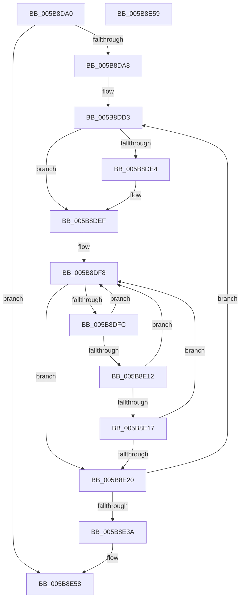

# KeAlertMultipleThreadByThreadId

- RVA: `0x005B8DA0`–`0x005B8E5A` (길이 `186` bytes)
- VA: `0x00000001405B8DA0`
- 실행 섹션: `.text`
- PDB 이름 있음: `예`; PDB Function 태그: `아니요`
- unwind 정보 RVA: `0x000CA020`
- 디코드: `56`개 명령, `186/186` bytes 표시
- 미해석 바이트: `0` (있으면 어셈블리에 `.byte`로 보존)

> 이 문서는 커널 이미지의 기계어와 PDB 기호를 분석해 생성했습니다. 4번과 5번은 함수 원형과 자료형을 바이너리 사용 방식에서 추정한 C 해석이며 원본 소스 복구 결과는 아닙니다.

## 1. Dependencies

- 직접 호출 지점: **4**; 고유 호출 대상: **4**
- 직접 호출자로 확인된 함수: **2**
- RIP 상대 이미지 참조: **1**

### Outgoing calls
- `0x005B8DEA` → [KiRaiseIrqlProcessIrqlFlags](../4F/KiRaiseIrqlProcessIrqlFlags_function_004F56FC.md) (function, `0x004F56FC`)
- `0x005B8E06` → [KiAlertSingleThreadByThreadId](../39/KiAlertSingleThreadByThreadId_function_00397D8C.md) (function, `0x00397D8C`)
- `0x005B8E17` → [KeShouldYieldProcessor](../27/KeShouldYieldProcessor_function_002773E0.md) (function, `0x002773E0`)
- `0x005B8E31` → [KiExitDispatcher](../25/KiExitDispatcher_function_00251CF0.md) (function, `0x00251CF0`)

### Direct callers
- [PspIumAlertMultipleThreadByThreadId](../5E/PspIumAlertMultipleThreadByThreadId_function_005E4324.md) at `0x005E4381`
- [NtAlertMultipleThreadByThreadId](../../page/78/NtAlertMultipleThreadByThreadId_function_00789650.md) at `0x0078984E`

### Static image references
- `0x005B8DDB` → RVA `0x00FC6D20` (`ALMOSTRO`; read)

## 2. Other-region calls and transfers

- 다른 실행 섹션으로 향하는 call: **0**
- 별도 외부 분기/꼬리 이동을 확인하지 못했습니다.

## 3. Assembly (complete function range)

```asm
005B8DA0  85 D2                           test edx, edx
005B8DA2  0F 84 B0 00 00 00               je 0x1405b8e58
005B8DA8  48 8B C4                        mov rax, rsp
005B8DAB  48 89 58 08                     mov qword ptr [rax + 8], rbx
005B8DAF  48 89 68 10                     mov qword ptr [rax + 0x10], rbp
005B8DB3  48 89 70 18                     mov qword ptr [rax + 0x18], rsi
005B8DB7  48 89 78 20                     mov qword ptr [rax + 0x20], rdi
005B8DBB  41 54                           push r12
005B8DBD  41 56                           push r14
005B8DBF  41 57                           push r15
005B8DC1  48 83 EC 30                     sub rsp, 0x30
005B8DC5  33 DB                           xor ebx, ebx
005B8DC7  4D 8B F0                        mov r14, r8
005B8DCA  8B F2                           mov esi, edx
005B8DCC  4C 8B F9                        mov r15, rcx
005B8DCF  44 8D 63 02                     lea r12d, [rbx + 2]
005B8DD3  44 0F 20 C7                     mov rdi, cr8
005B8DD7  45 0F 22 C4                     mov cr8, r12
005B8DDB  83 3D 3E DF A0 00 00            cmp dword ptr [rip + 0xa0df3e], 0
005B8DE2  74 0B                           je 0x1405b8def
005B8DE4  41 8A D4                        mov dl, r12b
005B8DE7  40 8A CF                        mov cl, dil
005B8DEA  E8 0D C9 F3 FF                  call 0x1404f56fc
005B8DEF  65 48 8B 2C 25 20 00 00 00      mov rbp, qword ptr gs:[0x20]
005B8DF8  3B DE                           cmp ebx, esi
005B8DFA  73 24                           jae 0x1405b8e20
005B8DFC  49 8B 14 DF                     mov rdx, qword ptr [r15 + rbx*8]
005B8E00  4D 8B C6                        mov r8, r14
005B8E03  48 8B CD                        mov rcx, rbp
005B8E06  E8 81 EF DD FF                  call 0x140397d8c
005B8E0B  FF C3                           inc ebx
005B8E0D  F6 C3 3F                        test bl, 0x3f
005B8E10  75 E6                           jne 0x1405b8df8
005B8E12  41 3A FC                        cmp dil, r12b
005B8E15  73 E1                           jae 0x1405b8df8
005B8E17  E8 C4 E5 CB FF                  call 0x1402773e0
005B8E1C  85 C0                           test eax, eax
005B8E1E  74 D8                           je 0x1405b8df8
005B8E20  33 D2                           xor edx, edx
005B8E22  40 88 7C 24 20                  mov byte ptr [rsp + 0x20], dil
005B8E27  48 8B CD                        mov rcx, rbp
005B8E2A  44 8D 4A 01                     lea r9d, [rdx + 1]
005B8E2E  45 8B C1                        mov r8d, r9d
005B8E31  E8 BA 8E C9 FF                  call 0x140251cf0
005B8E36  3B DE                           cmp ebx, esi
005B8E38  72 99                           jb 0x1405b8dd3
005B8E3A  48 8B 5C 24 50                  mov rbx, qword ptr [rsp + 0x50]
005B8E3F  48 8B 6C 24 58                  mov rbp, qword ptr [rsp + 0x58]
005B8E44  48 8B 74 24 60                  mov rsi, qword ptr [rsp + 0x60]
005B8E49  48 8B 7C 24 68                  mov rdi, qword ptr [rsp + 0x68]
005B8E4E  48 83 C4 30                     add rsp, 0x30
005B8E52  41 5F                           pop r15
005B8E54  41 5E                           pop r14
005B8E56  41 5C                           pop r12
005B8E58  C3                              ret
005B8E59  CC                              int3
```

## 4. C-style interpretation (structured pseudocode)

```c
__int64 __fastcall KeAlertMultipleThreadByThreadId(__int64 a1, int a2, __int64 a3)
{
    __int64 result;
    __int64 v_rbx;
    __int64 v_rsp;
    unsigned __int8 v_stack_m28;
    unsigned __int64 v_stack_p10;
    unsigned __int64 v_stack_p18;
    unsigned __int64 v_stack_p20;
    unsigned __int64 v_stack_p8;

    if (a2 == 0) goto loc_005B8E58;
    *(unsigned __int64 *)(v_rsp + 8) = v_rbx;
    *(unsigned __int64 *)(v_rsp + 16) = v_rbp;
    *(unsigned __int64 *)(v_rsp + 24) = v_rsi;
    *(unsigned __int64 *)(v_rsp + 32) = v_rdi;
    v_rsp = (v_rsp) - (48);
    v_rbx = 0;
loc_005B8DD3:
    result = v_rsp;
    if ((*(unsigned int *)(v_rip + 10542910)) != 0) {
        a2 = (unsigned __int8)(v_rbx + 2);
        a1 = (unsigned __int8)(v_cr8);
        result = KiRaiseIrqlProcessIrqlFlags(a1, a2, a3, a4);
    }
loc_005B8DF8:
    if (0 >= ((unsigned int)((unsigned int)(a2)))) goto loc_005B8E20;
    result = KiAlertSingleThreadByThreadId(*(unsigned __int64 *)(gs_base + (0 + 32)), *(unsigned __int64 *)(a1 + v_rbx * 8), a3, a4);
    v_rbx = (unsigned int)((v_rbx) + 1);
    if ((((unsigned __int8)(v_rbx)) & (63)) != 0) goto loc_005B8DF8;
    if (((unsigned __int8)(v_cr8)) >= ((unsigned __int8)(v_rbx + 2))) goto loc_005B8DF8;
    result = KeShouldYieldProcessor(*(unsigned __int64 *)(gs_base + (0 + 32)), *(unsigned __int64 *)(a1 + v_rbx * 8), a3, a4);
    if ((unsigned int)(result) == 0) goto loc_005B8DF8;
loc_005B8E20:
    a2 = 0;
    v_stack_m28 = (unsigned __int8)(v_cr8);
    result = KiExitDispatcher(*(unsigned __int64 *)(gs_base + (0 + 32)), a2, (unsigned int)((unsigned int)(a2 + 1)), a2 + 1);
    if (((unsigned int)(v_rbx)) < ((unsigned int)((unsigned int)(a2)))) goto loc_005B8DD3;
    v_rsp = (v_rsp) + (48);
loc_005B8E58:
    return result;
}
```

## 5. (Beta) C Style

```c
int64_t KeAlertMultipleThreadByThreadId(void *Arg1, int32_t Arg2, int64_t Arg3)
{
    uint8_t *arg1 = (uint8_t *)Arg1;

    int64_t result;
    int64_t local_rbx;
    int64_t local_rsp;
    uint8_t v_stack_m28;
    uint64_t v_stack_p10;
    uint64_t v_stack_p18;
    uint64_t v_stack_p20;
    uint64_t v_stack_p8;

    if (Arg2 == 0) goto loc_005B8E58;
    *(uint64_t *)(local_rsp + 0x8) = local_rbx;
    *(uint64_t *)(local_rsp + 0x10) = local_rbp;
    *(uint64_t *)(local_rsp + 0x18) = local_rsi;
    *(uint64_t *)(local_rsp + 0x20) = local_rdi;
    local_rsp = (local_rsp) - (48);
    local_rbx = 0;
loc_005B8DD3:
    result = local_rsp;
    if ((*(uint32_t *)(v_rip + 0xA0DF3E)) != 0) {
        Arg2 = (uint8_t)(local_rbx + 2);
        Arg1 = (uint8_t)(v_cr8);
        result = KiRaiseIrqlProcessIrqlFlags(Arg1, Arg2, Arg3, a4);
    }
loc_005B8DF8:
    if (0 >= ((uint32_t)((uint32_t)(Arg2)))) goto loc_005B8E20;
    result = KiAlertSingleThreadByThreadId(*(uint64_t *)(gs_base + (0 + 0x20)), *(uint64_t *)(arg1 + local_rbx * 8), Arg3, a4);
    local_rbx = (uint32_t)((local_rbx) + 1);
    if ((((uint8_t)(local_rbx)) & (63)) != 0) goto loc_005B8DF8;
    if (((uint8_t)(v_cr8)) >= ((uint8_t)(local_rbx + 2))) goto loc_005B8DF8;
    result = KeShouldYieldProcessor(*(uint64_t *)(gs_base + (0 + 0x20)), *(uint64_t *)(arg1 + local_rbx * 8), Arg3, a4);
    if ((uint32_t)(result) == 0) goto loc_005B8DF8;
loc_005B8E20:
    Arg2 = 0;
    v_stack_m28 = (uint8_t)(v_cr8);
    result = KiExitDispatcher(*(uint64_t *)(gs_base + (0 + 0x20)), Arg2, (uint32_t)((uint32_t)(Arg2 + 1)), Arg2 + 1);
    if (((uint32_t)(local_rbx)) < ((uint32_t)((uint32_t)(Arg2)))) goto loc_005B8DD3;
    local_rsp = (local_rsp) + (48);
loc_005B8E58:
    return result;
}
```

### 관측된 메모리 오프셋

구조체 형식이 확인되지 않은 접근은 인자 기준의 오프셋으로만 기록했습니다.

| 기준 인자 | 오프셋 표현 | 폭 (bit) | 접근 |
|---|---:|---:|---|
| `Arg1` | `+ 0x0 + rbx*8` | `64` | `R` |

## 6. Execution-region graph

[열기: 2D/3D 그래프와 함수 탐색 컨트롤 패널](../../../control-panel.html?section=text&rva=0x005B8DA0&view=graph)

- 2D 그래프는 위에서 아래로 흐르고, 3D 그래프는 빈 공간을 드래그해 회전합니다. Shift+드래그는 이동, 휠은 확대·축소, 함수 노드 선택은 대상 보고서 이동입니다.

### Static fallback


