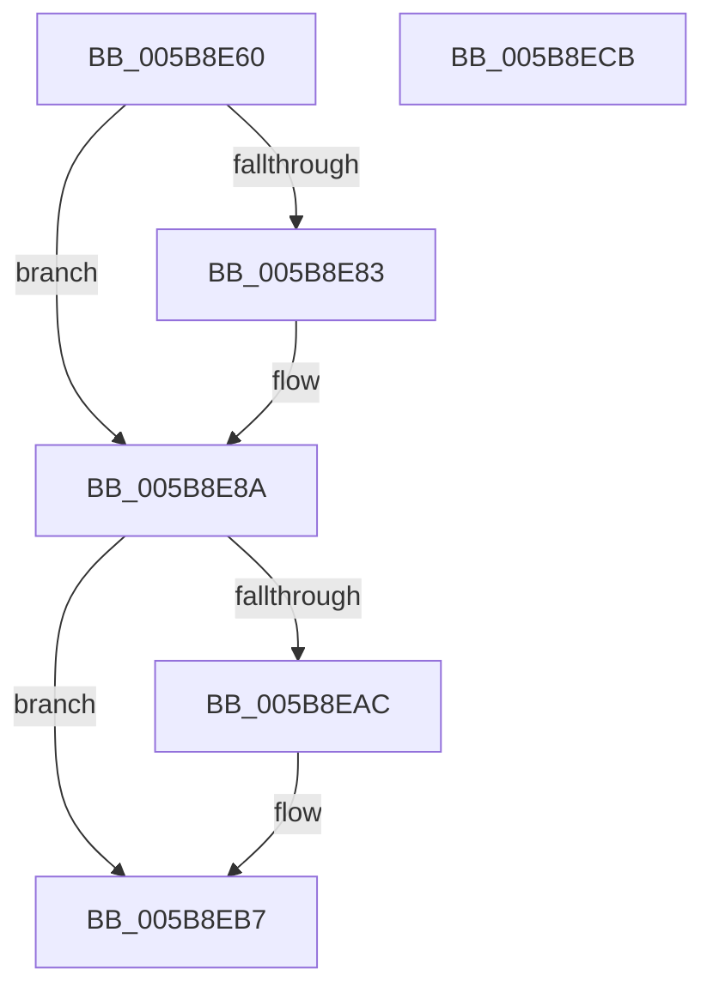

# KeAlertResumeThread

- RVA: `0x005B8E60`–`0x005B8ECC` (길이 `108` bytes)
- VA: `0x00000001405B8E60`
- 실행 섹션: `.text`
- PDB 이름 있음: `예`; PDB Function 태그: `아니요`
- unwind 정보 RVA: `0x0005CAAC`
- 디코드: `31`개 명령, `108/108` bytes 표시
- 미해석 바이트: `0` (있으면 어셈블리에 `.byte`로 보존)

> 이 문서는 커널 이미지의 기계어와 PDB 기호를 분석해 생성했습니다. 4번과 5번은 함수 원형과 자료형을 바이너리 사용 방식에서 추정한 C 해석이며 원본 소스 복구 결과는 아닙니다.

## 1. Dependencies

- 직접 호출 지점: **4**; 고유 호출 대상: **4**
- 직접 호출자로 확인된 함수: **1**
- RIP 상대 이미지 참조: **1**

### Outgoing calls
- `0x005B8E85` → [KiRaiseIrqlProcessIrqlFlags](../4F/KiRaiseIrqlProcessIrqlFlags_function_004F56FC.md) (function, `0x004F56FC`)
- `0x005B8E8F` → [KeAlertThread](../48/KeAlertThread_function_00489B40.md) (function, `0x00489B40`)
- `0x005B8E9C` → [KeResumeThread](../20/KeResumeThread_function_00202858.md) (function, `0x00202858`)
- `0x005B8EB2` → [KiLowerIrqlProcessIrqlFlags](../4F/KiLowerIrqlProcessIrqlFlags_function_004F5698.md) (function, `0x004F5698`)

### Direct callers
- [NtAlertResumeThread](../../page/78/NtAlertResumeThread_function_00787920.md) at `0x007879CF`

### Static image references
- `0x005B8E7A` → RVA `0x00FC6D20` (`ALMOSTRO`; read)

## 2. Other-region calls and transfers

- 다른 실행 섹션으로 향하는 call: **0**
- 별도 외부 분기/꼬리 이동을 확인하지 못했습니다.

## 3. Assembly (complete function range)

```asm
005B8E60  48 89 5C 24 08                  mov qword ptr [rsp + 8], rbx
005B8E65  57                              push rdi
005B8E66  48 83 EC 20                     sub rsp, 0x20
005B8E6A  48 8B F9                        mov rdi, rcx
005B8E6D  44 0F 20 C3                     mov rbx, cr8
005B8E71  BA 02 00 00 00                  mov edx, 2
005B8E76  44 0F 22 C2                     mov cr8, rdx
005B8E7A  83 3D 9F DE A0 00 00            cmp dword ptr [rip + 0xa0de9f], 0
005B8E81  74 07                           je 0x1405b8e8a
005B8E83  8A CB                           mov cl, bl
005B8E85  E8 72 C8 F3 FF                  call 0x1404f56fc
005B8E8A  33 D2                           xor edx, edx
005B8E8C  48 8B CF                        mov rcx, rdi
005B8E8F  E8 AC 0C ED FF                  call 0x140489b40
005B8E94  BA 01 00 00 00                  mov edx, 1
005B8E99  48 8B CF                        mov rcx, rdi
005B8E9C  E8 B7 99 C4 FF                  call 0x140202858
005B8EA1  83 3D 78 DE A0 00 00            cmp dword ptr [rip + 0xa0de78], 0
005B8EA8  8B F8                           mov edi, eax
005B8EAA  74 0B                           je 0x1405b8eb7
005B8EAC  44 0F 20 C1                     mov rcx, cr8
005B8EB0  8A D3                           mov dl, bl
005B8EB2  E8 E1 C7 F3 FF                  call 0x1404f5698
005B8EB7  0F B6 CB                        movzx ecx, bl
005B8EBA  44 0F 22 C1                     mov cr8, rcx
005B8EBE  48 8B 5C 24 30                  mov rbx, qword ptr [rsp + 0x30]
005B8EC3  8B C7                           mov eax, edi
005B8EC5  48 83 C4 20                     add rsp, 0x20
005B8EC9  5F                              pop rdi
005B8ECA  C3                              ret
005B8ECB  CC                              int3
```

## 4. C-style interpretation (structured pseudocode)

```c
__int64 __fastcall KeAlertResumeThread(__int64 a1)
{
    __int64 result;
    __int64 v_rsp;
    unsigned __int64 v_stack_p8;

    v_stack_p8 = v_rbx;
    v_rsp = (v_rsp) - (32);
    if ((*(unsigned int *)(v_rip + 10542751)) != 0) {
        a1 = (unsigned __int8)(v_cr8);
        result = KiRaiseIrqlProcessIrqlFlags(a1, 2, a3, a4);
    }
    a2 = 0;
    result = KeAlertThread(a1, a2, a3, a4);
    result = KeResumeThread(a1, 1, a3, a4);
    if ((*(unsigned int *)(v_rip + 10542712)) != 0) {
        a1 = 2;
        a2 = (unsigned __int8)(v_cr8);
        result = KiLowerIrqlProcessIrqlFlags(a1, a2, a3, a4);
    }
    v_rsp = (v_rsp) + (32);
    return (unsigned int)((unsigned int)((unsigned int)((unsigned int)(result))));
}
```

## 5. (Beta) C Style

```c
int64_t KeAlertResumeThread(int64_t Arg1)
{
    int64_t result;
    int64_t local_rsp;
    uint64_t v_stack_p8;

    v_stack_p8 = local_rbx;
    local_rsp = (local_rsp) - (32);
    if ((*(uint32_t *)(v_rip + 0xA0DE9F)) != 0) {
        Arg1 = (uint8_t)(v_cr8);
        result = KiRaiseIrqlProcessIrqlFlags(Arg1, 2, a3, a4);
    }
    a2 = 0;
    result = KeAlertThread(Arg1, a2, a3, a4);
    result = KeResumeThread(Arg1, 1, a3, a4);
    if ((*(uint32_t *)(v_rip + 0xA0DE78)) != 0) {
        Arg1 = 2;
        a2 = (uint8_t)(v_cr8);
        result = KiLowerIrqlProcessIrqlFlags(Arg1, a2, a3, a4);
    }
    local_rsp = (local_rsp) + (32);
    return (uint32_t)((uint32_t)((uint32_t)((uint32_t)(result))));
}
```

## 6. Execution-region graph

[열기: 2D/3D 그래프와 함수 탐색 컨트롤 패널](../../../control-panel.html?section=text&rva=0x005B8E60&view=graph)

- 2D 그래프는 위에서 아래로 흐르고, 3D 그래프는 빈 공간을 드래그해 회전합니다. Shift+드래그는 이동, 휠은 확대·축소, 함수 노드 선택은 대상 보고서 이동입니다.

### Static fallback


