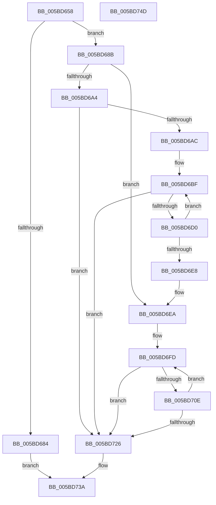

# KeAllocateKernelHiberSwapShadowStacks

- RVA: `0x005BD658`–`0x005BD74E` (길이 `246` bytes)
- VA: `0x00000001405BD658`
- 실행 섹션: `.text`
- PDB 이름 있음: `예`; PDB Function 태그: `아니요`
- unwind 정보 RVA: `0x000CA480`
- 디코드: `71`개 명령, `246/246` bytes 표시
- 미해석 바이트: `0` (있으면 어셈블리에 `.byte`로 보존)

> 이 문서는 커널 이미지의 기계어와 PDB 기호를 분석해 생성했습니다. 4번과 5번은 함수 원형과 자료형을 바이너리 사용 방식에서 추정한 C 해석이며 원본 소스 복구 결과는 아닙니다.

## 1. Dependencies

- 직접 호출 지점: **8**; 고유 호출 대상: **5**
- 직접 호출자로 확인된 함수: **2**
- RIP 상대 이미지 참조: **6**

### Outgoing calls
- `0x005BD694` → [ExAcquireFastMutex](../20/ExAcquireFastMutex_function_0020E5A0.md) (function, `0x0020E5A0`)
- `0x005BD6C7` → [KeEnumerateNextProcessor](../41/KeEnumerateNextProcessor_function_00415480.md) (function, `0x00415480`)
- `0x005BD6D3` → [KeGetPrcb](../2D/KeGetPrcb_function_002D85D0.md) (function, `0x002D85D0`)
- `0x005BD6DD` → [KiAllocateProcessorHiberSwapShadowStacks](KiAllocateProcessorHiberSwapShadowStacks_function_005BD754.md) (function, `0x005BD754`)
- `0x005BD705` → [KeEnumerateNextProcessor](../41/KeEnumerateNextProcessor_function_00415480.md) (function, `0x00415480`)
- `0x005BD711` → [KeGetPrcb](../2D/KeGetPrcb_function_002D85D0.md) (function, `0x002D85D0`)
- `0x005BD71B` → [KiAllocateProcessorHiberSwapShadowStacks](KiAllocateProcessorHiberSwapShadowStacks_function_005BD754.md) (function, `0x005BD754`)
- `0x005BD733` → [ExReleaseFastMutex](../25/ExReleaseFastMutex_function_002519C0.md) (function, `0x002519C0`)

### Direct callers
- [VslAllocateSecureHibernateResources](../../page/71/VslAllocateSecureHibernateResources_function_00718788.md) at `0x007187D7`
- [VslAllocateSecureHibernateResources](../../page/71/VslAllocateSecureHibernateResources_function_00718788.md) at `0x0071882D`
- [VslFreeSecureHibernateResources](../../page/71/VslFreeSecureHibernateResources_function_00718AF4.md) at `0x00718B33`

### Static image references
- `0x005BD671` → RVA `0x01201841` (`CFGRO`; read)
- `0x005BD68B` → RVA `0x00F22B80` (`.data`; read)
- `0x005BD699` → RVA `0x00FC7120` (`ALMOSTRO`; read)
- `0x005BD6A4` → RVA `0x00F230E4` (`.data`; read)
- `0x005BD6AC` → RVA `0x00FC7128` (`ALMOSTRO`; read)
- `0x005BD72D` → RVA `0x00F230E4` (`.data`; write)

## 2. Other-region calls and transfers

- 다른 실행 섹션으로 향하는 call: **0**
- 별도 외부 분기/꼬리 이동을 확인하지 못했습니다.

## 3. Assembly (complete function range)

```asm
005BD658  48 89 5C 24 08                  mov qword ptr [rsp + 8], rbx
005BD65D  48 89 74 24 18                  mov qword ptr [rsp + 0x18], rsi
005BD662  55                              push rbp
005BD663  57                              push rdi
005BD664  41 56                           push r14
005BD666  48 8B EC                        mov rbp, rsp
005BD669  48 83 EC 40                     sub rsp, 0x40
005BD66D  33 F6                           xor esi, esi
005BD66F  8B F9                           mov edi, ecx
005BD671  40 38 35 C9 41 C4 00            cmp byte ptr [rip + 0xc441c9], sil
005BD678  89 75 F2                        mov dword ptr [rbp - 0xe], esi
005BD67B  66 89 75 F6                     mov word ptr [rbp - 0xa], si
005BD67F  89 75 28                        mov dword ptr [rbp + 0x28], esi
005BD682  75 07                           jne 0x1405bd68b
005BD684  33 C0                           xor eax, eax
005BD686  E9 AF 00 00 00                  jmp 0x1405bd73a
005BD68B  48 8D 0D EE 54 96 00            lea rcx, [rip + 0x9654ee]
005BD692  8B DE                           mov ebx, esi
005BD694  E8 07 0F C5 FF                  call 0x14020e5a0
005BD699  4C 8D 35 80 9A A0 00            lea r14, [rip + 0xa09a80]
005BD6A0  85 FF                           test edi, edi
005BD6A2  74 46                           je 0x1405bd6ea
005BD6A4  39 35 3A 5A 96 00               cmp dword ptr [rip + 0x965a3a], esi
005BD6AA  75 7A                           jne 0x1405bd726
005BD6AC  48 8B 05 75 9A A0 00            mov rax, qword ptr [rip + 0xa09a75]
005BD6B3  48 89 45 E8                     mov qword ptr [rbp - 0x18], rax
005BD6B7  66 89 75 F0                     mov word ptr [rbp - 0x10], si
005BD6BB  4C 89 75 E0                     mov qword ptr [rbp - 0x20], r14
005BD6BF  48 8D 55 E0                     lea rdx, [rbp - 0x20]
005BD6C3  48 8D 4D 28                     lea rcx, [rbp + 0x28]
005BD6C7  E8 B4 7D E5 FF                  call 0x140415480
005BD6CC  85 C0                           test eax, eax
005BD6CE  75 56                           jne 0x1405bd726
005BD6D0  8B 4D 28                        mov ecx, dword ptr [rbp + 0x28]
005BD6D3  E8 F8 AE D1 FF                  call 0x1402d85d0
005BD6D8  8B D7                           mov edx, edi
005BD6DA  48 8B C8                        mov rcx, rax
005BD6DD  E8 72 00 00 00                  call 0x1405bd754
005BD6E2  8B D8                           mov ebx, eax
005BD6E4  85 C0                           test eax, eax
005BD6E6  79 D7                           jns 0x1405bd6bf
005BD6E8  8B FE                           mov edi, esi
005BD6EA  48 8B 0D 37 9A A0 00            mov rcx, qword ptr [rip + 0xa09a37]
005BD6F1  48 89 4D E8                     mov qword ptr [rbp - 0x18], rcx
005BD6F5  66 89 75 F0                     mov word ptr [rbp - 0x10], si
005BD6F9  4C 89 75 E0                     mov qword ptr [rbp - 0x20], r14
005BD6FD  48 8D 55 E0                     lea rdx, [rbp - 0x20]
005BD701  48 8D 4D 28                     lea rcx, [rbp + 0x28]
005BD705  E8 76 7D E5 FF                  call 0x140415480
005BD70A  85 C0                           test eax, eax
005BD70C  75 18                           jne 0x1405bd726
005BD70E  8B 4D 28                        mov ecx, dword ptr [rbp + 0x28]
005BD711  E8 BA AE D1 FF                  call 0x1402d85d0
005BD716  8B D7                           mov edx, edi
005BD718  48 8B C8                        mov rcx, rax
005BD71B  E8 34 00 00 00                  call 0x1405bd754
005BD720  8B D8                           mov ebx, eax
005BD722  85 C0                           test eax, eax
005BD724  79 D7                           jns 0x1405bd6fd
005BD726  48 8D 0D 53 54 96 00            lea rcx, [rip + 0x965453]
005BD72D  89 3D B1 59 96 00               mov dword ptr [rip + 0x9659b1], edi
005BD733  E8 88 42 C9 FF                  call 0x1402519c0
005BD738  8B C3                           mov eax, ebx
005BD73A  48 8B 5C 24 60                  mov rbx, qword ptr [rsp + 0x60]
005BD73F  48 8B 74 24 70                  mov rsi, qword ptr [rsp + 0x70]
005BD744  48 83 C4 40                     add rsp, 0x40
005BD748  41 5E                           pop r14
005BD74A  5F                              pop rdi
005BD74B  5D                              pop rbp
005BD74C  C3                              ret
005BD74D  CC                              int3
```

## 4. C-style interpretation (structured pseudocode)

```c
__int64 __fastcall KeAllocateKernelHiberSwapShadowStacks(int a1)
{
    __int64 result;
    __int64 v_rsi;
    __int64 v_rsp;
    unsigned __int16 v_stack_m22;
    unsigned int v_stack_m26;
    unsigned __int16 v_stack_m28;
    unsigned __int64 v_stack_m30;
    unsigned __int64 v_stack_m38;
    unsigned int v_stack_p10;
    unsigned __int64 v_stack_p18;
    unsigned __int64 v_stack_p8;

    v_stack_p8 = v_rbx;
    v_stack_p18 = v_rsi;
    v_rsp = (v_rsp) - (64);
    v_rsi = 0;
    v_stack_m26 = 0;
    v_stack_m22 = 0;
    v_stack_p10 = 0;
    if ((*(unsigned __int8 *)(v_rip + 12861897)) != 0) goto loc_005BD68B;
    result = 0;
    goto loc_005BD73A;
loc_005BD68B:
    result = ExAcquireFastMutex(v_rip + 9852142, a2, a3, a4);
    if ((unsigned int)((unsigned int)(a1)) == 0) goto loc_005BD6EA;
    if ((*(unsigned int *)(v_rip + 9853498)) != 0) goto loc_005BD726;
    v_stack_m30 = *(unsigned __int64 *)(v_rip + 10525301);
    v_stack_m28 = 0;
    v_stack_m38 = v_rip + 10525312;
loc_005BD6BF:
    result = KeEnumerateNextProcessor(v_stack_p10, v_stack_m38, a3, a4);
    if ((unsigned int)(result) != 0) goto loc_005BD726;
    result = KeGetPrcb((unsigned int)(v_stack_p10), v_stack_m38, a3, a4);
    result = KiAllocateProcessorHiberSwapShadowStacks(result, (unsigned int)((unsigned int)((unsigned int)(a1))), a3, a4);
    if (!sign_flag) goto loc_005BD6BF;
loc_005BD6EA:
    v_stack_m30 = *(unsigned __int64 *)(v_rip + 10525239);
    v_stack_m28 = 0;
    v_stack_m38 = v_rip + 10525312;
loc_005BD6FD:
    result = KeEnumerateNextProcessor(v_stack_p10, v_stack_m38, a3, a4);
    if ((unsigned int)(result) != 0) goto loc_005BD726;
    result = KeGetPrcb((unsigned int)(v_stack_p10), v_stack_m38, a3, a4);
    result = KiAllocateProcessorHiberSwapShadowStacks(result, 0, a3, a4);
    if (!sign_flag) goto loc_005BD6FD;
loc_005BD726:
    *(unsigned int *)(v_rip + 9853361) = 0;
    result = ExReleaseFastMutex(v_rip + 9851987, 0, a3, a4);
loc_005BD73A:
    v_rsp = (v_rsp) + (64);
    return (unsigned int)((unsigned int)((unsigned int)((unsigned int)(result))));
}
```

## 5. (Beta) C Style

```c
int64_t KeAllocateKernelHiberSwapShadowStacks(int32_t Arg1)
{
    int64_t result;
    int64_t local_rsi;
    int64_t local_rsp;
    uint16_t v_stack_m22;
    uint32_t v_stack_m26;
    uint16_t v_stack_m28;
    uint64_t v_stack_m30;
    uint64_t v_stack_m38;
    uint32_t v_stack_p10;
    uint64_t v_stack_p18;
    uint64_t v_stack_p8;

    v_stack_p8 = local_rbx;
    v_stack_p18 = local_rsi;
    local_rsp = (local_rsp) - (64);
    local_rsi = 0;
    v_stack_m26 = 0;
    v_stack_m22 = 0;
    v_stack_p10 = 0;
    if ((*(uint8_t *)(v_rip + 0xC441C9)) != 0) goto loc_005BD68B;
    result = 0;
    goto loc_005BD73A;
loc_005BD68B:
    result = ExAcquireFastMutex(v_rip + 9852142, a2, a3, a4);
    if ((uint32_t)((uint32_t)(Arg1)) == 0) goto loc_005BD6EA;
    if ((*(uint32_t *)(v_rip + 0x965A3A)) != 0) goto loc_005BD726;
    v_stack_m30 = *(uint64_t *)(v_rip + 0xA09A75);
    v_stack_m28 = 0;
    v_stack_m38 = v_rip + 10525312;
loc_005BD6BF:
    result = KeEnumerateNextProcessor(v_stack_p10, v_stack_m38, a3, a4);
    if ((uint32_t)(result) != 0) goto loc_005BD726;
    result = KeGetPrcb((uint32_t)(v_stack_p10), v_stack_m38, a3, a4);
    result = KiAllocateProcessorHiberSwapShadowStacks(result, (uint32_t)((uint32_t)((uint32_t)(Arg1))), a3, a4);
    if (!sign_flag) goto loc_005BD6BF;
loc_005BD6EA:
    v_stack_m30 = *(uint64_t *)(v_rip + 0xA09A37);
    v_stack_m28 = 0;
    v_stack_m38 = v_rip + 10525312;
loc_005BD6FD:
    result = KeEnumerateNextProcessor(v_stack_p10, v_stack_m38, a3, a4);
    if ((uint32_t)(result) != 0) goto loc_005BD726;
    result = KeGetPrcb((uint32_t)(v_stack_p10), v_stack_m38, a3, a4);
    result = KiAllocateProcessorHiberSwapShadowStacks(result, 0, a3, a4);
    if (!sign_flag) goto loc_005BD6FD;
loc_005BD726:
    *(uint32_t *)(v_rip + 0x9659B1) = 0;
    result = ExReleaseFastMutex(v_rip + 9851987, 0, a3, a4);
loc_005BD73A:
    local_rsp = (local_rsp) + (64);
    return (uint32_t)((uint32_t)((uint32_t)((uint32_t)(result))));
}
```

## 6. Execution-region graph

[열기: 2D/3D 그래프와 함수 탐색 컨트롤 패널](../../../control-panel.html?section=text&rva=0x005BD658&view=graph)

- 2D 그래프는 위에서 아래로 흐르고, 3D 그래프는 빈 공간을 드래그해 회전합니다. Shift+드래그는 이동, 휠은 확대·축소, 함수 노드 선택은 대상 보고서 이동입니다.

### Static fallback


