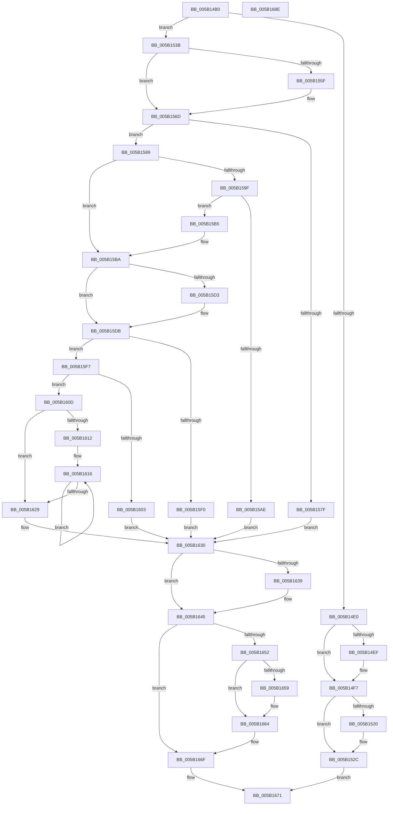

# KeAllocateProcessorProfileStructures

- RVA: `0x005B14B0`–`0x005B168F` (길이 `479` bytes)
- VA: `0x00000001405B14B0`
- 실행 섹션: `.text`
- PDB 이름 있음: `예`; PDB Function 태그: `아니요`
- unwind 정보 RVA: `0x00075C18`
- 디코드: `132`개 명령, `479/479` bytes 표시
- 미해석 바이트: `0` (있으면 어셈블리에 `.byte`로 보존)

> 이 문서는 커널 이미지의 기계어와 PDB 기호를 분석해 생성했습니다. 4번과 5번은 함수 원형과 자료형을 바이너리 사용 방식에서 추정한 C 해석이며 원본 소스 복구 결과는 아닙니다.

## 1. Dependencies

- 직접 호출 지점: **10**; 고유 호출 대상: **8**
- 직접 호출자로 확인된 함수: **1**
- RIP 상대 이미지 참조: **2**

### Outgoing calls
- `0x005B14F2` → [KiRaiseIrqlProcessIrqlFlags](../4F/KiRaiseIrqlProcessIrqlFlags_function_004F56FC.md) (function, `0x004F56FC`)
- `0x005B1527` → [KiLowerIrqlProcessIrqlFlags](../4F/KiLowerIrqlProcessIrqlFlags_function_004F5698.md) (function, `0x004F5698`)
- `0x005B1572` → [MmAllocateIndependentPages](../../page/AA/MmAllocateIndependentPages_function_00AA0CE0.md) (function, `0x00AA0CE0`)
- `0x005B1591` → [memset](../6C/memset_function_006C6C40.md) (function, `0x006C6C40`)
- `0x005B15A5` → [MmCreateShadowMapping](../../page/80/MmCreateShadowMapping_function_00807AB0.md) (function, `0x00807AB0`)
- `0x005B15D6` → [KiRaiseIrqlProcessIrqlFlags](../4F/KiRaiseIrqlProcessIrqlFlags_function_004F56FC.md) (function, `0x004F56FC`)
- `0x005B15E7` → [KiIsIntelPebsSupported](KiIsIntelPebsSupported_function_005B891C.md) (function, `0x005B891C`)
- `0x005B1640` → [KiLowerIrqlProcessIrqlFlags](../4F/KiLowerIrqlProcessIrqlFlags_function_004F5698.md) (function, `0x004F5698`)
- `0x005B165F` → [MmDeleteShadowMapping](../../page/80/MmDeleteShadowMapping_function_00807D00.md) (function, `0x00807D00`)
- `0x005B166A` → [MmFreeIndependentPages](../2A/MmFreeIndependentPages_function_002A2510.md) (function, `0x002A2510`)

### Direct callers
- [EmonCompleteInitializeProfiling](../../pagelk/B5/EmonCompleteInitializeProfiling_function_00B5F0D0.md) at `0x00B5F141`
- [EmonCompleteInitializeProfiling](../../pagelk/B5/EmonCompleteInitializeProfiling_function_00B5F0D0.md) at `0x00B5F16A`

### Static image references
- `0x005B14E7` → RVA `0x00FC6D20` (`ALMOSTRO`; read)
- `0x005B1557` → RVA `0x01201840` (`CFGRO`; read)

## 2. Other-region calls and transfers

- 다른 실행 섹션으로 향하는 call: **3**
  - `0x005B1572` → [MmAllocateIndependentPages](../../page/AA/MmAllocateIndependentPages_function_00AA0CE0.md) (`.text` → `PAGE`)
  - `0x005B15A5` → [MmCreateShadowMapping](../../page/80/MmCreateShadowMapping_function_00807AB0.md) (`.text` → `PAGE`)
  - `0x005B165F` → [MmDeleteShadowMapping](../../page/80/MmDeleteShadowMapping_function_00807D00.md) (`.text` → `PAGE`)
- 별도 외부 분기/꼬리 이동을 확인하지 못했습니다.

## 3. Assembly (complete function range)

```asm
005B14B0  48 89 5C 24 08                  mov qword ptr [rsp + 8], rbx
005B14B5  48 89 6C 24 10                  mov qword ptr [rsp + 0x10], rbp
005B14BA  48 89 74 24 18                  mov qword ptr [rsp + 0x18], rsi
005B14BF  57                              push rdi
005B14C0  41 54                           push r12
005B14C2  41 55                           push r13
005B14C4  41 56                           push r14
005B14C6  41 57                           push r15
005B14C8  48 83 EC 20                     sub rsp, 0x20
005B14CC  49 8B F8                        mov rdi, r8
005B14CF  44 8B E1                        mov r12d, ecx
005B14D2  4C 8B EA                        mov r13, rdx
005B14D5  44 0F 20 C5                     mov rbp, cr8
005B14D9  33 DB                           xor ebx, ebx
005B14DB  45 84 C9                        test r9b, r9b
005B14DE  75 5B                           jne 0x1405b153b
005B14E0  8D 53 02                        lea edx, [rbx + 2]
005B14E3  44 0F 22 C2                     mov cr8, rdx
005B14E7  39 1D 33 58 A1 00               cmp dword ptr [rip + 0xa15833], ebx
005B14ED  74 08                           je 0x1405b14f7
005B14EF  40 8A CD                        mov cl, bpl
005B14F2  E8 05 42 F4 FF                  call 0x1404f56fc
005B14F7  65 48 8B 0C 25 20 00 00 00      mov rcx, qword ptr gs:[0x20]
005B1500  48 8B 07                        mov rax, qword ptr [rdi]
005B1503  48 89 81 98 8E 00 00            mov qword ptr [rcx + 0x8e98], rax
005B150A  48 8B 07                        mov rax, qword ptr [rdi]
005B150D  48 83 C0 28                     add rax, 0x28
005B1511  48 89 81 A0 8E 00 00            mov qword ptr [rcx + 0x8ea0], rax
005B1518  39 1D 02 58 A1 00               cmp dword ptr [rip + 0xa15802], ebx
005B151E  74 0C                           je 0x1405b152c
005B1520  44 0F 20 C1                     mov rcx, cr8
005B1524  40 8A D5                        mov dl, bpl
005B1527  E8 6C 41 F4 FF                  call 0x1404f5698
005B152C  40 0F B6 C5                     movzx eax, bpl
005B1530  44 0F 22 C0                     mov cr8, rax
005B1534  33 C0                           xor eax, eax
005B1536  E9 36 01 00 00                  jmp 0x1405b1671
005B153B  4D 8B FC                        mov r15, r12
005B153E  49 89 18                        mov qword ptr [r8], rbx
005B1541  4D 0F AF FD                     imul r15, r13
005B1545  4B 8D 34 A4                     lea rsi, [r12 + r12*4]
005B1549  88 5C 24 68                     mov byte ptr [rsp + 0x68], bl
005B154D  48 C1 E6 05                     shl rsi, 5
005B1551  4D 8B F4                        mov r14, r12
005B1554  49 03 F7                        add rsi, r15
005B1557  38 1D E3 02 C5 00               cmp byte ptr [rip + 0xc502e3], bl
005B155D  74 0E                           je 0x1405b156d
005B155F  48 81 C6 FF 0F 00 00            add rsi, 0xfff
005B1566  48 81 E6 00 F0 FF FF            and rsi, 0xfffffffffffff000
005B156D  33 D2                           xor edx, edx
005B156F  48 8B CE                        mov rcx, rsi
005B1572  E8 69 F7 4E 00                  call 0x140aa0ce0
005B1577  48 8B D8                        mov rbx, rax
005B157A  48 85 C0                        test rax, rax
005B157D  75 0A                           jne 0x1405b1589
005B157F  BF 17 00 00 C0                  mov edi, 0xc0000017
005B1584  E9 A7 00 00 00                  jmp 0x1405b1630
005B1589  4C 8B C6                        mov r8, rsi
005B158C  33 D2                           xor edx, edx
005B158E  48 8B CB                        mov rcx, rbx
005B1591  E8 AA 56 11 00                  call 0x1406c6c40
005B1596  80 3D A3 02 C5 00 00            cmp byte ptr [rip + 0xc502a3], 0
005B159D  74 1B                           je 0x1405b15ba
005B159F  48 8B D6                        mov rdx, rsi
005B15A2  48 8B CB                        mov rcx, rbx
005B15A5  E8 06 65 25 00                  call 0x140807ab0
005B15AA  85 C0                           test eax, eax
005B15AC  75 07                           jne 0x1405b15b5
005B15AE  BF 9A 00 00 C0                  mov edi, 0xc000009a
005B15B3  EB 7B                           jmp 0x1405b1630
005B15B5  C6 44 24 68 01                  mov byte ptr [rsp + 0x68], 1
005B15BA  4C 03 FB                        add r15, rbx
005B15BD  44 0F 20 C5                     mov rbp, cr8
005B15C1  BA 02 00 00 00                  mov edx, 2
005B15C6  44 0F 22 C2                     mov cr8, rdx
005B15CA  83 3D 4F 57 A1 00 00            cmp dword ptr [rip + 0xa1574f], 0
005B15D1  74 08                           je 0x1405b15db
005B15D3  40 8A CD                        mov cl, bpl
005B15D6  E8 21 41 F4 FF                  call 0x1404f56fc
005B15DB  65 4C 8B 04 25 20 00 00 00      mov r8, qword ptr gs:[0x20]
005B15E4  49 8B C8                        mov rcx, r8
005B15E7  E8 30 73 00 00                  call 0x1405b891c
005B15EC  84 C0                           test al, al
005B15EE  75 07                           jne 0x1405b15f7
005B15F0  BF BB 00 00 C0                  mov edi, 0xc00000bb
005B15F5  EB 39                           jmp 0x1405b1630
005B15F7  49 8B 80 98 8E 00 00            mov rax, qword ptr [r8 + 0x8e98]
005B15FE  48 85 C0                        test rax, rax
005B1601  74 0A                           je 0x1405b160d
005B1603  48 89 07                        mov qword ptr [rdi], rax
005B1606  BF 0A 02 00 C0                  mov edi, 0xc000020a
005B160B  EB 23                           jmp 0x1405b1630
005B160D  45 85 E4                        test r12d, r12d
005B1610  74 17                           je 0x1405b1629
005B1612  49 8D 47 20                     lea rax, [r15 + 0x20]
005B1616  48 89 18                        mov qword ptr [rax], rbx
005B1619  49 03 DD                        add rbx, r13
005B161C  48 8D 80 A0 00 00 00            lea rax, [rax + 0xa0]
005B1623  49 83 EE 01                     sub r14, 1
005B1627  75 ED                           jne 0x1405b1616
005B1629  33 DB                           xor ebx, ebx
005B162B  4C 89 3F                        mov qword ptr [rdi], r15
005B162E  33 FF                           xor edi, edi
005B1630  83 3D E9 56 A1 00 00            cmp dword ptr [rip + 0xa156e9], 0
005B1637  74 0C                           je 0x1405b1645
005B1639  44 0F 20 C1                     mov rcx, cr8
005B163D  40 8A D5                        mov dl, bpl
005B1640  E8 53 40 F4 FF                  call 0x1404f5698
005B1645  40 0F B6 C5                     movzx eax, bpl
005B1649  44 0F 22 C0                     mov cr8, rax
005B164D  48 85 DB                        test rbx, rbx
005B1650  74 1D                           je 0x1405b166f
005B1652  80 7C 24 68 00                  cmp byte ptr [rsp + 0x68], 0
005B1657  74 0B                           je 0x1405b1664
005B1659  48 8B D6                        mov rdx, rsi
005B165C  48 8B CB                        mov rcx, rbx
005B165F  E8 9C 66 25 00                  call 0x140807d00
005B1664  48 8B D6                        mov rdx, rsi
005B1667  48 8B CB                        mov rcx, rbx
005B166A  E8 A1 0E CF FF                  call 0x1402a2510
005B166F  8B C7                           mov eax, edi
005B1671  48 8B 5C 24 50                  mov rbx, qword ptr [rsp + 0x50]
005B1676  48 8B 6C 24 58                  mov rbp, qword ptr [rsp + 0x58]
005B167B  48 8B 74 24 60                  mov rsi, qword ptr [rsp + 0x60]
005B1680  48 83 C4 20                     add rsp, 0x20
005B1684  41 5F                           pop r15
005B1686  41 5E                           pop r14
005B1688  41 5D                           pop r13
005B168A  41 5C                           pop r12
005B168C  5F                              pop rdi
005B168D  C3                              ret
005B168E  CC                              int3
```

## 4. C-style interpretation (structured pseudocode)

```c
__int64 __fastcall KeAllocateProcessorProfileStructures(int a1, __int64 a2, __int64 a3, unsigned __int8 a4)
{
    __int64 result;
    __int64 v_r14;
    __int64 v_r15;
    __int64 v_rbx;
    __int64 v_rdi;
    __int64 v_rsi;
    __int64 v_rsp;
    unsigned __int64 v_stack_p10;
    unsigned __int64 v_stack_p18;
    unsigned __int8 v_stack_p20;
    unsigned __int64 v_stack_p8;

    v_stack_p8 = v_rbx;
    v_stack_p10 = v_rbp;
    v_stack_p18 = v_rsi;
    v_rsp = (v_rsp) - (32);
    v_rbx = 0;
    if (a4 != 0) goto loc_005B153B;
    if ((*(unsigned int *)(v_rip + 10573875)) != 0) {
        a1 = (unsigned __int8)(v_cr8);
        result = KiRaiseIrqlProcessIrqlFlags(a1, v_rbx + 2, a3, a4);
    }
    *(unsigned __int64 *)(*(unsigned __int64 *)(gs_base + (0 + 32)) + 36504) = *(unsigned __int64 *)(a3);
    result = (*(unsigned __int64 *)(a3)) + (40);
    *(unsigned __int64 *)(*(unsigned __int64 *)(gs_base + (0 + 32)) + 36512) = result;
    if ((*(unsigned int *)(v_rip + 10573826)) != 0) {
        a1 = v_rbx + 2;
        a2 = (unsigned __int8)(v_cr8);
        result = KiLowerIrqlProcessIrqlFlags(a1, a2, a3, a4);
    }
    result = 0;
    goto loc_005B1671;
loc_005B153B:
    *(unsigned __int64 *)(a3) = 0;
    v_r15 = ((unsigned int)(a1)) * (a2);
    v_stack_p20 = 0;
    v_rsi = ((unsigned int)(a1) + (unsigned int)(a1) * 4) << (5);
    v_rsi = (v_rsi) + (v_r15);
    if ((*(unsigned __int8 *)(v_rip + 12911331)) != 0) {
        v_rsi = (v_rsi) + (0xFFFULL);
        v_rsi = (v_rsi) & (0xFFFFFFFFFFFFF000ULL);
    }
    a2 = 0;
    result = MmAllocateIndependentPages(v_rsi, a2, a3, a4);
    if (result != 0) goto loc_005B1589;
    goto loc_005B1630;
loc_005B1589:
    a2 = 0;
    result = memset(result, a2, v_rsi, a4);
    if ((*(unsigned __int8 *)(v_rip + 12911267)) == 0) goto loc_005B15BA;
    result = MmCreateShadowMapping(result, v_rsi, v_rsi, a4);
    if ((unsigned int)(result) != 0) goto loc_005B15B5;
    goto loc_005B1630;
loc_005B15B5:
    v_stack_p20 = 1;
loc_005B15BA:
    v_r15 = (v_r15) + (result);
    if ((*(unsigned int *)(v_rip + 10573647)) != 0) {
        a1 = (unsigned __int8)((unsigned __int8)(v_cr8));
        result = KiRaiseIrqlProcessIrqlFlags(a1, 2, v_rsi, a4);
    }
    result = KiIsIntelPebsSupported(*(unsigned __int64 *)(gs_base + (0 + 32)), 2, *(unsigned __int64 *)(gs_base + (0 + 32)), a4);
    if ((unsigned __int8)(result) != 0) goto loc_005B15F7;
    goto loc_005B1630;
loc_005B15F7:
    if (*(unsigned __int64 *)(*(unsigned __int64 *)(gs_base + (0 + 32)) + 36504) == 0) goto loc_005B160D;
    *(unsigned __int64 *)((unsigned int)(0xC00000BBULL)) = *(unsigned __int64 *)(*(unsigned __int64 *)(gs_base + (0 + 32)) + 36504);
    goto loc_005B1630;
loc_005B160D:
    if ((unsigned int)((unsigned int)(a1)) == 0) goto loc_005B1629;
loc_005B1616:
    *(unsigned __int64 *)(v_r15 + 32) = result;
    v_rbx = (result) + (0);
    v_r14 = ((unsigned int)(a1)) - (1);
    if (condition_is_not_equal) goto loc_005B1616;
loc_005B1629:
    v_rbx = 0;
    *(unsigned __int64 *)((unsigned int)(0xC000020AULL)) = v_r15;
    v_rdi = 0;
loc_005B1630:
    result = v_r15 + 32 + 160;
    if ((*(unsigned int *)(v_rip + 10573545)) != 0) {
        a1 = 2;
        a2 = (unsigned __int8)((unsigned __int8)(v_cr8));
        result = KiLowerIrqlProcessIrqlFlags(a1, a2, *(unsigned __int64 *)(gs_base + (0 + 32)), a4);
    }
    if (0 == 0) goto loc_005B166F;
    result = (unsigned __int8)((unsigned __int8)(v_cr8));
    if (v_stack_p20 != 0) {
        a2 = v_rsi;
        a1 = 0;
        result = MmDeleteShadowMapping(a1, a2, *(unsigned __int64 *)(gs_base + (0 + 32)), a4);
    }
    result = MmFreeIndependentPages(0, v_rsi, *(unsigned __int64 *)(gs_base + (0 + 32)), a4);
loc_005B166F:
loc_005B1671:
    v_rsp = (v_rsp) + (32);
    return 0;
}
```

## 5. (Beta) C Style

```c
int64_t KeAllocateProcessorProfileStructures(void *Arg1, int64_t Arg2, void *Arg3, uint8_t Arg4)
{
    uint8_t *arg1 = (uint8_t *)Arg1;
    uint8_t *arg3 = (uint8_t *)Arg3;

    int64_t result;
    int64_t local_r14;
    int64_t local_r15;
    int64_t local_rbx;
    int64_t local_rdi;
    int64_t local_rsi;
    int64_t local_rsp;
    uint64_t v_stack_p10;
    uint64_t v_stack_p18;
    uint8_t v_stack_p20;
    uint64_t v_stack_p8;

    v_stack_p8 = local_rbx;
    v_stack_p10 = local_rbp;
    v_stack_p18 = local_rsi;
    local_rsp = (local_rsp) - (32);
    local_rbx = 0;
    if (Arg4 != 0) goto loc_005B153B;
    if ((*(uint32_t *)(v_rip + 0xA15833)) != 0) {
        Arg1 = (uint8_t)(v_cr8);
        result = KiRaiseIrqlProcessIrqlFlags(Arg1, local_rbx + 2, Arg3, Arg4);
    }
    *(uint64_t *)(*(uint64_t *)(gs_base + (0 + 0x20)) + 0x8E98) = *(uint64_t *)(arg3);
    result = (*(uint64_t *)(arg3)) + (40);
    *(uint64_t *)(*(uint64_t *)(gs_base + (0 + 0x20)) + 0x8EA0) = result;
    if ((*(uint32_t *)(v_rip + 0xA15802)) != 0) {
        Arg1 = local_rbx + 2;
        Arg2 = (uint8_t)(v_cr8);
        result = KiLowerIrqlProcessIrqlFlags(Arg1, Arg2, Arg3, Arg4);
    }
    result = 0;
    goto loc_005B1671;
loc_005B153B:
    *(uint64_t *)(arg3) = 0;
    local_r15 = ((uint32_t)(Arg1)) * (Arg2);
    v_stack_p20 = 0;
    local_rsi = ((uint32_t)(Arg1) + (uint32_t)(Arg1) * 4) << (5);
    local_rsi = (local_rsi) + (local_r15);
    if ((*(uint8_t *)(v_rip + 0xC502E3)) != 0) {
        local_rsi = (local_rsi) + (0xFFFULL);
        local_rsi = (local_rsi) & (0xFFFFFFFFFFFFF000ULL);
    }
    Arg2 = 0;
    result = MmAllocateIndependentPages(local_rsi, Arg2, Arg3, Arg4);
    if (result != 0) goto loc_005B1589;
    goto loc_005B1630;
loc_005B1589:
    Arg2 = 0;
    result = memset(result, Arg2, local_rsi, Arg4);
    if ((*(uint8_t *)(v_rip + 0xC502A3)) == 0) goto loc_005B15BA;
    result = MmCreateShadowMapping(result, local_rsi, local_rsi, Arg4);
    if ((uint32_t)(result) != 0) goto loc_005B15B5;
    goto loc_005B1630;
loc_005B15B5:
    v_stack_p20 = 1;
loc_005B15BA:
    local_r15 = (local_r15) + (result);
    if ((*(uint32_t *)(v_rip + 0xA1574F)) != 0) {
        Arg1 = (uint8_t)((uint8_t)(v_cr8));
        result = KiRaiseIrqlProcessIrqlFlags(Arg1, 2, local_rsi, Arg4);
    }
    result = KiIsIntelPebsSupported(*(uint64_t *)(gs_base + (0 + 0x20)), 2, *(uint64_t *)(gs_base + (0 + 0x20)), Arg4);
    if ((uint8_t)(result) != 0) goto loc_005B15F7;
    goto loc_005B1630;
loc_005B15F7:
    if (*(uint64_t *)(*(uint64_t *)(gs_base + (0 + 0x20)) + 0x8E98) == 0) goto loc_005B160D;
    *(uint64_t *)((uint32_t)(0xC00000BBULL)) = *(uint64_t *)(*(uint64_t *)(gs_base + (0 + 0x20)) + 0x8E98);
    goto loc_005B1630;
loc_005B160D:
    if ((uint32_t)((uint32_t)(Arg1)) == 0) goto loc_005B1629;
loc_005B1616:
    *(uint64_t *)(local_r15 + 0x20) = result;
    local_rbx = (result) + (0);
    local_r14 = ((uint32_t)(Arg1)) - (1);
    if (condition_is_not_equal) goto loc_005B1616;
loc_005B1629:
    local_rbx = 0;
    *(uint64_t *)((uint32_t)(0xC000020AULL)) = local_r15;
    local_rdi = 0;
loc_005B1630:
    result = local_r15 + 32 + 160;
    if ((*(uint32_t *)(v_rip + 0xA156E9)) != 0) {
        Arg1 = 2;
        Arg2 = (uint8_t)((uint8_t)(v_cr8));
        result = KiLowerIrqlProcessIrqlFlags(Arg1, Arg2, *(uint64_t *)(gs_base + (0 + 0x20)), Arg4);
    }
    if (0 == 0) goto loc_005B166F;
    result = (uint8_t)((uint8_t)(v_cr8));
    if (v_stack_p20 != 0) {
        Arg2 = local_rsi;
        Arg1 = 0;
        result = MmDeleteShadowMapping(Arg1, Arg2, *(uint64_t *)(gs_base + (0 + 0x20)), Arg4);
    }
    result = MmFreeIndependentPages(0, local_rsi, *(uint64_t *)(gs_base + (0 + 0x20)), Arg4);
loc_005B166F:
loc_005B1671:
    local_rsp = (local_rsp) + (32);
    return 0;
}
```

### 관측된 메모리 오프셋

구조체 형식이 확인되지 않은 접근은 인자 기준의 오프셋으로만 기록했습니다.

| 기준 인자 | 오프셋 표현 | 폭 (bit) | 접근 |
|---|---:|---:|---|
| `Arg1` | `+ 0x0` | `64` | `W` |
| `Arg1` | `+ 0x0 + r12*4` | `64` | `R` |
| `Arg1` | `+ 0x20` | `64` | `R` |
| `Arg1` | `+ 0xA0` | `64` | `R` |
| `Arg3` | `+ 0x0` | `64` | `R` |
| `Arg3` | `+ 0x0` | `64` | `W` |

## 6. Execution-region graph

[열기: 2D/3D 그래프와 함수 탐색 컨트롤 패널](../../../control-panel.html?section=text&rva=0x005B14B0&view=graph)

- 2D 그래프는 위에서 아래로 흐르고, 3D 그래프는 빈 공간을 드래그해 회전합니다. Shift+드래그는 이동, 휠은 확대·축소, 함수 노드 선택은 대상 보고서 이동입니다.

### Static fallback


