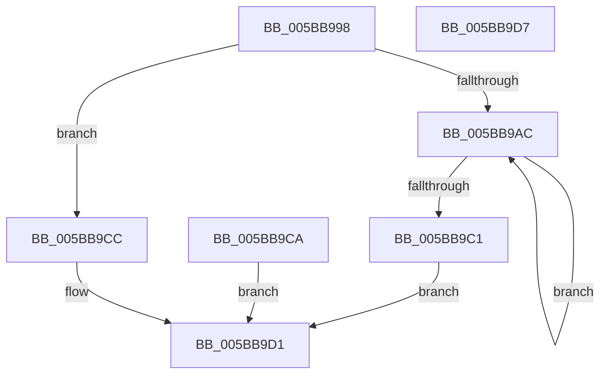

# KeBlockEnclavePage

- RVA: `0x005BB998`–`0x005BB9D8` (길이 `64` bytes)
- VA: `0x00000001405BB998`
- 실행 섹션: `.text`
- PDB 이름 있음: `예`; PDB Function 태그: `아니요`
- unwind 정보 RVA: `0x000CA2D0`
- 디코드: `21`개 명령, `64/64` bytes 표시
- 미해석 바이트: `0` (있으면 어셈블리에 `.byte`로 보존)

> 이 문서는 커널 이미지의 기계어와 PDB 기호를 분석해 생성했습니다. 4번과 5번은 함수 원형과 자료형을 바이너리 사용 방식에서 추정한 C 해석이며 원본 소스 복구 결과는 아닙니다.

## 1. Dependencies

- 직접 호출 지점: **2**; 고유 호출 대상: **2**
- 직접 호출자로 확인된 함수: **1**
- RIP 상대 이미지 참조: **1**

### Outgoing calls
- `0x005BB9B7` → [KiEncls](../6B/KiEncls_function_006B1BE0.md) (function, `0x006B1BE0`)
- `0x005BB9C3` → [KiEnclsStatus](../36/KiEnclsStatus_function_00368E1C.md) (function, `0x00368E1C`)

### Direct callers
- [sub_006E362E](../6E/Unknown_function_006E362E.md) at `0x006E38A7`

### Static image references
- `0x005BB9A1` → RVA `0x00FC6B30` (`ALMOSTRO`; read)

## 2. Other-region calls and transfers

- 다른 실행 섹션으로 향하는 call: **0**
- 별도 외부 분기/꼬리 이동을 확인하지 못했습니다.

## 3. Assembly (complete function range)

```asm
005BB998  40 53                           push rbx
005BB99A  48 83 EC 20                     sub rsp, 0x20
005BB99E  48 8B D9                        mov rbx, rcx
005BB9A1  48 0F BA 25 86 B1 A0 00 28      bt qword ptr [rip + 0xa0b186], 0x28
005BB9AA  73 20                           jae 0x1405bb9cc
005BB9AC  45 33 C9                        xor r9d, r9d
005BB9AF  4C 8B C3                        mov r8, rbx
005BB9B2  33 D2                           xor edx, edx
005BB9B4  8D 4A 09                        lea ecx, [rdx + 9]
005BB9B7  E8 24 62 0F 00                  call 0x1406b1be0
005BB9BC  83 F8 0F                        cmp eax, 0xf
005BB9BF  74 EB                           je 0x1405bb9ac
005BB9C1  8B C8                           mov ecx, eax
005BB9C3  E8 54 D4 DA FF                  call 0x140368e1c
005BB9C8  EB 07                           jmp 0x1405bb9d1
005BB9CA  EB 05                           jmp 0x1405bb9d1
005BB9CC  B8 BB 00 00 C0                  mov eax, 0xc00000bb
005BB9D1  48 83 C4 20                     add rsp, 0x20
005BB9D5  5B                              pop rbx
005BB9D6  C3                              ret
005BB9D7  CC                              int3
```

## 4. C-style interpretation (structured pseudocode)

```c
__int64 __fastcall KeBlockEnclavePage(__int64 a1, int a2, __int64 a3, int a4)
{
    __int64 result;
    __int64 v_rsp;

    v_rsp = (v_rsp) - (32);
    if (condition_is_above_or_equal) goto loc_005BB9CC;
loc_005BB9AC:
    a4 = 0;
    a2 = 0;
    result = KiEncls(a2 + 9, a2, a1, a4);
    if (((unsigned int)(result)) == 15) goto loc_005BB9AC;
    result = KiEnclsStatus((unsigned int)((unsigned int)(result)), a2, a1, a4);
    goto loc_005BB9D1;
loc_005BB9CC:
loc_005BB9D1:
    v_rsp = (v_rsp) + (32);
    return (unsigned int)(0xC00000BBULL);
}
```

## 5. (Beta) C Style

```c
int64_t KeBlockEnclavePage(int64_t Arg1, int32_t Arg2, int64_t Arg3, int32_t Arg4)
{
    int64_t result;
    int64_t local_rsp;

    local_rsp = (local_rsp) - (32);
    if (condition_is_above_or_equal) goto loc_005BB9CC;
loc_005BB9AC:
    Arg4 = 0;
    Arg2 = 0;
    result = KiEncls(Arg2 + 9, Arg2, Arg1, Arg4);
    if (((uint32_t)(result)) == 15) goto loc_005BB9AC;
    result = KiEnclsStatus((uint32_t)((uint32_t)(result)), Arg2, Arg1, Arg4);
    goto loc_005BB9D1;
loc_005BB9CC:
loc_005BB9D1:
    local_rsp = (local_rsp) + (32);
    return (uint32_t)(0xC00000BBULL);
}
```

## 6. Execution-region graph

[열기: 2D/3D 그래프와 함수 탐색 컨트롤 패널](../../../control-panel.html?section=text&rva=0x005BB998&view=graph)

- 2D 그래프는 위에서 아래로 흐르고, 3D 그래프는 빈 공간을 드래그해 회전합니다. Shift+드래그는 이동, 휠은 확대·축소, 함수 노드 선택은 대상 보고서 이동입니다.

### Static fallback


