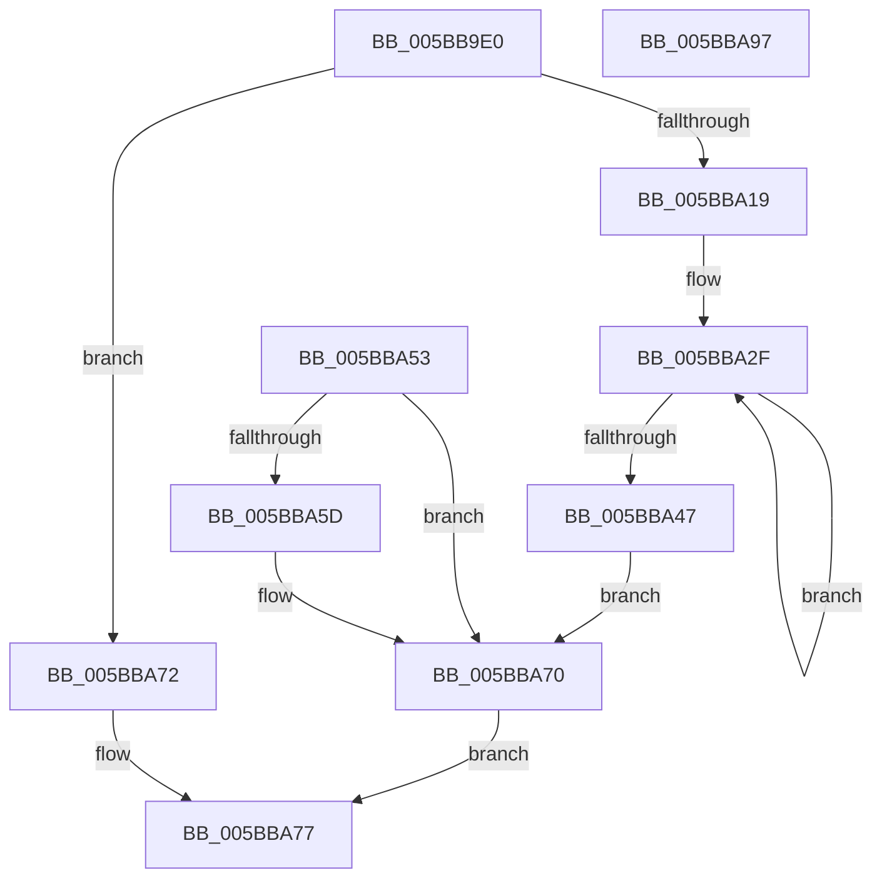

# KeCanChangeEnclavePageProtection

- RVA: `0x005BB9E0`–`0x005BBA98` (길이 `184` bytes)
- VA: `0x00000001405BB9E0`
- 실행 섹션: `.text`
- PDB 이름 있음: `예`; PDB Function 태그: `아니요`
- unwind 정보 RVA: `0x000CA21C`
- 디코드: `45`개 명령, `184/184` bytes 표시
- 미해석 바이트: `0` (있으면 어셈블리에 `.byte`로 보존)

> 이 문서는 커널 이미지의 기계어와 PDB 기호를 분석해 생성했습니다. 4번과 5번은 함수 원형과 자료형을 바이너리 사용 방식에서 추정한 C 해석이며 원본 소스 복구 결과는 아닙니다.

## 1. Dependencies

- 직접 호출 지점: **4**; 고유 호출 대상: **4**
- 직접 호출자로 확인된 함수: **1**
- RIP 상대 이미지 참조: **2**

### Outgoing calls
- `0x005BBA23` → [memset](../6C/memset_function_006C6C40.md) (function, `0x006C6C40`)
- `0x005BBA3D` → [KiEncls](../6B/KiEncls_function_006B1BE0.md) (function, `0x006B1BE0`)
- `0x005BBA49` → [KiEnclsStatus](../36/KiEnclsStatus_function_00368E1C.md) (function, `0x00368E1C`)
- `0x005BBA81` → [_security_check_cookie](../6A/_security_check_cookie_function_006AC640.md) (function, `0x006AC640`)

### Direct callers
- [MiProtectEnclavePages](../4D/MiProtectEnclavePages_function_004D5528.md) at `0x004D5A02`

### Static image references
- `0x005BB9FA` → RVA `0x00E0A740` (`.data`; read)
- `0x005BBA0E` → RVA `0x00FC6B30` (`ALMOSTRO`; read)

## 2. Other-region calls and transfers

- 다른 실행 섹션으로 향하는 call: **0**
- 별도 외부 분기/꼬리 이동을 확인하지 못했습니다.

## 3. Assembly (complete function range)

```asm
005BB9E0  48 89 5C 24 18                  mov qword ptr [rsp + 0x18], rbx
005BB9E5  89 54 24 10                     mov dword ptr [rsp + 0x10], edx
005BB9E9  55                              push rbp
005BB9EA  48 81 EC F0 00 00 00            sub rsp, 0xf0
005BB9F1  48 8D 6C 24 60                  lea rbp, [rsp + 0x60]
005BB9F6  48 83 E5 C0                     and rbp, 0xffffffffffffffc0
005BB9FA  48 8B 05 3F ED 84 00            mov rax, qword ptr [rip + 0x84ed3f]
005BBA01  48 33 C4                        xor rax, rsp
005BBA04  48 89 85 80 00 00 00            mov qword ptr [rbp + 0x80], rax
005BBA0B  48 8B D9                        mov rbx, rcx
005BBA0E  48 0F BA 25 19 B1 A0 00 2B      bt qword ptr [rip + 0xa0b119], 0x2b
005BBA17  73 59                           jae 0x1405bba72
005BBA19  33 D2                           xor edx, edx
005BBA1B  44 8D 42 40                     lea r8d, [rdx + 0x40]
005BBA1F  48 8D 4D 40                     lea rcx, [rbp + 0x40]
005BBA23  E8 18 B2 10 00                  call 0x1406c6c40
005BBA28  C7 45 40 07 00 00 00            mov dword ptr [rbp + 0x40], 7
005BBA2F  45 33 C9                        xor r9d, r9d
005BBA32  4C 8B C3                        mov r8, rbx
005BBA35  48 8D 55 40                     lea rdx, [rbp + 0x40]
005BBA39  41 8D 49 0E                     lea ecx, [r9 + 0xe]
005BBA3D  E8 9E 61 0F 00                  call 0x1406b1be0
005BBA42  83 F8 0F                        cmp eax, 0xf
005BBA45  74 E8                           je 0x1405bba2f
005BBA47  8B C8                           mov ecx, eax
005BBA49  E8 CE D3 DA FF                  call 0x140368e1c
005BBA4E  89 45 00                        mov dword ptr [rbp], eax
005BBA51  EB 1D                           jmp 0x1405bba70
005BBA53  89 45 00                        mov dword ptr [rbp], eax
005BBA56  3D A2 04 00 C0                  cmp eax, 0xc00004a2
005BBA5B  75 13                           jne 0x1405bba70
005BBA5D  F6 84 24 08 01 00 00 80         test byte ptr [rsp + 0x108], 0x80
005BBA65  B9 00 00 00 00                  mov ecx, 0
005BBA6A  0F 45 C1                        cmovne eax, ecx
005BBA6D  89 45 00                        mov dword ptr [rbp], eax
005BBA70  EB 05                           jmp 0x1405bba77
005BBA72  B8 BB 00 00 C0                  mov eax, 0xc00000bb
005BBA77  48 8B 8D 80 00 00 00            mov rcx, qword ptr [rbp + 0x80]
005BBA7E  48 33 CC                        xor rcx, rsp
005BBA81  E8 BA 0B 0F 00                  call 0x1406ac640
005BBA86  48 8B 9C 24 10 01 00 00         mov rbx, qword ptr [rsp + 0x110]
005BBA8E  48 81 C4 F0 00 00 00            add rsp, 0xf0
005BBA95  5D                              pop rbp
005BBA96  C3                              ret
005BBA97  CC                              int3
```

## 4. C-style interpretation (structured pseudocode)

```c
__int64 __fastcall KeCanChangeEnclavePageProtection(__int64 a1, int a2, __int64 a3, int a4)
{
    __int64 result;
    __int64 v_rbp;
    __int64 v_rsp;
    unsigned __int64 v_stack_m18;
    unsigned __int64 v_stack_m58;
    unsigned __int64 v_stack_m98;
    unsigned int v_stack_p10;
    unsigned __int64 v_stack_p18;

    v_stack_p18 = v_rbx;
    v_stack_p10 = a2;
    v_rsp = (v_rsp) - (240);
    v_rbp = (v_stack_m98) & (-64);
    result = (*(unsigned __int64 *)(v_rip + 8711487)) ^ (v_rsp);
    v_stack_m18 = result;
    if (condition_is_above_or_equal) goto loc_005BBA72;
    a2 = 0;
    result = memset(v_stack_m58, a2, a2 + 64, a4);
    v_stack_m58 = 7;
loc_005BBA2F:
    a4 = 0;
    result = KiEncls(a4 + 14, v_stack_m58, a1, a4);
    if (((unsigned int)(result)) == 15) goto loc_005BBA2F;
    result = KiEnclsStatus((unsigned int)((unsigned int)(result)), v_stack_m58, a1, a4);
    v_stack_m98 = (unsigned int)(result);
    goto loc_005BBA70;
loc_005BBA70:
    goto loc_005BBA77;
loc_005BBA72:
loc_005BBA77:
    a1 = (v_stack_m18) ^ (v_rsp);
    result = _security_check_cookie(a1, v_stack_m58, a1, a4);
    v_rsp = (v_rsp) + (240);
    return result;
}
```

## 5. (Beta) C Style

```c
int64_t KeCanChangeEnclavePageProtection(int64_t Arg1, int32_t Arg2, int64_t Arg3, int32_t Arg4)
{
    int64_t result;
    int64_t local_rbp;
    int64_t local_rsp;
    uint64_t v_stack_m18;
    uint64_t v_stack_m58;
    uint64_t v_stack_m98;
    uint32_t v_stack_p10;
    uint64_t v_stack_p18;

    v_stack_p18 = local_rbx;
    v_stack_p10 = Arg2;
    local_rsp = (local_rsp) - (240);
    local_rbp = (v_stack_m98) & (-64);
    result = (*(uint64_t *)(v_rip + 0x84ED3F)) ^ (local_rsp);
    v_stack_m18 = result;
    if (condition_is_above_or_equal) goto loc_005BBA72;
    Arg2 = 0;
    result = memset(v_stack_m58, Arg2, Arg2 + 64, Arg4);
    v_stack_m58 = 7;
loc_005BBA2F:
    Arg4 = 0;
    result = KiEncls(Arg4 + 14, v_stack_m58, Arg1, Arg4);
    if (((uint32_t)(result)) == 15) goto loc_005BBA2F;
    result = KiEnclsStatus((uint32_t)((uint32_t)(result)), v_stack_m58, Arg1, Arg4);
    v_stack_m98 = (uint32_t)(result);
    goto loc_005BBA70;
loc_005BBA70:
    goto loc_005BBA77;
loc_005BBA72:
loc_005BBA77:
    Arg1 = (v_stack_m18) ^ (local_rsp);
    result = _security_check_cookie(Arg1, v_stack_m58, Arg1, Arg4);
    local_rsp = (local_rsp) + (240);
    return result;
}
```

## 6. Execution-region graph

[열기: 2D/3D 그래프와 함수 탐색 컨트롤 패널](../../../control-panel.html?section=text&rva=0x005BB9E0&view=graph)

- 2D 그래프는 위에서 아래로 흐르고, 3D 그래프는 빈 공간을 드래그해 회전합니다. Shift+드래그는 이동, 휠은 확대·축소, 함수 노드 선택은 대상 보고서 이동입니다.

### Static fallback


