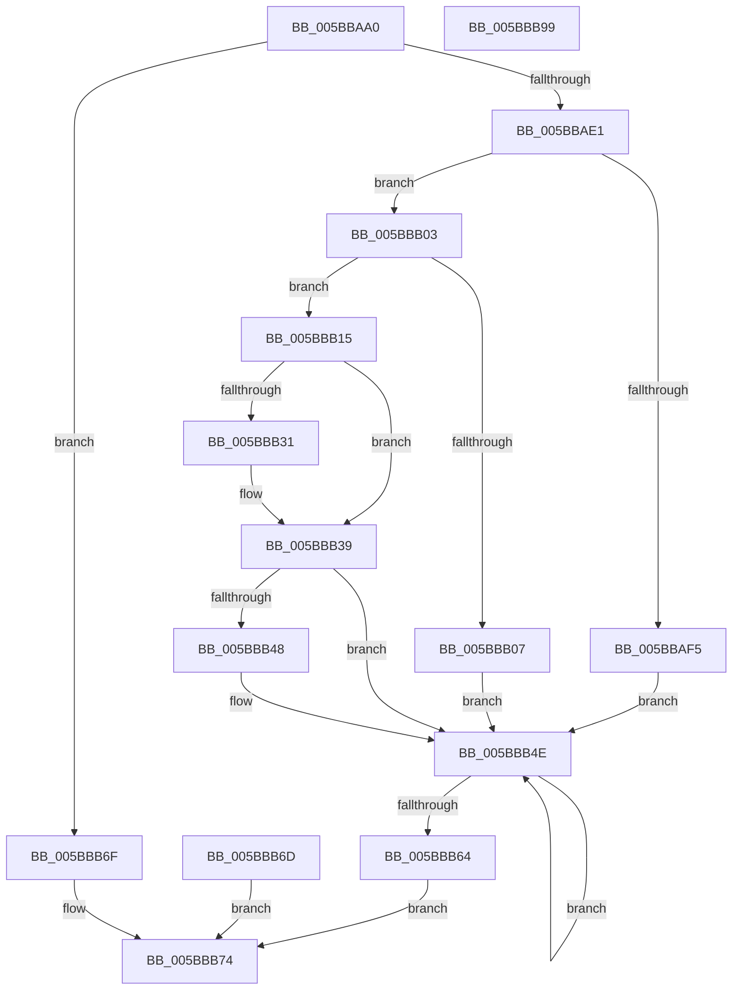

# KeChangeEnclavePageProtection

- RVA: `0x005BBAA0`–`0x005BBB9A` (길이 `250` bytes)
- VA: `0x00000001405BBAA0`
- 실행 섹션: `.text`
- PDB 이름 있음: `예`; PDB Function 태그: `아니요`
- unwind 정보 RVA: `0x000CA1DC`
- 디코드: `73`개 명령, `250/250` bytes 표시
- 미해석 바이트: `0` (있으면 어셈블리에 `.byte`로 보존)

> 이 문서는 커널 이미지의 기계어와 PDB 기호를 분석해 생성했습니다. 4번과 5번은 함수 원형과 자료형을 바이너리 사용 방식에서 추정한 C 해석이며 원본 소스 복구 결과는 아닙니다.

## 1. Dependencies

- 직접 호출 지점: **4**; 고유 호출 대상: **4**
- 직접 호출자로 확인된 함수: **1**
- RIP 상대 이미지 참조: **2**

### Outgoing calls
- `0x005BBAEB` → [memset](../6C/memset_function_006C6C40.md) (function, `0x006C6C40`)
- `0x005BBB5A` → [KiEncls](../6B/KiEncls_function_006B1BE0.md) (function, `0x006B1BE0`)
- `0x005BBB66` → [KiEnclsStatus](../36/KiEnclsStatus_function_00368E1C.md) (function, `0x00368E1C`)
- `0x005BBB7B` → [_security_check_cookie](../6A/_security_check_cookie_function_006AC640.md) (function, `0x006AC640`)

### Direct callers
- [MiProtectEnclavePages](../4D/MiProtectEnclavePages_function_004D5528.md) at `0x004D5AA5`

### Static image references
- `0x005BBABF` → RVA `0x00E0A740` (`.data`; read)
- `0x005BBAD2` → RVA `0x00FC6B30` (`ALMOSTRO`; read)

## 2. Other-region calls and transfers

- 다른 실행 섹션으로 향하는 call: **0**
- 별도 외부 분기/꼬리 이동을 확인하지 못했습니다.

## 3. Assembly (complete function range)

```asm
005BBAA0  48 8B C4                        mov rax, rsp
005BBAA3  48 89 58 10                     mov qword ptr [rax + 0x10], rbx
005BBAA7  48 89 70 18                     mov qword ptr [rax + 0x18], rsi
005BBAAB  48 89 78 20                     mov qword ptr [rax + 0x20], rdi
005BBAAF  55                              push rbp
005BBAB0  48 81 EC B0 00 00 00            sub rsp, 0xb0
005BBAB7  48 8D 68 A8                     lea rbp, [rax - 0x58]
005BBABB  48 83 E5 C0                     and rbp, 0xffffffffffffffc0
005BBABF  48 8B 05 7A EC 84 00            mov rax, qword ptr [rip + 0x84ec7a]
005BBAC6  48 33 C4                        xor rax, rsp
005BBAC9  48 89 45 40                     mov qword ptr [rbp + 0x40], rax
005BBACD  8B DA                           mov ebx, edx
005BBACF  48 8B F1                        mov rsi, rcx
005BBAD2  48 0F BA 25 55 B0 A0 00 2B      bt qword ptr [rip + 0xa0b055], 0x2b
005BBADB  0F 83 8E 00 00 00               jae 0x1405bbb6f
005BBAE1  33 D2                           xor edx, edx
005BBAE3  44 8D 42 40                     lea r8d, [rdx + 0x40]
005BBAE7  48 8D 4D 00                     lea rcx, [rbp]
005BBAEB  E8 50 B1 10 00                  call 0x1406c6c40
005BBAF0  F6 C3 08                        test bl, 8
005BBAF3  74 0E                           je 0x1405bbb03
005BBAF5  BF 0F 00 00 00                  mov edi, 0xf
005BBAFA  C7 45 00 00 01 00 00            mov dword ptr [rbp], 0x100
005BBB01  EB 4B                           jmp 0x1405bbb4e
005BBB03  84 DB                           test bl, bl
005BBB05  79 0E                           jns 0x1405bbb15
005BBB07  BF 0F 00 00 00                  mov edi, 0xf
005BBB0C  C7 45 00 00 04 00 00            mov dword ptr [rbp], 0x400
005BBB13  EB 39                           jmp 0x1405bbb4e
005BBB15  BF 0E 00 00 00                  mov edi, 0xe
005BBB1A  8B CB                           mov ecx, ebx
005BBB1C  8D 57 F3                        lea edx, [rdi - 0xd]
005BBB1F  23 CA                           and ecx, edx
005BBB21  8B 45 00                        mov eax, dword ptr [rbp]
005BBB24  0F 45 C2                        cmovne eax, edx
005BBB27  89 45 00                        mov dword ptr [rbp], eax
005BBB2A  8B D3                           mov edx, ebx
005BBB2C  83 E2 02                        and edx, 2
005BBB2F  74 08                           je 0x1405bbb39
005BBB31  8B C1                           mov eax, ecx
005BBB33  83 C8 02                        or eax, 2
005BBB36  89 45 00                        mov dword ptr [rbp], eax
005BBB39  8B C1                           mov eax, ecx
005BBB3B  83 C8 02                        or eax, 2
005BBB3E  85 D2                           test edx, edx
005BBB40  0F 44 C1                        cmove eax, ecx
005BBB43  F6 C3 04                        test bl, 4
005BBB46  74 06                           je 0x1405bbb4e
005BBB48  83 C8 04                        or eax, 4
005BBB4B  89 45 00                        mov dword ptr [rbp], eax
005BBB4E  45 33 C9                        xor r9d, r9d
005BBB51  4C 8B C6                        mov r8, rsi
005BBB54  48 8D 55 00                     lea rdx, [rbp]
005BBB58  8B CF                           mov ecx, edi
005BBB5A  E8 81 60 0F 00                  call 0x1406b1be0
005BBB5F  83 F8 0F                        cmp eax, 0xf
005BBB62  74 EA                           je 0x1405bbb4e
005BBB64  8B C8                           mov ecx, eax
005BBB66  E8 B1 D2 DA FF                  call 0x140368e1c
005BBB6B  EB 07                           jmp 0x1405bbb74
005BBB6D  EB 05                           jmp 0x1405bbb74
005BBB6F  B8 BB 00 00 C0                  mov eax, 0xc00000bb
005BBB74  48 8B 4D 40                     mov rcx, qword ptr [rbp + 0x40]
005BBB78  48 33 CC                        xor rcx, rsp
005BBB7B  E8 C0 0A 0F 00                  call 0x1406ac640
005BBB80  4C 8D 9C 24 B0 00 00 00         lea r11, [rsp + 0xb0]
005BBB88  49 8B 5B 18                     mov rbx, qword ptr [r11 + 0x18]
005BBB8C  49 8B 73 20                     mov rsi, qword ptr [r11 + 0x20]
005BBB90  49 8B 7B 28                     mov rdi, qword ptr [r11 + 0x28]
005BBB94  49 8B E3                        mov rsp, r11
005BBB97  5D                              pop rbp
005BBB98  C3                              ret
005BBB99  CC                              int3
```

## 4. C-style interpretation (structured pseudocode)

```c
__int64 __fastcall KeChangeEnclavePageProtection(__int64 a1, int a2, __int64 a3, int a4)
{
    __int64 result;
    __int64 v_rbp;
    __int64 v_rsp;
    unsigned __int64 v_stack_m8;

    *(unsigned __int64 *)(v_rsp + 16) = v_rbx;
    *(unsigned __int64 *)(v_rsp + 24) = v_rsi;
    *(unsigned __int64 *)(v_rsp + 32) = v_rdi;
    v_rsp = (v_rsp) - (176);
    v_rbp = (v_rsp - 88) & (-64);
    result = (*(unsigned __int64 *)(v_rip + 8711290)) ^ (v_rsp);
    *(unsigned __int64 *)(v_rbp + 64) = result;
    if (condition_is_above_or_equal) goto loc_005BBB6F;
    a2 = 0;
    result = memset(v_rbp, a2, a2 + 64, a4);
    if ((((unsigned __int8)((unsigned int)(a2))) & (8)) == 0) goto loc_005BBB03;
    *(unsigned int *)(v_rbp) = 256;
    goto loc_005BBB4E;
loc_005BBB03:
    if (!sign_flag) goto loc_005BBB15;
    *(unsigned int *)(v_rbp) = 0x400ULL;
    goto loc_005BBB4E;
loc_005BBB15:
    a1 = (unsigned int)(((unsigned int)((unsigned int)((unsigned int)(a2)))) & ((unsigned int)(14 - 13)));
    result = (unsigned int)(*(unsigned int *)(v_rbp));
    if (condition_is_not_equal) { result = (unsigned int)(14 - 13); }
    *(unsigned int *)(v_rbp) = (unsigned int)(result);
    a2 = (unsigned int)(((unsigned int)((unsigned int)((unsigned int)(a2)))) & (2));
    if (!(condition_is_equal)) {
        result = (unsigned int)(a1);
        result = (unsigned int)((result) | (2));
        *(unsigned int *)(v_rbp) = (unsigned int)(result);
    }
    result = (unsigned int)(((unsigned int)((unsigned int)(a1))) | (2));
    if (a2 == 0) { result = (unsigned int)(a1); }
    if ((((unsigned __int8)((unsigned int)(a2))) & (4)) != 0) {
        result = (unsigned int)((result) | (4));
        *(unsigned int *)(v_rbp) = (unsigned int)(result);
    }
    a4 = 0;
    result = KiEncls(14, v_rbp, a1, a4);
    if (((unsigned int)(result)) == 15) goto loc_005BBB4E;
    result = KiEnclsStatus((unsigned int)((unsigned int)(result)), v_rbp, a1, a4);
    goto loc_005BBB74;
loc_005BBB6F:
loc_005BBB74:
    a1 = (*(unsigned __int64 *)(v_rbp + 64)) ^ (v_rsp);
    result = _security_check_cookie(a1, v_rbp, a1, a4);
    return result;
}
```

## 5. (Beta) C Style

```c
int64_t KeChangeEnclavePageProtection(int64_t Arg1, int32_t Arg2, int64_t Arg3, int32_t Arg4)
{
    int64_t result;
    int64_t local_rbp;
    int64_t local_rsp;
    uint64_t v_stack_m8;

    *(uint64_t *)(local_rsp + 0x10) = local_rbx;
    *(uint64_t *)(local_rsp + 0x18) = local_rsi;
    *(uint64_t *)(local_rsp + 0x20) = local_rdi;
    local_rsp = (local_rsp) - (176);
    local_rbp = (local_rsp - 88) & (-64);
    result = (*(uint64_t *)(v_rip + 0x84EC7A)) ^ (local_rsp);
    *(uint64_t *)(local_rbp + 0x40) = result;
    if (condition_is_above_or_equal) goto loc_005BBB6F;
    Arg2 = 0;
    result = memset(local_rbp, Arg2, Arg2 + 64, Arg4);
    if ((((uint8_t)((uint32_t)(Arg2))) & (8)) == 0) goto loc_005BBB03;
    *(uint32_t *)(local_rbp) = 256;
    goto loc_005BBB4E;
loc_005BBB03:
    if (!sign_flag) goto loc_005BBB15;
    *(uint32_t *)(local_rbp) = 0x400ULL;
    goto loc_005BBB4E;
loc_005BBB15:
    Arg1 = (uint32_t)(((uint32_t)((uint32_t)((uint32_t)(Arg2)))) & ((uint32_t)(14 - 13)));
    result = (uint32_t)(*(uint32_t *)(local_rbp));
    if (condition_is_not_equal) { result = (uint32_t)(14 - 13); }
    *(uint32_t *)(local_rbp) = (uint32_t)(result);
    Arg2 = (uint32_t)(((uint32_t)((uint32_t)((uint32_t)(Arg2)))) & (2));
    if (!(condition_is_equal)) {
        result = (uint32_t)(Arg1);
        result = (uint32_t)((result) | (2));
        *(uint32_t *)(local_rbp) = (uint32_t)(result);
    }
    result = (uint32_t)(((uint32_t)((uint32_t)(Arg1))) | (2));
    if (Arg2 == 0) { result = (uint32_t)(Arg1); }
    if ((((uint8_t)((uint32_t)(Arg2))) & (4)) != 0) {
        result = (uint32_t)((result) | (4));
        *(uint32_t *)(local_rbp) = (uint32_t)(result);
    }
    Arg4 = 0;
    result = KiEncls(14, local_rbp, Arg1, Arg4);
    if (((uint32_t)(result)) == 15) goto loc_005BBB4E;
    result = KiEnclsStatus((uint32_t)((uint32_t)(result)), local_rbp, Arg1, Arg4);
    goto loc_005BBB74;
loc_005BBB6F:
loc_005BBB74:
    Arg1 = (*(uint64_t *)(local_rbp + 0x40)) ^ (local_rsp);
    result = _security_check_cookie(Arg1, local_rbp, Arg1, Arg4);
    return result;
}
```

## 6. Execution-region graph

[열기: 2D/3D 그래프와 함수 탐색 컨트롤 패널](../../../control-panel.html?section=text&rva=0x005BBAA0&view=graph)

- 2D 그래프는 위에서 아래로 흐르고, 3D 그래프는 빈 공간을 드래그해 회전합니다. Shift+드래그는 이동, 휠은 확대·축소, 함수 노드 선택은 대상 보고서 이동입니다.

### Static fallback


