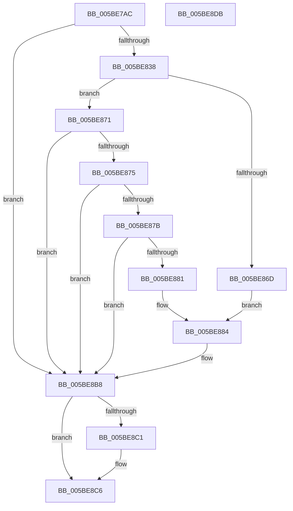

# KeCommitSmtState

- RVA: `0x005BE7AC`–`0x005BE8DC` (길이 `304` bytes)
- VA: `0x00000001405BE7AC`
- 실행 섹션: `.text`
- PDB 이름 있음: `예`; PDB Function 태그: `아니요`
- unwind 정보 RVA: `0x00079278`
- 디코드: `73`개 명령, `304/304` bytes 표시
- 미해석 바이트: `0` (있으면 어셈블리에 `.byte`로 보존)

> 이 문서는 커널 이미지의 기계어와 PDB 기호를 분석해 생성했습니다. 4번과 5번은 함수 원형과 자료형을 바이너리 사용 방식에서 추정한 C 해석이며 원본 소스 복구 결과는 아닙니다.

## 1. Dependencies

- 직접 호출 지점: **5**; 고유 호출 대상: **5**
- 직접 호출자로 확인된 함수: **1**
- RIP 상대 이미지 참조: **4**

### Outgoing calls
- `0x005BE82B` → [ZwOpenKey](../6A/ZwOpenKey_function_006AD310.md) (function, `0x006AD310`)
- `0x005BE85B` → [ZwQueryValueKey](../6A/ZwQueryValueKey_function_006AD3B0.md) (function, `0x006AD3B0`)
- `0x005BE8B3` → [ZwSetValueKey](../6A/ZwSetValueKey_function_006ADCD0.md) (function, `0x006ADCD0`)
- `0x005BE8C1` → [ZwClose](../6A/ZwClose_function_006AD2B0.md) (function, `0x006AD2B0`)
- `0x005BE8CD` → [_security_check_cookie](../6A/_security_check_cookie_function_006AC640.md) (function, `0x006AC640`)

### Direct callers
- [CmpAcceptBoot](../../page/7D/CmpAcceptBoot_function_007DF574.md) at `0x007DF5B8`

### Static image references
- `0x005BE7BA` → RVA `0x00E0A740` (`.data`; read)
- `0x005BE7F1` → RVA `0x006CBB10` (` ?? ::FNODOBFM::`string'`; read)
- `0x005BE7FC` → RVA `0x00FD9FB8` (`PAGEDATA`; read)
- `0x005BE884` → RVA `0x00F10EC0` (`.data`; read)

## 2. Other-region calls and transfers

- 다른 실행 섹션으로 향하는 call: **0**
- 별도 외부 분기/꼬리 이동을 확인하지 못했습니다.

## 3. Assembly (complete function range)

```asm
005BE7AC  40 55                           push rbp
005BE7AE  48 8D 6C 24 A9                  lea rbp, [rsp - 0x57]
005BE7B3  48 81 EC B0 00 00 00            sub rsp, 0xb0
005BE7BA  48 8B 05 7F BF 84 00            mov rax, qword ptr [rip + 0x84bf7f]
005BE7C1  48 33 C4                        xor rax, rsp
005BE7C4  48 89 45 47                     mov qword ptr [rbp + 0x47], rax
005BE7C8  83 65 1B 00                     and dword ptr [rbp + 0x1b], 0
005BE7CC  4C 8D 45 FF                     lea r8, [rbp - 1]
005BE7D0  48 83 65 DF 00                  and qword ptr [rbp - 0x21], 0
005BE7D5  48 8D 4D DF                     lea rcx, [rbp - 0x21]
005BE7D9  48 83 65 07 00                  and qword ptr [rbp + 7], 0
005BE7DE  33 C0                           xor eax, eax
005BE7E0  21 45 E7                        and dword ptr [rbp - 0x19], eax
005BE7E3  0F 57 C0                        xorps xmm0, xmm0
005BE7E6  21 45 D7                        and dword ptr [rbp - 0x29], eax
005BE7E9  BA 1F 00 02 00                  mov edx, 0x2001f
005BE7EE  89 45 3F                        mov dword ptr [rbp + 0x3f], eax
005BE7F1  48 8D 05 18 D3 10 00            lea rax, [rip + 0x10d318]
005BE7F8  48 89 45 F7                     mov qword ptr [rbp - 9], rax
005BE7FC  48 8D 05 B5 B7 A1 00            lea rax, [rip + 0xa1b7b5]
005BE803  48 C7 45 FF 30 00 00 00         mov qword ptr [rbp - 1], 0x30
005BE80B  83 65 03 00                     and dword ptr [rbp + 3], 0
005BE80F  48 89 45 0F                     mov qword ptr [rbp + 0xf], rax
005BE813  0F 11 45 2F                     movups xmmword ptr [rbp + 0x2f], xmm0
005BE817  48 C7 45 EF 1E 00 20 00         mov qword ptr [rbp - 0x11], 0x20001e
005BE81F  C7 45 17 40 02 00 00            mov dword ptr [rbp + 0x17], 0x240
005BE826  F3 0F 7F 45 1F                  movdqu xmmword ptr [rbp + 0x1f], xmm0
005BE82B  E8 E0 EA 0E 00                  call 0x1406ad310
005BE830  85 C0                           test eax, eax
005BE832  0F 88 80 00 00 00               js 0x1405be8b8
005BE838  48 8B 4D DF                     mov rcx, qword ptr [rbp - 0x21]
005BE83C  48 8D 45 E7                     lea rax, [rbp - 0x19]
005BE840  48 89 44 24 28                  mov qword ptr [rsp + 0x28], rax
005BE845  4C 8D 4D 2F                     lea r9, [rbp + 0x2f]
005BE849  41 B8 02 00 00 00               mov r8d, 2
005BE84F  C7 44 24 20 14 00 00 00         mov dword ptr [rsp + 0x20], 0x14
005BE857  48 8D 55 EF                     lea rdx, [rbp - 0x11]
005BE85B  E8 50 EB 0E 00                  call 0x1406ad3b0
005BE860  41 B9 04 00 00 00               mov r9d, 4
005BE866  3D 34 00 00 C0                  cmp eax, 0xc0000034
005BE86B  75 04                           jne 0x1405be871
005BE86D  33 C9                           xor ecx, ecx
005BE86F  EB 13                           jmp 0x1405be884
005BE871  85 C0                           test eax, eax
005BE873  78 43                           js 0x1405be8b8
005BE875  44 39 4D 33                     cmp dword ptr [rbp + 0x33], r9d
005BE879  75 3D                           jne 0x1405be8b8
005BE87B  44 39 4D 37                     cmp dword ptr [rbp + 0x37], r9d
005BE87F  75 37                           jne 0x1405be8b8
005BE881  8B 4D 3B                        mov ecx, dword ptr [rbp + 0x3b]
005BE884  8B 05 36 26 95 00               mov eax, dword ptr [rip + 0x952636]
005BE88A  48 8D 55 EF                     lea rdx, [rbp - 0x11]
005BE88E  25 00 00 1C 00                  and eax, 0x1c0000
005BE893  44 89 4C 24 28                  mov dword ptr [rsp + 0x28], r9d
005BE898  81 E1 FF FF E3 FF               and ecx, 0xffe3ffff
005BE89E  45 33 C0                        xor r8d, r8d
005BE8A1  0B C1                           or eax, ecx
005BE8A3  48 8B 4D DF                     mov rcx, qword ptr [rbp - 0x21]
005BE8A7  89 45 D7                        mov dword ptr [rbp - 0x29], eax
005BE8AA  48 8D 45 D7                     lea rax, [rbp - 0x29]
005BE8AE  48 89 44 24 20                  mov qword ptr [rsp + 0x20], rax
005BE8B3  E8 18 F4 0E 00                  call 0x1406adcd0
005BE8B8  48 8B 4D DF                     mov rcx, qword ptr [rbp - 0x21]
005BE8BC  48 85 C9                        test rcx, rcx
005BE8BF  74 05                           je 0x1405be8c6
005BE8C1  E8 EA E9 0E 00                  call 0x1406ad2b0
005BE8C6  48 8B 4D 47                     mov rcx, qword ptr [rbp + 0x47]
005BE8CA  48 33 CC                        xor rcx, rsp
005BE8CD  E8 6E DD 0E 00                  call 0x1406ac640
005BE8D2  48 81 C4 B0 00 00 00            add rsp, 0xb0
005BE8D9  5D                              pop rbp
005BE8DA  C3                              ret
005BE8DB  CC                              int3
```

## 4. C-style interpretation (structured pseudocode)

```c
__int64 __fastcall KeCommitSmtState(void)
{
    __int64 result;
    __int64 v_rsp;
    unsigned __int64 v_stack_m18;
    unsigned int v_stack_m20;
    unsigned int v_stack_m24;
    unsigned int v_stack_m28;
    unsigned int v_stack_m2C;
    unsigned __int64 v_stack_m30;
    unsigned __int64 v_stack_m40;
    unsigned int v_stack_m44;
    unsigned int v_stack_m48;
    unsigned __int64 v_stack_m50;
    unsigned __int64 v_stack_m58;
    unsigned int v_stack_m5C;
    unsigned __int64 v_stack_m5F;
    unsigned __int64 v_stack_m60;
    unsigned __int64 v_stack_m68;
    unsigned __int64 v_stack_m70;
    unsigned int v_stack_m78;
    unsigned __int64 v_stack_m80;
    unsigned int v_stack_m88;
    unsigned __int64 v_stack_m90;
    unsigned int v_stack_m98;

    v_rsp = (v_rsp) - (176);
    result = (*(unsigned __int64 *)(v_rip + 8699775)) ^ (v_rsp);
    v_stack_m18 = result;
    result = 0;
    v_stack_m20 = 0;
    v_stack_m68 = v_rip + 1102616;
    v_stack_m60 = 48;
    v_stack_m50 = v_rip + 10598325;
    v_stack_m30 = v_xmm0;
    v_stack_m70 = 0x20001EULL;
    v_stack_m48 = 576;
    v_stack_m40 = v_xmm0;
    result = ZwOpenKey(v_stack_m80, (unsigned int)(0x2001FULL), v_stack_m60, a4);
    if (sign_flag) goto loc_005BE8B8;
    v_stack_m90 = v_stack_m78;
    v_stack_m98 = 20;
    result = ZwQueryValueKey(v_stack_m80, v_stack_m70, 2, v_stack_m30);
    if (((unsigned int)(result)) != 0xC0000034ULL) goto loc_005BE871;
    a1 = 0;
    goto loc_005BE884;
loc_005BE871:
    if (sign_flag) goto loc_005BE8B8;
    if (v_stack_m2C != 4) goto loc_005BE8B8;
    if (v_stack_m28 != 4) goto loc_005BE8B8;
loc_005BE884:
    result = (unsigned int)(((unsigned int)(*(unsigned int *)(v_rip + 9774646))) & (0x1C0000ULL));
    v_stack_m90 = 4;
    a1 = (unsigned int)(((unsigned int)(v_stack_m24)) & (0xFFE3FFFFULL));
    a3 = 0;
    result = (unsigned int)((result) | ((unsigned int)(a1)));
    v_stack_m88 = (unsigned int)(result);
    v_stack_m98 = v_stack_m88;
    result = ZwSetValueKey(v_stack_m80, v_stack_m70, a3, 4);
loc_005BE8B8:
    if (v_stack_m80 != 0) {
        result = ZwClose(v_stack_m80, v_stack_m70, a3, 4);
    }
    a1 = (v_stack_m18) ^ (v_rsp);
    result = _security_check_cookie(a1, v_stack_m70, a3, 4);
    v_rsp = (v_rsp) + (176);
    return result;
}
```

## 5. (Beta) C Style

```c
void KeCommitSmtState(void)
{
    int64_t result;
    int64_t local_rsp;
    uint64_t v_stack_m18;
    uint32_t v_stack_m20;
    uint32_t v_stack_m24;
    uint32_t v_stack_m28;
    uint32_t v_stack_m2C;
    uint64_t v_stack_m30;
    uint64_t v_stack_m40;
    uint32_t v_stack_m44;
    uint32_t v_stack_m48;
    uint64_t v_stack_m50;
    uint64_t v_stack_m58;
    uint32_t v_stack_m5C;
    uint64_t v_stack_m5F;
    uint64_t v_stack_m60;
    uint64_t v_stack_m68;
    uint64_t v_stack_m70;
    uint32_t v_stack_m78;
    uint64_t v_stack_m80;
    uint32_t v_stack_m88;
    uint64_t v_stack_m90;
    uint32_t v_stack_m98;

    local_rsp = (local_rsp) - (176);
    result = (*(uint64_t *)(v_rip + 0x84BF7F)) ^ (local_rsp);
    v_stack_m18 = result;
    result = 0;
    v_stack_m20 = 0;
    v_stack_m68 = v_rip + 1102616;
    v_stack_m60 = 48;
    v_stack_m50 = v_rip + 10598325;
    v_stack_m30 = v_xmm0;
    v_stack_m70 = 0x20001EULL;
    v_stack_m48 = 576;
    v_stack_m40 = v_xmm0;
    result = ZwOpenKey(v_stack_m80, (uint32_t)(0x2001FULL), v_stack_m60, a4);
    if (sign_flag) goto loc_005BE8B8;
    v_stack_m90 = v_stack_m78;
    v_stack_m98 = 20;
    result = ZwQueryValueKey(v_stack_m80, v_stack_m70, 2, v_stack_m30);
    if (((uint32_t)(result)) != 0xC0000034ULL) goto loc_005BE871;
    a1 = 0;
    goto loc_005BE884;
loc_005BE871:
    if (sign_flag) goto loc_005BE8B8;
    if (v_stack_m2C != 4) goto loc_005BE8B8;
    if (v_stack_m28 != 4) goto loc_005BE8B8;
loc_005BE884:
    result = (uint32_t)(((uint32_t)(*(uint32_t *)(v_rip + 0x952636))) & (0x1C0000ULL));
    v_stack_m90 = 4;
    a1 = (uint32_t)(((uint32_t)(v_stack_m24)) & (0xFFE3FFFFULL));
    a3 = 0;
    result = (uint32_t)((result) | ((uint32_t)(a1)));
    v_stack_m88 = (uint32_t)(result);
    v_stack_m98 = v_stack_m88;
    result = ZwSetValueKey(v_stack_m80, v_stack_m70, a3, 4);
loc_005BE8B8:
    if (v_stack_m80 != 0) {
        result = ZwClose(v_stack_m80, v_stack_m70, a3, 4);
    }
    a1 = (v_stack_m18) ^ (local_rsp);
    result = _security_check_cookie(a1, v_stack_m70, a3, 4);
    local_rsp = (local_rsp) + (176);
    return result;
}
```

## 6. Execution-region graph

[열기: 2D/3D 그래프와 함수 탐색 컨트롤 패널](../../../control-panel.html?section=text&rva=0x005BE7AC&view=graph)

- 2D 그래프는 위에서 아래로 흐르고, 3D 그래프는 빈 공간을 드래그해 회전합니다. Shift+드래그는 이동, 휠은 확대·축소, 함수 노드 선택은 대상 보고서 이동입니다.

### Static fallback


