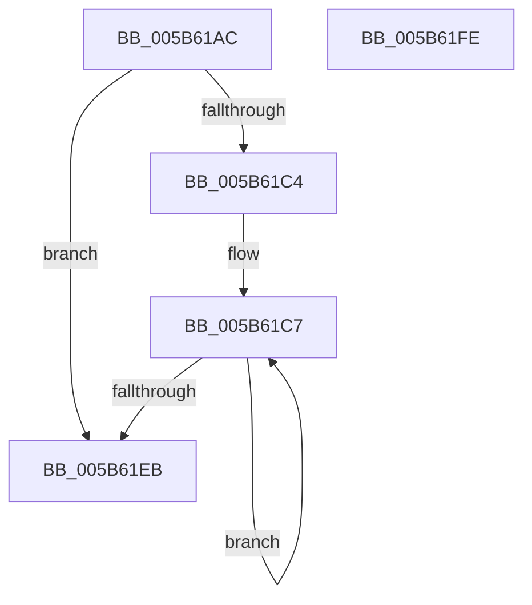

# KeCompactServiceTable

- RVA: `0x005B61AC`–`0x005B61FF` (길이 `83` bytes)
- VA: `0x00000001405B61AC`
- 실행 섹션: `.text`
- PDB 이름 있음: `예`; PDB Function 태그: `아니요`
- unwind 정보 RVA: `0x0005CAAC`
- 디코드: `28`개 명령, `83/83` bytes 표시
- 미해석 바이트: `0` (있으면 어셈블리에 `.byte`로 보존)

> 이 문서는 커널 이미지의 기계어와 PDB 기호를 분석해 생성했습니다. 4번과 5번은 함수 원형과 자료형을 바이너리 사용 방식에서 추정한 C 해석이며 원본 소스 복구 결과는 아닙니다.

## 1. Dependencies

- 직접 호출 지점: **1**; 고유 호출 대상: **1**
- 직접 호출자로 확인된 함수: **2**
- RIP 상대 이미지 참조: **0**

### Outgoing calls
- `0x005B61EE` → [KiLockServiceTable](../69/KiLockServiceTable_function_0069BC98.md) (function, `0x0069BC98`)

### Direct callers
- [MiCompactServiceTable](../../page/80/MiCompactServiceTable_function_0080C63C.md) at `0x0080C753`
- [MiCompactServiceTable](../../page/80/MiCompactServiceTable_function_0080C63C.md) at `0x0080C772`
- [KiInitializeKernel](../../pagelk/B6/KiInitializeKernel_function_00B68D20.md) at `0x00B68F77`

### Static image references
- 디코드된 RIP-relative 메모리 참조가 없습니다.

## 2. Other-region calls and transfers

- 다른 실행 섹션으로 향하는 call: **0**
- 별도 외부 분기/꼬리 이동을 확인하지 못했습니다.

## 3. Assembly (complete function range)

```asm
005B61AC  48 89 5C 24 08                  mov qword ptr [rsp + 8], rbx
005B61B1  57                              push rdi
005B61B2  48 83 EC 20                     sub rsp, 0x20
005B61B6  4C 8B D2                        mov r10, rdx
005B61B9  48 8B DA                        mov rbx, rdx
005B61BC  4C 8B D9                        mov r11, rcx
005B61BF  45 85 C0                        test r8d, r8d
005B61C2  74 27                           je 0x1405b61eb
005B61C4  41 8B F8                        mov edi, r8d
005B61C7  0F B6 03                        movzx eax, byte ptr [rbx]
005B61CA  48 FF C3                        inc rbx
005B61CD  8B 54 24 50                     mov edx, dword ptr [rsp + 0x50]
005B61D1  2B D1                           sub edx, ecx
005B61D3  C1 E8 02                        shr eax, 2
005B61D6  41 03 13                        add edx, dword ptr [r11]
005B61D9  C1 E2 04                        shl edx, 4
005B61DC  0B D0                           or edx, eax
005B61DE  41 89 13                        mov dword ptr [r11], edx
005B61E1  4D 8D 5B 04                     lea r11, [r11 + 4]
005B61E5  48 83 EF 01                     sub rdi, 1
005B61E9  75 DC                           jne 0x1405b61c7
005B61EB  49 8B D2                        mov rdx, r10
005B61EE  E8 A5 5A 0E 00                  call 0x14069bc98
005B61F3  48 8B 5C 24 30                  mov rbx, qword ptr [rsp + 0x30]
005B61F8  48 83 C4 20                     add rsp, 0x20
005B61FC  5F                              pop rdi
005B61FD  C3                              ret
005B61FE  CC                              int3
```

## 4. C-style interpretation (structured pseudocode)

```c
__int64 __fastcall KeCompactServiceTable(__int64 a1, __int64 a2, int a3, __int64 a4, unsigned int a5)
{
    __int64 result;
    __int64 v_rbx;
    __int64 v_rdi;
    __int64 v_rsp;
    unsigned __int64 v_stack_p8;

    v_stack_p8 = v_rbx;
    v_rsp = (v_rsp) - (32);
    if (a3 == 0) goto loc_005B61EB;
loc_005B61C7:
    v_rbx = (a2) + 1;
    a2 = (unsigned int)(((unsigned int)(a5)) - ((unsigned int)(a1)));
    result = (unsigned int)((*(unsigned __int8 *)(a2)) >> (2));
    a2 = (unsigned int)((a2) + (*(unsigned int *)(a1)));
    a2 = (unsigned int)((a2) << (4));
    a2 = (unsigned int)((a2) | ((unsigned int)(result)));
    *(unsigned int *)(a1) = (unsigned int)(a2);
    v_rdi = ((unsigned int)(a3)) - (1);
    if (condition_is_not_equal) goto loc_005B61C7;
loc_005B61EB:
    result = KiLockServiceTable(a1, a2, a3, a4);
    v_rsp = (v_rsp) + (32);
    return result;
}
```

## 5. (Beta) C Style

```c
int64_t KeCompactServiceTable(void *Arg1, int64_t Arg2, int32_t Arg3, int64_t Arg4, uint32_t Arg5)
{
    uint8_t *arg1 = (uint8_t *)Arg1;

    int64_t result;
    int64_t local_rbx;
    int64_t local_rdi;
    int64_t local_rsp;
    uint64_t v_stack_p8;

    v_stack_p8 = local_rbx;
    local_rsp = (local_rsp) - (32);
    if (Arg3 == 0) goto loc_005B61EB;
loc_005B61C7:
    local_rbx = (Arg2) + 1;
    Arg2 = (uint32_t)(((uint32_t)(Arg5)) - ((uint32_t)(Arg1)));
    result = (uint32_t)((*(uint8_t *)(Arg2)) >> (2));
    Arg2 = (uint32_t)((Arg2) + (*(uint32_t *)(arg1)));
    Arg2 = (uint32_t)((Arg2) << (4));
    Arg2 = (uint32_t)((Arg2) | ((uint32_t)(result)));
    *(uint32_t *)(arg1) = (uint32_t)(Arg2);
    local_rdi = ((uint32_t)(Arg3)) - (1);
    if (condition_is_not_equal) goto loc_005B61C7;
loc_005B61EB:
    result = KiLockServiceTable(Arg1, Arg2, Arg3, Arg4);
    local_rsp = (local_rsp) + (32);
    return result;
}
```

### 관측된 메모리 오프셋

구조체 형식이 확인되지 않은 접근은 인자 기준의 오프셋으로만 기록했습니다.

| 기준 인자 | 오프셋 표현 | 폭 (bit) | 접근 |
|---|---:|---:|---|
| `Arg1` | `+ 0x0` | `32` | `R` |
| `Arg1` | `+ 0x0` | `32` | `W` |
| `Arg1` | `+ 0x4` | `64` | `R` |

## 6. Execution-region graph

[열기: 2D/3D 그래프와 함수 탐색 컨트롤 패널](../../../control-panel.html?section=text&rva=0x005B61AC&view=graph)

- 2D 그래프는 위에서 아래로 흐르고, 3D 그래프는 빈 공간을 드래그해 회전합니다. Shift+드래그는 이동, 휠은 확대·축소, 함수 노드 선택은 대상 보고서 이동입니다.

### Static fallback


