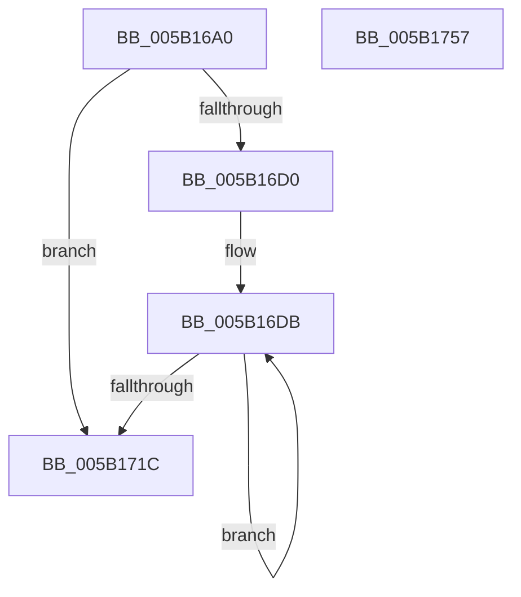

# KeComputeParallelSha256

- RVA: `0x005B16A0`–`0x005B1758` (길이 `184` bytes)
- VA: `0x00000001405B16A0`
- 실행 섹션: `.text`
- PDB 이름 있음: `예`; PDB Function 태그: `아니요`
- unwind 정보 RVA: `0x000794E0`
- 디코드: `44`개 명령, `184/184` bytes 표시
- 미해석 바이트: `0` (있으면 어셈블리에 `.byte`로 보존)

> 이 문서는 커널 이미지의 기계어와 PDB 기호를 분석해 생성했습니다. 4번과 5번은 함수 원형과 자료형을 바이너리 사용 방식에서 추정한 C 해석이며 원본 소스 복구 결과는 아닙니다.

## 1. Dependencies

- 직접 호출 지점: **2**; 고유 호출 대상: **2**
- 직접 호출자로 확인된 함수: **0**
- RIP 상대 이미지 참조: **0**

### Outgoing calls
- `0x005B16C3` → [SymCryptParallelSha256Init](../51/SymCryptParallelSha256Init_function_0051EF2C.md) (function, `0x0051EF2C`)
- `0x005B1742` → [SymCryptParallelSha256Process](../51/SymCryptParallelSha256Process_function_0051EF68.md) (function, `0x0051EF68`)

### Direct callers
- 이 함수 시작 RVA로 연결되는 직접 call은 확인되지 않았습니다. 간접 호출은 완전히 역산할 수 없습니다.

### Static image references
- 디코드된 RIP-relative 메모리 참조가 없습니다.

## 2. Other-region calls and transfers

- 다른 실행 섹션으로 향하는 call: **0**
- 별도 외부 분기/꼬리 이동을 확인하지 못했습니다.

## 3. Assembly (complete function range)

```asm
005B16A0  48 89 5C 24 08                  mov qword ptr [rsp + 8], rbx
005B16A5  48 89 74 24 10                  mov qword ptr [rsp + 0x10], rsi
005B16AA  57                              push rdi
005B16AB  48 83 EC 30                     sub rsp, 0x30
005B16AF  48 8D 99 8F 01 00 00            lea rbx, [rcx + 0x18f]
005B16B6  48 8B F1                        mov rsi, rcx
005B16B9  48 83 E3 F0                     and rbx, 0xfffffffffffffff0
005B16BD  48 8B FA                        mov rdi, rdx
005B16C0  48 8B CB                        mov rcx, rbx
005B16C3  E8 64 D8 F6 FF                  call 0x14051ef2c
005B16C8  45 33 C0                        xor r8d, r8d
005B16CB  48 85 FF                        test rdi, rdi
005B16CE  74 4C                           je 0x1405b171c
005B16D0  48 8D 4E 10                     lea rcx, [rsi + 0x10]
005B16D4  48 8D 93 10 04 00 00            lea rdx, [rbx + 0x410]
005B16DB  4C 89 42 F0                     mov qword ptr [rdx - 0x10], r8
005B16DF  C7 42 F8 01 00 00 00            mov dword ptr [rdx - 8], 1
005B16E6  48 8B 41 F0                     mov rax, qword ptr [rcx - 0x10]
005B16EA  48 89 02                        mov qword ptr [rdx], rax
005B16ED  48 8D 52 50                     lea rdx, [rdx + 0x50]
005B16F1  48 8B 41 F8                     mov rax, qword ptr [rcx - 8]
005B16F5  48 89 42 B8                     mov qword ptr [rdx - 0x48], rax
005B16F9  4C 89 42 C8                     mov qword ptr [rdx - 0x38], r8
005B16FD  49 FF C0                        inc r8
005B1700  48 89 4A D8                     mov qword ptr [rdx - 0x28], rcx
005B1704  48 83 C1 30                     add rcx, 0x30
005B1708  C7 42 D0 02 00 00 00            mov dword ptr [rdx - 0x30], 2
005B170F  48 C7 42 E0 20 00 00 00         mov qword ptr [rdx - 0x20], 0x20
005B1717  4C 3B C7                        cmp r8, rdi
005B171A  72 BF                           jb 0x1405b16db
005B171C  48 8D 83 80 06 00 00            lea rax, [rbx + 0x680]
005B1723  48 C7 44 24 28 6E 0B 00 00      mov qword ptr [rsp + 0x28], 0xb6e
005B172C  4C 8D 0C 3F                     lea r9, [rdi + rdi]
005B1730  48 89 44 24 20                  mov qword ptr [rsp + 0x20], rax
005B1735  4C 8D 83 00 04 00 00            lea r8, [rbx + 0x400]
005B173C  48 8B D7                        mov rdx, rdi
005B173F  48 8B CB                        mov rcx, rbx
005B1742  E8 21 D8 F6 FF                  call 0x14051ef68
005B1747  48 8B 5C 24 40                  mov rbx, qword ptr [rsp + 0x40]
005B174C  48 8B 74 24 48                  mov rsi, qword ptr [rsp + 0x48]
005B1751  48 83 C4 30                     add rsp, 0x30
005B1755  5F                              pop rdi
005B1756  C3                              ret
005B1757  CC                              int3
```

## 4. C-style interpretation (structured pseudocode)

```c
__int64 __fastcall KeComputeParallelSha256(__int64 a1, __int64 a2, int a3)
{
    __int64 result;
    __int64 v_rbx;
    __int64 v_rsp;
    unsigned __int64 v_stack_m10;
    unsigned __int64 v_stack_m18;
    unsigned __int64 v_stack_p10;
    unsigned __int64 v_stack_p8;

    v_stack_p8 = v_rbx;
    v_stack_p10 = v_rsi;
    v_rsp = (v_rsp) - (48);
    v_rbx = (a1 + 399) & (-16);
    result = SymCryptParallelSha256Init(v_rbx, a2, a3, a4);
    a3 = 0;
    if (a2 == 0) goto loc_005B171C;
loc_005B16DB:
    *(unsigned __int64 *)(v_rbx + 1040 - 16) = 0;
    *(unsigned int *)(v_rbx + 1040 - 8) = 1;
    *(unsigned __int64 *)(v_rbx + 1040) = *(unsigned __int64 *)(a1 + 16 - 16);
    *(unsigned __int64 *)(v_rbx + 1040 + 80 - 72) = *(unsigned __int64 *)(a1 + 16 - 8);
    *(unsigned __int64 *)(v_rbx + 1040 + 80 - 56) = 0;
    a3 = (a3) + 1;
    *(unsigned __int64 *)(v_rbx + 1040 + 80 - 40) = a1 + 16;
    a1 = (a1 + 16) + (48);
    *(unsigned int *)(v_rbx + 1040 + 80 - 48) = 2;
    *(unsigned __int64 *)(v_rbx + 1040 + 80 - 32) = 32;
    if (a3 < a2) goto loc_005B16DB;
loc_005B171C:
    v_stack_m10 = 0xB6EULL;
    v_stack_m18 = v_rbx + 1664;
    result = SymCryptParallelSha256Process(v_rbx, a2, v_rbx + 1024, a2 + a2 * 1);
    v_rsp = (v_rsp) + (48);
    return result;
}
```

## 5. (Beta) C Style

```c
int64_t KeComputeParallelSha256(void *Arg1, int64_t Arg2, int32_t Arg3)
{
    uint8_t *arg1 = (uint8_t *)Arg1;

    int64_t result;
    int64_t local_rbx;
    int64_t local_rsp;
    uint64_t v_stack_m10;
    uint64_t v_stack_m18;
    uint64_t v_stack_p10;
    uint64_t v_stack_p8;

    v_stack_p8 = local_rbx;
    v_stack_p10 = local_rsi;
    local_rsp = (local_rsp) - (48);
    local_rbx = (Arg1 + 399) & (-16);
    result = SymCryptParallelSha256Init(local_rbx, Arg2, Arg3, a4);
    Arg3 = 0;
    if (Arg2 == 0) goto loc_005B171C;
loc_005B16DB:
    *(uint64_t *)(local_rbx + 0x410 - 0x10) = 0;
    *(uint32_t *)(local_rbx + 0x410 - 0x8) = 1;
    *(uint64_t *)(local_rbx + 0x410) = *(uint64_t *)(arg1 + 0x10 - 0x10);
    *(uint64_t *)(local_rbx + 0x410 + 0x50 - 0x48) = *(uint64_t *)(arg1 + 0x10 - 0x8);
    *(uint64_t *)(local_rbx + 0x410 + 0x50 - 0x38) = 0;
    Arg3 = (Arg3) + 1;
    *(void **)(local_rbx + 0x410 + 0x50 - 0x28) = Arg1 + 16;
    Arg1 = (Arg1 + 16) + (48);
    *(uint32_t *)(local_rbx + 0x410 + 0x50 - 0x30) = 2;
    *(uint64_t *)(local_rbx + 0x410 + 0x50 - 0x20) = 32;
    if (Arg3 < Arg2) goto loc_005B16DB;
loc_005B171C:
    v_stack_m10 = 0xB6EULL;
    v_stack_m18 = local_rbx + 1664;
    result = SymCryptParallelSha256Process(local_rbx, Arg2, local_rbx + 1024, Arg2 + Arg2 * 1);
    local_rsp = (local_rsp) + (48);
    return result;
}
```

### 관측된 메모리 오프셋

구조체 형식이 확인되지 않은 접근은 인자 기준의 오프셋으로만 기록했습니다.

| 기준 인자 | 오프셋 표현 | 폭 (bit) | 접근 |
|---|---:|---:|---|
| `Arg1` | `- 0x48` | `64` | `W` |
| `Arg1` | `- 0x38` | `64` | `W` |
| `Arg1` | `- 0x30` | `32` | `W` |
| `Arg1` | `- 0x28` | `64` | `W` |
| `Arg1` | `- 0x20` | `64` | `W` |
| `Arg1` | `- 0x10` | `64` | `R` |
| `Arg1` | `- 0x10` | `64` | `W` |
| `Arg1` | `- 0x8` | `32` | `W` |
| `Arg1` | `- 0x8` | `64` | `R` |
| `Arg1` | `+ 0x0` | `64` | `W` |
| `Arg1` | `+ 0x10` | `64` | `R` |
| `Arg1` | `+ 0x50` | `64` | `R` |
| `Arg1` | `+ 0x18F` | `64` | `R` |
| `Arg1` | `+ 0x400` | `64` | `R` |
| `Arg1` | `+ 0x410` | `64` | `R` |
| `Arg1` | `+ 0x680` | `64` | `R` |

## 6. Execution-region graph

[열기: 2D/3D 그래프와 함수 탐색 컨트롤 패널](../../../control-panel.html?section=text&rva=0x005B16A0&view=graph)

- 2D 그래프는 위에서 아래로 흐르고, 3D 그래프는 빈 공간을 드래그해 회전합니다. Shift+드래그는 이동, 휠은 확대·축소, 함수 노드 선택은 대상 보고서 이동입니다.

### Static fallback


