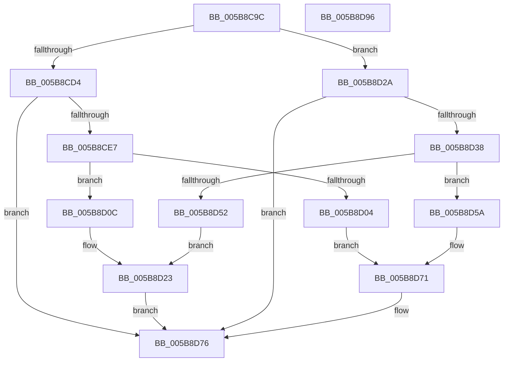

# KeConfigureDynamicMemory

- RVA: `0x005B8C9C`–`0x005B8D97` (길이 `251` bytes)
- VA: `0x00000001405B8C9C`
- 실행 섹션: `.text`
- PDB 이름 있음: `예`; PDB Function 태그: `아니요`
- unwind 정보 RVA: `0x0006F978`
- 디코드: `70`개 명령, `251/251` bytes 표시
- 미해석 바이트: `0` (있으면 어셈블리에 `.byte`로 보존)

> 이 문서는 커널 이미지의 기계어와 PDB 기호를 분석해 생성했습니다. 4번과 5번은 함수 원형과 자료형을 바이너리 사용 방식에서 추정한 C 해석이며 원본 소스 복구 결과는 아닙니다.

## 1. Dependencies

- 직접 호출 지점: **10**; 고유 호출 대상: **4**
- 직접 호출자로 확인된 함수: **2**
- RIP 상대 이미지 참조: **1**

### Outgoing calls
- `0x005B8CC4` → [ExAcquireFastMutex](../20/ExAcquireFastMutex_function_0020E5A0.md) (function, `0x0020E5A0`)
- `0x005B8CD8` → [VslConfigureDynamicMemory](../58/VslConfigureDynamicMemory_function_0058DFA8.md) (function, `0x0058DFA8`)
- `0x005B8CF3` → [HvlConfigureDynamicMemory](../6A/HvlConfigureDynamicMemory_function_006A7958.md) (function, `0x006A7958`)
- `0x005B8D12` → [VslConfigureDynamicMemory](../58/VslConfigureDynamicMemory_function_0058DFA8.md) (function, `0x0058DFA8`)
- `0x005B8D23` → [HvlConfigureDynamicMemory](../6A/HvlConfigureDynamicMemory_function_006A7958.md) (function, `0x006A7958`)
- `0x005B8D2D` → [HvlConfigureDynamicMemory](../6A/HvlConfigureDynamicMemory_function_006A7958.md) (function, `0x006A7958`)
- `0x005B8D41` → [VslConfigureDynamicMemory](../58/VslConfigureDynamicMemory_function_0058DFA8.md) (function, `0x0058DFA8`)
- `0x005B8D60` → [HvlConfigureDynamicMemory](../6A/HvlConfigureDynamicMemory_function_006A7958.md) (function, `0x006A7958`)
- `0x005B8D71` → [VslConfigureDynamicMemory](../58/VslConfigureDynamicMemory_function_0058DFA8.md) (function, `0x0058DFA8`)
- `0x005B8D79` → [ExReleaseFastMutex](../25/ExReleaseFastMutex_function_002519C0.md) (function, `0x002519C0`)

### Direct callers
- [MiAddPhysicalMemory](../../page/7F/MiAddPhysicalMemory_function_007F95FC.md) at `0x007F9847`
- [MiRemovePhysicalMemory](../../page/7F/MiRemovePhysicalMemory_function_007FAD3C.md) at `0x007FAF23`

### Static image references
- `0x005B8CB4` → RVA `0x00F22DA0` (`.data`; read)

## 2. Other-region calls and transfers

- 다른 실행 섹션으로 향하는 call: **0**
- 별도 외부 분기/꼬리 이동을 확인하지 못했습니다.

## 3. Assembly (complete function range)

```asm
005B8C9C  48 89 5C 24 08                  mov qword ptr [rsp + 8], rbx
005B8CA1  48 89 74 24 10                  mov qword ptr [rsp + 0x10], rsi
005B8CA6  48 89 7C 24 18                  mov qword ptr [rsp + 0x18], rdi
005B8CAB  41 56                           push r14
005B8CAD  48 83 EC 20                     sub rsp, 0x20
005B8CB1  48 8B F1                        mov rsi, rcx
005B8CB4  4C 8D 35 E5 A0 96 00            lea r14, [rip + 0x96a0e5]
005B8CBB  49 8B CE                        mov rcx, r14
005B8CBE  41 8B D8                        mov ebx, r8d
005B8CC1  48 8B FA                        mov rdi, rdx
005B8CC4  E8 D7 58 C5 FF                  call 0x14020e5a0
005B8CC9  48 8B D7                        mov rdx, rdi
005B8CCC  48 8B CE                        mov rcx, rsi
005B8CCF  83 FB 20                        cmp ebx, 0x20
005B8CD2  75 56                           jne 0x1405b8d2a
005B8CD4  44 8D 43 E2                     lea r8d, [rbx - 0x1e]
005B8CD8  E8 CB 52 FD FF                  call 0x14058dfa8
005B8CDD  8B D8                           mov ebx, eax
005B8CDF  85 C0                           test eax, eax
005B8CE1  0F 88 8F 00 00 00               js 0x1405b8d76
005B8CE7  41 B8 02 00 00 00               mov r8d, 2
005B8CED  48 8B D7                        mov rdx, rdi
005B8CF0  48 8B CE                        mov rcx, rsi
005B8CF3  E8 60 EC 0E 00                  call 0x1406a7958
005B8CF8  8B D8                           mov ebx, eax
005B8CFA  48 8B D7                        mov rdx, rdi
005B8CFD  48 8B CE                        mov rcx, rsi
005B8D00  85 C0                           test eax, eax
005B8D02  79 08                           jns 0x1405b8d0c
005B8D04  41 B8 08 00 00 00               mov r8d, 8
005B8D0A  EB 65                           jmp 0x1405b8d71
005B8D0C  41 B8 04 00 00 00               mov r8d, 4
005B8D12  E8 91 52 FD FF                  call 0x14058dfa8
005B8D17  41 B8 04 00 00 00               mov r8d, 4
005B8D1D  48 8B D7                        mov rdx, rdi
005B8D20  48 8B CE                        mov rcx, rsi
005B8D23  E8 30 EC 0E 00                  call 0x1406a7958
005B8D28  EB 4C                           jmp 0x1405b8d76
005B8D2A  45 33 C0                        xor r8d, r8d
005B8D2D  E8 26 EC 0E 00                  call 0x1406a7958
005B8D32  8B D8                           mov ebx, eax
005B8D34  85 C0                           test eax, eax
005B8D36  78 3E                           js 0x1405b8d76
005B8D38  45 33 C0                        xor r8d, r8d
005B8D3B  48 8B D7                        mov rdx, rdi
005B8D3E  48 8B CE                        mov rcx, rsi
005B8D41  E8 62 52 FD FF                  call 0x14058dfa8
005B8D46  8B D8                           mov ebx, eax
005B8D48  48 8B D7                        mov rdx, rdi
005B8D4B  48 8B CE                        mov rcx, rsi
005B8D4E  85 C0                           test eax, eax
005B8D50  79 08                           jns 0x1405b8d5a
005B8D52  41 B8 08 00 00 00               mov r8d, 8
005B8D58  EB C9                           jmp 0x1405b8d23
005B8D5A  41 B8 01 00 00 00               mov r8d, 1
005B8D60  E8 F3 EB 0E 00                  call 0x1406a7958
005B8D65  41 B8 01 00 00 00               mov r8d, 1
005B8D6B  48 8B D7                        mov rdx, rdi
005B8D6E  48 8B CE                        mov rcx, rsi
005B8D71  E8 32 52 FD FF                  call 0x14058dfa8
005B8D76  49 8B CE                        mov rcx, r14
005B8D79  E8 42 8C C9 FF                  call 0x1402519c0
005B8D7E  48 8B 74 24 38                  mov rsi, qword ptr [rsp + 0x38]
005B8D83  8B C3                           mov eax, ebx
005B8D85  48 8B 5C 24 30                  mov rbx, qword ptr [rsp + 0x30]
005B8D8A  48 8B 7C 24 40                  mov rdi, qword ptr [rsp + 0x40]
005B8D8F  48 83 C4 20                     add rsp, 0x20
005B8D93  41 5E                           pop r14
005B8D95  C3                              ret
005B8D96  CC                              int3
```

## 4. C-style interpretation (structured pseudocode)

```c
__int64 __fastcall KeConfigureDynamicMemory(__int64 a1, __int64 a2, int a3)
{
    __int64 result;
    __int64 v_rsp;
    unsigned __int64 v_stack_p10;
    unsigned __int64 v_stack_p18;
    unsigned __int64 v_stack_p8;

    v_stack_p8 = v_rbx;
    v_stack_p10 = v_rsi;
    v_stack_p18 = v_rdi;
    v_rsp = (v_rsp) - (32);
    result = ExAcquireFastMutex(v_rip + 9871589, a2, a3, a4);
    if (((unsigned int)((unsigned int)(a3))) != 32) goto loc_005B8D2A;
    result = VslConfigureDynamicMemory(a1, a2, (unsigned int)(a3) - 30, a4);
    if (sign_flag) goto loc_005B8D76;
    result = HvlConfigureDynamicMemory(a1, a2, 2, a4);
    if (!sign_flag) goto loc_005B8D0C;
    goto loc_005B8D71;
loc_005B8D0C:
    result = VslConfigureDynamicMemory(a1, a2, 4, a4);
loc_005B8D23:
    result = HvlConfigureDynamicMemory(a1, a2, 4, a4);
    goto loc_005B8D76;
loc_005B8D2A:
    a3 = 0;
    result = HvlConfigureDynamicMemory(a1, a2, a3, a4);
    if (sign_flag) goto loc_005B8D76;
    a3 = 0;
    result = VslConfigureDynamicMemory(a1, a2, a3, a4);
    if (!sign_flag) goto loc_005B8D5A;
    goto loc_005B8D23;
loc_005B8D5A:
    result = HvlConfigureDynamicMemory(a1, a2, 1, a4);
loc_005B8D71:
    result = VslConfigureDynamicMemory(a1, a2, 1, a4);
loc_005B8D76:
    result = ExReleaseFastMutex(v_rip + 9871589, a2, 1, a4);
    v_rsp = (v_rsp) + (32);
    return (unsigned int)((unsigned int)((unsigned int)((unsigned int)(result))));
}
```

## 5. (Beta) C Style

```c
int64_t KeConfigureDynamicMemory(int64_t Arg1, int64_t Arg2, int32_t Arg3)
{
    int64_t result;
    int64_t local_rsp;
    uint64_t v_stack_p10;
    uint64_t v_stack_p18;
    uint64_t v_stack_p8;

    v_stack_p8 = local_rbx;
    v_stack_p10 = local_rsi;
    v_stack_p18 = local_rdi;
    local_rsp = (local_rsp) - (32);
    result = ExAcquireFastMutex(v_rip + 9871589, Arg2, Arg3, a4);
    if (((uint32_t)((uint32_t)(Arg3))) != 32) goto loc_005B8D2A;
    result = VslConfigureDynamicMemory(Arg1, Arg2, (uint32_t)(Arg3) - 30, a4);
    if (sign_flag) goto loc_005B8D76;
    result = HvlConfigureDynamicMemory(Arg1, Arg2, 2, a4);
    if (!sign_flag) goto loc_005B8D0C;
    goto loc_005B8D71;
loc_005B8D0C:
    result = VslConfigureDynamicMemory(Arg1, Arg2, 4, a4);
loc_005B8D23:
    result = HvlConfigureDynamicMemory(Arg1, Arg2, 4, a4);
    goto loc_005B8D76;
loc_005B8D2A:
    Arg3 = 0;
    result = HvlConfigureDynamicMemory(Arg1, Arg2, Arg3, a4);
    if (sign_flag) goto loc_005B8D76;
    Arg3 = 0;
    result = VslConfigureDynamicMemory(Arg1, Arg2, Arg3, a4);
    if (!sign_flag) goto loc_005B8D5A;
    goto loc_005B8D23;
loc_005B8D5A:
    result = HvlConfigureDynamicMemory(Arg1, Arg2, 1, a4);
loc_005B8D71:
    result = VslConfigureDynamicMemory(Arg1, Arg2, 1, a4);
loc_005B8D76:
    result = ExReleaseFastMutex(v_rip + 9871589, Arg2, 1, a4);
    local_rsp = (local_rsp) + (32);
    return (uint32_t)((uint32_t)((uint32_t)((uint32_t)(result))));
}
```

## 6. Execution-region graph

[열기: 2D/3D 그래프와 함수 탐색 컨트롤 패널](../../../control-panel.html?section=text&rva=0x005B8C9C&view=graph)

- 2D 그래프는 위에서 아래로 흐르고, 3D 그래프는 빈 공간을 드래그해 회전합니다. Shift+드래그는 이동, 휠은 확대·축소, 함수 노드 선택은 대상 보고서 이동입니다.

### Static fallback


