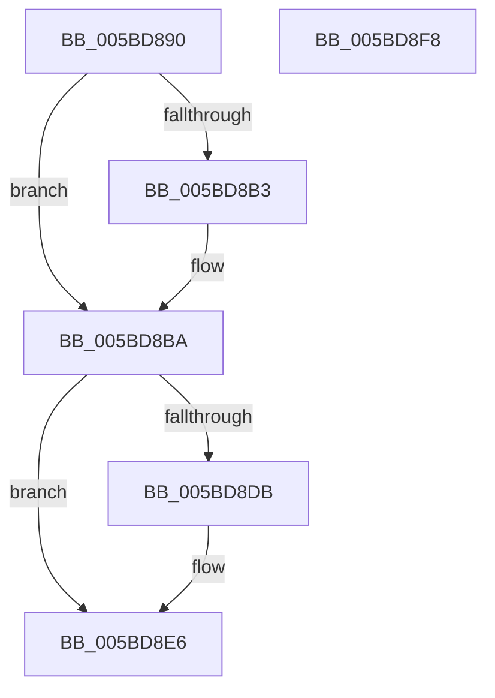

# KeConnectInterruptForHal

- RVA: `0x005BD890`–`0x005BD8F9` (길이 `105` bytes)
- VA: `0x00000001405BD890`
- 실행 섹션: `.text`
- PDB 이름 있음: `예`; PDB Function 태그: `아니요`
- unwind 정보 RVA: `0x0005CAAC`
- 디코드: `27`개 명령, `105/105` bytes 표시
- 미해석 바이트: `0` (있으면 어셈블리에 `.byte`로 보존)

> 이 문서는 커널 이미지의 기계어와 PDB 기호를 분석해 생성했습니다. 4번과 5번은 함수 원형과 자료형을 바이너리 사용 방식에서 추정한 C 해석이며 원본 소스 복구 결과는 아닙니다.

## 1. Dependencies

- 직접 호출 지점: **2**; 고유 호출 대상: **2**
- 직접 호출자로 확인된 함수: **1**
- RIP 상대 이미지 참조: **1**

### Outgoing calls
- `0x005BD8B5` → [KiRaiseIrqlProcessIrqlFlags](../4F/KiRaiseIrqlProcessIrqlFlags_function_004F56FC.md) (function, `0x004F56FC`)
- `0x005BD8E1` → [KiLowerIrqlProcessIrqlFlags](../4F/KiLowerIrqlProcessIrqlFlags_function_004F5698.md) (function, `0x004F5698`)

### Direct callers
- [HalpCreateInterrupt](../55/HalpCreateInterrupt_function_0055BA00.md) at `0x0055BAB0`

### Static image references
- `0x005BD8AA` → RVA `0x00FC6D20` (`ALMOSTRO`; read)

## 2. Other-region calls and transfers

- 다른 실행 섹션으로 향하는 call: **0**
- 별도 외부 분기/꼬리 이동을 확인하지 못했습니다.

## 3. Assembly (complete function range)

```asm
005BD890  48 89 5C 24 08                  mov qword ptr [rsp + 8], rbx
005BD895  57                              push rdi
005BD896  48 83 EC 20                     sub rsp, 0x20
005BD89A  48 8B F9                        mov rdi, rcx
005BD89D  44 0F 20 C3                     mov rbx, cr8
005BD8A1  BA 0F 00 00 00                  mov edx, 0xf
005BD8A6  44 0F 22 C2                     mov cr8, rdx
005BD8AA  83 3D 6F 94 A0 00 00            cmp dword ptr [rip + 0xa0946f], 0
005BD8B1  74 07                           je 0x1405bd8ba
005BD8B3  8A CB                           mov cl, bl
005BD8B5  E8 42 7E F3 FF                  call 0x1404f56fc
005BD8BA  8B 47 58                        mov eax, dword ptr [rdi + 0x58]
005BD8BD  C6 47 5F 01                     mov byte ptr [rdi + 0x5f], 1
005BD8C1  65 48 8B 0C 25 20 00 00 00      mov rcx, qword ptr gs:[0x20]
005BD8CA  48 89 BC C1 00 39 00 00         mov qword ptr [rcx + rax*8 + 0x3900], rdi
005BD8D2  83 3D 47 94 A0 00 00            cmp dword ptr [rip + 0xa09447], 0
005BD8D9  74 0B                           je 0x1405bd8e6
005BD8DB  44 0F 20 C1                     mov rcx, cr8
005BD8DF  8A D3                           mov dl, bl
005BD8E1  E8 B2 7D F3 FF                  call 0x1404f5698
005BD8E6  0F B6 C3                        movzx eax, bl
005BD8E9  44 0F 22 C0                     mov cr8, rax
005BD8ED  48 8B 5C 24 30                  mov rbx, qword ptr [rsp + 0x30]
005BD8F2  48 83 C4 20                     add rsp, 0x20
005BD8F6  5F                              pop rdi
005BD8F7  C3                              ret
005BD8F8  CC                              int3
```

## 4. C-style interpretation (structured pseudocode)

```c
__int64 __fastcall KeConnectInterruptForHal(__int64 a1)
{
    __int64 result;
    __int64 v_rsp;
    unsigned __int64 v_stack_p8;

    v_stack_p8 = v_rbx;
    v_rsp = (v_rsp) - (32);
    if ((*(unsigned int *)(v_rip + 10523759)) != 0) {
        a1 = (unsigned __int8)(v_cr8);
        result = KiRaiseIrqlProcessIrqlFlags(a1, 15, a3, a4);
    }
    *(unsigned __int8 *)(a1 + 95) = 1;
    *(unsigned __int64 *)(*(unsigned __int64 *)(gs_base + (0 + 32)) + (unsigned int)(*(unsigned int *)(a1 + 88)) * 8 + 14592) = a1;
    result = (unsigned int)(*(unsigned int *)(a1 + 88));
    if ((*(unsigned int *)(v_rip + 10523719)) != 0) {
        a1 = 15;
        a2 = (unsigned __int8)(v_cr8);
        result = KiLowerIrqlProcessIrqlFlags(a1, a2, a3, a4);
    }
    v_rsp = (v_rsp) + (32);
    return (unsigned __int8)(v_cr8);
}
```

## 5. (Beta) C Style

```c
int64_t KeConnectInterruptForHal(void *Arg1)
{
    uint8_t *arg1 = (uint8_t *)Arg1;

    int64_t result;
    int64_t local_rsp;
    uint64_t v_stack_p8;

    v_stack_p8 = local_rbx;
    local_rsp = (local_rsp) - (32);
    if ((*(uint32_t *)(v_rip + 0xA0946F)) != 0) {
        Arg1 = (uint8_t)(v_cr8);
        result = KiRaiseIrqlProcessIrqlFlags(Arg1, 15, a3, a4);
    }
    *(uint8_t *)(arg1 + 0x5F) = 1;
    *(void **)(*(uint64_t *)(gs_base + (0 + 0x20)) + (uint32_t)(*(uint32_t *)(arg1 + 0x58)) * 8 + 0x3900) = Arg1;
    result = (uint32_t)(*(uint32_t *)(arg1 + 0x58));
    if ((*(uint32_t *)(v_rip + 0xA09447)) != 0) {
        Arg1 = 15;
        a2 = (uint8_t)(v_cr8);
        result = KiLowerIrqlProcessIrqlFlags(Arg1, a2, a3, a4);
    }
    local_rsp = (local_rsp) + (32);
    return (uint8_t)(v_cr8);
}
```

### 관측된 메모리 오프셋

구조체 형식이 확인되지 않은 접근은 인자 기준의 오프셋으로만 기록했습니다.

| 기준 인자 | 오프셋 표현 | 폭 (bit) | 접근 |
|---|---:|---:|---|
| `Arg1` | `+ 0x58` | `32` | `R` |
| `Arg1` | `+ 0x5F` | `8` | `W` |

## 6. Execution-region graph

[열기: 2D/3D 그래프와 함수 탐색 컨트롤 패널](../../../control-panel.html?section=text&rva=0x005BD890&view=graph)

- 2D 그래프는 위에서 아래로 흐르고, 3D 그래프는 빈 공간을 드래그해 회전합니다. Shift+드래그는 이동, 휠은 확대·축소, 함수 노드 선택은 대상 보고서 이동입니다.

### Static fallback


