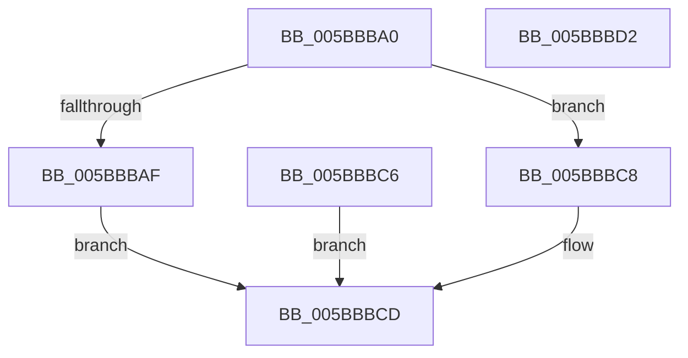

# KeCreateEnclaveMetadataPage

- RVA: `0x005BBBA0`–`0x005BBBD3` (길이 `51` bytes)
- VA: `0x00000001405BBBA0`
- 실행 섹션: `.text`
- PDB 이름 있음: `예`; PDB Function 태그: `아니요`
- unwind 정보 RVA: `0x000CA328`
- 디코드: `16`개 명령, `51/51` bytes 표시
- 미해석 바이트: `0` (있으면 어셈블리에 `.byte`로 보존)

> 이 문서는 커널 이미지의 기계어와 PDB 기호를 분석해 생성했습니다. 4번과 5번은 함수 원형과 자료형을 바이너리 사용 방식에서 추정한 C 해석이며 원본 소스 복구 결과는 아닙니다.

## 1. Dependencies

- 직접 호출 지점: **1**; 고유 호출 대상: **1**
- 직접 호출자로 확인된 함수: **2**
- RIP 상대 이미지 참조: **1**

### Outgoing calls
- `0x005BBBBC` → [KiEncls](../6B/KiEncls_function_006B1BE0.md) (function, `0x006B1BE0`)

### Direct callers
- [MiPrepareEnclaveMetadataPage](../68/MiPrepareEnclaveMetadataPage_function_00686EAC.md) at `0x00687023`
- [sub_006E362E](../6E/Unknown_function_006E362E.md) at `0x006E3941`

### Static image references
- `0x005BBBA4` → RVA `0x00FC6B30` (`ALMOSTRO`; read)

## 2. Other-region calls and transfers

- 다른 실행 섹션으로 향하는 call: **0**
- 별도 외부 분기/꼬리 이동을 확인하지 못했습니다.

## 3. Assembly (complete function range)

```asm
005BBBA0  48 83 EC 28                     sub rsp, 0x28
005BBBA4  48 0F BA 25 83 AF A0 00 28      bt qword ptr [rip + 0xa0af83], 0x28
005BBBAD  73 19                           jae 0x1405bbbc8
005BBBAF  45 33 C9                        xor r9d, r9d
005BBBB2  4C 8B C1                        mov r8, rcx
005BBBB5  41 8D 51 03                     lea edx, [r9 + 3]
005BBBB9  8D 4A 07                        lea ecx, [rdx + 7]
005BBBBC  E8 1F 60 0F 00                  call 0x1406b1be0
005BBBC1  90                              nop
005BBBC2  33 C0                           xor eax, eax
005BBBC4  EB 07                           jmp 0x1405bbbcd
005BBBC6  EB 05                           jmp 0x1405bbbcd
005BBBC8  B8 BB 00 00 C0                  mov eax, 0xc00000bb
005BBBCD  48 83 C4 28                     add rsp, 0x28
005BBBD1  C3                              ret
005BBBD2  CC                              int3
```

## 4. C-style interpretation (structured pseudocode)

```c
__int64 __fastcall KeCreateEnclaveMetadataPage(__int64 a1, __int64 a2, __int64 a3, int a4)
{
    __int64 result;
    __int64 v_rsp;

    v_rsp = (v_rsp) - (40);
    if (condition_is_above_or_equal) goto loc_005BBBC8;
    a4 = 0;
    result = KiEncls(a4 + 3 + 7, a4 + 3, a1, a4);
    result = 0;
    goto loc_005BBBCD;
loc_005BBBC8:
loc_005BBBCD:
    v_rsp = (v_rsp) + (40);
    return (unsigned int)(0xC00000BBULL);
}
```

## 5. (Beta) C Style

```c
int64_t KeCreateEnclaveMetadataPage(int64_t Arg1, int64_t Arg2, int64_t Arg3, int32_t Arg4)
{
    int64_t result;
    int64_t local_rsp;

    local_rsp = (local_rsp) - (40);
    if (condition_is_above_or_equal) goto loc_005BBBC8;
    Arg4 = 0;
    result = KiEncls(Arg4 + 3 + 7, Arg4 + 3, Arg1, Arg4);
    result = 0;
    goto loc_005BBBCD;
loc_005BBBC8:
loc_005BBBCD:
    local_rsp = (local_rsp) + (40);
    return (uint32_t)(0xC00000BBULL);
}
```

## 6. Execution-region graph

[열기: 2D/3D 그래프와 함수 탐색 컨트롤 패널](../../../control-panel.html?section=text&rva=0x005BBBA0&view=graph)

- 2D 그래프는 위에서 아래로 흐르고, 3D 그래프는 빈 공간을 드래그해 회전합니다. Shift+드래그는 이동, 휠은 확대·축소, 함수 노드 선택은 대상 보고서 이동입니다.

### Static fallback


