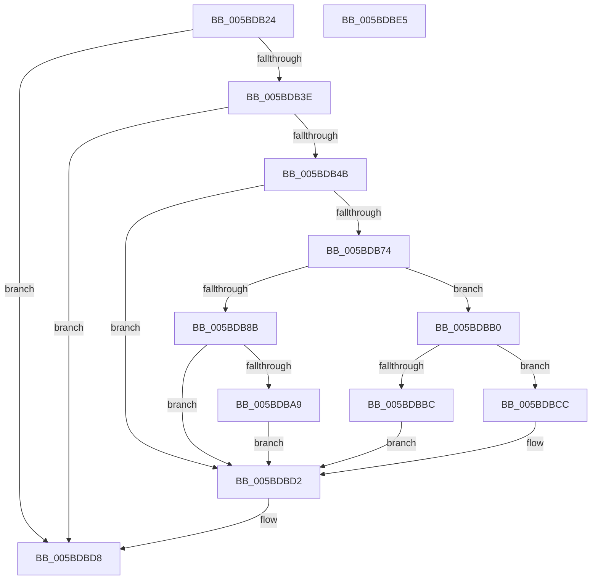

# KeDeepSleepProcessor

- RVA: `0x005BDB24`–`0x005BDBE6` (길이 `194` bytes)
- VA: `0x00000001405BDB24`
- 실행 섹션: `.text`
- PDB 이름 있음: `예`; PDB Function 태그: `아니요`
- unwind 정보 RVA: `0x0005CAAC`
- 디코드: `48`개 명령, `194/194` bytes 표시
- 미해석 바이트: `0` (있으면 어셈블리에 `.byte`로 보존)

> 이 문서는 커널 이미지의 기계어와 PDB 기호를 분석해 생성했습니다. 4번과 5번은 함수 원형과 자료형을 바이너리 사용 방식에서 추정한 C 해석이며 원본 소스 복구 결과는 아닙니다.

## 1. Dependencies

- 직접 호출 지점: **4**; 고유 호출 대상: **4**
- 직접 호출자로 확인된 함수: **1**
- RIP 상대 이미지 참조: **3**

### Outgoing calls
- `0x005BDB3E` → [HviIsXboxNanovisorPresent](../66/HviIsXboxNanovisorPresent_function_00666980.md) (function, `0x00666980`)
- `0x005BDB65` → [KeInterlockedSetProcessorAffinityEx](../35/KeInterlockedSetProcessorAffinityEx_function_00352560.md) (function, `0x00352560`)
- `0x005BDB7E` → [KeInterlockedClearProcessorAffinityEx](../35/KeInterlockedClearProcessorAffinityEx_function_003524F0.md) (function, `0x003524F0`)
- `0x005BDBA9` → [KiSetUserTbFlushPending](../6B/KiSetUserTbFlushPending_function_006B20C0.md) (function, `0x006B20C0`)

### Direct callers
- [PpmIdleExecuteTransition](../2D/PpmIdleExecuteTransition_function_002D0A1C.md) at `0x002D0D89`

### Static image references
- `0x005BDB2E` → RVA `0x00FC6AB8` (`ALMOSTRO`; read)
- `0x005BDB54` → RVA `0x00F10F20` (`.data`; read)
- `0x005BDB83` → RVA `0x00FC6A87` (`ALMOSTRO`; read)

## 2. Other-region calls and transfers

- 다른 실행 섹션으로 향하는 call: **0**
- 별도 외부 분기/꼬리 이동을 확인하지 못했습니다.

## 3. Assembly (complete function range)

```asm
005BDB24  48 89 5C 24 08                  mov qword ptr [rsp + 8], rbx
005BDB29  57                              push rdi
005BDB2A  48 83 EC 20                     sub rsp, 0x20
005BDB2E  8B 05 84 8F A0 00               mov eax, dword ptr [rip + 0xa08f84]
005BDB34  32 DB                           xor bl, bl
005BDB36  A8 04                           test al, 4
005BDB38  0F 85 9A 00 00 00               jne 0x1405bdbd8
005BDB3E  E8 3D 8E 0A 00                  call 0x140666980
005BDB43  84 C0                           test al, al
005BDB45  0F 85 8D 00 00 00               jne 0x1405bdbd8
005BDB4B  65 48 8B 3C 25 20 00 00 00      mov rdi, qword ptr gs:[0x20]
005BDB54  48 8D 0D C5 33 95 00            lea rcx, [rip + 0x9533c5]
005BDB5B  8B 57 24                        mov edx, dword ptr [rdi + 0x24]
005BDB5E  C6 87 5A 86 00 00 01            mov byte ptr [rdi + 0x865a], 1
005BDB65  E8 F6 49 D9 FF                  call 0x140352560
005BDB6A  8A 87 5A 86 00 00               mov al, byte ptr [rdi + 0x865a]
005BDB70  84 C0                           test al, al
005BDB72  75 5E                           jne 0x1405bdbd2
005BDB74  8B 57 24                        mov edx, dword ptr [rdi + 0x24]
005BDB77  48 8D 0D A2 33 95 00            lea rcx, [rip + 0x9533a2]
005BDB7E  E8 6D 49 D9 FF                  call 0x1403524f0
005BDB83  38 1D FE 8E A0 00               cmp byte ptr [rip + 0xa08efe], bl
005BDB89  74 25                           je 0x1405bdbb0
005BDB8B  0F 20 D8                        mov rax, cr3
005BDB8E  0F 22 D8                        mov cr3, rax
005BDB91  65 48 8B 04 25 88 01 00 00      mov rax, qword ptr gs:[0x188]
005BDB9A  48 8B 88 B8 00 00 00            mov rcx, qword ptr [rax + 0xb8]
005BDBA1  38 99 60 01 00 00               cmp byte ptr [rcx + 0x160], bl
005BDBA7  75 29                           jne 0x1405bdbd2
005BDBA9  E8 12 45 0F 00                  call 0x1406b20c0
005BDBAE  EB 22                           jmp 0x1405bdbd2
005BDBB0  0F 20 E1                        mov rcx, cr4
005BDBB3  48 F7 C1 80 00 02 00            test rcx, 0x20080
005BDBBA  74 10                           je 0x1405bdbcc
005BDBBC  48 8B C1                        mov rax, rcx
005BDBBF  48 0F BA F8 07                  btc rax, 7
005BDBC4  0F 22 E0                        mov cr4, rax
005BDBC7  0F 22 E1                        mov cr4, rcx
005BDBCA  EB 06                           jmp 0x1405bdbd2
005BDBCC  0F 20 D8                        mov rax, cr3
005BDBCF  0F 22 D8                        mov cr3, rax
005BDBD2  8A 9F 5A 86 00 00               mov bl, byte ptr [rdi + 0x865a]
005BDBD8  8A C3                           mov al, bl
005BDBDA  48 8B 5C 24 30                  mov rbx, qword ptr [rsp + 0x30]
005BDBDF  48 83 C4 20                     add rsp, 0x20
005BDBE3  5F                              pop rdi
005BDBE4  C3                              ret
005BDBE5  CC                              int3
```

## 4. C-style interpretation (structured pseudocode)

```c
__int64 __fastcall KeDeepSleepProcessor(void)
{
    __int64 result;
    __int64 v_rbx;
    __int64 v_rsp;
    unsigned __int64 v_stack_p8;

    v_stack_p8 = v_rbx;
    v_rsp = (v_rsp) - (32);
    v_rbx = 0;
    if ((((unsigned __int8)((unsigned int)(*(unsigned int *)(v_rip + 10522500)))) & (4)) != 0) goto loc_005BDBD8;
    result = HviIsXboxNanovisorPresent(a1, a2, a3, a4);
    if ((unsigned __int8)(result) != 0) goto loc_005BDBD8;
    *(unsigned __int8 *)(*(unsigned __int64 *)(gs_base + (0 + 32)) + 34394) = 1;
    result = KeInterlockedSetProcessorAffinityEx(v_rip + 9778117, (unsigned int)(*(unsigned int *)(*(unsigned __int64 *)(gs_base + (0 + 32)) + 36)), a3, a4);
    if ((unsigned __int8)(*(unsigned __int8 *)(*(unsigned __int64 *)(gs_base + (0 + 32)) + 34394)) != 0) goto loc_005BDBD2;
    result = KeInterlockedClearProcessorAffinityEx(v_rip + 9778082, (unsigned int)(*(unsigned int *)(*(unsigned __int64 *)(gs_base + (0 + 32)) + 36)), a3, a4);
    if ((*(unsigned __int8 *)(v_rip + 10522366)) == 0) goto loc_005BDBB0;
    if ((*(unsigned __int8 *)(*(unsigned __int64 *)(*(unsigned __int64 *)(gs_base + (0 + 392)) + 184) + 352)) != 0) goto loc_005BDBD2;
    result = KiSetUserTbFlushPending(*(unsigned __int64 *)(*(unsigned __int64 *)(gs_base + (0 + 392)) + 184), (unsigned int)(*(unsigned int *)(*(unsigned __int64 *)(gs_base + (0 + 32)) + 36)), a3, a4);
    goto loc_005BDBD2;
loc_005BDBB0:
    if (((v_cr4) & (0x20080ULL)) == 0) goto loc_005BDBCC;
    goto loc_005BDBD2;
loc_005BDBCC:
loc_005BDBD2:
loc_005BDBD8:
    v_rsp = (v_rsp) + (32);
    return (unsigned __int8)(*(unsigned __int8 *)(*(unsigned __int64 *)(gs_base + (0 + 32)) + 34394));
}
```

## 5. (Beta) C Style

```c
void KeDeepSleepProcessor(void)
{
    int64_t result;
    int64_t local_rbx;
    int64_t local_rsp;
    uint64_t v_stack_p8;

    v_stack_p8 = local_rbx;
    local_rsp = (local_rsp) - (32);
    local_rbx = 0;
    if ((((uint8_t)((uint32_t)(*(uint32_t *)(v_rip + 0xA08F84)))) & (4)) != 0) goto loc_005BDBD8;
    result = HviIsXboxNanovisorPresent(a1, a2, a3, a4);
    if ((uint8_t)(result) != 0) goto loc_005BDBD8;
    *(uint8_t *)(*(uint64_t *)(gs_base + (0 + 0x20)) + 0x865A) = 1;
    result = KeInterlockedSetProcessorAffinityEx(v_rip + 9778117, (uint32_t)(*(uint32_t *)(*(uint64_t *)(gs_base + (0 + 0x20)) + 0x24)), a3, a4);
    if ((uint8_t)(*(uint8_t *)(*(uint64_t *)(gs_base + (0 + 0x20)) + 0x865A)) != 0) goto loc_005BDBD2;
    result = KeInterlockedClearProcessorAffinityEx(v_rip + 9778082, (uint32_t)(*(uint32_t *)(*(uint64_t *)(gs_base + (0 + 0x20)) + 0x24)), a3, a4);
    if ((*(uint8_t *)(v_rip + 0xA08EFE)) == 0) goto loc_005BDBB0;
    if ((*(uint8_t *)(*(uint64_t *)(*(uint64_t *)(gs_base + (0 + 0x188)) + 0xB8) + 0x160)) != 0) goto loc_005BDBD2;
    result = KiSetUserTbFlushPending(*(uint64_t *)(*(uint64_t *)(gs_base + (0 + 0x188)) + 0xB8), (uint32_t)(*(uint32_t *)(*(uint64_t *)(gs_base + (0 + 0x20)) + 0x24)), a3, a4);
    goto loc_005BDBD2;
loc_005BDBB0:
    if (((v_cr4) & (0x20080ULL)) == 0) goto loc_005BDBCC;
    goto loc_005BDBD2;
loc_005BDBCC:
loc_005BDBD2:
loc_005BDBD8:
    local_rsp = (local_rsp) + (32);
    return (uint8_t)(*(uint8_t *)(*(uint64_t *)(gs_base + (0 + 0x20)) + 0x865A));
}
```

## 6. Execution-region graph

[열기: 2D/3D 그래프와 함수 탐색 컨트롤 패널](../../../control-panel.html?section=text&rva=0x005BDB24&view=graph)

- 2D 그래프는 위에서 아래로 흐르고, 3D 그래프는 빈 공간을 드래그해 회전합니다. Shift+드래그는 이동, 휠은 확대·축소, 함수 노드 선택은 대상 보고서 이동입니다.

### Static fallback


