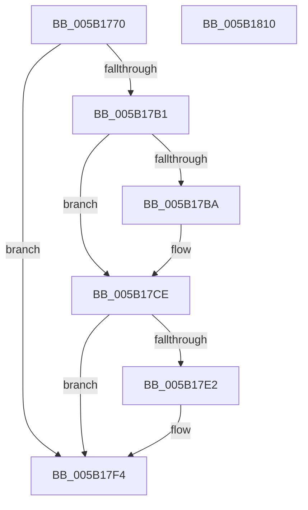

# KeDeregisterBoundCallback

- RVA: `0x005B1770`–`0x005B1811` (길이 `161` bytes)
- VA: `0x00000001405B1770`
- 실행 섹션: `.text`
- PDB 이름 있음: `예`; PDB Function 태그: `아니요`
- unwind 정보 RVA: `0x0005C954`
- 디코드: `42`개 명령, `161/161` bytes 표시
- 미해석 바이트: `0` (있으면 어셈블리에 `.byte`로 보존)

> 이 문서는 커널 이미지의 기계어와 PDB 기호를 분석해 생성했습니다. 4번과 5번은 함수 원형과 자료형을 바이너리 사용 방식에서 추정한 C 해석이며 원본 소스 복구 결과는 아닙니다.

## 1. Dependencies

- 직접 호출 지점: **6**; 고유 호출 대상: **6**
- 직접 호출자로 확인된 함수: **0**
- RIP 상대 이미지 참조: **1**

### Outgoing calls
- `0x005B17A4` → [ExReferenceCallBackBlock](../2F/ExReferenceCallBackBlock_function_002F0040.md) (function, `0x002F0040`)
- `0x005B17C6` → [ExCompareExchangeCallBack](../41/ExCompareExchangeCallBack_function_0041BCD0.md) (function, `0x0041BCD0`)
- `0x005B17D8` → [ExDereferenceCallBackBlock](../44/ExDereferenceCallBackBlock_function_0044D730.md) (function, `0x0044D730`)
- `0x005B17E5` → [ExWaitForCallBacks](../../page/AC/ExWaitForCallBacks_function_00ACFA04.md) (function, `0x00ACFA04`)
- `0x005B17ED` → [AlpcpFreeBuffer](../../page/90/AlpcpFreeBuffer_function_009071C0.md) (function, `0x009071C0`)
- `0x005B17F4` → [KeLeaveCriticalRegion](../25/KeLeaveCriticalRegion_function_0025D8B0.md) (function, `0x0025D8B0`)

### Direct callers
- 이 함수 시작 RVA로 연결되는 직접 call은 확인되지 않았습니다. 간접 호출은 완전히 역산할 수 없습니다.

### Static image references
- `0x005B1790` → RVA `0x00F475B8` (`.data`; read)

## 2. Other-region calls and transfers

- 다른 실행 섹션으로 향하는 call: **2**
  - `0x005B17E5` → [ExWaitForCallBacks](../../page/AC/ExWaitForCallBacks_function_00ACFA04.md) (`.text` → `PAGE`)
  - `0x005B17ED` → [AlpcpFreeBuffer](../../page/90/AlpcpFreeBuffer_function_009071C0.md) (`.text` → `PAGE`)
- 별도 외부 분기/꼬리 이동을 확인하지 못했습니다.

## 3. Assembly (complete function range)

```asm
005B1770  48 89 5C 24 08                  mov qword ptr [rsp + 8], rbx
005B1775  48 89 6C 24 10                  mov qword ptr [rsp + 0x10], rbp
005B177A  48 89 74 24 18                  mov qword ptr [rsp + 0x18], rsi
005B177F  57                              push rdi
005B1780  48 83 EC 20                     sub rsp, 0x20
005B1784  65 48 8B 04 25 88 01 00 00      mov rax, qword ptr gs:[0x188]
005B178D  48 8B E9                        mov rbp, rcx
005B1790  48 8D 0D 21 5E 99 00            lea rcx, [rip + 0x995e21]
005B1797  BF 08 00 00 C0                  mov edi, 0xc0000008
005B179C  66 FF 88 E4 01 00 00            dec word ptr [rax + 0x1e4]
005B17A3  90                              nop
005B17A4  E8 97 E8 D3 FF                  call 0x1402f0040
005B17A9  48 8B D8                        mov rbx, rax
005B17AC  48 85 C0                        test rax, rax
005B17AF  74 43                           je 0x1405b17f4
005B17B1  40 32 F6                        xor sil, sil
005B17B4  48 39 68 08                     cmp qword ptr [rax + 8], rbp
005B17B8  75 14                           jne 0x1405b17ce
005B17BA  4C 8B C0                        mov r8, rax
005B17BD  48 8D 0D F4 5D 99 00            lea rcx, [rip + 0x995df4]
005B17C4  33 D2                           xor edx, edx
005B17C6  E8 05 A5 E6 FF                  call 0x14041bcd0
005B17CB  40 8A F0                        mov sil, al
005B17CE  48 8B D3                        mov rdx, rbx
005B17D1  48 8D 0D E0 5D 99 00            lea rcx, [rip + 0x995de0]
005B17D8  E8 53 BF E9 FF                  call 0x14044d730
005B17DD  40 84 F6                        test sil, sil
005B17E0  74 12                           je 0x1405b17f4
005B17E2  48 8B CB                        mov rcx, rbx
005B17E5  E8 1A E2 51 00                  call 0x140acfa04
005B17EA  48 8B CB                        mov rcx, rbx
005B17ED  E8 CE 59 35 00                  call 0x1409071c0
005B17F2  33 FF                           xor edi, edi
005B17F4  E8 B7 C0 CA FF                  call 0x14025d8b0
005B17F9  48 8B 5C 24 30                  mov rbx, qword ptr [rsp + 0x30]
005B17FE  8B C7                           mov eax, edi
005B1800  48 8B 6C 24 38                  mov rbp, qword ptr [rsp + 0x38]
005B1805  48 8B 74 24 40                  mov rsi, qword ptr [rsp + 0x40]
005B180A  48 83 C4 20                     add rsp, 0x20
005B180E  5F                              pop rdi
005B180F  C3                              ret
005B1810  CC                              int3
```

## 4. C-style interpretation (structured pseudocode)

```c
__int64 __fastcall KeDeregisterBoundCallback(__int64 a1, int a2)
{
    __int64 result;
    __int64 v_rdi;
    __int64 v_rsi;
    __int64 v_rsp;
    unsigned __int64 v_stack_p10;
    unsigned __int64 v_stack_p18;
    unsigned __int64 v_stack_p8;

    v_stack_p8 = v_rbx;
    v_stack_p10 = v_rbp;
    v_stack_p18 = v_rsi;
    v_rsp = (v_rsp) - (32);
    result = ExReferenceCallBackBlock(v_rip + 10051105, a2, a3, a4);
    if (result == 0) goto loc_005B17F4;
    v_rsi = 0;
    if ((*(unsigned __int64 *)(result + 8)) == a1) {
        a3 = result;
        a1 = v_rip + 10051060;
        a2 = 0;
        result = ExCompareExchangeCallBack(a1, a2, a3, a4);
        v_rsi = (unsigned __int8)(result);
    }
    result = ExDereferenceCallBackBlock(v_rip + 10051040, result, a3, a4);
    v_rdi = (unsigned int)(0xC0000008ULL);
    if ((unsigned __int8)(v_rsi) != 0) {
        a1 = result;
        result = ExWaitForCallBacks(a1, result, a3, a4);
        a1 = result;
        result = AlpcpFreeBuffer(a1, result, a3, a4);
        v_rdi = 0;
    }
    result = KeLeaveCriticalRegion(a1, result, a3, a4);
    v_rsp = (v_rsp) + (32);
    return 0;
}
```

## 5. (Beta) C Style

```c
int64_t KeDeregisterBoundCallback(int64_t Arg1, int32_t Arg2)
{
    int64_t result;
    int64_t local_rdi;
    int64_t local_rsi;
    int64_t local_rsp;
    uint64_t v_stack_p10;
    uint64_t v_stack_p18;
    uint64_t v_stack_p8;

    v_stack_p8 = local_rbx;
    v_stack_p10 = local_rbp;
    v_stack_p18 = local_rsi;
    local_rsp = (local_rsp) - (32);
    result = ExReferenceCallBackBlock(v_rip + 10051105, Arg2, a3, a4);
    if (result == 0) goto loc_005B17F4;
    local_rsi = 0;
    if ((*(uint64_t *)(result + 0x8)) == Arg1) {
        a3 = result;
        Arg1 = v_rip + 10051060;
        Arg2 = 0;
        result = ExCompareExchangeCallBack(Arg1, Arg2, a3, a4);
        local_rsi = (uint8_t)(result);
    }
    result = ExDereferenceCallBackBlock(v_rip + 10051040, result, a3, a4);
    local_rdi = (uint32_t)(0xC0000008ULL);
    if ((uint8_t)(local_rsi) != 0) {
        Arg1 = result;
        result = ExWaitForCallBacks(Arg1, result, a3, a4);
        Arg1 = result;
        result = AlpcpFreeBuffer(Arg1, result, a3, a4);
        local_rdi = 0;
    }
    result = KeLeaveCriticalRegion(Arg1, result, a3, a4);
    local_rsp = (local_rsp) + (32);
    return 0;
}
```

## 6. Execution-region graph

[열기: 2D/3D 그래프와 함수 탐색 컨트롤 패널](../../../control-panel.html?section=text&rva=0x005B1770&view=graph)

- 2D 그래프는 위에서 아래로 흐르고, 3D 그래프는 빈 공간을 드래그해 회전합니다. Shift+드래그는 이동, 휠은 확대·축소, 함수 노드 선택은 대상 보고서 이동입니다.

### Static fallback


