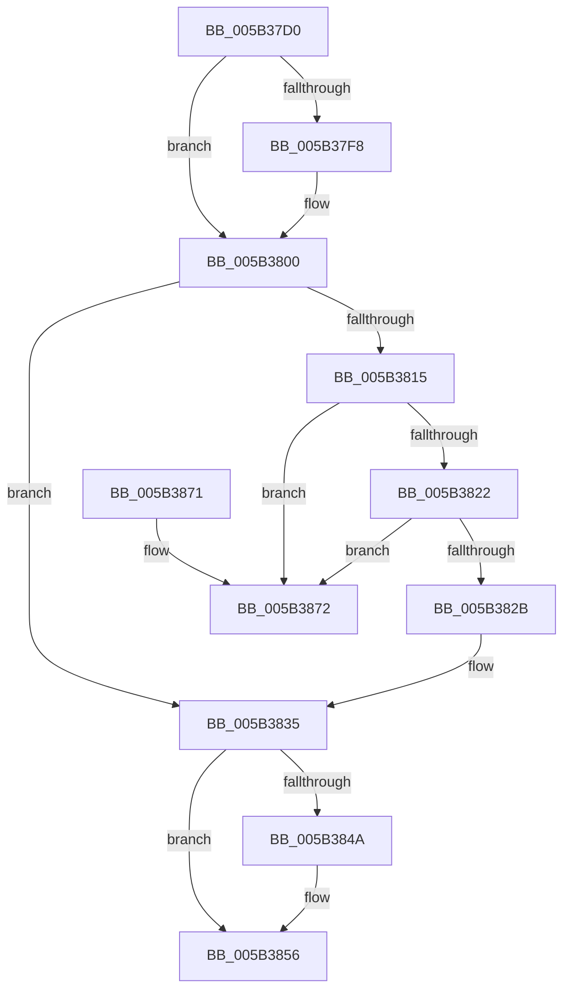

# KeDeregisterBugCheckCallback

- RVA: `0x005B37D0`–`0x005B3879` (길이 `169` bytes)
- VA: `0x00000001405B37D0`
- 실행 섹션: `.text`
- PDB 이름 있음: `예`; PDB Function 태그: `아니요`
- unwind 정보 RVA: `0x0006383C`
- 디코드: `45`개 명령, `169/169` bytes 표시
- 미해석 바이트: `0` (있으면 어셈블리에 `.byte`로 보존)

> 이 문서는 커널 이미지의 기계어와 PDB 기호를 분석해 생성했습니다. 4번과 5번은 함수 원형과 자료형을 바이너리 사용 방식에서 추정한 C 해석이며 원본 소스 복구 결과는 아닙니다.

## 1. Dependencies

- 직접 호출 지점: **4**; 고유 호출 대상: **4**
- 직접 호출자로 확인된 함수: **0**
- RIP 상대 이미지 참조: **2**

### Outgoing calls
- `0x005B37FB` → [KiRaiseIrqlProcessIrqlFlags](../4F/KiRaiseIrqlProcessIrqlFlags_function_004F56FC.md) (function, `0x004F56FC`)
- `0x005B3807` → [KeAcquireSpinLockAtDpcLevel](../20/KeAcquireSpinLockAtDpcLevel_function_00208430.md) (function, `0x00208430`)
- `0x005B383C` → [KxReleaseSpinLock](../20/KxReleaseSpinLock_function_00206670.md) (function, `0x00206670`)
- `0x005B3851` → [KiLowerIrqlProcessIrqlFlags](../4F/KiLowerIrqlProcessIrqlFlags_function_004F5698.md) (function, `0x004F5698`)

### Direct callers
- 이 함수 시작 RVA로 연결되는 직접 call은 확인되지 않았습니다. 간접 호출은 완전히 역산할 수 없습니다.

### Static image references
- `0x005B37EF` → RVA `0x00FC6D20` (`ALMOSTRO`; read)
- `0x005B3800` → RVA `0x00F231A0` (`.data`; read)

## 2. Other-region calls and transfers

- 다른 실행 섹션으로 향하는 call: **0**
- 별도 외부 분기/꼬리 이동을 확인하지 못했습니다.

## 3. Assembly (complete function range)

```asm
005B37D0  48 89 5C 24 08                  mov qword ptr [rsp + 8], rbx
005B37D5  48 89 74 24 10                  mov qword ptr [rsp + 0x10], rsi
005B37DA  57                              push rdi
005B37DB  48 83 EC 20                     sub rsp, 0x20
005B37DF  48 8B D9                        mov rbx, rcx
005B37E2  44 0F 20 C7                     mov rdi, cr8
005B37E6  BA 0F 00 00 00                  mov edx, 0xf
005B37EB  44 0F 22 C2                     mov cr8, rdx
005B37EF  83 3D 2A 35 A1 00 00            cmp dword ptr [rip + 0xa1352a], 0
005B37F6  74 08                           je 0x1405b3800
005B37F8  40 8A CF                        mov cl, dil
005B37FB  E8 FC 1E F4 FF                  call 0x1404f56fc
005B3800  48 8D 0D 99 F9 96 00            lea rcx, [rip + 0x96f999]
005B3807  E8 24 4C C5 FF                  call 0x140208430
005B380C  40 32 F6                        xor sil, sil
005B380F  80 7B 38 01                     cmp byte ptr [rbx + 0x38], 1
005B3813  75 20                           jne 0x1405b3835
005B3815  40 88 73 38                     mov byte ptr [rbx + 0x38], sil
005B3819  48 8B 0B                        mov rcx, qword ptr [rbx]
005B381C  48 39 59 08                     cmp qword ptr [rcx + 8], rbx
005B3820  75 50                           jne 0x1405b3872
005B3822  48 8B 43 08                     mov rax, qword ptr [rbx + 8]
005B3826  48 39 18                        cmp qword ptr [rax], rbx
005B3829  75 47                           jne 0x1405b3872
005B382B  48 89 08                        mov qword ptr [rax], rcx
005B382E  40 B6 01                        mov sil, 1
005B3831  48 89 41 08                     mov qword ptr [rcx + 8], rax
005B3835  48 8D 0D 64 F9 96 00            lea rcx, [rip + 0x96f964]
005B383C  E8 2F 2E C5 FF                  call 0x140206670
005B3841  83 3D D8 34 A1 00 00            cmp dword ptr [rip + 0xa134d8], 0
005B3848  74 0C                           je 0x1405b3856
005B384A  44 0F 20 C1                     mov rcx, cr8
005B384E  40 8A D7                        mov dl, dil
005B3851  E8 42 1E F4 FF                  call 0x1404f5698
005B3856  40 0F B6 CF                     movzx ecx, dil
005B385A  44 0F 22 C1                     mov cr8, rcx
005B385E  48 8B 5C 24 30                  mov rbx, qword ptr [rsp + 0x30]
005B3863  40 8A C6                        mov al, sil
005B3866  48 8B 74 24 38                  mov rsi, qword ptr [rsp + 0x38]
005B386B  48 83 C4 20                     add rsp, 0x20
005B386F  5F                              pop rdi
005B3870  C3                              ret
005B3871  CC                              int3
005B3872  B9 03 00 00 00                  mov ecx, 3
005B3877  CD 29                           int 0x29
```

## 4. C-style interpretation (structured pseudocode)

```c
__int64 __fastcall KeDeregisterBugCheckCallback(__int64 a1)
{
    __int64 result;
    __int64 v_rsi;
    __int64 v_rsp;
    unsigned __int64 v_stack_p10;
    unsigned __int64 v_stack_p8;

    v_stack_p8 = v_rbx;
    v_stack_p10 = v_rsi;
    v_rsp = (v_rsp) - (32);
    if ((*(unsigned int *)(v_rip + 10564906)) != 0) {
        a1 = (unsigned __int8)(v_cr8);
        result = KiRaiseIrqlProcessIrqlFlags(a1, 15, a3, a4);
    }
    result = KeAcquireSpinLockAtDpcLevel(v_rip + 9894297, 15, a3, a4);
    v_rsi = 0;
    if ((*(unsigned __int8 *)(a1 + 56)) != 1) goto loc_005B3835;
    *(unsigned __int8 *)(a1 + 56) = 0;
    if ((*(unsigned __int64 *)(*(unsigned __int64 *)(a1) + 8)) != a1) goto loc_005B3872;
    if ((*(unsigned __int64 *)(*(unsigned __int64 *)(a1 + 8))) != a1) goto loc_005B3872;
    *(unsigned __int64 *)(*(unsigned __int64 *)(a1 + 8)) = *(unsigned __int64 *)(a1);
    *(unsigned __int64 *)(*(unsigned __int64 *)(a1) + 8) = *(unsigned __int64 *)(a1 + 8);
loc_005B3835:
    result = KxReleaseSpinLock(v_rip + 9894244, 15, a3, a4);
    if ((*(unsigned int *)(v_rip + 10564824)) != 0) {
        a1 = 15;
        a2 = (unsigned __int8)(v_cr8);
        result = KiLowerIrqlProcessIrqlFlags(a1, a2, a3, a4);
    }
    v_rsp = (v_rsp) + (32);
    return 1;
loc_005B3872:
    return 1;
}
```

## 5. (Beta) C Style

```c
int64_t KeDeregisterBugCheckCallback(void *Arg1)
{
    uint8_t *arg1 = (uint8_t *)Arg1;

    int64_t result;
    int64_t local_rsi;
    int64_t local_rsp;
    uint64_t v_stack_p10;
    uint64_t v_stack_p8;

    v_stack_p8 = local_rbx;
    v_stack_p10 = local_rsi;
    local_rsp = (local_rsp) - (32);
    if ((*(uint32_t *)(v_rip + 0xA1352A)) != 0) {
        Arg1 = (uint8_t)(v_cr8);
        result = KiRaiseIrqlProcessIrqlFlags(Arg1, 15, a3, a4);
    }
    result = KeAcquireSpinLockAtDpcLevel(v_rip + 9894297, 15, a3, a4);
    local_rsi = 0;
    if ((*(uint8_t *)(arg1 + 0x38)) != 1) goto loc_005B3835;
    *(uint8_t *)(arg1 + 0x38) = 0;
    if ((*(uint64_t *)(*(uint64_t *)(arg1) + 0x8)) != Arg1) goto loc_005B3872;
    if ((*(uint64_t *)(*(uint64_t *)(arg1 + 0x8))) != Arg1) goto loc_005B3872;
    *(uint64_t *)(*(uint64_t *)(arg1 + 0x8)) = *(uint64_t *)(arg1);
    *(uint64_t *)(*(uint64_t *)(arg1) + 0x8) = *(uint64_t *)(arg1 + 0x8);
loc_005B3835:
    result = KxReleaseSpinLock(v_rip + 9894244, 15, a3, a4);
    if ((*(uint32_t *)(v_rip + 0xA134D8)) != 0) {
        Arg1 = 15;
        a2 = (uint8_t)(v_cr8);
        result = KiLowerIrqlProcessIrqlFlags(Arg1, a2, a3, a4);
    }
    local_rsp = (local_rsp) + (32);
    return 1;
loc_005B3872:
    return 1;
}
```

### 관측된 메모리 오프셋

구조체 형식이 확인되지 않은 접근은 인자 기준의 오프셋으로만 기록했습니다.

| 기준 인자 | 오프셋 표현 | 폭 (bit) | 접근 |
|---|---:|---:|---|
| `Arg1` | `+ 0x0` | `64` | `R` |
| `Arg1` | `+ 0x8` | `64` | `R` |
| `Arg1` | `+ 0x38` | `8` | `R` |
| `Arg1` | `+ 0x38` | `8` | `W` |

## 6. Execution-region graph

[열기: 2D/3D 그래프와 함수 탐색 컨트롤 패널](../../../control-panel.html?section=text&rva=0x005B37D0&view=graph)

- 2D 그래프는 위에서 아래로 흐르고, 3D 그래프는 빈 공간을 드래그해 회전합니다. Shift+드래그는 이동, 휠은 확대·축소, 함수 노드 선택은 대상 보고서 이동입니다.

### Static fallback


