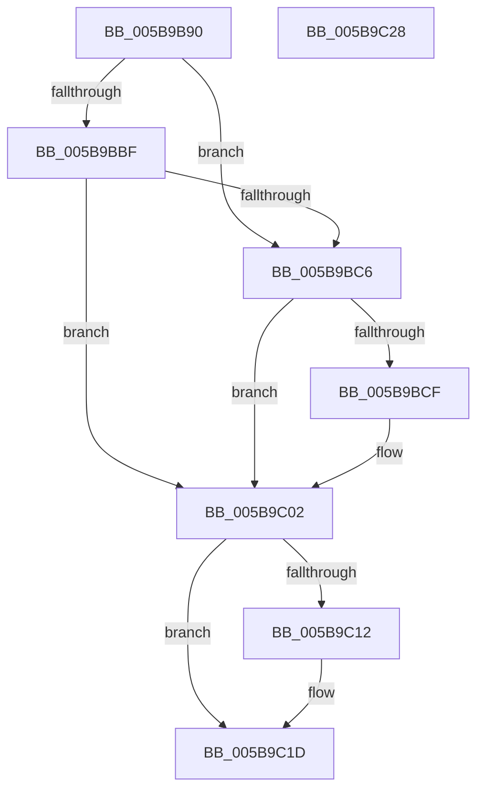

# KeEnableOptionalXStateFeaturesApc

- RVA: `0x005B9B90`–`0x005B9C29` (길이 `153` bytes)
- VA: `0x00000001405B9B90`
- 실행 섹션: `.text`
- PDB 이름 있음: `예`; PDB Function 태그: `아니요`
- unwind 정보 RVA: `0x000CA0D8`
- 디코드: `40`개 명령, `153/153` bytes 표시
- 미해석 바이트: `0` (있으면 어셈블리에 `.byte`로 보존)

> 이 문서는 커널 이미지의 기계어와 PDB 기호를 분석해 생성했습니다. 4번과 5번은 함수 원형과 자료형을 바이너리 사용 방식에서 추정한 C 해석이며 원본 소스 복구 결과는 아닙니다.

## 1. Dependencies

- 직접 호출 지점: **3**; 고유 호출 대상: **3**
- 직접 호출자로 확인된 함수: **1**
- RIP 상대 이미지 참조: **0**

### Outgoing calls
- `0x005B9BB6` → [KxEnableOptionalXStateFeatures](KxEnableOptionalXStateFeatures_function_005BA164.md) (function, `0x005BA164`)
- `0x005B9BFD` → [MmDeleteKernelStack](../33/MmDeleteKernelStack_function_0033A960.md) (function, `0x0033A960`)
- `0x005B9C18` → [ExFreePoolWithTag](../../poolcode/B8/ExFreePoolWithTag_function_00B82870.md) (function, `0x00B82870`)

### Direct callers
- [PspEnableProcessOptionalXStateFeatures](../../page/78/PspEnableProcessOptionalXStateFeatures_function_00781EF0.md) at `0x007822BE`

### Static image references
- 디코드된 RIP-relative 메모리 참조가 없습니다.

## 2. Other-region calls and transfers

- 다른 실행 섹션으로 향하는 call: **1**
  - `0x005B9C18` → [ExFreePoolWithTag](../../poolcode/B8/ExFreePoolWithTag_function_00B82870.md) (`.text` → `POOLCODE`)
- 별도 외부 분기/꼬리 이동을 확인하지 못했습니다.

## 3. Assembly (complete function range)

```asm
005B9B90  48 89 5C 24 10                  mov qword ptr [rsp + 0x10], rbx
005B9B95  57                              push rdi
005B9B96  48 83 EC 50                     sub rsp, 0x50
005B9B9A  48 8B 79 70                     mov rdi, qword ptr [rcx + 0x70]
005B9B9E  4C 8D 4C 24 60                  lea r9, [rsp + 0x60]
005B9BA3  4C 8B 41 58                     mov r8, qword ptr [rcx + 0x58]
005B9BA7  48 8B D9                        mov rbx, rcx
005B9BAA  48 8B 51 68                     mov rdx, qword ptr [rcx + 0x68]
005B9BAE  48 8B CF                        mov rcx, rdi
005B9BB1  C6 44 24 60 00                  mov byte ptr [rsp + 0x60], 0
005B9BB6  E8 A9 05 00 00                  call 0x1405ba164
005B9BBB  85 C0                           test eax, eax
005B9BBD  78 07                           js 0x1405b9bc6
005B9BBF  80 7C 24 60 00                  cmp byte ptr [rsp + 0x60], 0
005B9BC4  75 3C                           jne 0x1405b9c02
005B9BC6  48 8B 43 60                     mov rax, qword ptr [rbx + 0x60]
005B9BCA  48 85 C0                        test rax, rax
005B9BCD  74 33                           je 0x1405b9c02
005B9BCF  48 83 64 24 28 00               and qword ptr [rsp + 0x28], 0
005B9BD5  48 8D 4C 24 20                  lea rcx, [rsp + 0x20]
005B9BDA  0F 57 C0                        xorps xmm0, xmm0
005B9BDD  C7 44 24 20 08 00 00 00         mov dword ptr [rsp + 0x20], 8
005B9BE5  F3 0F 7F 44 24 40               movdqu xmmword ptr [rsp + 0x40], xmm0
005B9BEB  C7 44 24 24 05 00 00 00         mov dword ptr [rsp + 0x24], 5
005B9BF3  48 89 44 24 38                  mov qword ptr [rsp + 0x38], rax
005B9BF8  48 89 7C 24 30                  mov qword ptr [rsp + 0x30], rdi
005B9BFD  E8 5E 0D D8 FF                  call 0x14033a960
005B9C02  48 8B 43 78                     mov rax, qword ptr [rbx + 0x78]
005B9C06  83 C9 FF                        or ecx, 0xffffffff
005B9C09  F0 0F C1 08                     lock xadd dword ptr [rax], ecx
005B9C0D  83 F9 01                        cmp ecx, 1
005B9C10  75 0B                           jne 0x1405b9c1d
005B9C12  48 8B 4B 78                     mov rcx, qword ptr [rbx + 0x78]
005B9C16  33 D2                           xor edx, edx
005B9C18  E8 53 8C 5C 00                  call 0x140b82870
005B9C1D  48 8B 5C 24 68                  mov rbx, qword ptr [rsp + 0x68]
005B9C22  48 83 C4 50                     add rsp, 0x50
005B9C26  5F                              pop rdi
005B9C27  C3                              ret
005B9C28  CC                              int3
```

## 4. C-style interpretation (structured pseudocode)

```c
__int64 __fastcall KeEnableOptionalXStateFeaturesApc(__int64 a1)
{
    __int64 result;
    __int64 v_rsp;
    unsigned __int64 v_stack_m18;
    unsigned __int64 v_stack_m20;
    unsigned __int64 v_stack_m28;
    unsigned __int64 v_stack_m30;
    unsigned int v_stack_m34;
    unsigned __int64 v_stack_m38;
    unsigned __int64 v_stack_p10;
    unsigned __int64 v_stack_p8;

    v_stack_p10 = v_rbx;
    v_rsp = (v_rsp) - (80);
    v_stack_p8 = 0;
    result = KxEnableOptionalXStateFeatures(*(unsigned __int64 *)(a1 + 112), *(unsigned __int64 *)(a1 + 104), *(unsigned __int64 *)(a1 + 88), v_stack_p8);
    if (sign_flag) goto loc_005B9BC6;
    if (v_stack_p8 != 0) goto loc_005B9C02;
loc_005B9BC6:
    result = *(unsigned __int64 *)(a1 + 96);
    if (*(unsigned __int64 *)(a1 + 96) != 0) {
        a1 = v_stack_m38;
        v_stack_m38 = 8;
        v_stack_m18 = v_xmm0;
        v_stack_m34 = 5;
        v_stack_m20 = *(unsigned __int64 *)(a1 + 96);
        v_stack_m28 = *(unsigned __int64 *)(a1 + 112);
        result = MmDeleteKernelStack(a1, *(unsigned __int64 *)(a1 + 104), *(unsigned __int64 *)(a1 + 88), v_stack_p8);
    }
    a1 = (unsigned int)((a1) | (0xFFFFFFFFULL));
    result = *(unsigned __int64 *)(a1 + 120);
    if (((unsigned int)(a1)) == 1) {
        a1 = *(unsigned __int64 *)(a1 + 120);
        a2 = 0;
        result = ExFreePoolWithTag(a1, a2, *(unsigned __int64 *)(a1 + 88), v_stack_p8);
    }
    v_rsp = (v_rsp) + (80);
    return result;
}
```

## 5. (Beta) C Style

```c
int64_t KeEnableOptionalXStateFeaturesApc(void *Arg1)
{
    uint8_t *arg1 = (uint8_t *)Arg1;

    int64_t result;
    int64_t local_rsp;
    uint64_t v_stack_m18;
    uint64_t v_stack_m20;
    uint64_t v_stack_m28;
    uint64_t v_stack_m30;
    uint32_t v_stack_m34;
    uint64_t v_stack_m38;
    uint64_t v_stack_p10;
    uint64_t v_stack_p8;

    v_stack_p10 = local_rbx;
    local_rsp = (local_rsp) - (80);
    v_stack_p8 = 0;
    result = KxEnableOptionalXStateFeatures(*(uint64_t *)(arg1 + 0x70), *(uint64_t *)(arg1 + 0x68), *(uint64_t *)(arg1 + 0x58), v_stack_p8);
    if (sign_flag) goto loc_005B9BC6;
    if (v_stack_p8 != 0) goto loc_005B9C02;
loc_005B9BC6:
    result = *(uint64_t *)(arg1 + 0x60);
    if (*(uint64_t *)(arg1 + 0x60) != 0) {
        Arg1 = v_stack_m38;
        v_stack_m38 = 8;
        v_stack_m18 = v_xmm0;
        v_stack_m34 = 5;
        v_stack_m20 = *(uint64_t *)(arg1 + 0x60);
        v_stack_m28 = *(uint64_t *)(arg1 + 0x70);
        result = MmDeleteKernelStack(Arg1, *(uint64_t *)(arg1 + 0x68), *(uint64_t *)(arg1 + 0x58), v_stack_p8);
    }
    Arg1 = (uint32_t)((Arg1) | (0xFFFFFFFFULL));
    result = *(uint64_t *)(arg1 + 0x78);
    if (((uint32_t)(Arg1)) == 1) {
        Arg1 = *(uint64_t *)(arg1 + 0x78);
        a2 = 0;
        result = ExFreePoolWithTag(Arg1, a2, *(uint64_t *)(arg1 + 0x58), v_stack_p8);
    }
    local_rsp = (local_rsp) + (80);
    return result;
}
```

### 관측된 메모리 오프셋

구조체 형식이 확인되지 않은 접근은 인자 기준의 오프셋으로만 기록했습니다.

| 기준 인자 | 오프셋 표현 | 폭 (bit) | 접근 |
|---|---:|---:|---|
| `Arg1` | `+ 0x58` | `64` | `R` |
| `Arg1` | `+ 0x60` | `64` | `R` |
| `Arg1` | `+ 0x68` | `64` | `R` |
| `Arg1` | `+ 0x70` | `64` | `R` |
| `Arg1` | `+ 0x78` | `64` | `R` |

## 6. Execution-region graph

[열기: 2D/3D 그래프와 함수 탐색 컨트롤 패널](../../../control-panel.html?section=text&rva=0x005B9B90&view=graph)

- 2D 그래프는 위에서 아래로 흐르고, 3D 그래프는 빈 공간을 드래그해 회전합니다. Shift+드래그는 이동, 휠은 확대·축소, 함수 노드 선택은 대상 보고서 이동입니다.

### Static fallback


