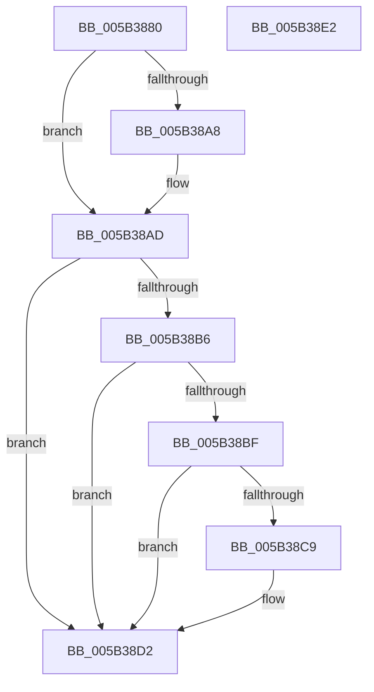

# KeEnterKernelDebugger

- RVA: `0x005B3880`–`0x005B38E3` (길이 `99` bytes)
- VA: `0x00000001405B3880`
- 실행 섹션: `.text`
- PDB 이름 있음: `예`; PDB Function 태그: `아니요`
- unwind 정보 RVA: `0x0005CF00`
- 디코드: `28`개 명령, `99/99` bytes 표시
- 미해석 바이트: `0` (있으면 어셈블리에 `.byte`로 보존)

> 이 문서는 커널 이미지의 기계어와 PDB 기호를 분석해 생성했습니다. 4번과 5번은 함수 원형과 자료형을 바이너리 사용 방식에서 추정한 C 해석이며 원본 소스 복구 결과는 아닙니다.

## 1. Dependencies

- 직접 호출 지점: **3**; 고유 호출 대상: **3**
- 직접 호출자로 확인된 함수: **0**
- RIP 상대 이미지 참조: **5**

### Outgoing calls
- `0x005B38A8` → [KiRaiseIrqlProcessIrqlFlags](../4F/KiRaiseIrqlProcessIrqlFlags_function_004F56FC.md) (function, `0x004F56FC`)
- `0x005B38CD` → [KdInitSystem](../../pagekd/B8/KdInitSystem_function_00B85E30.md) (function, `0x00B85E30`)
- `0x005B38D7` → [KiBugCheckDebugBreak](KiBugCheckDebugBreak_function_005B3DC0.md) (function, `0x005B3DC0`)

### Direct callers
- 이 함수 시작 RVA로 연결되는 직접 call은 확인되지 않았습니다. 간접 호출은 완전히 역산할 수 없습니다.

### Static image references
- `0x005B388D` → RVA `0x00F110B0` (`.data`; read/write)
- `0x005B389F` → RVA `0x00FC6D20` (`ALMOSTRO`; read)
- `0x005B38AD` → RVA `0x00F475F8` (`.data`; read)
- `0x005B38B6` → RVA `0x00E0AA1C` (`.data`; read)
- `0x005B38BF` → RVA `0x00E667EC` (`.data`; read/write)

## 2. Other-region calls and transfers

- 다른 실행 섹션으로 향하는 call: **1**
  - `0x005B38CD` → [KdInitSystem](../../pagekd/B8/KdInitSystem_function_00B85E30.md) (`.text` → `PAGEKD`)
- 별도 외부 분기/꼬리 이동을 확인하지 못했습니다.

## 3. Assembly (complete function range)

```asm
005B3880  40 53                           push rbx
005B3882  48 83 EC 20                     sub rsp, 0x20
005B3886  BB 01 00 00 00                  mov ebx, 1
005B388B  8B C3                           mov eax, ebx
005B388D  87 05 1D D8 95 00               xchg dword ptr [rip + 0x95d81d], eax
005B3893  FA                              cli
005B3894  44 0F 20 C1                     mov rcx, cr8
005B3898  8D 53 0E                        lea edx, [rbx + 0xe]
005B389B  44 0F 22 C2                     mov cr8, rdx
005B389F  83 3D 7A 34 A1 00 00            cmp dword ptr [rip + 0xa1347a], 0
005B38A6  74 05                           je 0x1405b38ad
005B38A8  E8 4F 1E F4 FF                  call 0x1404f56fc
005B38AD  80 3D 44 3D 99 00 00            cmp byte ptr [rip + 0x993d44], 0
005B38B4  75 1C                           jne 0x1405b38d2
005B38B6  80 3D 5F 71 85 00 00            cmp byte ptr [rip + 0x85715f], 0
005B38BD  75 13                           jne 0x1405b38d2
005B38BF  87 1D 27 2F 8B 00               xchg dword ptr [rip + 0x8b2f27], ebx
005B38C5  85 DB                           test ebx, ebx
005B38C7  75 09                           jne 0x1405b38d2
005B38C9  33 D2                           xor edx, edx
005B38CB  33 C9                           xor ecx, ecx
005B38CD  E8 5E 25 5D 00                  call 0x140b85e30
005B38D2  B9 05 00 00 00                  mov ecx, 5
005B38D7  E8 E4 04 00 00                  call 0x1405b3dc0
005B38DC  48 83 C4 20                     add rsp, 0x20
005B38E0  5B                              pop rbx
005B38E1  C3                              ret
005B38E2  CC                              int3
```

## 4. C-style interpretation (structured pseudocode)

```c
__int64 __fastcall KeEnterKernelDebugger(void)
{
    __int64 result;
    __int64 v_rsp;

    v_rsp = (v_rsp) - (32);
    result = 1;
    if ((*(unsigned int *)(v_rip + 10564730)) != 0) {
        result = KiRaiseIrqlProcessIrqlFlags(v_cr8, 1 + 14, a3, a4);
    }
    if ((*(unsigned __int8 *)(v_rip + 10042692)) != 0) goto loc_005B38D2;
    if ((*(unsigned __int8 *)(v_rip + 8745311)) != 0) goto loc_005B38D2;
    if (1 == 0) {
        a2 = 0;
        a1 = 0;
        result = KdInitSystem(a1, a2, a3, a4);
    }
    result = KiBugCheckDebugBreak(5, a2, a3, a4);
    v_rsp = (v_rsp) + (32);
    return result;
}
```

## 5. (Beta) C Style

```c
void KeEnterKernelDebugger(void)
{
    int64_t result;
    int64_t local_rsp;

    local_rsp = (local_rsp) - (32);
    result = 1;
    if ((*(uint32_t *)(v_rip + 0xA1347A)) != 0) {
        result = KiRaiseIrqlProcessIrqlFlags(v_cr8, 1 + 14, a3, a4);
    }
    if ((*(uint8_t *)(v_rip + 0x993D44)) != 0) goto loc_005B38D2;
    if ((*(uint8_t *)(v_rip + 0x85715F)) != 0) goto loc_005B38D2;
    if (1 == 0) {
        a2 = 0;
        a1 = 0;
        result = KdInitSystem(a1, a2, a3, a4);
    }
    result = KiBugCheckDebugBreak(5, a2, a3, a4);
    local_rsp = (local_rsp) + (32);
    return result;
}
```

## 6. Execution-region graph

[열기: 2D/3D 그래프와 함수 탐색 컨트롤 패널](../../../control-panel.html?section=text&rva=0x005B3880&view=graph)

- 2D 그래프는 위에서 아래로 흐르고, 3D 그래프는 빈 공간을 드래그해 회전합니다. Shift+드래그는 이동, 휠은 확대·축소, 함수 노드 선택은 대상 보고서 이동입니다.

### Static fallback


