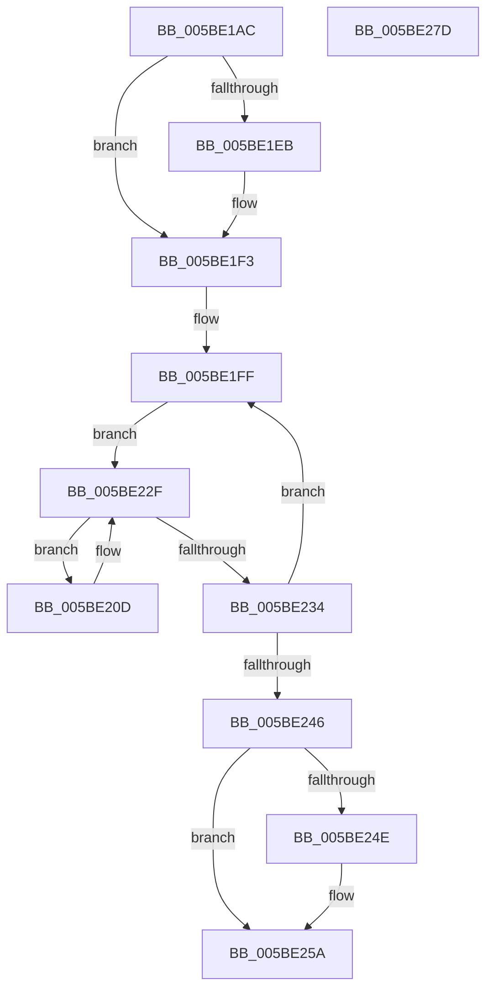

# KeEnumerateProcessorDpcs

- RVA: `0x005BE1AC`–`0x005BE27E` (길이 `210` bytes)
- VA: `0x00000001405BE1AC`
- 실행 섹션: `.text`
- PDB 이름 있음: `예`; PDB Function 태그: `아니요`
- unwind 정보 RVA: `0x0005D7BC`
- 디코드: `54`개 명령, `210/210` bytes 표시
- 미해석 바이트: `0` (있으면 어셈블리에 `.byte`로 보존)

> 이 문서는 커널 이미지의 기계어와 PDB 기호를 분석해 생성했습니다. 4번과 5번은 함수 원형과 자료형을 바이너리 사용 방식에서 추정한 C 해석이며 원본 소스 복구 결과는 아닙니다.

## 1. Dependencies

- 직접 호출 지점: **5**; 고유 호출 대상: **5**
- 직접 호출자로 확인된 함수: **1**
- RIP 상대 이미지 참조: **2**

### Outgoing calls
- `0x005BE1EE` → [KiRaiseIrqlProcessIrqlFlags](../4F/KiRaiseIrqlProcessIrqlFlags_function_004F56FC.md) (function, `0x004F56FC`)
- `0x005BE202` → [KeAcquireSpinLockAtDpcLevel](../20/KeAcquireSpinLockAtDpcLevel_function_00208430.md) (function, `0x00208430`)
- `0x005BE227` → [DbgkpLkmdSnapDataEx](../57/DbgkpLkmdSnapDataEx_function_0057FDD4.md) (function, `0x0057FDD4`)
- `0x005BE237` → [KxReleaseSpinLock](../20/KxReleaseSpinLock_function_00206670.md) (function, `0x00206670`)
- `0x005BE255` → [KiLowerIrqlProcessIrqlFlags](../4F/KiLowerIrqlProcessIrqlFlags_function_004F5698.md) (function, `0x004F5698`)

### Direct callers
- [DbgkpLkmdSnapGlobals](../57/DbgkpLkmdSnapGlobals_function_0057FE0C.md) at `0x0057FEAC`

### Static image references
- `0x005BE1C7` → RVA `0x00FC8C40` (`ALMOSTRO`; read)
- `0x005BE1E2` → RVA `0x00FC6D20` (`ALMOSTRO`; read)

## 2. Other-region calls and transfers

- 다른 실행 섹션으로 향하는 call: **0**
- 별도 외부 분기/꼬리 이동을 확인하지 못했습니다.

## 3. Assembly (complete function range)

```asm
005BE1AC  48 8B C4                        mov rax, rsp
005BE1AF  48 89 58 08                     mov qword ptr [rax + 8], rbx
005BE1B3  48 89 68 10                     mov qword ptr [rax + 0x10], rbp
005BE1B7  48 89 70 18                     mov qword ptr [rax + 0x18], rsi
005BE1BB  48 89 78 20                     mov qword ptr [rax + 0x20], rdi
005BE1BF  41 56                           push r14
005BE1C1  48 83 EC 30                     sub rsp, 0x30
005BE1C5  8B C1                           mov eax, ecx
005BE1C7  48 8D 1D 72 AA A0 00            lea rbx, [rip + 0xa0aa72]
005BE1CE  4D 8B F0                        mov r14, r8
005BE1D1  48 8B 1C C3                     mov rbx, qword ptr [rbx + rax*8]
005BE1D5  44 0F 20 C6                     mov rsi, cr8
005BE1D9  BA 0F 00 00 00                  mov edx, 0xf
005BE1DE  44 0F 22 C2                     mov cr8, rdx
005BE1E2  83 3D 37 8B A0 00 00            cmp dword ptr [rip + 0xa08b37], 0
005BE1E9  74 08                           je 0x1405be1f3
005BE1EB  40 8A CE                        mov cl, sil
005BE1EE  E8 09 75 F3 FF                  call 0x1404f56fc
005BE1F3  48 81 C3 50 38 00 00            add rbx, 0x3850
005BE1FA  BD 02 00 00 00                  mov ebp, 2
005BE1FF  48 8B CB                        mov rcx, rbx
005BE202  E8 29 A2 C4 FF                  call 0x140208430
005BE207  48 8B 7B F0                     mov rdi, qword ptr [rbx - 0x10]
005BE20B  EB 22                           jmp 0x1405be22f
005BE20D  48 83 64 24 28 00               and qword ptr [rsp + 0x28], 0
005BE213  48 8D 57 F8                     lea rdx, [rdi - 8]
005BE217  48 83 64 24 20 00               and qword ptr [rsp + 0x20], 0
005BE21D  45 33 C9                        xor r9d, r9d
005BE220  49 8B CE                        mov rcx, r14
005BE223  45 8D 41 40                     lea r8d, [r9 + 0x40]
005BE227  E8 A8 1B FC FF                  call 0x14057fdd4
005BE22C  48 8B 3F                        mov rdi, qword ptr [rdi]
005BE22F  48 85 FF                        test rdi, rdi
005BE232  75 D9                           jne 0x1405be20d
005BE234  48 8B CB                        mov rcx, rbx
005BE237  E8 34 84 C4 FF                  call 0x140206670
005BE23C  48 83 C3 30                     add rbx, 0x30
005BE240  48 83 ED 01                     sub rbp, 1
005BE244  75 B9                           jne 0x1405be1ff
005BE246  39 2D D4 8A A0 00               cmp dword ptr [rip + 0xa08ad4], ebp
005BE24C  74 0C                           je 0x1405be25a
005BE24E  44 0F 20 C1                     mov rcx, cr8
005BE252  40 8A D6                        mov dl, sil
005BE255  E8 3E 74 F3 FF                  call 0x1404f5698
005BE25A  40 0F B6 C6                     movzx eax, sil
005BE25E  44 0F 22 C0                     mov cr8, rax
005BE262  48 8B 5C 24 40                  mov rbx, qword ptr [rsp + 0x40]
005BE267  48 8B 6C 24 48                  mov rbp, qword ptr [rsp + 0x48]
005BE26C  48 8B 74 24 50                  mov rsi, qword ptr [rsp + 0x50]
005BE271  48 8B 7C 24 58                  mov rdi, qword ptr [rsp + 0x58]
005BE276  48 83 C4 30                     add rsp, 0x30
005BE27A  41 5E                           pop r14
005BE27C  C3                              ret
005BE27D  CC                              int3
```

## 4. C-style interpretation (structured pseudocode)

```c
__int64 __fastcall KeEnumerateProcessorDpcs(int a1, __int64 a2, __int64 a3, int a4)
{
    __int64 result;
    __int64 v_rbp;
    __int64 v_rbx;
    __int64 v_rsp;
    unsigned __int64 v_stack_m10;
    unsigned __int64 v_stack_m18;
    unsigned __int64 v_stack_p10;
    unsigned __int64 v_stack_p18;
    unsigned __int64 v_stack_p20;
    unsigned __int64 v_stack_p8;

    *(unsigned __int64 *)(v_rsp + 8) = v_rbx;
    *(unsigned __int64 *)(v_rsp + 16) = v_rbp;
    *(unsigned __int64 *)(v_rsp + 24) = v_rsi;
    *(unsigned __int64 *)(v_rsp + 32) = v_rdi;
    v_rsp = (v_rsp) - (48);
    result = (unsigned int)(a1);
    if ((*(unsigned int *)(v_rip + 10521399)) != 0) {
        a1 = (unsigned __int8)(v_cr8);
        result = KiRaiseIrqlProcessIrqlFlags(a1, 15, a3, a4);
    }
    v_rbx = (*(unsigned __int64 *)(v_rip + 10529394 + (unsigned int)(a1) * 8)) + (0x3850ULL);
loc_005BE1FF:
    result = KeAcquireSpinLockAtDpcLevel(v_rbx, 15, a3, a4);
    goto loc_005BE22F;
loc_005BE20D:
    a4 = 0;
    result = DbgkpLkmdSnapDataEx(a3, *(unsigned __int64 *)(v_rbx - 16) - 8, a4 + 64, a4);
loc_005BE22F:
    if (*(unsigned __int64 *)(*(unsigned __int64 *)(v_rbx - 16)) != 0) goto loc_005BE20D;
    result = KxReleaseSpinLock(v_rbx, *(unsigned __int64 *)(v_rbx - 16) - 8, a4 + 64, a4);
    v_rbx = (v_rbx) + (48);
    v_rbp = (2) - (1);
    if (condition_is_not_equal) goto loc_005BE1FF;
    if ((*(unsigned int *)(v_rip + 10521300)) != ((unsigned int)(v_rbp))) {
        a1 = 15;
        a2 = (unsigned __int8)(v_cr8);
        result = KiLowerIrqlProcessIrqlFlags(a1, a2, a4 + 64, a4);
    }
    v_rsp = (v_rsp) + (48);
    return (unsigned __int8)(v_cr8);
}
```

## 5. (Beta) C Style

```c
int64_t KeEnumerateProcessorDpcs(int32_t Arg1, int64_t Arg2, int64_t Arg3, int32_t Arg4)
{
    int64_t result;
    int64_t local_rbp;
    int64_t local_rbx;
    int64_t local_rsp;
    uint64_t v_stack_m10;
    uint64_t v_stack_m18;
    uint64_t v_stack_p10;
    uint64_t v_stack_p18;
    uint64_t v_stack_p20;
    uint64_t v_stack_p8;

    *(uint64_t *)(local_rsp + 0x8) = local_rbx;
    *(uint64_t *)(local_rsp + 0x10) = local_rbp;
    *(uint64_t *)(local_rsp + 0x18) = local_rsi;
    *(uint64_t *)(local_rsp + 0x20) = local_rdi;
    local_rsp = (local_rsp) - (48);
    result = (uint32_t)(Arg1);
    if ((*(uint32_t *)(v_rip + 0xA08B37)) != 0) {
        Arg1 = (uint8_t)(v_cr8);
        result = KiRaiseIrqlProcessIrqlFlags(Arg1, 15, Arg3, Arg4);
    }
    local_rbx = (*(uint64_t *)(v_rip + 0xA0AA72 + (uint32_t)(Arg1) * 8)) + (0x3850ULL);
loc_005BE1FF:
    result = KeAcquireSpinLockAtDpcLevel(local_rbx, 15, Arg3, Arg4);
    goto loc_005BE22F;
loc_005BE20D:
    Arg4 = 0;
    result = DbgkpLkmdSnapDataEx(Arg3, *(uint64_t *)(local_rbx - 0x10) - 8, Arg4 + 64, Arg4);
loc_005BE22F:
    if (*(uint64_t *)(*(uint64_t *)(local_rbx - 0x10)) != 0) goto loc_005BE20D;
    result = KxReleaseSpinLock(local_rbx, *(uint64_t *)(local_rbx - 0x10) - 8, Arg4 + 64, Arg4);
    local_rbx = (local_rbx) + (48);
    local_rbp = (2) - (1);
    if (condition_is_not_equal) goto loc_005BE1FF;
    if ((*(uint32_t *)(v_rip + 0xA08AD4)) != ((uint32_t)(local_rbp))) {
        Arg1 = 15;
        Arg2 = (uint8_t)(v_cr8);
        result = KiLowerIrqlProcessIrqlFlags(Arg1, Arg2, Arg4 + 64, Arg4);
    }
    local_rsp = (local_rsp) + (48);
    return (uint8_t)(v_cr8);
}
```

## 6. Execution-region graph

[열기: 2D/3D 그래프와 함수 탐색 컨트롤 패널](../../../control-panel.html?section=text&rva=0x005BE1AC&view=graph)

- 2D 그래프는 위에서 아래로 흐르고, 3D 그래프는 빈 공간을 드래그해 회전합니다. Shift+드래그는 이동, 휠은 확대·축소, 함수 노드 선택은 대상 보고서 이동입니다.

### Static fallback


