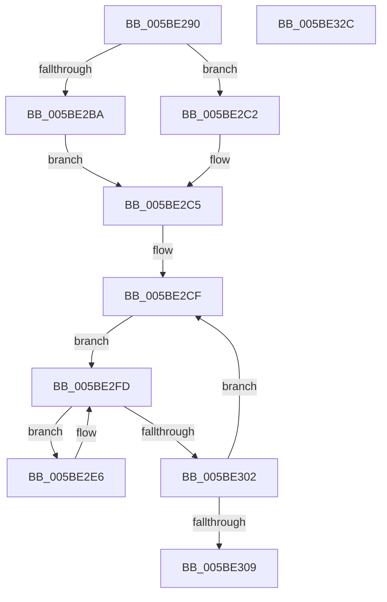

# KeEnumerateQueueApc

- RVA: `0x005BE290`–`0x005BE32D` (길이 `157` bytes)
- VA: `0x00000001405BE290`
- 실행 섹션: `.text`
- PDB 이름 있음: `예`; PDB Function 태그: `아니요`
- unwind 정보 RVA: `0x00083688`
- 디코드: `51`개 명령, `157/157` bytes 표시
- 미해석 바이트: `0` (있으면 어셈블리에 `.byte`로 보존)

> 이 문서는 커널 이미지의 기계어와 PDB 기호를 분석해 생성했습니다. 4번과 5번은 함수 원형과 자료형을 바이너리 사용 방식에서 추정한 C 해석이며 원본 소스 복구 결과는 아닙니다.

## 1. Dependencies

- 직접 호출 지점: **3**; 고유 호출 대상: **3**
- 직접 호출자로 확인된 함수: **1**
- RIP 상대 이미지 참조: **0**

### Outgoing calls
- `0x005BE2CA` → [KiAcquireThreadLockRaiseToDpc](../39/KiAcquireThreadLockRaiseToDpc_function_00396280.md) (function, `0x00396280`)
- `0x005BE2F5` → [guard_dispatch_icall](../6B/guard_dispatch_icall_function_006BAAD0.md) (function, `0x006BAAD0`)
- `0x005BE310` → [KiReleaseThreadLockLowerIrql](../3C/KiReleaseThreadLockLowerIrql_function_003C65D0.md) (function, `0x003C65D0`)

### Direct callers
- [DbgkpLkmdSnapThread](../58/DbgkpLkmdSnapThread_function_00580174.md) at `0x005801A4`

### Static image references
- 디코드된 RIP-relative 메모리 참조가 없습니다.

## 2. Other-region calls and transfers

- 다른 실행 섹션으로 향하는 call: **0**
- 별도 외부 분기/꼬리 이동을 확인하지 못했습니다.

## 3. Assembly (complete function range)

```asm
005BE290  48 89 5C 24 10                  mov qword ptr [rsp + 0x10], rbx
005BE295  48 89 6C 24 18                  mov qword ptr [rsp + 0x18], rbp
005BE29A  56                              push rsi
005BE29B  57                              push rdi
005BE29C  41 54                           push r12
005BE29E  41 56                           push r14
005BE2A0  41 57                           push r15
005BE2A2  48 83 EC 20                     sub rsp, 0x20
005BE2A6  33 DB                           xor ebx, ebx
005BE2A8  4D 8B F8                        mov r15, r8
005BE2AB  88 5C 24 50                     mov byte ptr [rsp + 0x50], bl
005BE2AF  4C 8B E2                        mov r12, rdx
005BE2B2  48 8B F9                        mov rdi, rcx
005BE2B5  4D 85 C9                        test r9, r9
005BE2B8  74 08                           je 0x1405be2c2
005BE2BA  41 8A 19                        mov bl, byte ptr [r9]
005BE2BD  40 8A EB                        mov bpl, bl
005BE2C0  EB 03                           jmp 0x1405be2c5
005BE2C2  40 B5 01                        mov bpl, 1
005BE2C5  48 8D 54 24 50                  lea rdx, [rsp + 0x50]
005BE2CA  E8 B1 7F DD FF                  call 0x140396280
005BE2CF  4C 0F BE F3                     movsx r14, bl
005BE2D3  49 C1 E6 04                     shl r14, 4
005BE2D7  49 81 C6 98 00 00 00            add r14, 0x98
005BE2DE  4C 03 F7                        add r14, rdi
005BE2E1  49 8B 36                        mov rsi, qword ptr [r14]
005BE2E4  EB 17                           jmp 0x1405be2fd
005BE2E6  48 8D 4E F0                     lea rcx, [rsi - 0x10]
005BE2EA  4D 8B C7                        mov r8, r15
005BE2ED  BA 58 00 00 00                  mov edx, 0x58
005BE2F2  49 8B C4                        mov rax, r12
005BE2F5  E8 D6 C7 0F 00                  call 0x1406baad0
005BE2FA  48 8B 36                        mov rsi, qword ptr [rsi]
005BE2FD  49 3B F6                        cmp rsi, r14
005BE300  75 E4                           jne 0x1405be2e6
005BE302  FE C3                           inc bl
005BE304  40 3A DD                        cmp bl, bpl
005BE307  7E C6                           jle 0x1405be2cf
005BE309  8A 54 24 50                     mov dl, byte ptr [rsp + 0x50]
005BE30D  48 8B CF                        mov rcx, rdi
005BE310  E8 BB 82 E0 FF                  call 0x1403c65d0
005BE315  48 8B 5C 24 58                  mov rbx, qword ptr [rsp + 0x58]
005BE31A  48 8B 6C 24 60                  mov rbp, qword ptr [rsp + 0x60]
005BE31F  48 83 C4 20                     add rsp, 0x20
005BE323  41 5F                           pop r15
005BE325  41 5E                           pop r14
005BE327  41 5C                           pop r12
005BE329  5F                              pop rdi
005BE32A  5E                              pop rsi
005BE32B  C3                              ret
005BE32C  CC                              int3
```

## 4. C-style interpretation (structured pseudocode)

```c
__int64 __fastcall KeEnumerateQueueApc(__int64 a1, __int64 a2, __int64 a3, __int64 a4)
{
    __int64 result;
    __int64 v_r14;
    __int64 v_rbx;
    __int64 v_rsp;
    unsigned __int64 v_stack_p10;
    unsigned __int64 v_stack_p18;
    unsigned __int8 v_stack_p8;

    v_stack_p10 = v_rbx;
    v_stack_p18 = v_rbp;
    v_rsp = (v_rsp) - (32);
    v_rbx = 0;
    v_stack_p8 = 0;
    if (a4 == 0) goto loc_005BE2C2;
    goto loc_005BE2C5;
loc_005BE2C2:
loc_005BE2C5:
    result = KiAcquireThreadLockRaiseToDpc(a1, v_stack_p8, a3, a4);
loc_005BE2CF:
    v_r14 = ((__int8)((unsigned __int8)(*(unsigned __int8 *)(a4)))) << (4);
    v_r14 = (v_r14) + (152);
    v_r14 = (v_r14) + (a1);
    goto loc_005BE2FD;
loc_005BE2E6:
    result = guard_dispatch_icall(*(unsigned __int64 *)(v_r14) - 16, 88, a3, a4);
loc_005BE2FD:
    if ((*(unsigned __int64 *)(*(unsigned __int64 *)(v_r14))) != v_r14) goto loc_005BE2E6;
    v_rbx = (unsigned __int8)((*(unsigned __int8 *)(a4)) + 1);
    if (((unsigned __int8)(v_rbx)) <= 1) goto loc_005BE2CF;
    result = KiReleaseThreadLockLowerIrql(a1, v_stack_p8, a3, a4);
    v_rsp = (v_rsp) + (32);
    return result;
}
```

## 5. (Beta) C Style

```c
int64_t KeEnumerateQueueApc(int64_t Arg1, int64_t Arg2, int64_t Arg3, int64_t Arg4)
{
    int64_t result;
    int64_t local_r14;
    int64_t local_rbx;
    int64_t local_rsp;
    uint64_t v_stack_p10;
    uint64_t v_stack_p18;
    uint8_t v_stack_p8;

    v_stack_p10 = local_rbx;
    v_stack_p18 = local_rbp;
    local_rsp = (local_rsp) - (32);
    local_rbx = 0;
    v_stack_p8 = 0;
    if (Arg4 == 0) goto loc_005BE2C2;
    goto loc_005BE2C5;
loc_005BE2C2:
loc_005BE2C5:
    result = KiAcquireThreadLockRaiseToDpc(Arg1, v_stack_p8, Arg3, Arg4);
loc_005BE2CF:
    local_r14 = ((int8_t)((uint8_t)(*(uint8_t *)(Arg4)))) << (4);
    local_r14 = (local_r14) + (152);
    local_r14 = (local_r14) + (Arg1);
    goto loc_005BE2FD;
loc_005BE2E6:
    result = guard_dispatch_icall(*(uint64_t *)(local_r14) - 16, 88, Arg3, Arg4);
loc_005BE2FD:
    if ((*(uint64_t *)(*(uint64_t *)(local_r14))) != local_r14) goto loc_005BE2E6;
    local_rbx = (uint8_t)((*(uint8_t *)(Arg4)) + 1);
    if (((uint8_t)(local_rbx)) <= 1) goto loc_005BE2CF;
    result = KiReleaseThreadLockLowerIrql(Arg1, v_stack_p8, Arg3, Arg4);
    local_rsp = (local_rsp) + (32);
    return result;
}
```

## 6. Execution-region graph

[열기: 2D/3D 그래프와 함수 탐색 컨트롤 패널](../../../control-panel.html?section=text&rva=0x005BE290&view=graph)

- 2D 그래프는 위에서 아래로 흐르고, 3D 그래프는 빈 공간을 드래그해 회전합니다. Shift+드래그는 이동, 휠은 확대·축소, 함수 노드 선택은 대상 보고서 이동입니다.

### Static fallback


