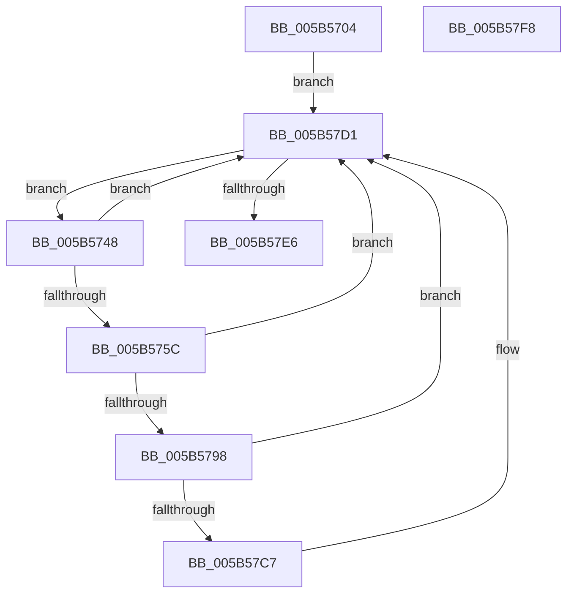

# KeEtwInitializeCpuStarvationProvider

- RVA: `0x005B5704`–`0x005B57F9` (길이 `245` bytes)
- VA: `0x00000001405B5704`
- 실행 섹션: `.text`
- PDB 이름 있음: `예`; PDB Function 태그: `아니요`
- unwind 정보 RVA: `0x000C48B8`
- 디코드: `60`개 명령, `245/245` bytes 표시
- 미해석 바이트: `0` (있으면 어셈블리에 `.byte`로 보존)

> 이 문서는 커널 이미지의 기계어와 PDB 기호를 분석해 생성했습니다. 4번과 5번은 함수 원형과 자료형을 바이너리 사용 방식에서 추정한 C 해석이며 원본 소스 복구 결과는 아닙니다.

## 1. Dependencies

- 직접 호출 지점: **4**; 고유 호출 대상: **4**
- 직접 호출자로 확인된 함수: **1**
- RIP 상대 이미지 참조: **3**

### Outgoing calls
- `0x005B574B` → [KeGetPrcb](../2D/KeGetPrcb_function_002D85D0.md) (function, `0x002D85D0`)
- `0x005B578B` → [ExAllocatePool3](../../poolcode/B8/ExAllocatePool3_function_00B84270.md) (function, `0x00B84270`)
- `0x005B57CC` → [ExFreePoolWithTag](../../poolcode/B8/ExFreePoolWithTag_function_00B82870.md) (function, `0x00B82870`)
- `0x005B57D9` → [KeEnumerateNextProcessor](../41/KeEnumerateNextProcessor_function_00415480.md) (function, `0x00415480`)

### Direct callers
- [EtwpCpuStarvationProvEnableCallback](../64/EtwpCpuStarvationProvEnableCallback_function_0064E850.md) at `0x0064E859`

### Static image references
- `0x005B5716` → RVA `0x00FC7128` (`ALMOSTRO`; read)
- `0x005B5726` → RVA `0x00FC7120` (`ALMOSTRO`; read)
- `0x005B579F` → RVA `0x005B5D50` (`KiLogSingleDpcSoftTimeoutEvent`; read)

## 2. Other-region calls and transfers

- 다른 실행 섹션으로 향하는 call: **2**
  - `0x005B578B` → [ExAllocatePool3](../../poolcode/B8/ExAllocatePool3_function_00B84270.md) (`.text` → `POOLCODE`)
  - `0x005B57CC` → [ExFreePoolWithTag](../../poolcode/B8/ExFreePoolWithTag_function_00B82870.md) (`.text` → `POOLCODE`)
- 별도 외부 분기/꼬리 이동을 확인하지 못했습니다.

## 3. Assembly (complete function range)

```asm
005B5704  48 89 5C 24 10                  mov qword ptr [rsp + 0x10], rbx
005B5709  48 89 7C 24 18                  mov qword ptr [rsp + 0x18], rdi
005B570E  55                              push rbp
005B570F  48 8B EC                        mov rbp, rsp
005B5712  48 83 EC 60                     sub rsp, 0x60
005B5716  48 8B 05 0B 1A A1 00            mov rax, qword ptr [rip + 0xa11a0b]
005B571D  33 FF                           xor edi, edi
005B571F  48 89 45 E8                     mov qword ptr [rbp - 0x18], rax
005B5723  0F 57 C0                        xorps xmm0, xmm0
005B5726  48 8D 05 F3 19 A1 00            lea rax, [rip + 0xa119f3]
005B572D  89 7D F2                        mov dword ptr [rbp - 0xe], edi
005B5730  48 89 45 E0                     mov qword ptr [rbp - 0x20], rax
005B5734  66 89 7D F6                     mov word ptr [rbp - 0xa], di
005B5738  0F 11 45 D0                     movups xmmword ptr [rbp - 0x30], xmm0
005B573C  89 7D 10                        mov dword ptr [rbp + 0x10], edi
005B573F  66 89 7D F0                     mov word ptr [rbp - 0x10], di
005B5743  E9 89 00 00 00                  jmp 0x1405b57d1
005B5748  8B 4D 10                        mov ecx, dword ptr [rbp + 0x10]
005B574B  E8 80 2E D2 FF                  call 0x1402d85d0
005B5750  48 8B D8                        mov rbx, rax
005B5753  48 39 B8 D0 38 00 00            cmp qword ptr [rax + 0x38d0], rdi
005B575A  75 75                           jne 0x1405b57d1
005B575C  48 8B 88 C0 00 00 00            mov rcx, qword ptr [rax + 0xc0]
005B5763  4C 8D 4D D0                     lea r9, [rbp - 0x30]
005B5767  41 B8 4B 69 43 70               mov r8d, 0x7043694b
005B576D  C6 45 D0 03                     mov byte ptr [rbp - 0x30], 3
005B5771  C7 44 24 20 01 00 00 00         mov dword ptr [rsp + 0x20], 1
005B5779  0F B7 91 8A 00 00 00            movzx edx, word ptr [rcx + 0x8a]
005B5780  89 55 D8                        mov dword ptr [rbp - 0x28], edx
005B5783  BA 50 00 00 00                  mov edx, 0x50
005B5788  8D 4A F0                        lea ecx, [rdx - 0x10]
005B578B  E8 E0 EA 5C 00                  call 0x140b84270
005B5790  48 8B C8                        mov rcx, rax
005B5793  48 85 C0                        test rax, rax
005B5796  74 39                           je 0x1405b57d1
005B5798  C6 00 13                        mov byte ptr [rax], 0x13
005B579B  66 89 78 02                     mov word ptr [rax + 2], di
005B579F  48 8D 05 AA 05 00 00            lea rax, [rip + 0x5aa]
005B57A6  48 89 41 18                     mov qword ptr [rcx + 0x18], rax
005B57AA  33 C0                           xor eax, eax
005B57AC  48 89 59 20                     mov qword ptr [rcx + 0x20], rbx
005B57B0  48 89 79 38                     mov qword ptr [rcx + 0x38], rdi
005B57B4  48 89 79 10                     mov qword ptr [rcx + 0x10], rdi
005B57B8  C6 41 01 02                     mov byte ptr [rcx + 1], 2
005B57BC  F0 48 0F B1 8B D0 38 00 00      lock cmpxchg qword ptr [rbx + 0x38d0], rcx
005B57C5  74 0A                           je 0x1405b57d1
005B57C7  BA 4B 69 43 70                  mov edx, 0x7043694b
005B57CC  E8 9F D0 5C 00                  call 0x140b82870
005B57D1  48 8D 55 E0                     lea rdx, [rbp - 0x20]
005B57D5  48 8D 4D 10                     lea rcx, [rbp + 0x10]
005B57D9  E8 A2 FC E5 FF                  call 0x140415480
005B57DE  85 C0                           test eax, eax
005B57E0  0F 84 62 FF FF FF               je 0x1405b5748
005B57E6  4C 8D 5C 24 60                  lea r11, [rsp + 0x60]
005B57EB  49 8B 5B 18                     mov rbx, qword ptr [r11 + 0x18]
005B57EF  49 8B 7B 20                     mov rdi, qword ptr [r11 + 0x20]
005B57F3  49 8B E3                        mov rsp, r11
005B57F6  5D                              pop rbp
005B57F7  C3                              ret
005B57F8  CC                              int3
```

## 4. C-style interpretation (structured pseudocode)

```c
__int64 __fastcall KeEtwInitializeCpuStarvationProvider(void)
{
    __int64 result;
    __int64 v_rdi;
    __int64 v_rsp;
    unsigned __int16 v_stack_m12;
    unsigned int v_stack_m16;
    unsigned __int16 v_stack_m18;
    unsigned __int64 v_stack_m20;
    unsigned __int64 v_stack_m28;
    unsigned int v_stack_m30;
    unsigned __int64 v_stack_m38;
    unsigned int v_stack_m48;
    unsigned __int64 v_stack_m8;
    unsigned __int64 v_stack_p10;
    unsigned __int64 v_stack_p18;
    unsigned int v_stack_p8;

    v_stack_p10 = v_rbx;
    v_stack_p18 = v_rdi;
    v_rsp = (v_rsp) - (96);
    v_rdi = 0;
    v_stack_m20 = *(unsigned __int64 *)(v_rip + 10557963);
    v_stack_m16 = 0;
    v_stack_m28 = v_rip + 10557939;
    v_stack_m12 = 0;
    v_stack_m38 = v_xmm0;
    v_stack_p8 = 0;
    v_stack_m18 = 0;
    goto loc_005B57D1;
loc_005B5748:
    result = KeGetPrcb((unsigned int)(v_stack_p8), a2, a3, a4);
    if ((*(unsigned __int64 *)(result + 14544)) != 0) goto loc_005B57D1;
    v_stack_m38 = 3;
    v_stack_m48 = 1;
    v_stack_m30 = (unsigned int)(*(unsigned __int16 *)(*(unsigned __int64 *)(result + 192) + 138));
    result = ExAllocatePool3(80 - 16, 80, (unsigned int)(0x7043694BULL), v_stack_m38);
    if (result == 0) goto loc_005B57D1;
    *(unsigned __int8 *)(result) = 19;
    *(unsigned __int16 *)(result + 2) = 0;
    *(unsigned __int64 *)(result + 24) = v_rip + 1450;
    result = 0;
    *(unsigned __int64 *)(result + 32) = 0;
    *(unsigned __int64 *)(result + 56) = 0;
    *(unsigned __int64 *)(result + 16) = 0;
    *(unsigned __int8 *)(result + 1) = 2;
    if (!(condition_is_equal)) {
        a2 = 0x7043694BULL;
        result = ExFreePoolWithTag(result, a2, (unsigned int)(0x7043694BULL), v_stack_m38);
    }
    result = KeEnumerateNextProcessor(v_stack_p8, v_stack_m28, (unsigned int)(0x7043694BULL), v_stack_m38);
    if ((unsigned int)(result) == 0) goto loc_005B5748;
    return result;
}
```

## 5. (Beta) C Style

```c
void KeEtwInitializeCpuStarvationProvider(void)
{
    int64_t result;
    int64_t local_rdi;
    int64_t local_rsp;
    uint16_t v_stack_m12;
    uint32_t v_stack_m16;
    uint16_t v_stack_m18;
    uint64_t v_stack_m20;
    uint64_t v_stack_m28;
    uint32_t v_stack_m30;
    uint64_t v_stack_m38;
    uint32_t v_stack_m48;
    uint64_t v_stack_m8;
    uint64_t v_stack_p10;
    uint64_t v_stack_p18;
    uint32_t v_stack_p8;

    v_stack_p10 = local_rbx;
    v_stack_p18 = local_rdi;
    local_rsp = (local_rsp) - (96);
    local_rdi = 0;
    v_stack_m20 = *(uint64_t *)(v_rip + 0xA11A0B);
    v_stack_m16 = 0;
    v_stack_m28 = v_rip + 10557939;
    v_stack_m12 = 0;
    v_stack_m38 = v_xmm0;
    v_stack_p8 = 0;
    v_stack_m18 = 0;
    goto loc_005B57D1;
loc_005B5748:
    result = KeGetPrcb((uint32_t)(v_stack_p8), a2, a3, a4);
    if ((*(uint64_t *)(result + 0x38D0)) != 0) goto loc_005B57D1;
    v_stack_m38 = 3;
    v_stack_m48 = 1;
    v_stack_m30 = (uint32_t)(*(uint16_t *)(*(uint64_t *)(result + 0xC0) + 0x8A));
    result = ExAllocatePool3(80 - 16, 80, (uint32_t)(0x7043694BULL), v_stack_m38);
    if (result == 0) goto loc_005B57D1;
    *(uint8_t *)(result) = 19;
    *(uint16_t *)(result + 0x2) = 0;
    *(uint64_t *)(result + 0x18) = v_rip + 1450;
    result = 0;
    *(uint64_t *)(result + 0x20) = 0;
    *(uint64_t *)(result + 0x38) = 0;
    *(uint64_t *)(result + 0x10) = 0;
    *(uint8_t *)(result + 0x1) = 2;
    if (!(condition_is_equal)) {
        a2 = 0x7043694BULL;
        result = ExFreePoolWithTag(result, a2, (uint32_t)(0x7043694BULL), v_stack_m38);
    }
    result = KeEnumerateNextProcessor(v_stack_p8, v_stack_m28, (uint32_t)(0x7043694BULL), v_stack_m38);
    if ((uint32_t)(result) == 0) goto loc_005B5748;
    return result;
}
```

## 6. Execution-region graph

[열기: 2D/3D 그래프와 함수 탐색 컨트롤 패널](../../../control-panel.html?section=text&rva=0x005B5704&view=graph)

- 2D 그래프는 위에서 아래로 흐르고, 3D 그래프는 빈 공간을 드래그해 회전합니다. Shift+드래그는 이동, 휠은 확대·축소, 함수 노드 선택은 대상 보고서 이동입니다.

### Static fallback


