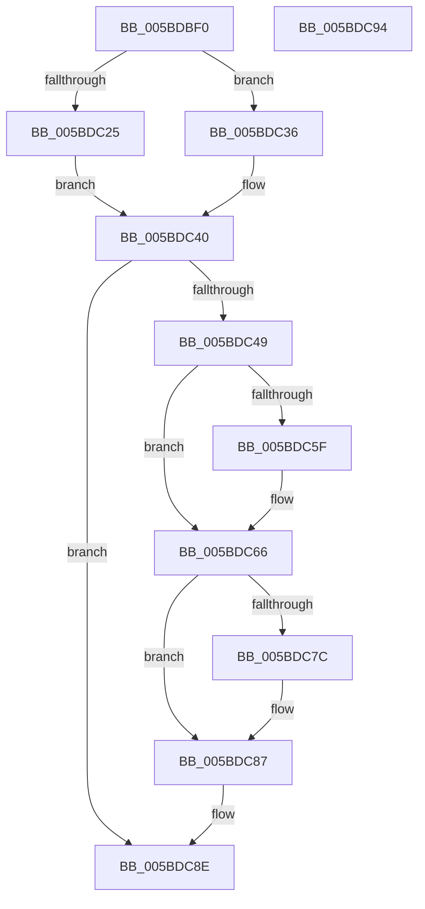

# KeFlushEntireTb

- RVA: `0x005BDBF0`–`0x005BDC95` (길이 `165` bytes)
- VA: `0x00000001405BDBF0`
- 실행 섹션: `.text`
- PDB 이름 있음: `예`; PDB Function 태그: `아니요`
- unwind 정보 RVA: `0x00064C80`
- 디코드: `45`개 명령, `165/165` bytes 표시
- 미해석 바이트: `0` (있으면 어셈블리에 `.byte`로 보존)

> 이 문서는 커널 이미지의 기계어와 PDB 기호를 분석해 생성했습니다. 4번과 5번은 함수 원형과 자료형을 바이너리 사용 방식에서 추정한 C 해석이며 원본 소스 복구 결과는 아닙니다.

## 1. Dependencies

- 직접 호출 지점: **6**; 고유 호출 대상: **6**
- 직접 호출자로 확인된 함수: **1**
- RIP 상대 이미지 참조: **2**

### Outgoing calls
- `0x005BDC19` → [KiPreprocessFlushTb](../30/KiPreprocessFlushTb_function_00308E00.md) (function, `0x00308E00`)
- `0x005BDC2F` → [KiFlushAddressSpaceTb](../30/KiFlushAddressSpaceTb_function_00308F50.md) (function, `0x00308F50`)
- `0x005BDC3B` → [KxFlushEntireTb](../30/KxFlushEntireTb_function_00309094.md) (function, `0x00309094`)
- `0x005BDC61` → [KiRaiseIrqlProcessIrqlFlags](../4F/KiRaiseIrqlProcessIrqlFlags_function_004F56FC.md) (function, `0x004F56FC`)
- `0x005BDC6E` → [ExFlushTb](../31/ExFlushTb_function_00312B34.md) (function, `0x00312B34`)
- `0x005BDC82` → [KiLowerIrqlProcessIrqlFlags](../4F/KiLowerIrqlProcessIrqlFlags_function_004F5698.md) (function, `0x004F5698`)

### Direct callers
- [MiRebaseDynamicRelocationRegions](../../init/C6/MiRebaseDynamicRelocationRegions_function_00C65C4C.md) at `0x00C65D23`

### Static image references
- `0x005BDC40` → RVA `0x00E685D4` (`.data`; read)
- `0x005BDC56` → RVA `0x00FC6D20` (`ALMOSTRO`; read)

## 2. Other-region calls and transfers

- 다른 실행 섹션으로 향하는 call: **0**
- 별도 외부 분기/꼬리 이동을 확인하지 못했습니다.

## 3. Assembly (complete function range)

```asm
005BDBF0  40 53                           push rbx
005BDBF2  48 83 EC 30                     sub rsp, 0x30
005BDBF6  BA 02 00 00 00                  mov edx, 2
005BDBFB  C6 44 24 50 00                  mov byte ptr [rsp + 0x50], 0
005BDC00  48 8D 44 24 58                  lea rax, [rsp + 0x58]
005BDC05  C6 44 24 58 00                  mov byte ptr [rsp + 0x58], 0
005BDC0A  44 8B C2                        mov r8d, edx
005BDC0D  48 89 44 24 20                  mov qword ptr [rsp + 0x20], rax
005BDC12  4C 8D 4C 24 50                  lea r9, [rsp + 0x50]
005BDC17  B1 01                           mov cl, 1
005BDC19  E8 E2 B1 D4 FF                  call 0x140308e00
005BDC1E  80 7C 24 50 00                  cmp byte ptr [rsp + 0x50], 0
005BDC23  74 11                           je 0x1405bdc36
005BDC25  41 B1 01                        mov r9b, 1
005BDC28  33 D2                           xor edx, edx
005BDC2A  45 8A C1                        mov r8b, r9b
005BDC2D  33 C9                           xor ecx, ecx
005BDC2F  E8 1C B3 D4 FF                  call 0x140308f50
005BDC34  EB 0A                           jmp 0x1405bdc40
005BDC36  B9 02 00 00 00                  mov ecx, 2
005BDC3B  E8 54 B4 D4 FF                  call 0x140309094
005BDC40  83 3D 8D A9 8A 00 00            cmp dword ptr [rip + 0x8aa98d], 0
005BDC47  74 45                           je 0x1405bdc8e
005BDC49  44 0F 20 C3                     mov rbx, cr8
005BDC4D  BA 0F 00 00 00                  mov edx, 0xf
005BDC52  44 0F 22 C2                     mov cr8, rdx
005BDC56  83 3D C3 90 A0 00 00            cmp dword ptr [rip + 0xa090c3], 0
005BDC5D  74 07                           je 0x1405bdc66
005BDC5F  8A CB                           mov cl, bl
005BDC61  E8 96 7A F3 FF                  call 0x1404f56fc
005BDC66  33 D2                           xor edx, edx
005BDC68  33 C9                           xor ecx, ecx
005BDC6A  44 8D 42 02                     lea r8d, [rdx + 2]
005BDC6E  E8 C1 4E D5 FF                  call 0x140312b34
005BDC73  83 3D A6 90 A0 00 00            cmp dword ptr [rip + 0xa090a6], 0
005BDC7A  74 0B                           je 0x1405bdc87
005BDC7C  44 0F 20 C1                     mov rcx, cr8
005BDC80  8A D3                           mov dl, bl
005BDC82  E8 11 7A F3 FF                  call 0x1404f5698
005BDC87  0F B6 C3                        movzx eax, bl
005BDC8A  44 0F 22 C0                     mov cr8, rax
005BDC8E  48 83 C4 30                     add rsp, 0x30
005BDC92  5B                              pop rbx
005BDC93  C3                              ret
005BDC94  CC                              int3
```

## 4. C-style interpretation (structured pseudocode)

```c
__int64 __fastcall KeFlushEntireTb(void)
{
    __int64 result;
    __int64 v_rsp;
    unsigned __int64 v_stack_m18;
    unsigned __int8 v_stack_p18;
    unsigned __int64 v_stack_p20;

    v_rsp = (v_rsp) - (48);
    v_stack_p18 = 0;
    v_stack_p20 = 0;
    v_stack_m18 = v_stack_p20;
    result = KiPreprocessFlushTb(1, 2, 2, v_stack_p18);
    if (v_stack_p18 == 0) goto loc_005BDC36;
    a2 = 0;
    a1 = 0;
    result = KiFlushAddressSpaceTb(a1, a2, 1, 1);
    goto loc_005BDC40;
loc_005BDC36:
    result = KxFlushEntireTb(2, a2, 1, 1);
loc_005BDC40:
    if ((*(unsigned int *)(v_rip + 9087373)) == 0) goto loc_005BDC8E;
    if ((*(unsigned int *)(v_rip + 10522819)) != 0) {
        a1 = (unsigned __int8)(v_cr8);
        result = KiRaiseIrqlProcessIrqlFlags(a1, 15, 1, 1);
    }
    a2 = 0;
    a1 = 0;
    result = ExFlushTb(a1, a2, a2 + 2, 1);
    if ((*(unsigned int *)(v_rip + 10522790)) != 0) {
        a1 = 15;
        a2 = (unsigned __int8)(v_cr8);
        result = KiLowerIrqlProcessIrqlFlags(a1, a2, a2 + 2, 1);
    }
loc_005BDC8E:
    v_rsp = (v_rsp) + (48);
    return (unsigned __int8)(v_cr8);
}
```

## 5. (Beta) C Style

```c
void KeFlushEntireTb(void)
{
    int64_t result;
    int64_t local_rsp;
    uint64_t v_stack_m18;
    uint8_t v_stack_p18;
    uint64_t v_stack_p20;

    local_rsp = (local_rsp) - (48);
    v_stack_p18 = 0;
    v_stack_p20 = 0;
    v_stack_m18 = v_stack_p20;
    result = KiPreprocessFlushTb(1, 2, 2, v_stack_p18);
    if (v_stack_p18 == 0) goto loc_005BDC36;
    a2 = 0;
    a1 = 0;
    result = KiFlushAddressSpaceTb(a1, a2, 1, 1);
    goto loc_005BDC40;
loc_005BDC36:
    result = KxFlushEntireTb(2, a2, 1, 1);
loc_005BDC40:
    if ((*(uint32_t *)(v_rip + 0x8AA98D)) == 0) goto loc_005BDC8E;
    if ((*(uint32_t *)(v_rip + 0xA090C3)) != 0) {
        a1 = (uint8_t)(v_cr8);
        result = KiRaiseIrqlProcessIrqlFlags(a1, 15, 1, 1);
    }
    a2 = 0;
    a1 = 0;
    result = ExFlushTb(a1, a2, a2 + 2, 1);
    if ((*(uint32_t *)(v_rip + 0xA090A6)) != 0) {
        a1 = 15;
        a2 = (uint8_t)(v_cr8);
        result = KiLowerIrqlProcessIrqlFlags(a1, a2, a2 + 2, 1);
    }
loc_005BDC8E:
    local_rsp = (local_rsp) + (48);
    return (uint8_t)(v_cr8);
}
```

## 6. Execution-region graph

[열기: 2D/3D 그래프와 함수 탐색 컨트롤 패널](../../../control-panel.html?section=text&rva=0x005BDBF0&view=graph)

- 2D 그래프는 위에서 아래로 흐르고, 3D 그래프는 빈 공간을 드래그해 회전합니다. Shift+드래그는 이동, 휠은 확대·축소, 함수 노드 선택은 대상 보고서 이동입니다.

### Static fallback


