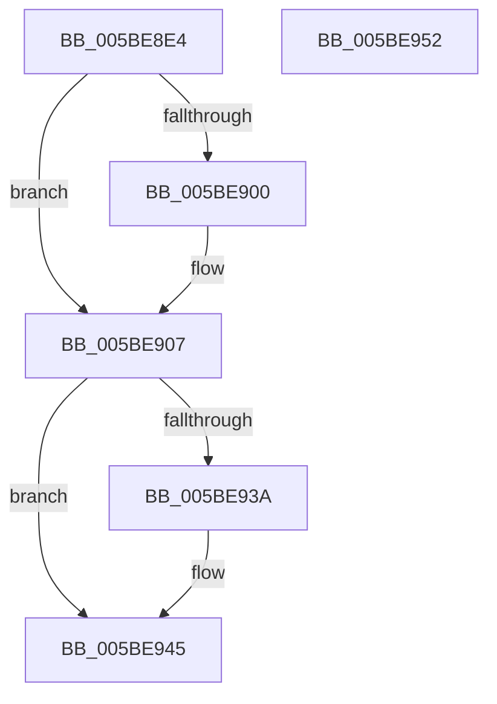

# KeFlushRsb

- RVA: `0x005BE8E4`–`0x005BE953` (길이 `111` bytes)
- VA: `0x00000001405BE8E4`
- 실행 섹션: `.text`
- PDB 이름 있음: `예`; PDB Function 태그: `아니요`
- unwind 정보 RVA: `0x00064C80`
- 디코드: `29`개 명령, `111/111` bytes 표시
- 미해석 바이트: `0` (있으면 어셈블리에 `.byte`로 보존)

> 이 문서는 커널 이미지의 기계어와 PDB 기호를 분석해 생성했습니다. 4번과 5번은 함수 원형과 자료형을 바이너리 사용 방식에서 추정한 C 해석이며 원본 소스 복구 결과는 아닙니다.

## 1. Dependencies

- 직접 호출 지점: **5**; 고유 호출 대상: **5**
- 직접 호출자로 확인된 함수: **1**
- RIP 상대 이미지 참조: **2**

### Outgoing calls
- `0x005BE902` → [KiRaiseIrqlProcessIrqlFlags](../4F/KiRaiseIrqlProcessIrqlFlags_function_004F56FC.md) (function, `0x004F56FC`)
- `0x005BE922` → [KiIpiSendPacket](../47/KiIpiSendPacket_function_004711DC.md) (function, `0x004711DC`)
- `0x005BE927` → [KiIpiStallOnPacketTargets](../47/KiIpiStallOnPacketTargets_function_004718D8.md) (function, `0x004718D8`)
- `0x005BE92C` → [KiFlushCurrentRsb](../6C/KiFlushCurrentRsb_function_006C6540.md) (function, `0x006C6540`)
- `0x005BE940` → [KiLowerIrqlProcessIrqlFlags](../4F/KiLowerIrqlProcessIrqlFlags_function_004F5698.md) (function, `0x004F5698`)

### Direct callers
- [MiUnloadSystemImage](../../page/AA/MiUnloadSystemImage_function_00AA2FD4.md) at `0x00AA316A`

### Static image references
- `0x005BE8F7` → RVA `0x00FC6D20` (`ALMOSTRO`; read)
- `0x005BE90D` → RVA `0x004DB4D0` (`KiFlushRsbTarget`; read)

## 2. Other-region calls and transfers

- 다른 실행 섹션으로 향하는 call: **0**
- 별도 외부 분기/꼬리 이동을 확인하지 못했습니다.

## 3. Assembly (complete function range)

```asm
005BE8E4  40 53                           push rbx
005BE8E6  48 83 EC 30                     sub rsp, 0x30
005BE8EA  44 0F 20 C3                     mov rbx, cr8
005BE8EE  BA 0C 00 00 00                  mov edx, 0xc
005BE8F3  44 0F 22 C2                     mov cr8, rdx
005BE8F7  83 3D 22 84 A0 00 00            cmp dword ptr [rip + 0xa08422], 0
005BE8FE  74 07                           je 0x1405be907
005BE900  8A CB                           mov cl, bl
005BE902  E8 F5 6D F3 FF                  call 0x1404f56fc
005BE907  48 83 64 24 28 00               and qword ptr [rsp + 0x28], 0
005BE90D  4C 8D 05 BC CB F1 FF            lea r8, [rip - 0xe3444]
005BE914  48 83 64 24 20 00               and qword ptr [rsp + 0x20], 0
005BE91A  33 D2                           xor edx, edx
005BE91C  45 33 C9                        xor r9d, r9d
005BE91F  8D 4A 01                        lea ecx, [rdx + 1]
005BE922  E8 B5 28 EB FF                  call 0x1404711dc
005BE927  E8 AC 2F EB FF                  call 0x1404718d8
005BE92C  E8 0F 7C 10 00                  call 0x1406c6540
005BE931  83 3D E8 83 A0 00 00            cmp dword ptr [rip + 0xa083e8], 0
005BE938  74 0B                           je 0x1405be945
005BE93A  44 0F 20 C1                     mov rcx, cr8
005BE93E  8A D3                           mov dl, bl
005BE940  E8 53 6D F3 FF                  call 0x1404f5698
005BE945  0F B6 C3                        movzx eax, bl
005BE948  44 0F 22 C0                     mov cr8, rax
005BE94C  48 83 C4 30                     add rsp, 0x30
005BE950  5B                              pop rbx
005BE951  C3                              ret
005BE952  CC                              int3
```

## 4. C-style interpretation (structured pseudocode)

```c
__int64 __fastcall KeFlushRsb(__int64 a1, __int64 a2, __int64 a3, int a4)
{
    __int64 result;
    __int64 v_rsp;
    unsigned __int64 v_stack_m10;
    unsigned __int64 v_stack_m18;

    v_rsp = (v_rsp) - (48);
    if ((*(unsigned int *)(v_rip + 10519586)) != 0) {
        a1 = (unsigned __int8)(v_cr8);
        result = KiRaiseIrqlProcessIrqlFlags(a1, 12, a3, a4);
    }
    a2 = 0;
    a4 = 0;
    result = KiIpiSendPacket(a2 + 1, a2, v_rip - 930884, a4);
    result = KiIpiStallOnPacketTargets(a2 + 1, a2, v_rip - 930884, a4);
    result = KiFlushCurrentRsb(a2 + 1, a2, v_rip - 930884, a4);
    if ((*(unsigned int *)(v_rip + 10519528)) != 0) {
        a1 = 12;
        a2 = (unsigned __int8)(v_cr8);
        result = KiLowerIrqlProcessIrqlFlags(a1, a2, v_rip - 930884, a4);
    }
    v_rsp = (v_rsp) + (48);
    return (unsigned __int8)(v_cr8);
}
```

## 5. (Beta) C Style

```c
int64_t KeFlushRsb(int64_t Arg1, int64_t Arg2, int64_t Arg3, int32_t Arg4)
{
    int64_t result;
    int64_t local_rsp;
    uint64_t v_stack_m10;
    uint64_t v_stack_m18;

    local_rsp = (local_rsp) - (48);
    if ((*(uint32_t *)(v_rip + 0xA08422)) != 0) {
        Arg1 = (uint8_t)(v_cr8);
        result = KiRaiseIrqlProcessIrqlFlags(Arg1, 12, Arg3, Arg4);
    }
    Arg2 = 0;
    Arg4 = 0;
    result = KiIpiSendPacket(Arg2 + 1, Arg2, v_rip - 930884, Arg4);
    result = KiIpiStallOnPacketTargets(Arg2 + 1, Arg2, v_rip - 930884, Arg4);
    result = KiFlushCurrentRsb(Arg2 + 1, Arg2, v_rip - 930884, Arg4);
    if ((*(uint32_t *)(v_rip + 0xA083E8)) != 0) {
        Arg1 = 12;
        Arg2 = (uint8_t)(v_cr8);
        result = KiLowerIrqlProcessIrqlFlags(Arg1, Arg2, v_rip - 930884, Arg4);
    }
    local_rsp = (local_rsp) + (48);
    return (uint8_t)(v_cr8);
}
```

## 6. Execution-region graph

[열기: 2D/3D 그래프와 함수 탐색 컨트롤 패널](../../../control-panel.html?section=text&rva=0x005BE8E4&view=graph)

- 2D 그래프는 위에서 아래로 흐르고, 3D 그래프는 빈 공간을 드래그해 회전합니다. Shift+드래그는 이동, 휠은 확대·축소, 함수 노드 선택은 대상 보고서 이동입니다.

### Static fallback


