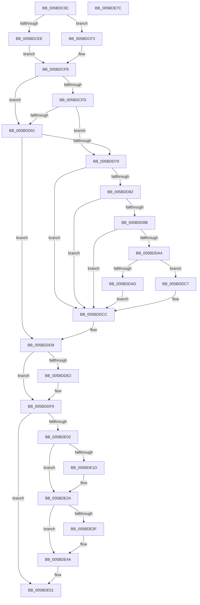

# KeFlushSingleCurrentTb

- RVA: `0x005BDC9C`–`0x005BDE7D` (길이 `481` bytes)
- VA: `0x00000001405BDC9C`
- 실행 섹션: `.text`
- PDB 이름 있음: `예`; PDB Function 태그: `아니요`
- unwind 정보 RVA: `0x000CA514`
- 디코드: `117`개 명령, `481/481` bytes 표시
- 미해석 바이트: `0` (있으면 어셈블리에 `.byte`로 보존)

> 이 문서는 커널 이미지의 기계어와 PDB 기호를 분석해 생성했습니다. 4번과 5번은 함수 원형과 자료형을 바이너리 사용 방식에서 추정한 C 해석이며 원본 소스 복구 결과는 아닙니다.

## 1. Dependencies

- 직접 호출 지점: **11**; 고유 호출 대상: **11**
- 직접 호출자로 확인된 함수: **4**
- RIP 상대 이미지 참조: **6**

### Outgoing calls
- `0x005BDCD7` → [KiIsSecureFlushRequired](../40/KiIsSecureFlushRequired_function_00401CCC.md) (function, `0x00401CCC`)
- `0x005BDD13` → [memset](../6C/memset_function_006C6C40.md) (function, `0x006C6C40`)
- `0x005BDD2A` → [KiPrepareFlushParameters](../44/KiPrepareFlushParameters_function_00445500.md) (function, `0x00445500`)
- `0x005BDD34` → [KiPrepareFlushCurrentAffinity](../31/KiPrepareFlushCurrentAffinity_function_00313424.md) (function, `0x00313424`)
- `0x005BDD70` → [HvlFlushRangeListTb](../31/HvlFlushRangeListTb_function_00312C10.md) (function, `0x00312C10`)
- `0x005BDDC7` → [KiSetUserTbFlushPending](../6B/KiSetUserTbFlushPending_function_006B20C0.md) (function, `0x006B20C0`)
- `0x005BDDF4` → [VmFlushTb](../31/VmFlushTb_function_00312BD0.md) (function, `0x00312BD0`)
- `0x005BDE1F` → [KiRaiseIrqlProcessIrqlFlags](../4F/KiRaiseIrqlProcessIrqlFlags_function_004F56FC.md) (function, `0x004F56FC`)
- `0x005BDE31` → [ExFlushTb](../31/ExFlushTb_function_00312B34.md) (function, `0x00312B34`)
- `0x005BDE45` → [KiLowerIrqlProcessIrqlFlags](../4F/KiLowerIrqlProcessIrqlFlags_function_004F5698.md) (function, `0x004F5698`)
- `0x005BDE5B` → [_security_check_cookie](../6A/_security_check_cookie_function_006AC640.md) (function, `0x006AC640`)

### Direct callers
- [MiDbgReleaseAddress](../68/MiDbgReleaseAddress_function_00685630.md) at `0x0068573A`
- [MiDbgTranslatePhysicalAddress](../68/MiDbgTranslatePhysicalAddress_function_00685760.md) at `0x00685ABE`
- [MiDbgUnTranslatePhysicalAddress](../68/MiDbgUnTranslatePhysicalAddress_function_00685AF8.md) at `0x00685B4A`
- [MiDbgWriteCheck](../68/MiDbgWriteCheck_function_00685BE4.md) at `0x00685F14`

### Static image references
- `0x005BDCBD` → RVA `0x00E0A740` (`.data`; read)
- `0x005BDCDC` → RVA `0x00FC6AB8` (`ALMOSTRO`; read)
- `0x005BDD82` → RVA `0x00FC6A87` (`ALMOSTRO`; read)
- `0x005BDDD9` → RVA `0x00FC5004` (`ALMOSTRO`; read)
- `0x005BDDF9` → RVA `0x00E685D4` (`.data`; read)
- `0x005BDE14` → RVA `0x00FC6D20` (`ALMOSTRO`; read)

## 2. Other-region calls and transfers

- 다른 실행 섹션으로 향하는 call: **0**
- 별도 외부 분기/꼬리 이동을 확인하지 못했습니다.

## 3. Assembly (complete function range)

```asm
005BDC9C  48 89 5C 24 18                  mov qword ptr [rsp + 0x18], rbx
005BDCA1  48 89 74 24 20                  mov qword ptr [rsp + 0x20], rsi
005BDCA6  55                              push rbp
005BDCA7  57                              push rdi
005BDCA8  41 54                           push r12
005BDCAA  41 56                           push r14
005BDCAC  41 57                           push r15
005BDCAE  48 8D AC 24 70 FF FF FF         lea rbp, [rsp - 0x90]
005BDCB6  48 81 EC 90 01 00 00            sub rsp, 0x190
005BDCBD  48 8B 05 7C CA 84 00            mov rax, qword ptr [rip + 0x84ca7c]
005BDCC4  48 33 C4                        xor rax, rsp
005BDCC7  48 89 85 80 00 00 00            mov qword ptr [rbp + 0x80], rax
005BDCCE  45 33 C0                        xor r8d, r8d
005BDCD1  44 8B F2                        mov r14d, edx
005BDCD4  48 8B F1                        mov rsi, rcx
005BDCD7  E8 F0 3F E4 FF                  call 0x140401ccc
005BDCDC  8B 1D D6 8D A0 00               mov ebx, dword ptr [rip + 0xa08dd6]
005BDCE2  45 33 E4                        xor r12d, r12d
005BDCE5  44 8B F8                        mov r15d, eax
005BDCE8  0F BA E3 17                     bt ebx, 0x17
005BDCEC  72 05                           jb 0x1405bdcf3
005BDCEE  41 8A DC                        mov bl, r12b
005BDCF1  EB 05                           jmp 0x1405bdcf8
005BDCF3  D0 EB                           shr bl, 1
005BDCF5  80 E3 01                        and bl, 1
005BDCF8  45 85 FF                        test r15d, r15d
005BDCFB  75 04                           jne 0x1405bdd01
005BDCFD  84 DB                           test bl, bl
005BDCFF  74 78                           je 0x1405bdd79
005BDD01  33 D2                           xor edx, edx
005BDD03  4C 89 64 24 50                  mov qword ptr [rsp + 0x50], r12
005BDD08  41 B8 08 01 00 00               mov r8d, 0x108
005BDD0E  48 8D 4C 24 70                  lea rcx, [rsp + 0x70]
005BDD13  E8 28 8F 10 00                  call 0x1406c6c40
005BDD18  4C 8D 44 24 40                  lea r8, [rsp + 0x40]
005BDD1D  44 88 64 24 40                  mov byte ptr [rsp + 0x40], r12b
005BDD22  48 8D 54 24 50                  lea rdx, [rsp + 0x50]
005BDD27  41 8B CE                        mov ecx, r14d
005BDD2A  E8 D1 77 E8 FF                  call 0x140445500
005BDD2F  48 8D 4C 24 70                  lea rcx, [rsp + 0x70]
005BDD34  E8 EB 56 D5 FF                  call 0x140313424
005BDD39  44 8A 44 24 40                  mov r8b, byte ptr [rsp + 0x40]
005BDD3E  48 8D 44 24 58                  lea rax, [rsp + 0x58]
005BDD43  48 8B 4C 24 50                  mov rcx, qword ptr [rsp + 0x50]
005BDD48  48 8D 54 24 70                  lea rdx, [rsp + 0x70]
005BDD4D  48 89 44 24 30                  mov qword ptr [rsp + 0x30], rax
005BDD52  48 8B FE                        mov rdi, rsi
005BDD55  48 81 E7 00 F0 FF FF            and rdi, 0xfffffffffffff000
005BDD5C  C7 44 24 28 01 00 00 00         mov dword ptr [rsp + 0x28], 1
005BDD64  45 8B CF                        mov r9d, r15d
005BDD67  88 5C 24 20                     mov byte ptr [rsp + 0x20], bl
005BDD6B  48 89 7C 24 58                  mov qword ptr [rsp + 0x58], rdi
005BDD70  E8 9B 4E D5 FF                  call 0x140312c10
005BDD75  84 C0                           test al, al
005BDD77  75 60                           jne 0x1405bddd9
005BDD79  41 8D 46 FF                     lea eax, [r14 - 1]
005BDD7D  83 F8 01                        cmp eax, 1
005BDD80  77 4A                           ja 0x1405bddcc
005BDD82  44 38 25 FE 8C A0 00            cmp byte ptr [rip + 0xa08cfe], r12b
005BDD89  74 41                           je 0x1405bddcc
005BDD8B  65 48 8B 04 25 88 01 00 00      mov rax, qword ptr gs:[0x188]
005BDD94  48 8B 88 B8 00 00 00            mov rcx, qword ptr [rax + 0xb8]
005BDD9B  44 38 A1 60 01 00 00            cmp byte ptr [rcx + 0x160], r12b
005BDDA2  75 28                           jne 0x1405bddcc
005BDDA4  F6 05 DC 8C A0 00 02            test byte ptr [rip + 0xa08cdc], 2
005BDDAB  74 1A                           je 0x1405bddc7
005BDDAD  48 C7 44 24 60 01 00 00 00      mov qword ptr [rsp + 0x60], 1
005BDDB6  48 89 74 24 68                  mov qword ptr [rsp + 0x68], rsi
005BDDBB  41 8B C4                        mov eax, r12d
005BDDBE  66 0F 38 82 44 24 60            invpcid rax, xmmword ptr [rsp + 0x60]
005BDDC5  EB 05                           jmp 0x1405bddcc
005BDDC7  E8 F4 42 0F 00                  call 0x1406b20c0
005BDDCC  0F 01 3E                        invlpg byte ptr [rsi]
005BDDCF  48 8B FE                        mov rdi, rsi
005BDDD2  48 81 E7 00 F0 FF FF            and rdi, 0xfffffffffffff000
005BDDD9  44 38 25 24 72 A0 00            cmp byte ptr [rip + 0xa07224], r12b
005BDDE0  74 17                           je 0x1405bddf9
005BDDE2  45 8B C6                        mov r8d, r14d
005BDDE5  48 89 7C 24 48                  mov qword ptr [rsp + 0x48], rdi
005BDDEA  48 8D 54 24 48                  lea rdx, [rsp + 0x48]
005BDDEF  B9 01 00 00 00                  mov ecx, 1
005BDDF4  E8 D7 4D D5 FF                  call 0x140312bd0
005BDDF9  44 39 25 D4 A7 8A 00            cmp dword ptr [rip + 0x8aa7d4], r12d
005BDE00  74 4F                           je 0x1405bde51
005BDE02  48 89 7C 24 48                  mov qword ptr [rsp + 0x48], rdi
005BDE07  44 0F 20 C3                     mov rbx, cr8
005BDE0B  BA 0F 00 00 00                  mov edx, 0xf
005BDE10  44 0F 22 C2                     mov cr8, rdx
005BDE14  44 39 25 05 8F A0 00            cmp dword ptr [rip + 0xa08f05], r12d
005BDE1B  74 07                           je 0x1405bde24
005BDE1D  8A CB                           mov cl, bl
005BDE1F  E8 D8 78 F3 FF                  call 0x1404f56fc
005BDE24  45 8B C6                        mov r8d, r14d
005BDE27  48 8D 54 24 48                  lea rdx, [rsp + 0x48]
005BDE2C  B9 01 00 00 00                  mov ecx, 1
005BDE31  E8 FE 4C D5 FF                  call 0x140312b34
005BDE36  44 39 25 E3 8E A0 00            cmp dword ptr [rip + 0xa08ee3], r12d
005BDE3D  74 0B                           je 0x1405bde4a
005BDE3F  44 0F 20 C1                     mov rcx, cr8
005BDE43  8A D3                           mov dl, bl
005BDE45  E8 4E 78 F3 FF                  call 0x1404f5698
005BDE4A  0F B6 C3                        movzx eax, bl
005BDE4D  44 0F 22 C0                     mov cr8, rax
005BDE51  48 8B 8D 80 00 00 00            mov rcx, qword ptr [rbp + 0x80]
005BDE58  48 33 CC                        xor rcx, rsp
005BDE5B  E8 E0 E7 0E 00                  call 0x1406ac640
005BDE60  4C 8D 9C 24 90 01 00 00         lea r11, [rsp + 0x190]
005BDE68  49 8B 5B 40                     mov rbx, qword ptr [r11 + 0x40]
005BDE6C  49 8B 73 48                     mov rsi, qword ptr [r11 + 0x48]
005BDE70  49 8B E3                        mov rsp, r11
005BDE73  41 5F                           pop r15
005BDE75  41 5E                           pop r14
005BDE77  41 5C                           pop r12
005BDE79  5F                              pop rdi
005BDE7A  5D                              pop rbp
005BDE7B  C3                              ret
005BDE7C  CC                              int3
```

## 4. C-style interpretation (structured pseudocode)

```c
__int64 __fastcall KeFlushSingleCurrentTb(__int64 a1, int a2, int a3)
{
    __int64 result;
    __int64 v_r12;
    __int64 v_rbx;
    __int64 v_rdi;
    __int64 v_rsp;
    unsigned __int64 v_stack_m148;
    unsigned __int64 v_stack_m150;
    unsigned __int64 v_stack_m158;
    unsigned __int64 v_stack_m160;
    unsigned __int64 v_stack_m168;
    unsigned __int64 v_stack_m170;
    unsigned __int64 v_stack_m178;
    unsigned __int64 v_stack_m188;
    unsigned int v_stack_m190;
    unsigned __int8 v_stack_m198;
    unsigned __int64 v_stack_m28;
    unsigned __int64 v_stack_m38;
    unsigned __int64 v_stack_mB8;
    unsigned __int64 v_stack_p18;
    unsigned __int64 v_stack_p20;

    v_stack_p18 = v_rbx;
    v_stack_p20 = v_rsi;
    v_rsp = (v_rsp) - (400);
    result = (*(unsigned __int64 *)(v_rip + 8702588)) ^ (v_rsp);
    v_stack_m38 = result;
    a3 = 0;
    result = KiIsSecureFlushRequired(a1, a2, a3, a4);
    v_r12 = 0;
    if (condition_is_below) goto loc_005BDCF3;
    goto loc_005BDCF8;
loc_005BDCF3:
    v_rbx = (unsigned __int8)((0) >> (1));
    v_rbx = (unsigned __int8)((v_rbx) & (1));
loc_005BDCF8:
    if ((unsigned int)((unsigned int)((unsigned int)(result))) != 0) goto loc_005BDD01;
    if ((unsigned __int8)(v_rbx) == 0) goto loc_005BDD79;
loc_005BDD01:
    a2 = 0;
    v_stack_m168 = 0;
    result = memset(v_stack_m148, a2, 264, a4);
    v_stack_m178 = 0;
    result = KiPrepareFlushParameters((unsigned int)((unsigned int)((unsigned int)(a2))), v_stack_m168, v_stack_m178, a4);
    result = KiPrepareFlushCurrentAffinity(v_stack_m148, v_stack_m168, v_stack_m178, a4);
    v_stack_m188 = v_stack_m160;
    v_rdi = (a1) & (0xFFFFFFFFFFFFF000ULL);
    v_stack_m190 = 1;
    v_stack_m198 = (unsigned __int8)(v_rbx);
    v_stack_m160 = v_rdi;
    result = HvlFlushRangeListTb(v_stack_m168, v_stack_m148, v_stack_m178, (unsigned int)((unsigned int)((unsigned int)((unsigned int)(result)))));
    if ((unsigned __int8)(result) != 0) goto loc_005BDDD9;
loc_005BDD79:
    if (((unsigned int)((unsigned int)(a2) - 1)) > 1) goto loc_005BDDCC;
    if ((*(unsigned __int8 *)(v_rip + 10521854)) == 0) goto loc_005BDDCC;
    if ((*(unsigned __int8 *)(*(unsigned __int64 *)(*(unsigned __int64 *)(gs_base + (0 + 392)) + 184) + 352)) != 0) goto loc_005BDDCC;
    if (((*(unsigned __int8 *)(v_rip + 10521820)) & (2)) == 0) goto loc_005BDDC7;
    v_stack_m158 = 1;
    v_stack_m150 = a1;
    goto loc_005BDDCC;
loc_005BDDC7:
    result = KiSetUserTbFlushPending(*(unsigned __int64 *)(*(unsigned __int64 *)(gs_base + (0 + 392)) + 184), v_stack_m148, v_stack_m178, (unsigned int)((unsigned int)((unsigned int)((unsigned int)(result)))));
loc_005BDDCC:
    v_rdi = (a1) & (0xFFFFFFFFFFFFF000ULL);
loc_005BDDD9:
    if ((*(unsigned __int8 *)(v_rip + 10514980)) != 0) {
        a3 = (unsigned int)((unsigned int)(a2));
        v_stack_m170 = v_rdi;
        a2 = v_stack_m170;
        a1 = 1;
        result = VmFlushTb(a1, a2, a3, (unsigned int)((unsigned int)((unsigned int)((unsigned int)(result)))));
    }
    if ((*(unsigned int *)(v_rip + 9086932)) == 0) goto loc_005BDE51;
    v_stack_m170 = v_rdi;
    if ((*(unsigned int *)(v_rip + 10522373)) != 0) {
        a1 = (unsigned __int8)(v_cr8);
        result = KiRaiseIrqlProcessIrqlFlags(a1, 15, a3, (unsigned int)((unsigned int)((unsigned int)((unsigned int)(result)))));
    }
    result = ExFlushTb(1, v_stack_m170, (unsigned int)((unsigned int)((unsigned int)(a2))), (unsigned int)((unsigned int)((unsigned int)((unsigned int)(result)))));
    if ((*(unsigned int *)(v_rip + 10522339)) != 0) {
        a1 = 15;
        a2 = (unsigned __int8)(v_cr8);
        result = KiLowerIrqlProcessIrqlFlags(a1, a2, (unsigned int)((unsigned int)((unsigned int)(a2))), (unsigned int)((unsigned int)((unsigned int)((unsigned int)(result)))));
    }
loc_005BDE51:
    a1 = (v_stack_m38) ^ (v_rsp);
    result = _security_check_cookie(a1, a2, (unsigned int)((unsigned int)((unsigned int)(a2))), (unsigned int)((unsigned int)((unsigned int)((unsigned int)(result)))));
    return result;
}
```

## 5. (Beta) C Style

```c
int64_t KeFlushSingleCurrentTb(void *Arg1, void *Arg2, int32_t Arg3)
{
    uint8_t *arg1 = (uint8_t *)Arg1;
    uint8_t *arg2 = (uint8_t *)Arg2;

    int64_t result;
    int64_t local_r12;
    int64_t local_rbx;
    int64_t local_rdi;
    int64_t local_rsp;
    uint64_t v_stack_m148;
    uint64_t v_stack_m150;
    uint64_t v_stack_m158;
    uint64_t v_stack_m160;
    uint64_t v_stack_m168;
    uint64_t v_stack_m170;
    uint64_t v_stack_m178;
    uint64_t v_stack_m188;
    uint32_t v_stack_m190;
    uint8_t v_stack_m198;
    uint64_t v_stack_m28;
    uint64_t v_stack_m38;
    uint64_t v_stack_mB8;
    uint64_t v_stack_p18;
    uint64_t v_stack_p20;

    v_stack_p18 = local_rbx;
    v_stack_p20 = local_rsi;
    local_rsp = (local_rsp) - (400);
    result = (*(uint64_t *)(v_rip + 0x84CA7C)) ^ (local_rsp);
    v_stack_m38 = result;
    Arg3 = 0;
    result = KiIsSecureFlushRequired(Arg1, Arg2, Arg3, a4);
    local_r12 = 0;
    if (condition_is_below) goto loc_005BDCF3;
    goto loc_005BDCF8;
loc_005BDCF3:
    local_rbx = (uint8_t)((0) >> (1));
    local_rbx = (uint8_t)((local_rbx) & (1));
loc_005BDCF8:
    if ((uint32_t)((uint32_t)((uint32_t)(result))) != 0) goto loc_005BDD01;
    if ((uint8_t)(local_rbx) == 0) goto loc_005BDD79;
loc_005BDD01:
    Arg2 = 0;
    v_stack_m168 = 0;
    result = memset(v_stack_m148, Arg2, 264, a4);
    v_stack_m178 = 0;
    result = KiPrepareFlushParameters((uint32_t)((uint32_t)((uint32_t)(Arg2))), v_stack_m168, v_stack_m178, a4);
    result = KiPrepareFlushCurrentAffinity(v_stack_m148, v_stack_m168, v_stack_m178, a4);
    v_stack_m188 = v_stack_m160;
    local_rdi = (Arg1) & (0xFFFFFFFFFFFFF000ULL);
    v_stack_m190 = 1;
    v_stack_m198 = (uint8_t)(local_rbx);
    v_stack_m160 = local_rdi;
    result = HvlFlushRangeListTb(v_stack_m168, v_stack_m148, v_stack_m178, (uint32_t)((uint32_t)((uint32_t)((uint32_t)(result)))));
    if ((uint8_t)(result) != 0) goto loc_005BDDD9;
loc_005BDD79:
    if (((uint32_t)((uint32_t)(Arg2) - 1)) > 1) goto loc_005BDDCC;
    if ((*(uint8_t *)(v_rip + 0xA08CFE)) == 0) goto loc_005BDDCC;
    if ((*(uint8_t *)(*(uint64_t *)(*(uint64_t *)(gs_base + (0 + 0x188)) + 0xB8) + 0x160)) != 0) goto loc_005BDDCC;
    if (((*(uint8_t *)(v_rip + 0xA08CDC)) & (2)) == 0) goto loc_005BDDC7;
    v_stack_m158 = 1;
    v_stack_m150 = Arg1;
    goto loc_005BDDCC;
loc_005BDDC7:
    result = KiSetUserTbFlushPending(*(uint64_t *)(*(uint64_t *)(gs_base + (0 + 0x188)) + 0xB8), v_stack_m148, v_stack_m178, (uint32_t)((uint32_t)((uint32_t)((uint32_t)(result)))));
loc_005BDDCC:
    local_rdi = (Arg1) & (0xFFFFFFFFFFFFF000ULL);
loc_005BDDD9:
    if ((*(uint8_t *)(v_rip + 0xA07224)) != 0) {
        Arg3 = (uint32_t)((uint32_t)(Arg2));
        v_stack_m170 = local_rdi;
        Arg2 = v_stack_m170;
        Arg1 = 1;
        result = VmFlushTb(Arg1, Arg2, Arg3, (uint32_t)((uint32_t)((uint32_t)((uint32_t)(result)))));
    }
    if ((*(uint32_t *)(v_rip + 0x8AA7D4)) == 0) goto loc_005BDE51;
    v_stack_m170 = local_rdi;
    if ((*(uint32_t *)(v_rip + 0xA08F05)) != 0) {
        Arg1 = (uint8_t)(v_cr8);
        result = KiRaiseIrqlProcessIrqlFlags(Arg1, 15, Arg3, (uint32_t)((uint32_t)((uint32_t)((uint32_t)(result)))));
    }
    result = ExFlushTb(1, v_stack_m170, (uint32_t)((uint32_t)((uint32_t)(Arg2))), (uint32_t)((uint32_t)((uint32_t)((uint32_t)(result)))));
    if ((*(uint32_t *)(v_rip + 0xA08EE3)) != 0) {
        Arg1 = 15;
        Arg2 = (uint8_t)(v_cr8);
        result = KiLowerIrqlProcessIrqlFlags(Arg1, Arg2, (uint32_t)((uint32_t)((uint32_t)(Arg2))), (uint32_t)((uint32_t)((uint32_t)((uint32_t)(result)))));
    }
loc_005BDE51:
    Arg1 = (v_stack_m38) ^ (local_rsp);
    result = _security_check_cookie(Arg1, Arg2, (uint32_t)((uint32_t)((uint32_t)(Arg2))), (uint32_t)((uint32_t)((uint32_t)((uint32_t)(result)))));
    return result;
}
```

### 관측된 메모리 오프셋

구조체 형식이 확인되지 않은 접근은 인자 기준의 오프셋으로만 기록했습니다.

| 기준 인자 | 오프셋 표현 | 폭 (bit) | 접근 |
|---|---:|---:|---|
| `Arg1` | `+ 0x0` | `8` | `R` |
| `Arg2` | `- 0x1` | `32` | `R` |

## 6. Execution-region graph

[열기: 2D/3D 그래프와 함수 탐색 컨트롤 패널](../../../control-panel.html?section=text&rva=0x005BDC9C&view=graph)

- 2D 그래프는 위에서 아래로 흐르고, 3D 그래프는 빈 공간을 드래그해 회전합니다. Shift+드래그는 이동, 휠은 확대·축소, 함수 노드 선택은 대상 보고서 이동입니다.

### Static fallback


