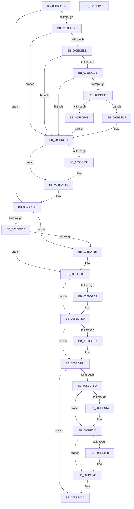

# KeFlushSingleTb

- RVA: `0x005BDE84`–`0x005BE06C` (길이 `488` bytes)
- VA: `0x00000001405BDE84`
- 실행 섹션: `.text`
- PDB 이름 있음: `예`; PDB Function 태그: `아니요`
- unwind 정보 RVA: `0x000CA4F4`
- 디코드: `133`개 명령, `488/488` bytes 표시
- 미해석 바이트: `0` (있으면 어셈블리에 `.byte`로 보존)

> 이 문서는 커널 이미지의 기계어와 PDB 기호를 분석해 생성했습니다. 4번과 5번은 함수 원형과 자료형을 바이너리 사용 방식에서 추정한 C 해석이며 원본 소스 복구 결과는 아닙니다.

## 1. Dependencies

- 직접 호출 지점: **13**; 고유 호출 대상: **12**
- 직접 호출자로 확인된 함수: **4**
- RIP 상대 이미지 참조: **5**

### Outgoing calls
- `0x005BDECC` → [KiPreprocessFlushTb](../30/KiPreprocessFlushTb_function_00308E00.md) (function, `0x00308E00`)
- `0x005BDF1F` → [KiSetUserTbFlushPending](../6B/KiSetUserTbFlushPending_function_006B20C0.md) (function, `0x006B20C0`)
- `0x005BDF37` → [KiLowerIrqlProcessIrqlFlags](../4F/KiLowerIrqlProcessIrqlFlags_function_004F5698.md) (function, `0x004F5698`)
- `0x005BDF4F` → [KiIsSecureFlushRequired](../40/KiIsSecureFlushRequired_function_00401CCC.md) (function, `0x00401CCC`)
- `0x005BDF7D` → [KiPrepareFlushParameters](../44/KiPrepareFlushParameters_function_00445500.md) (function, `0x00445500`)
- `0x005BDF89` → [KiFlushAffinity](../45/KiFlushAffinity_function_0045312C.md) (function, `0x0045312C`)
- `0x005BDFB6` → [HvlFlushRangeListTb](../31/HvlFlushRangeListTb_function_00312C10.md) (function, `0x00312C10`)
- `0x005BDFCB` → [KxFlushSingleTb](../5C/KxFlushSingleTb_function_005CAE18.md) (function, `0x005CAE18`)
- `0x005BDFEF` → [VmFlushTb](../31/VmFlushTb_function_00312BD0.md) (function, `0x00312BD0`)
- `0x005BE01C` → [KiRaiseIrqlProcessIrqlFlags](../4F/KiRaiseIrqlProcessIrqlFlags_function_004F56FC.md) (function, `0x004F56FC`)
- `0x005BE02D` → [ExFlushTb](../31/ExFlushTb_function_00312B34.md) (function, `0x00312B34`)
- `0x005BE041` → [KiLowerIrqlProcessIrqlFlags](../4F/KiLowerIrqlProcessIrqlFlags_function_004F5698.md) (function, `0x004F5698`)
- `0x005BE054` → [_security_check_cookie](../6A/_security_check_cookie_function_006AC640.md) (function, `0x006AC640`)

### Direct callers
- [MiDbgCopyMemoryTarget](../68/MiDbgCopyMemoryTarget_function_00684E70.md) at `0x00684F65`
- [MiDbgReleaseAddress](../68/MiDbgReleaseAddress_function_00685630.md) at `0x00685733`
- [MiDbgTranslatePhysicalAddress](../68/MiDbgTranslatePhysicalAddress_function_00685760.md) at `0x00685AB7`
- [MiDbgUnTranslatePhysicalAddress](../68/MiDbgUnTranslatePhysicalAddress_function_00685AF8.md) at `0x00685B41`

### Static image references
- `0x005BDE99` → RVA `0x00E0A740` (`.data`; read)
- `0x005BDEDD` → RVA `0x00FC6A87` (`ALMOSTRO`; read)
- `0x005BDF27` → RVA `0x00FC6D20` (`ALMOSTRO`; read)
- `0x005BDFD0` → RVA `0x00FC5004` (`ALMOSTRO`; read)
- `0x005BDFF4` → RVA `0x00E685D4` (`.data`; read)

## 2. Other-region calls and transfers

- 다른 실행 섹션으로 향하는 call: **0**
- 별도 외부 분기/꼬리 이동을 확인하지 못했습니다.

## 3. Assembly (complete function range)

```asm
005BDE84  40 55                           push rbp
005BDE86  53                              push rbx
005BDE87  56                              push rsi
005BDE88  57                              push rdi
005BDE89  41 55                           push r13
005BDE8B  41 56                           push r14
005BDE8D  41 57                           push r15
005BDE8F  48 8B EC                        mov rbp, rsp
005BDE92  48 81 EC 80 00 00 00            sub rsp, 0x80
005BDE99  48 8B 05 A0 C8 84 00            mov rax, qword ptr [rip + 0x84c8a0]
005BDEA0  48 33 C4                        xor rax, rsp
005BDEA3  48 89 45 F0                     mov qword ptr [rbp - 0x10], rax
005BDEA7  45 33 FF                        xor r15d, r15d
005BDEAA  48 8D 45 C1                     lea rax, [rbp - 0x3f]
005BDEAE  48 8B D9                        mov rbx, rcx
005BDEB1  44 88 7D C0                     mov byte ptr [rbp - 0x40], r15b
005BDEB5  33 C9                           xor ecx, ecx
005BDEB7  44 88 7D C1                     mov byte ptr [rbp - 0x3f], r15b
005BDEBB  4C 8D 4D C0                     lea r9, [rbp - 0x40]
005BDEBF  48 89 44 24 20                  mov qword ptr [rsp + 0x20], rax
005BDEC4  41 8A F7                        mov sil, r15b
005BDEC7  45 8B F0                        mov r14d, r8d
005BDECA  8B FA                           mov edi, edx
005BDECC  E8 2F AF D4 FF                  call 0x140308e00
005BDED1  84 C0                           test al, al
005BDED3  74 72                           je 0x1405bdf47
005BDED5  8D 47 FF                        lea eax, [rdi - 1]
005BDED8  83 F8 01                        cmp eax, 1
005BDEDB  77 47                           ja 0x1405bdf24
005BDEDD  44 38 3D A3 8B A0 00            cmp byte ptr [rip + 0xa08ba3], r15b
005BDEE4  74 3E                           je 0x1405bdf24
005BDEE6  65 48 8B 04 25 88 01 00 00      mov rax, qword ptr gs:[0x188]
005BDEEF  48 8B 88 B8 00 00 00            mov rcx, qword ptr [rax + 0xb8]
005BDEF6  44 38 B9 60 01 00 00            cmp byte ptr [rcx + 0x160], r15b
005BDEFD  75 25                           jne 0x1405bdf24
005BDEFF  F6 05 81 8B A0 00 02            test byte ptr [rip + 0xa08b81], 2
005BDF06  74 17                           je 0x1405bdf1f
005BDF08  48 C7 45 E0 01 00 00 00         mov qword ptr [rbp - 0x20], 1
005BDF10  48 89 5D E8                     mov qword ptr [rbp - 0x18], rbx
005BDF14  41 8B C7                        mov eax, r15d
005BDF17  66 0F 38 82 45 E0               invpcid rax, xmmword ptr [rbp - 0x20]
005BDF1D  EB 05                           jmp 0x1405bdf24
005BDF1F  E8 9C 41 0F 00                  call 0x1406b20c0
005BDF24  0F 01 3B                        invlpg byte ptr [rbx]
005BDF27  44 39 3D F2 8D A0 00            cmp dword ptr [rip + 0xa08df2], r15d
005BDF2E  74 0C                           je 0x1405bdf3c
005BDF30  44 0F 20 C1                     mov rcx, cr8
005BDF34  8A 55 C1                        mov dl, byte ptr [rbp - 0x3f]
005BDF37  E8 5C 77 F3 FF                  call 0x1404f5698
005BDF3C  0F B6 45 C1                     movzx eax, byte ptr [rbp - 0x3f]
005BDF40  44 0F 22 C0                     mov cr8, rax
005BDF44  40 B6 01                        mov sil, 1
005BDF47  45 33 C0                        xor r8d, r8d
005BDF4A  8B D7                           mov edx, edi
005BDF4C  48 8B CB                        mov rcx, rbx
005BDF4F  E8 78 3D E4 FF                  call 0x140401ccc
005BDF54  44 8A 4D C0                     mov r9b, byte ptr [rbp - 0x40]
005BDF58  44 8B D0                        mov r10d, eax
005BDF5B  49 C7 C5 00 F0 FF FF            mov r13, 0xfffffffffffff000
005BDF62  85 C0                           test eax, eax
005BDF64  75 05                           jne 0x1405bdf6b
005BDF66  45 84 C9                        test r9b, r9b
005BDF69  74 53                           je 0x1405bdfbe
005BDF6B  4C 8D 45 C0                     lea r8, [rbp - 0x40]
005BDF6F  4C 89 7D D8                     mov qword ptr [rbp - 0x28], r15
005BDF73  48 8D 55 D8                     lea rdx, [rbp - 0x28]
005BDF77  44 88 7D C0                     mov byte ptr [rbp - 0x40], r15b
005BDF7B  8B CF                           mov ecx, edi
005BDF7D  E8 7E 75 E8 FF                  call 0x140445500
005BDF82  41 8B CE                        mov ecx, r14d
005BDF85  48 89 5D C8                     mov qword ptr [rbp - 0x38], rbx
005BDF89  E8 9E 51 E9 FF                  call 0x14045312c
005BDF8E  44 8A 45 C0                     mov r8b, byte ptr [rbp - 0x40]
005BDF92  48 8D 4D C8                     lea rcx, [rbp - 0x38]
005BDF96  4C 21 6D C8                     and qword ptr [rbp - 0x38], r13
005BDF9A  48 8B D0                        mov rdx, rax
005BDF9D  48 89 4C 24 30                  mov qword ptr [rsp + 0x30], rcx
005BDFA2  48 8B 4D D8                     mov rcx, qword ptr [rbp - 0x28]
005BDFA6  C7 44 24 28 01 00 00 00         mov dword ptr [rsp + 0x28], 1
005BDFAE  44 88 4C 24 20                  mov byte ptr [rsp + 0x20], r9b
005BDFB3  45 8B CA                        mov r9d, r10d
005BDFB6  E8 55 4C D5 FF                  call 0x140312c10
005BDFBB  40 0A F0                        or sil, al
005BDFBE  40 84 F6                        test sil, sil
005BDFC1  75 0D                           jne 0x1405bdfd0
005BDFC3  45 8B C6                        mov r8d, r14d
005BDFC6  8B D7                           mov edx, edi
005BDFC8  48 8B CB                        mov rcx, rbx
005BDFCB  E8 48 CE 00 00                  call 0x1405cae18
005BDFD0  44 38 3D 2D 70 A0 00            cmp byte ptr [rip + 0xa0702d], r15b
005BDFD7  74 1B                           je 0x1405bdff4
005BDFD9  48 8B C3                        mov rax, rbx
005BDFDC  48 8D 55 D0                     lea rdx, [rbp - 0x30]
005BDFE0  49 23 C5                        and rax, r13
005BDFE3  44 8B C7                        mov r8d, edi
005BDFE6  B9 01 00 00 00                  mov ecx, 1
005BDFEB  48 89 45 D0                     mov qword ptr [rbp - 0x30], rax
005BDFEF  E8 DC 4B D5 FF                  call 0x140312bd0
005BDFF4  44 39 3D D9 A5 8A 00            cmp dword ptr [rip + 0x8aa5d9], r15d
005BDFFB  74 50                           je 0x1405be04d
005BDFFD  49 23 DD                        and rbx, r13
005BE000  48 89 5D D0                     mov qword ptr [rbp - 0x30], rbx
005BE004  44 0F 20 C3                     mov rbx, cr8
005BE008  BA 0F 00 00 00                  mov edx, 0xf
005BE00D  44 0F 22 C2                     mov cr8, rdx
005BE011  44 39 3D 08 8D A0 00            cmp dword ptr [rip + 0xa08d08], r15d
005BE018  74 07                           je 0x1405be021
005BE01A  8A CB                           mov cl, bl
005BE01C  E8 DB 76 F3 FF                  call 0x1404f56fc
005BE021  44 8B C7                        mov r8d, edi
005BE024  48 8D 55 D0                     lea rdx, [rbp - 0x30]
005BE028  B9 01 00 00 00                  mov ecx, 1
005BE02D  E8 02 4B D5 FF                  call 0x140312b34
005BE032  44 39 3D E7 8C A0 00            cmp dword ptr [rip + 0xa08ce7], r15d
005BE039  74 0B                           je 0x1405be046
005BE03B  44 0F 20 C1                     mov rcx, cr8
005BE03F  8A D3                           mov dl, bl
005BE041  E8 52 76 F3 FF                  call 0x1404f5698
005BE046  0F B6 C3                        movzx eax, bl
005BE049  44 0F 22 C0                     mov cr8, rax
005BE04D  48 8B 4D F0                     mov rcx, qword ptr [rbp - 0x10]
005BE051  48 33 CC                        xor rcx, rsp
005BE054  E8 E7 E5 0E 00                  call 0x1406ac640
005BE059  48 81 C4 80 00 00 00            add rsp, 0x80
005BE060  41 5F                           pop r15
005BE062  41 5E                           pop r14
005BE064  41 5D                           pop r13
005BE066  5F                              pop rdi
005BE067  5E                              pop rsi
005BE068  5B                              pop rbx
005BE069  5D                              pop rbp
005BE06A  C3                              ret
005BE06B  CC                              int3
```

## 4. C-style interpretation (structured pseudocode)

```c
__int64 __fastcall KeFlushSingleTb(__int64 a1, int a2, int a3)
{
    __int64 result;
    __int64 v_r15;
    __int64 v_rbx;
    __int64 v_rsi;
    __int64 v_rsp;
    unsigned __int64 v_stack_m48;
    unsigned __int64 v_stack_m50;
    unsigned __int64 v_stack_m58;
    unsigned __int64 v_stack_m60;
    unsigned __int64 v_stack_m68;
    unsigned __int64 v_stack_m70;
    unsigned __int64 v_stack_m77;
    unsigned __int8 v_stack_m78;
    unsigned __int64 v_stack_m88;
    unsigned int v_stack_m90;
    unsigned __int64 v_stack_m98;

    v_rsp = (v_rsp) - (128);
    result = (*(unsigned __int64 *)(v_rip + 8702112)) ^ (v_rsp);
    v_stack_m48 = result;
    v_r15 = 0;
    v_stack_m78 = 0;
    a1 = 0;
    v_stack_m77 = 0;
    v_stack_m98 = v_stack_m77;
    result = KiPreprocessFlushTb(a1, a2, a3, v_stack_m78);
    if ((unsigned __int8)(result) == 0) goto loc_005BDF47;
    if (((unsigned int)((unsigned int)(a2) - 1)) > 1) goto loc_005BDF24;
    if ((*(unsigned __int8 *)(v_rip + 10521507)) == 0) goto loc_005BDF24;
    if ((*(unsigned __int8 *)(*(unsigned __int64 *)(*(unsigned __int64 *)(gs_base + (0 + 392)) + 184) + 352)) != 0) goto loc_005BDF24;
    if (((*(unsigned __int8 *)(v_rip + 10521473)) & (2)) == 0) goto loc_005BDF1F;
    v_stack_m58 = 1;
    v_stack_m50 = 0;
    goto loc_005BDF24;
loc_005BDF1F:
    result = KiSetUserTbFlushPending(*(unsigned __int64 *)(*(unsigned __int64 *)(gs_base + (0 + 392)) + 184), a2, a3, v_stack_m78);
loc_005BDF24:
    if ((*(unsigned int *)(v_rip + 10522098)) != 0) {
        a1 = v_cr8;
        a2 = v_stack_m77;
        result = KiLowerIrqlProcessIrqlFlags(a1, a2, a3, v_stack_m78);
    }
loc_005BDF47:
    a3 = 0;
    result = KiIsSecureFlushRequired(a1, (unsigned int)((unsigned int)((unsigned int)(a2))), a3, v_stack_m78);
    if ((unsigned int)(result) != 0) goto loc_005BDF6B;
    v_rsi = 1;
    if ((unsigned __int8)(v_stack_m78) != 0) {
        a3 = v_stack_m78;
        v_stack_m60 = 0;
        a2 = v_stack_m60;
        v_stack_m78 = 0;
        a1 = (unsigned int)((unsigned int)(a2));
        result = KiPrepareFlushParameters(a1, a2, a3, v_stack_m78);
        a1 = (unsigned int)((unsigned int)(a3));
        v_stack_m70 = a1;
        result = KiFlushAffinity(a1, a2, a3, v_stack_m78);
        a3 = v_stack_m78;
        a1 = v_stack_m70;
        a2 = result;
        v_stack_m88 = a1;
        a1 = v_stack_m60;
        v_stack_m90 = 1;
        v_stack_m98 = (unsigned __int8)(v_stack_m78);
        a4 = (unsigned int)((unsigned int)((unsigned int)(result)));
        result = HvlFlushRangeListTb(a1, a2, a3, a4);
        v_rsi = (unsigned __int8)((1) | ((unsigned __int8)(result)));
    }
    if ((unsigned __int8)(v_rsi) == 0) {
        a3 = (unsigned int)((unsigned int)(a3));
        a2 = (unsigned int)((unsigned int)(a2));
        a1 = a1;
        result = KxFlushSingleTb(a1, a2, a3, a4);
    }
    if ((*(unsigned __int8 *)(v_rip + 10514477)) != 0) {
        result = a1;
        a2 = v_stack_m68;
        result = (result) & (0xFFFFFFFFFFFFF000ULL);
        a3 = (unsigned int)((unsigned int)(a2));
        a1 = 1;
        v_stack_m68 = result;
        result = VmFlushTb(a1, a2, a3, a4);
    }
    if ((*(unsigned int *)(v_rip + 9086425)) == 0) goto loc_005BE04D;
    v_rbx = (a1) & (0xFFFFFFFFFFFFF000ULL);
    v_stack_m68 = v_rbx;
    if ((*(unsigned int *)(v_rip + 10521864)) != 0) {
        a1 = (unsigned __int8)(v_stack_m77);
        result = KiRaiseIrqlProcessIrqlFlags(a1, 15, a3, a4);
    }
    result = ExFlushTb(1, v_stack_m68, (unsigned int)((unsigned int)((unsigned int)(a2))), a4);
    if ((*(unsigned int *)(v_rip + 10521831)) != 0) {
        a1 = 15;
        a2 = (unsigned __int8)(v_stack_m77);
        result = KiLowerIrqlProcessIrqlFlags(a1, a2, (unsigned int)((unsigned int)((unsigned int)(a2))), a4);
    }
loc_005BE04D:
    a1 = (v_stack_m48) ^ (v_rsp);
    result = _security_check_cookie(a1, a2, (unsigned int)((unsigned int)((unsigned int)(a2))), a4);
    v_rsp = (v_rsp) + (128);
    return result;
}
```

## 5. (Beta) C Style

```c
int64_t KeFlushSingleTb(void *Arg1, void *Arg2, int32_t Arg3)
{
    uint8_t *arg1 = (uint8_t *)Arg1;
    uint8_t *arg2 = (uint8_t *)Arg2;

    int64_t result;
    int64_t local_r15;
    int64_t local_rbx;
    int64_t local_rsi;
    int64_t local_rsp;
    uint64_t v_stack_m48;
    uint64_t v_stack_m50;
    uint64_t v_stack_m58;
    uint64_t v_stack_m60;
    uint64_t v_stack_m68;
    uint64_t v_stack_m70;
    uint64_t v_stack_m77;
    uint8_t v_stack_m78;
    uint64_t v_stack_m88;
    uint32_t v_stack_m90;
    uint64_t v_stack_m98;

    local_rsp = (local_rsp) - (128);
    result = (*(uint64_t *)(v_rip + 0x84C8A0)) ^ (local_rsp);
    v_stack_m48 = result;
    local_r15 = 0;
    v_stack_m78 = 0;
    Arg1 = 0;
    v_stack_m77 = 0;
    v_stack_m98 = v_stack_m77;
    result = KiPreprocessFlushTb(Arg1, Arg2, Arg3, v_stack_m78);
    if ((uint8_t)(result) == 0) goto loc_005BDF47;
    if (((uint32_t)((uint32_t)(Arg2) - 1)) > 1) goto loc_005BDF24;
    if ((*(uint8_t *)(v_rip + 0xA08BA3)) == 0) goto loc_005BDF24;
    if ((*(uint8_t *)(*(uint64_t *)(*(uint64_t *)(gs_base + (0 + 0x188)) + 0xB8) + 0x160)) != 0) goto loc_005BDF24;
    if (((*(uint8_t *)(v_rip + 0xA08B81)) & (2)) == 0) goto loc_005BDF1F;
    v_stack_m58 = 1;
    v_stack_m50 = 0;
    goto loc_005BDF24;
loc_005BDF1F:
    result = KiSetUserTbFlushPending(*(uint64_t *)(*(uint64_t *)(gs_base + (0 + 0x188)) + 0xB8), Arg2, Arg3, v_stack_m78);
loc_005BDF24:
    if ((*(uint32_t *)(v_rip + 0xA08DF2)) != 0) {
        Arg1 = v_cr8;
        Arg2 = v_stack_m77;
        result = KiLowerIrqlProcessIrqlFlags(Arg1, Arg2, Arg3, v_stack_m78);
    }
loc_005BDF47:
    Arg3 = 0;
    result = KiIsSecureFlushRequired(Arg1, (uint32_t)((uint32_t)((uint32_t)(Arg2))), Arg3, v_stack_m78);
    if ((uint32_t)(result) != 0) goto loc_005BDF6B;
    local_rsi = 1;
    if ((uint8_t)(v_stack_m78) != 0) {
        Arg3 = v_stack_m78;
        v_stack_m60 = 0;
        Arg2 = v_stack_m60;
        v_stack_m78 = 0;
        Arg1 = (uint32_t)((uint32_t)(Arg2));
        result = KiPrepareFlushParameters(Arg1, Arg2, Arg3, v_stack_m78);
        Arg1 = (uint32_t)((uint32_t)(Arg3));
        v_stack_m70 = Arg1;
        result = KiFlushAffinity(Arg1, Arg2, Arg3, v_stack_m78);
        Arg3 = v_stack_m78;
        Arg1 = v_stack_m70;
        Arg2 = result;
        v_stack_m88 = Arg1;
        Arg1 = v_stack_m60;
        v_stack_m90 = 1;
        v_stack_m98 = (uint8_t)(v_stack_m78);
        a4 = (uint32_t)((uint32_t)((uint32_t)(result)));
        result = HvlFlushRangeListTb(Arg1, Arg2, Arg3, a4);
        local_rsi = (uint8_t)((1) | ((uint8_t)(result)));
    }
    if ((uint8_t)(local_rsi) == 0) {
        Arg3 = (uint32_t)((uint32_t)(Arg3));
        Arg2 = (uint32_t)((uint32_t)(Arg2));
        Arg1 = Arg1;
        result = KxFlushSingleTb(Arg1, Arg2, Arg3, a4);
    }
    if ((*(uint8_t *)(v_rip + 0xA0702D)) != 0) {
        result = Arg1;
        Arg2 = v_stack_m68;
        result = (result) & (0xFFFFFFFFFFFFF000ULL);
        Arg3 = (uint32_t)((uint32_t)(Arg2));
        Arg1 = 1;
        v_stack_m68 = result;
        result = VmFlushTb(Arg1, Arg2, Arg3, a4);
    }
    if ((*(uint32_t *)(v_rip + 0x8AA5D9)) == 0) goto loc_005BE04D;
    local_rbx = (Arg1) & (0xFFFFFFFFFFFFF000ULL);
    v_stack_m68 = local_rbx;
    if ((*(uint32_t *)(v_rip + 0xA08D08)) != 0) {
        Arg1 = (uint8_t)(v_stack_m77);
        result = KiRaiseIrqlProcessIrqlFlags(Arg1, 15, Arg3, a4);
    }
    result = ExFlushTb(1, v_stack_m68, (uint32_t)((uint32_t)((uint32_t)(Arg2))), a4);
    if ((*(uint32_t *)(v_rip + 0xA08CE7)) != 0) {
        Arg1 = 15;
        Arg2 = (uint8_t)(v_stack_m77);
        result = KiLowerIrqlProcessIrqlFlags(Arg1, Arg2, (uint32_t)((uint32_t)((uint32_t)(Arg2))), a4);
    }
loc_005BE04D:
    Arg1 = (v_stack_m48) ^ (local_rsp);
    result = _security_check_cookie(Arg1, Arg2, (uint32_t)((uint32_t)((uint32_t)(Arg2))), a4);
    local_rsp = (local_rsp) + (128);
    return result;
}
```

### 관측된 메모리 오프셋

구조체 형식이 확인되지 않은 접근은 인자 기준의 오프셋으로만 기록했습니다.

| 기준 인자 | 오프셋 표현 | 폭 (bit) | 접근 |
|---|---:|---:|---|
| `Arg1` | `+ 0x0` | `8` | `R` |
| `Arg2` | `- 0x1` | `32` | `R` |

## 6. Execution-region graph

[열기: 2D/3D 그래프와 함수 탐색 컨트롤 패널](../../../control-panel.html?section=text&rva=0x005BDE84&view=graph)

- 2D 그래프는 위에서 아래로 흐르고, 3D 그래프는 빈 공간을 드래그해 회전합니다. Shift+드래그는 이동, 휠은 확대·축소, 함수 노드 선택은 대상 보고서 이동입니다.

### Static fallback


