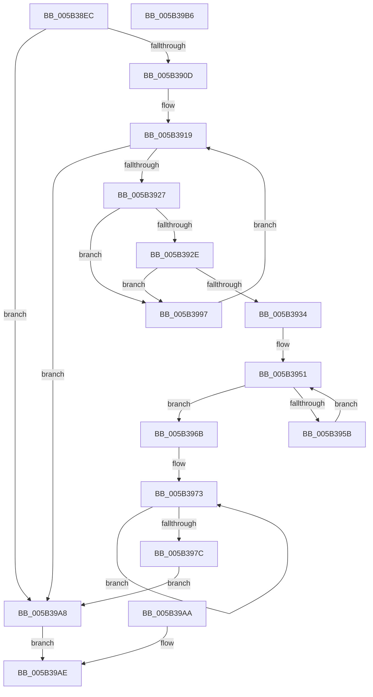

# KeGetBugMessageText

- RVA: `0x005B38EC`–`0x005B39B7` (길이 `203` bytes)
- VA: `0x00000001405B38EC`
- 실행 섹션: `.text`
- PDB 이름 있음: `예`; PDB Function 태그: `아니요`
- unwind 정보 RVA: `0x000C9CF8`
- 디코드: `56`개 명령, `203/203` bytes 표시
- 미해석 바이트: `0` (있으면 어셈블리에 `.byte`로 보존)

> 이 문서는 커널 이미지의 기계어와 PDB 기호를 분석해 생성했습니다. 4번과 5번은 함수 원형과 자료형을 바이너리 사용 방식에서 추정한 C 해석이며 원본 소스 복구 결과는 아닙니다.

## 1. Dependencies

- 직접 호출 지점: **0**; 고유 호출 대상: **0**
- 직접 호출자로 확인된 함수: **2**
- RIP 상대 이미지 참조: **1**

### Outgoing calls
- 직접 디코드된 call 명령이 없습니다.

### Direct callers
- [KiDisplayBlueScreen](KiDisplayBlueScreen_function_005B494C.md) at `0x005B4AA3`
- [CmpCreateHwProfileFriendlyName](../../page/7E/CmpCreateHwProfileFriendlyName_function_007E3840.md) at `0x007E3919`

### Static image references
- `0x005B38FD` → RVA `0x00FC6DF8` (`ALMOSTRO`; read)

## 2. Other-region calls and transfers

- 다른 실행 섹션으로 향하는 call: **0**
- 별도 외부 분기/꼬리 이동을 확인하지 못했습니다.

## 3. Assembly (complete function range)

```asm
005B38EC  48 83 EC 28                     sub rsp, 0x28
005B38F0  4C 8B DA                        mov r11, rdx
005B38F3  44 8B D1                        mov r10d, ecx
005B38F6  45 33 C0                        xor r8d, r8d
005B38F9  44 88 04 24                     mov byte ptr [rsp], r8b
005B38FD  4C 8B 0D F4 34 A1 00            mov r9, qword ptr [rip + 0xa134f4]
005B3904  4D 85 C9                        test r9, r9
005B3907  0F 84 9B 00 00 00               je 0x1405b39a8
005B390D  49 8D 41 04                     lea rax, [r9 + 4]
005B3911  48 89 44 24 18                  mov qword ptr [rsp + 0x18], rax
005B3916  41 8B 09                        mov ecx, dword ptr [r9]
005B3919  48 89 4C 24 08                  mov qword ptr [rsp + 8], rcx
005B391E  48 85 C9                        test rcx, rcx
005B3921  0F 84 81 00 00 00               je 0x1405b39a8
005B3927  8B 10                           mov edx, dword ptr [rax]
005B3929  44 3B D2                        cmp r10d, edx
005B392C  72 69                           jb 0x1405b3997
005B392E  44 3B 50 04                     cmp r10d, dword ptr [rax + 4]
005B3932  77 63                           ja 0x1405b3997
005B3934  48 8B 0D BD 34 A1 00            mov rcx, qword ptr [rip + 0xa134bd]
005B393B  48 89 4C 24 10                  mov qword ptr [rsp + 0x10], rcx
005B3940  8B 40 08                        mov eax, dword ptr [rax + 8]
005B3943  48 03 C8                        add rcx, rax
005B3946  48 89 4C 24 10                  mov qword ptr [rsp + 0x10], rcx
005B394B  44 2B D2                        sub r10d, edx
005B394E  41 8B D2                        mov edx, r10d
005B3951  48 89 54 24 08                  mov qword ptr [rsp + 8], rdx
005B3956  48 85 D2                        test rdx, rdx
005B3959  74 10                           je 0x1405b396b
005B395B  0F B7 01                        movzx eax, word ptr [rcx]
005B395E  48 03 C8                        add rcx, rax
005B3961  48 89 4C 24 10                  mov qword ptr [rsp + 0x10], rcx
005B3966  48 FF CA                        dec rdx
005B3969  EB E6                           jmp 0x1405b3951
005B396B  48 83 C1 04                     add rcx, 4
005B396F  48 83 C8 FF                     or rax, 0xffffffffffffffff
005B3973  48 FF C0                        inc rax
005B3976  44 38 04 01                     cmp byte ptr [rcx + rax], r8b
005B397A  75 F7                           jne 0x1405b3973
005B397C  48 89 44 24 40                  mov qword ptr [rsp + 0x40], rax
005B3981  49 89 4B 08                     mov qword ptr [r11 + 8], rcx
005B3985  66 41 89 03                     mov word ptr [r11], ax
005B3989  66 41 89 43 02                  mov word ptr [r11 + 2], ax
005B398E  41 B0 01                        mov r8b, 1
005B3991  44 88 04 24                     mov byte ptr [rsp], r8b
005B3995  EB 11                           jmp 0x1405b39a8
005B3997  48 83 C0 0C                     add rax, 0xc
005B399B  48 89 44 24 18                  mov qword ptr [rsp + 0x18], rax
005B39A0  48 FF C9                        dec rcx
005B39A3  E9 71 FF FF FF                  jmp 0x1405b3919
005B39A8  EB 04                           jmp 0x1405b39ae
005B39AA  44 8A 04 24                     mov r8b, byte ptr [rsp]
005B39AE  41 8A C0                        mov al, r8b
005B39B1  48 83 C4 28                     add rsp, 0x28
005B39B5  C3                              ret
005B39B6  CC                              int3
```

## 4. C-style interpretation (structured pseudocode)

```c
__int64 __fastcall KeGetBugMessageText(int a1, __int64 a2, int a3)
{
    __int64 result;
    __int64 v_r10;
    __int64 v_rsp;
    unsigned __int64 v_stack_m10;
    unsigned __int64 v_stack_m18;
    unsigned __int64 v_stack_m20;
    unsigned __int8 v_stack_m28;
    unsigned __int64 v_stack_p18;

    v_rsp = (v_rsp) - (40);
    a3 = 0;
    v_stack_m28 = 0;
    if (*(unsigned __int64 *)(v_rip + 10564852) == 0) goto loc_005B39A8;
    v_stack_m10 = *(unsigned __int64 *)(v_rip + 10564852) + 4;
loc_005B3919:
    v_stack_m20 = (unsigned int)(*(unsigned int *)(*(unsigned __int64 *)(v_rip + 10564852)));
    if ((unsigned int)(*(unsigned int *)(*(unsigned __int64 *)(v_rip + 10564852))) == 0) goto loc_005B39A8;
    if (((unsigned int)((unsigned int)(a1))) < ((unsigned int)((unsigned int)(*(unsigned int *)(*(unsigned __int64 *)(v_rip + 10564852) + 4))))) goto loc_005B3997;
    if (((unsigned int)((unsigned int)(a1))) > (*(unsigned int *)(*(unsigned __int64 *)(v_rip + 10564852) + 4 + 4))) goto loc_005B3997;
    v_stack_m18 = *(unsigned __int64 *)(v_rip + 10564797);
    a1 = (*(unsigned __int64 *)(v_rip + 10564797)) + ((unsigned int)(*(unsigned int *)(*(unsigned __int64 *)(v_rip + 10564852) + 4 + 8)));
    v_stack_m18 = a1;
    v_r10 = (unsigned int)(((unsigned int)(a1)) - ((unsigned int)((unsigned int)(*(unsigned int *)(*(unsigned __int64 *)(v_rip + 10564852) + 4)))));
loc_005B3951:
    v_stack_m20 = (unsigned int)((unsigned int)(v_r10));
    if ((unsigned int)((unsigned int)(v_r10)) == 0) goto loc_005B396B;
    a1 = (a1) + (*(unsigned __int16 *)(a1));
    v_stack_m18 = a1;
    a2 = ((unsigned int)((unsigned int)(v_r10))) - 1;
    goto loc_005B3951;
loc_005B396B:
    a1 = (a1) + (4);
    result = (*(unsigned __int16 *)(a1)) | (-1);
loc_005B3973:
    result = (result) + 1;
    if ((*(unsigned __int8 *)(a1 + result * 1)) != 0) goto loc_005B3973;
    v_stack_p18 = result;
    *(unsigned __int64 *)(a2 + 8) = a1;
    *(unsigned __int16 *)(a2) = (unsigned __int16)(result);
    *(unsigned __int16 *)(a2 + 2) = (unsigned __int16)(result);
    v_stack_m28 = 1;
    goto loc_005B39A8;
loc_005B3997:
    result = (result) + (12);
    v_stack_m10 = result;
    a1 = (a1) - 1;
    goto loc_005B3919;
loc_005B39A8:
    goto loc_005B39AE;
loc_005B39AE:
    v_rsp = (v_rsp) + (40);
    return 1;
}
```

## 5. (Beta) C Style

```c
int64_t KeGetBugMessageText(int32_t Arg1, void *Arg2, int32_t Arg3)
{
    uint8_t *arg2 = (uint8_t *)Arg2;

    int64_t result;
    int64_t local_r10;
    int64_t local_rsp;
    uint64_t v_stack_m10;
    uint64_t v_stack_m18;
    uint64_t v_stack_m20;
    uint8_t v_stack_m28;
    uint64_t v_stack_p18;

    local_rsp = (local_rsp) - (40);
    Arg3 = 0;
    v_stack_m28 = 0;
    if (*(uint64_t *)(v_rip + 0xA134F4) == 0) goto loc_005B39A8;
    v_stack_m10 = *(uint64_t *)(v_rip + 0xA134F4) + 4;
loc_005B3919:
    v_stack_m20 = (uint32_t)(*(uint32_t *)(*(uint64_t *)(v_rip + 0xA134F4)));
    if ((uint32_t)(*(uint32_t *)(*(uint64_t *)(v_rip + 0xA134F4))) == 0) goto loc_005B39A8;
    if (((uint32_t)((uint32_t)(Arg1))) < ((uint32_t)((uint32_t)(*(uint32_t *)(*(uint64_t *)(v_rip + 0xA134F4) + 0x4))))) goto loc_005B3997;
    if (((uint32_t)((uint32_t)(Arg1))) > (*(uint32_t *)(*(uint64_t *)(v_rip + 0xA134F4) + 0x4 + 0x4))) goto loc_005B3997;
    v_stack_m18 = *(uint64_t *)(v_rip + 0xA134BD);
    Arg1 = (*(uint64_t *)(v_rip + 0xA134BD)) + ((uint32_t)(*(uint32_t *)(*(uint64_t *)(v_rip + 0xA134F4) + 0x4 + 0x8)));
    v_stack_m18 = Arg1;
    local_r10 = (uint32_t)(((uint32_t)(Arg1)) - ((uint32_t)((uint32_t)(*(uint32_t *)(*(uint64_t *)(v_rip + 0xA134F4) + 0x4)))));
loc_005B3951:
    v_stack_m20 = (uint32_t)((uint32_t)(local_r10));
    if ((uint32_t)((uint32_t)(local_r10)) == 0) goto loc_005B396B;
    Arg1 = (Arg1) + (*(uint16_t *)(Arg1));
    v_stack_m18 = Arg1;
    Arg2 = ((uint32_t)((uint32_t)(local_r10))) - 1;
    goto loc_005B3951;
loc_005B396B:
    Arg1 = (Arg1) + (4);
    result = (*(uint16_t *)(Arg1)) | (-1);
loc_005B3973:
    result = (result) + 1;
    if ((*(uint8_t *)(Arg1 + result * 1)) != 0) goto loc_005B3973;
    v_stack_p18 = result;
    *(uint64_t *)(arg2 + 0x8) = Arg1;
    *(uint16_t *)(arg2) = (uint16_t)(result);
    *(uint16_t *)(arg2 + 0x2) = (uint16_t)(result);
    v_stack_m28 = 1;
    goto loc_005B39A8;
loc_005B3997:
    result = (result) + (12);
    v_stack_m10 = result;
    Arg1 = (Arg1) - 1;
    goto loc_005B3919;
loc_005B39A8:
    goto loc_005B39AE;
loc_005B39AE:
    local_rsp = (local_rsp) + (40);
    return 1;
}
```

### 관측된 메모리 오프셋

구조체 형식이 확인되지 않은 접근은 인자 기준의 오프셋으로만 기록했습니다.

| 기준 인자 | 오프셋 표현 | 폭 (bit) | 접근 |
|---|---:|---:|---|
| `Arg2` | `+ 0x0` | `16` | `W` |
| `Arg2` | `+ 0x2` | `16` | `W` |
| `Arg2` | `+ 0x8` | `64` | `W` |

## 6. Execution-region graph

[열기: 2D/3D 그래프와 함수 탐색 컨트롤 패널](../../../control-panel.html?section=text&rva=0x005B38EC&view=graph)

- 2D 그래프는 위에서 아래로 흐르고, 3D 그래프는 빈 공간을 드래그해 회전합니다. Shift+드래그는 이동, 휠은 확대·축소, 함수 노드 선택은 대상 보고서 이동입니다.

### Static fallback


