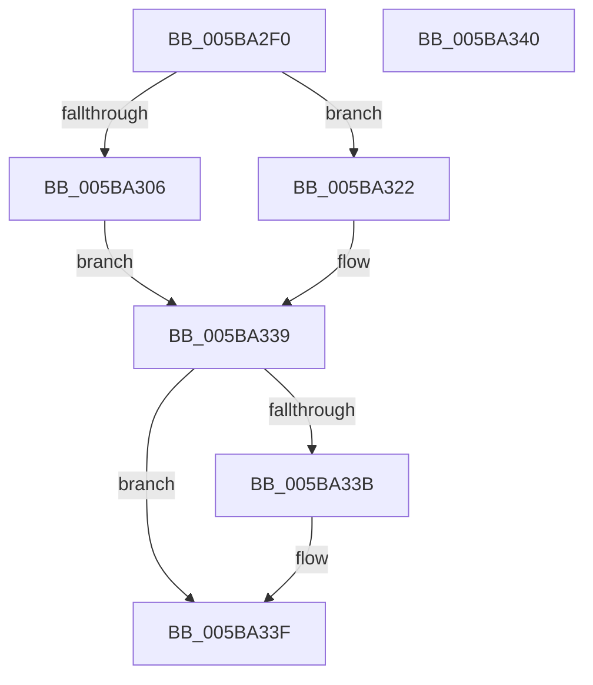

# KeGetClockTimerResolution

- RVA: `0x005BA2F0`–`0x005BA341` (길이 `81` bytes)
- VA: `0x00000001405BA2F0`
- 실행 섹션: `.text`
- PDB 이름 있음: `예`; PDB Function 태그: `아니요`
- unwind 정보 RVA: `0x000DB714`
- 디코드: `19`개 명령, `81/81` bytes 표시
- 미해석 바이트: `0` (있으면 어셈블리에 `.byte`로 보존)

> 이 문서는 커널 이미지의 기계어와 PDB 기호를 분석해 생성했습니다. 4번과 5번은 함수 원형과 자료형을 바이너리 사용 방식에서 추정한 C 해석이며 원본 소스 복구 결과는 아닙니다.

## 1. Dependencies

- 직접 호출 지점: **0**; 고유 호출 대상: **0**
- 직접 호출자로 확인된 함수: **1**
- RIP 상대 이미지 참조: **4**

### Outgoing calls
- 직접 디코드된 call 명령이 없습니다.

### Direct callers
- [HalpTimerSwitchToNormalClock](../54/HalpTimerSwitchToNormalClock_function_00548814.md) at `0x00548886`

### Static image references
- `0x005BA2F9` → RVA `0x00FC6A85` (`ALMOSTRO`; read)
- `0x005BA322` → RVA `0x00FC6B7C` (`ALMOSTRO`; read)
- `0x005BA328` → RVA `0x00F21FA8` (`.data`; read)
- `0x005BA331` → RVA `0x00F21FC0` (`.data`; read)

## 2. Other-region calls and transfers

- 다른 실행 섹션으로 향하는 call: **0**
- 별도 외부 분기/꼬리 이동을 확인하지 못했습니다.

## 3. Assembly (complete function range)

```asm
005BA2F0  65 4C 8B 0C 25 20 00 00 00      mov r9, qword ptr gs:[0x20]
005BA2F9  80 3D 85 C7 A0 00 00            cmp byte ptr [rip + 0xa0c785], 0
005BA300  41 C6 00 00                     mov byte ptr [r8], 0
005BA304  74 1C                           je 0x1405ba322
005BA306  41 8B 81 88 95 00 00            mov eax, dword ptr [r9 + 0x9588]
005BA30D  89 02                           mov dword ptr [rdx], eax
005BA30F  41 8B 81 8C 95 00 00            mov eax, dword ptr [r9 + 0x958c]
005BA316  89 01                           mov dword ptr [rcx], eax
005BA318  41 83 B9 90 95 00 00 01         cmp dword ptr [r9 + 0x9590], 1
005BA320  EB 17                           jmp 0x1405ba339
005BA322  8B 05 54 C8 A0 00               mov eax, dword ptr [rip + 0xa0c854]
005BA328  83 3D 79 7C 96 00 01            cmp dword ptr [rip + 0x967c79], 1
005BA32F  89 02                           mov dword ptr [rdx], eax
005BA331  8B 05 89 7C 96 00               mov eax, dword ptr [rip + 0x967c89]
005BA337  89 01                           mov dword ptr [rcx], eax
005BA339  75 04                           jne 0x1405ba33f
005BA33B  41 C6 00 01                     mov byte ptr [r8], 1
005BA33F  C3                              ret
005BA340  CC                              int3
```

## 4. C-style interpretation (structured pseudocode)

```c
__int64 __fastcall KeGetClockTimerResolution(__int64 a1, __int64 a2, __int64 a3)
{
    *(unsigned __int8 *)(a3) = 0;
    if ((*(unsigned __int8 *)(v_rip + 10536837)) == 0) goto loc_005BA322;
    *(unsigned int *)(a2) = (unsigned int)((unsigned int)(*(unsigned int *)(*(unsigned __int64 *)(gs_base + (0 + 32)) + 38280)));
    *(unsigned int *)(a1) = (unsigned int)((unsigned int)(*(unsigned int *)(*(unsigned __int64 *)(gs_base + (0 + 32)) + 38284)));
    goto loc_005BA339;
loc_005BA322:
    *(unsigned int *)(a2) = (unsigned int)((unsigned int)(*(unsigned int *)(v_rip + 10537044)));
    *(unsigned int *)(a1) = (unsigned int)((unsigned int)(*(unsigned int *)(v_rip + 9862281)));
loc_005BA339:
    if ((*(unsigned int *)(v_rip + 9862265)) == 1) {
        *(unsigned __int8 *)(a3) = 1;
    }
    return (unsigned int)(*(unsigned int *)(v_rip + 9862281));
}
```

## 5. (Beta) C Style

```c
int64_t KeGetClockTimerResolution(void *Arg1, void *Arg2, void *Arg3)
{
    uint8_t *arg1 = (uint8_t *)Arg1;
    uint8_t *arg2 = (uint8_t *)Arg2;
    uint8_t *arg3 = (uint8_t *)Arg3;

    *(uint8_t *)(arg3) = 0;
    if ((*(uint8_t *)(v_rip + 0xA0C785)) == 0) goto loc_005BA322;
    *(uint32_t *)(arg2) = (uint32_t)((uint32_t)(*(uint32_t *)(*(uint64_t *)(gs_base + (0 + 0x20)) + 0x9588)));
    *(uint32_t *)(arg1) = (uint32_t)((uint32_t)(*(uint32_t *)(*(uint64_t *)(gs_base + (0 + 0x20)) + 0x958C)));
    goto loc_005BA339;
loc_005BA322:
    *(uint32_t *)(arg2) = (uint32_t)((uint32_t)(*(uint32_t *)(v_rip + 0xA0C854)));
    *(uint32_t *)(arg1) = (uint32_t)((uint32_t)(*(uint32_t *)(v_rip + 0x967C89)));
loc_005BA339:
    if ((*(uint32_t *)(v_rip + 0x967C79)) == 1) {
        *(uint8_t *)(arg3) = 1;
    }
    return (uint32_t)(*(uint32_t *)(v_rip + 0x967C89));
}
```

### 관측된 메모리 오프셋

구조체 형식이 확인되지 않은 접근은 인자 기준의 오프셋으로만 기록했습니다.

| 기준 인자 | 오프셋 표현 | 폭 (bit) | 접근 |
|---|---:|---:|---|
| `Arg1` | `+ 0x0` | `32` | `W` |
| `Arg2` | `+ 0x0` | `32` | `W` |
| `Arg3` | `+ 0x0` | `8` | `W` |

## 6. Execution-region graph

[열기: 2D/3D 그래프와 함수 탐색 컨트롤 패널](../../../control-panel.html?section=text&rva=0x005BA2F0&view=graph)

- 2D 그래프는 위에서 아래로 흐르고, 3D 그래프는 빈 공간을 드래그해 회전합니다. Shift+드래그는 이동, 휠은 확대·축소, 함수 노드 선택은 대상 보고서 이동입니다.

### Static fallback


