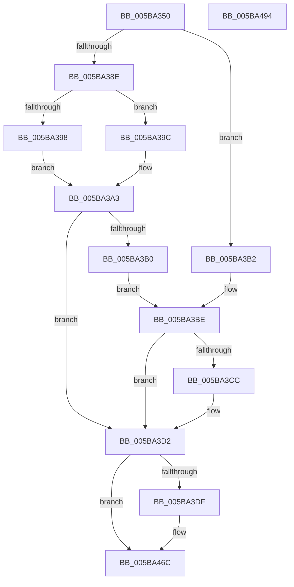

# KeGetNextClockTickDuration

- RVA: `0x005BA350`–`0x005BA495` (길이 `325` bytes)
- VA: `0x00000001405BA350`
- 실행 섹션: `.text`
- PDB 이름 있음: `예`; PDB Function 태그: `아니요`
- unwind 정보 RVA: `0x000CA1B8`
- 디코드: `83`개 명령, `325/325` bytes 표시
- 미해석 바이트: `0` (있으면 어셈블리에 `.byte`로 보존)

> 이 문서는 커널 이미지의 기계어와 PDB 기호를 분석해 생성했습니다. 4번과 5번은 함수 원형과 자료형을 바이너리 사용 방식에서 추정한 C 해석이며 원본 소스 복구 결과는 아닙니다.

## 1. Dependencies

- 직접 호출 지점: **3**; 고유 호출 대상: **3**
- 직접 호출자로 확인된 함수: **1**
- RIP 상대 이미지 참조: **6**

### Outgoing calls
- `0x005BA3C2` → [RtlGetInterruptTimePrecise](../20/RtlGetInterruptTimePrecise_function_0020A4C0.md) (function, `0x0020A4C0`)
- `0x005BA467` → [tlgWriteTransfer_EtwWriteTransfer](../42/tlgWriteTransfer_EtwWriteTransfer_function_004260E0.md) (function, `0x004260E0`)
- `0x005BA476` → [_security_check_cookie](../6A/_security_check_cookie_function_006AC640.md) (function, `0x006AC640`)

### Direct callers
- [HalpTimerClockPowerChange](../54/HalpTimerClockPowerChange_function_005481A0.md) at `0x0054820C`

### Static image references
- `0x005BA36B` → RVA `0x00E0A740` (`.data`; read)
- `0x005BA385` → RVA `0x00FC6A85` (`ALMOSTRO`; read)
- `0x005BA3B2` → RVA `0x00F21F88` (`.data`; read)
- `0x005BA3D2` → RVA `0x00E070D8` (`.data`; read)
- `0x005BA430` → RVA `0x00F21FB0` (`.data`; read)
- `0x005BA44D` → RVA `0x0004853B` (`.rdata`; read)

## 2. Other-region calls and transfers

- 다른 실행 섹션으로 향하는 call: **0**
- 별도 외부 분기/꼬리 이동을 확인하지 못했습니다.

## 3. Assembly (complete function range)

```asm
005BA350  48 8B C4                        mov rax, rsp
005BA353  48 89 58 10                     mov qword ptr [rax + 0x10], rbx
005BA357  48 89 70 18                     mov qword ptr [rax + 0x18], rsi
005BA35B  48 89 78 20                     mov qword ptr [rax + 0x20], rdi
005BA35F  55                              push rbp
005BA360  48 8D 68 A1                     lea rbp, [rax - 0x5f]
005BA364  48 81 EC C0 00 00 00            sub rsp, 0xc0
005BA36B  48 8B 05 CE 03 85 00            mov rax, qword ptr [rip + 0x8503ce]
005BA372  48 33 C4                        xor rax, rsp
005BA375  48 89 45 47                     mov qword ptr [rbp + 0x47], rax
005BA379  65 48 8B 3C 25 20 00 00 00      mov rdi, qword ptr gs:[0x20]
005BA382  48 8B F1                        mov rsi, rcx
005BA385  80 3D F9 C6 A0 00 00            cmp byte ptr [rip + 0xa0c6f9], 0
005BA38C  74 24                           je 0x1405ba3b2
005BA38E  8A 97 08 96 00 00               mov dl, byte ptr [rdi + 0x9608]
005BA394  84 D2                           test dl, dl
005BA396  75 04                           jne 0x1405ba39c
005BA398  33 FF                           xor edi, edi
005BA39A  EB 07                           jmp 0x1405ba3a3
005BA39C  48 8B BF 80 95 00 00            mov rdi, qword ptr [rdi + 0x9580]
005BA3A3  84 D2                           test dl, dl
005BA3A5  0F 94 C0                        sete al
005BA3A8  33 DB                           xor ebx, ebx
005BA3AA  88 01                           mov byte ptr [rcx], al
005BA3AC  84 D2                           test dl, dl
005BA3AE  74 22                           je 0x1405ba3d2
005BA3B0  EB 0C                           jmp 0x1405ba3be
005BA3B2  48 8B 3D CF 7B 96 00            mov rdi, qword ptr [rip + 0x967bcf]
005BA3B9  33 DB                           xor ebx, ebx
005BA3BB  C6 01 00                        mov byte ptr [rcx], 0
005BA3BE  48 8D 4D CF                     lea rcx, [rbp - 0x31]
005BA3C2  E8 F9 00 C5 FF                  call 0x14020a4c0
005BA3C7  48 3B F8                        cmp rdi, rax
005BA3CA  76 06                           jbe 0x1405ba3d2
005BA3CC  48 8B DF                        mov rbx, rdi
005BA3CF  48 2B D8                        sub rbx, rax
005BA3D2  83 3D FF CC 84 00 05            cmp dword ptr [rip + 0x84ccff], 5
005BA3D9  0F 86 8D 00 00 00               jbe 0x1405ba46c
005BA3DF  8A 06                           mov al, byte ptr [rsi]
005BA3E1  BA 01 00 00 00                  mov edx, 1
005BA3E6  83 65 13 00                     and dword ptr [rbp + 0x13], 0
005BA3EA  83 65 23 00                     and dword ptr [rbp + 0x23], 0
005BA3EE  83 65 33 00                     and dword ptr [rbp + 0x33], 0
005BA3F2  88 45 C7                        mov byte ptr [rbp - 0x39], al
005BA3F5  8D 4A 07                        lea ecx, [rdx + 7]
005BA3F8  89 55 0F                        mov dword ptr [rbp + 0xf], edx
005BA3FB  48 8D 45 C7                     lea rax, [rbp - 0x39]
005BA3FF  48 89 45 07                     mov qword ptr [rbp + 7], rax
005BA403  48 8D 45 D7                     lea rax, [rbp - 0x29]
005BA407  48 89 45 17                     mov qword ptr [rbp + 0x17], rax
005BA40B  48 8D 45 CF                     lea rax, [rbp - 0x31]
005BA40F  48 89 45 27                     mov qword ptr [rbp + 0x27], rax
005BA413  89 4D 1F                        mov dword ptr [rbp + 0x1f], ecx
005BA416  89 4D 2F                        mov dword ptr [rbp + 0x2f], ecx
005BA419  48 8D 0D B8 CC 84 00            lea rcx, [rip + 0x84ccb8]
005BA420  48 89 5D D7                     mov qword ptr [rbp - 0x29], rbx
005BA424  48 89 7D CF                     mov qword ptr [rbp - 0x31], rdi
005BA428  65 8B 04 25 A4 01 00 00         mov eax, dword ptr gs:[0x1a4]
005BA430  39 05 7A 7B 96 00               cmp dword ptr [rip + 0x967b7a], eax
005BA436  48 8D 45 C8                     lea rax, [rbp - 0x38]
005BA43A  48 89 45 37                     mov qword ptr [rbp + 0x37], rax
005BA43E  48 8D 45 E7                     lea rax, [rbp - 0x19]
005BA442  0F 94 45 C8                     sete byte ptr [rbp - 0x38]
005BA446  89 55 3F                        mov dword ptr [rbp + 0x3f], edx
005BA449  83 65 43 00                     and dword ptr [rbp + 0x43], 0
005BA44D  48 8D 15 E7 E0 A8 FF            lea rdx, [rip - 0x571f19]
005BA454  48 89 44 24 28                  mov qword ptr [rsp + 0x28], rax
005BA459  45 33 C9                        xor r9d, r9d
005BA45C  45 33 C0                        xor r8d, r8d
005BA45F  C7 44 24 20 06 00 00 00         mov dword ptr [rsp + 0x20], 6
005BA467  E8 74 BC E6 FF                  call 0x1404260e0
005BA46C  48 8B C3                        mov rax, rbx
005BA46F  48 8B 4D 47                     mov rcx, qword ptr [rbp + 0x47]
005BA473  48 33 CC                        xor rcx, rsp
005BA476  E8 C5 21 0F 00                  call 0x1406ac640
005BA47B  4C 8D 9C 24 C0 00 00 00         lea r11, [rsp + 0xc0]
005BA483  49 8B 5B 18                     mov rbx, qword ptr [r11 + 0x18]
005BA487  49 8B 73 20                     mov rsi, qword ptr [r11 + 0x20]
005BA48B  49 8B 7B 28                     mov rdi, qword ptr [r11 + 0x28]
005BA48F  49 8B E3                        mov rsp, r11
005BA492  5D                              pop rbp
005BA493  C3                              ret
005BA494  CC                              int3
```

## 4. C-style interpretation (structured pseudocode)

```c
__int64 __fastcall KeGetNextClockTickDuration(__int64 a1, __int64 a2, int a3, int a4)
{
    __int64 result;
    __int64 v_rbx;
    __int64 v_rdi;
    __int64 v_rsp;
    unsigned __int64 v_stack_m8;
    unsigned __int64 v_stack_mA0;
    unsigned int v_stack_mA8;

    *(unsigned __int64 *)(v_rsp + 16) = v_rbx;
    *(unsigned __int64 *)(v_rsp + 24) = v_rsi;
    *(unsigned __int64 *)(v_rsp + 32) = v_rdi;
    v_rsp = (v_rsp) - (192);
    result = (*(unsigned __int64 *)(v_rip + 8717262)) ^ (v_rsp);
    *(unsigned __int64 *)(v_rsp - 95 + 71) = result;
    if ((*(unsigned __int8 *)(v_rip + 10536697)) == 0) goto loc_005BA3B2;
    if ((unsigned __int8)(*(unsigned __int8 *)(*(unsigned __int64 *)(gs_base + (0 + 32)) + 38408)) != 0) goto loc_005BA39C;
    v_rdi = 0;
    goto loc_005BA3A3;
loc_005BA39C:
loc_005BA3A3:
    result = ((unsigned __int8)(*(unsigned __int8 *)(*(unsigned __int64 *)(gs_base + (0 + 32)) + 38408)) == 0) ? 1 : 0;
    v_rbx = 0;
    *(unsigned __int8 *)(a1) = (unsigned __int8)(result);
    if ((unsigned __int8)(*(unsigned __int8 *)(*(unsigned __int64 *)(gs_base + (0 + 32)) + 38408)) == 0) goto loc_005BA3D2;
    goto loc_005BA3BE;
loc_005BA3B2:
    v_rbx = 0;
    *(unsigned __int8 *)(a1) = 0;
loc_005BA3BE:
    result = RtlGetInterruptTimePrecise(v_rsp - 95 - 49, *(unsigned __int8 *)(*(unsigned __int64 *)(gs_base + (0 + 32)) + 38408), a3, a4);
    if ((*(unsigned __int64 *)(v_rip + 9862095)) >= = result) {
        v_rbx = *(unsigned __int64 *)(v_rip + 9862095);
        v_rbx = (v_rbx) - (result);
    }
    if ((*(unsigned int *)(v_rip + 8703231)) >= = 5) {
        result = *(unsigned __int8 *)(a1);
        a2 = 1;
        *(unsigned __int8 *)(v_rsp - 95 - 57) = (unsigned __int8)(result);
        a1 = a2 + 7;
        *(unsigned int *)(v_rsp - 95 + 15) = (unsigned int)(a2);
        result = v_rsp - 95 - 57;
        *(unsigned __int64 *)(v_rsp - 95 + 7) = result;
        result = v_rsp - 95 - 41;
        *(unsigned __int64 *)(v_rsp - 95 + 23) = result;
        result = v_rsp - 95 - 49;
        *(unsigned __int64 *)(v_rsp - 95 + 39) = result;
        *(unsigned int *)(v_rsp - 95 + 31) = (unsigned int)(a1);
        *(unsigned int *)(v_rsp - 95 + 47) = (unsigned int)(a1);
        a1 = v_rip + 8703160;
        *(unsigned __int64 *)(v_rsp - 95 - 41) = v_rbx;
        *(unsigned __int64 *)(v_rsp - 95 - 49) = *(unsigned __int64 *)(v_rip + 9862095);
        result = *(unsigned int *)(gs_base + (0 + 420));
        result = v_rsp - 95 - 56;
        *(unsigned __int64 *)(v_rsp - 95 + 55) = result;
        result = v_rsp - 95 - 25;
        *(unsigned int *)(v_rsp - 95 + 63) = (unsigned int)(a2);
        a2 = v_rip - 5709593;
        v_stack_mA0 = result;
        a4 = 0;
        a3 = 0;
        v_stack_mA8 = 6;
        result = tlgWriteTransfer_EtwWriteTransfer(a1, a2, a3, a4);
    }
    a1 = (*(unsigned __int64 *)(v_rsp - 95 + 71)) ^ (v_rsp);
    result = _security_check_cookie(a1, a2, a3, a4);
    return result;
}
```

## 5. (Beta) C Style

```c
int64_t KeGetNextClockTickDuration(void *Arg1, int64_t Arg2, int32_t Arg3, int32_t Arg4)
{
    uint8_t *arg1 = (uint8_t *)Arg1;

    int64_t result;
    int64_t local_rbx;
    int64_t local_rdi;
    int64_t local_rsp;
    uint64_t v_stack_m8;
    uint64_t v_stack_mA0;
    uint32_t v_stack_mA8;

    *(uint64_t *)(local_rsp + 0x10) = local_rbx;
    *(uint64_t *)(local_rsp + 0x18) = local_rsi;
    *(uint64_t *)(local_rsp + 0x20) = local_rdi;
    local_rsp = (local_rsp) - (192);
    result = (*(uint64_t *)(v_rip + 0x8503CE)) ^ (local_rsp);
    *(uint64_t *)(local_rsp - 0x5F + 0x47) = result;
    if ((*(uint8_t *)(v_rip + 0xA0C6F9)) == 0) goto loc_005BA3B2;
    if ((uint8_t)(*(uint8_t *)(*(uint64_t *)(gs_base + (0 + 0x20)) + 0x9608)) != 0) goto loc_005BA39C;
    local_rdi = 0;
    goto loc_005BA3A3;
loc_005BA39C:
loc_005BA3A3:
    result = ((uint8_t)(*(uint8_t *)(*(uint64_t *)(gs_base + (0 + 0x20)) + 0x9608)) == 0) ? 1 : 0;
    local_rbx = 0;
    *(uint8_t *)(arg1) = (uint8_t)(result);
    if ((uint8_t)(*(uint8_t *)(*(uint64_t *)(gs_base + (0 + 0x20)) + 0x9608)) == 0) goto loc_005BA3D2;
    goto loc_005BA3BE;
loc_005BA3B2:
    local_rbx = 0;
    *(uint8_t *)(arg1) = 0;
loc_005BA3BE:
    result = RtlGetInterruptTimePrecise(local_rsp - 95 - 49, *(uint8_t *)(*(uint64_t *)(gs_base + (0 + 0x20)) + 0x9608), Arg3, Arg4);
    if ((*(uint64_t *)(v_rip + 0x967BCF)) >= = result) {
        local_rbx = *(uint64_t *)(v_rip + 0x967BCF);
        local_rbx = (local_rbx) - (result);
    }
    if ((*(uint32_t *)(v_rip + 0x84CCFF)) >= = 5) {
        result = *(uint8_t *)(arg1);
        Arg2 = 1;
        *(uint8_t *)(local_rsp - 0x5F - 0x39) = (uint8_t)(result);
        Arg1 = Arg2 + 7;
        *(uint32_t *)(local_rsp - 0x5F + 0xF) = (uint32_t)(Arg2);
        result = local_rsp - 95 - 57;
        *(uint64_t *)(local_rsp - 0x5F + 0x7) = result;
        result = local_rsp - 95 - 41;
        *(uint64_t *)(local_rsp - 0x5F + 0x17) = result;
        result = local_rsp - 95 - 49;
        *(uint64_t *)(local_rsp - 0x5F + 0x27) = result;
        *(uint32_t *)(local_rsp - 0x5F + 0x1F) = (uint32_t)(Arg1);
        *(uint32_t *)(local_rsp - 0x5F + 0x2F) = (uint32_t)(Arg1);
        Arg1 = v_rip + 8703160;
        *(uint64_t *)(local_rsp - 0x5F - 0x29) = local_rbx;
        *(uint64_t *)(local_rsp - 0x5F - 0x31) = *(uint64_t *)(v_rip + 0x967BCF);
        result = *(uint32_t *)(gs_base + (0 + 0x1A4));
        result = local_rsp - 95 - 56;
        *(uint64_t *)(local_rsp - 0x5F + 0x37) = result;
        result = local_rsp - 95 - 25;
        *(uint32_t *)(local_rsp - 0x5F + 0x3F) = (uint32_t)(Arg2);
        Arg2 = v_rip - 5709593;
        v_stack_mA0 = result;
        Arg4 = 0;
        Arg3 = 0;
        v_stack_mA8 = 6;
        result = tlgWriteTransfer_EtwWriteTransfer(Arg1, Arg2, Arg3, Arg4);
    }
    Arg1 = (*(uint64_t *)(local_rsp - 0x5F + 0x47)) ^ (local_rsp);
    result = _security_check_cookie(Arg1, Arg2, Arg3, Arg4);
    return result;
}
```

### 관측된 메모리 오프셋

구조체 형식이 확인되지 않은 접근은 인자 기준의 오프셋으로만 기록했습니다.

| 기준 인자 | 오프셋 표현 | 폭 (bit) | 접근 |
|---|---:|---:|---|
| `Arg1` | `+ 0x0` | `8` | `R` |
| `Arg1` | `+ 0x0` | `8` | `W` |

## 6. Execution-region graph

[열기: 2D/3D 그래프와 함수 탐색 컨트롤 패널](../../../control-panel.html?section=text&rva=0x005BA350&view=graph)

- 2D 그래프는 위에서 아래로 흐르고, 3D 그래프는 빈 공간을 드래그해 회전합니다. Shift+드래그는 이동, 휠은 확대·축소, 함수 노드 선택은 대상 보고서 이동입니다.

### Static fallback


