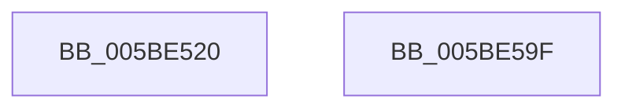

# KeInitializeInterrupt

- RVA: `0x005BE520`–`0x005BE5A0` (길이 `128` bytes)
- VA: `0x00000001405BE520`
- 실행 섹션: `.text`
- PDB 이름 있음: `예`; PDB Function 태그: `아니요`
- unwind 정보 RVA: `0x0007F678`
- 디코드: `26`개 명령, `128/128` bytes 표시
- 미해석 바이트: `0` (있으면 어셈블리에 `.byte`로 보존)

> 이 문서는 커널 이미지의 기계어와 PDB 기호를 분석해 생성했습니다. 4번과 5번은 함수 원형과 자료형을 바이너리 사용 방식에서 추정한 C 해석이며 원본 소스 복구 결과는 아닙니다.

## 1. Dependencies

- 직접 호출 지점: **1**; 고유 호출 대상: **1**
- 직접 호출자로 확인된 함수: **0**
- RIP 상대 이미지 참조: **0**

### Outgoing calls
- `0x005BE592` → [KeInitializeInterruptEx](../48/KeInitializeInterruptEx_function_00488664.md) (function, `0x00488664`)

### Direct callers
- 이 함수 시작 RVA로 연결되는 직접 call은 확인되지 않았습니다. 간접 호출은 완전히 역산할 수 없습니다.

### Static image references
- 디코드된 RIP-relative 메모리 참조가 없습니다.

## 2. Other-region calls and transfers

- 다른 실행 섹션으로 향하는 call: **0**
- 별도 외부 분기/꼬리 이동을 확인하지 못했습니다.

## 3. Assembly (complete function range)

```asm
005BE520  4C 8B DC                        mov r11, rsp
005BE523  48 81 EC 88 00 00 00            sub rsp, 0x88
005BE52A  8B 84 24 E8 00 00 00            mov eax, dword ptr [rsp + 0xe8]
005BE531  45 33 D2                        xor r10d, r10d
005BE534  4D 89 53 F0                     mov qword ptr [r11 - 0x10], r10
005BE538  45 88 53 E8                     mov byte ptr [r11 - 0x18], r10b
005BE53C  89 44 24 60                     mov dword ptr [rsp + 0x60], eax
005BE540  8A 84 24 E0 00 00 00            mov al, byte ptr [rsp + 0xe0]
005BE547  88 44 24 58                     mov byte ptr [rsp + 0x58], al
005BE54B  8B 84 24 D8 00 00 00            mov eax, dword ptr [rsp + 0xd8]
005BE552  89 44 24 50                     mov dword ptr [rsp + 0x50], eax
005BE556  8A 84 24 D0 00 00 00            mov al, byte ptr [rsp + 0xd0]
005BE55D  88 44 24 48                     mov byte ptr [rsp + 0x48], al
005BE561  8A 84 24 C8 00 00 00            mov al, byte ptr [rsp + 0xc8]
005BE568  88 44 24 40                     mov byte ptr [rsp + 0x40], al
005BE56C  8B 84 24 C0 00 00 00            mov eax, dword ptr [rsp + 0xc0]
005BE573  89 44 24 38                     mov dword ptr [rsp + 0x38], eax
005BE577  48 8B 84 24 B8 00 00 00         mov rax, qword ptr [rsp + 0xb8]
005BE57F  4D 89 53 A8                     mov qword ptr [r11 - 0x58], r10
005BE583  49 89 43 A0                     mov qword ptr [r11 - 0x60], rax
005BE587  8B 84 24 B0 00 00 00            mov eax, dword ptr [rsp + 0xb0]
005BE58E  89 44 24 20                     mov dword ptr [rsp + 0x20], eax
005BE592  E8 CD A0 EC FF                  call 0x140488664
005BE597  48 81 C4 88 00 00 00            add rsp, 0x88
005BE59E  C3                              ret
005BE59F  CC                              int3
```

## 4. C-style interpretation (structured pseudocode)

```c
__int64 __fastcall KeInitializeInterrupt(__int64 a1, __int64 a2, __int64 a3, __int64 a4, unsigned int a5, __int64 a6, unsigned int a7, unsigned __int8 a8, unsigned __int8 a9, unsigned int a10, unsigned __int8 a11, unsigned int a12)
{
    __int64 result;
    __int64 v_r10;
    __int64 v_rsp;
    unsigned int v_stack_m28;
    unsigned __int8 v_stack_m30;
    unsigned int v_stack_m38;
    unsigned __int8 v_stack_m40;
    unsigned __int8 v_stack_m48;
    unsigned int v_stack_m50;
    unsigned int v_stack_m68;

    v_rsp = (v_rsp) - (136);
    v_r10 = 0;
    *(unsigned __int64 *)(v_rsp - 16) = 0;
    *(unsigned __int8 *)(v_rsp - 24) = 0;
    v_stack_m28 = (unsigned int)((unsigned int)(a12));
    v_stack_m30 = a11;
    v_stack_m38 = (unsigned int)((unsigned int)(a10));
    v_stack_m40 = a9;
    v_stack_m48 = a8;
    v_stack_m50 = (unsigned int)((unsigned int)(a7));
    *(unsigned __int64 *)(v_rsp - 88) = 0;
    *(unsigned __int64 *)(v_rsp - 96) = a6;
    v_stack_m68 = (unsigned int)((unsigned int)(a5));
    result = KeInitializeInterruptEx(a1, a2, a3, a4);
    v_rsp = (v_rsp) + (136);
    return result;
}
```

## 5. (Beta) C Style

```c
int64_t KeInitializeInterrupt(int64_t Arg1, int64_t Arg2, int64_t Arg3, int64_t Arg4, uint32_t Arg5, int64_t Arg6, uint32_t Arg7, uint8_t Arg8, uint8_t Arg9, uint32_t Arg10, uint8_t Arg11, uint32_t Arg12)
{
    int64_t result;
    int64_t local_r10;
    int64_t local_rsp;
    uint32_t v_stack_m28;
    uint8_t v_stack_m30;
    uint32_t v_stack_m38;
    uint8_t v_stack_m40;
    uint8_t v_stack_m48;
    uint32_t v_stack_m50;
    uint32_t v_stack_m68;

    local_rsp = (local_rsp) - (136);
    local_r10 = 0;
    *(uint64_t *)(local_rsp - 0x10) = 0;
    *(uint8_t *)(local_rsp - 0x18) = 0;
    v_stack_m28 = (uint32_t)((uint32_t)(Arg12));
    v_stack_m30 = Arg11;
    v_stack_m38 = (uint32_t)((uint32_t)(Arg10));
    v_stack_m40 = Arg9;
    v_stack_m48 = Arg8;
    v_stack_m50 = (uint32_t)((uint32_t)(Arg7));
    *(uint64_t *)(local_rsp - 0x58) = 0;
    *(uint64_t *)(local_rsp - 0x60) = Arg6;
    v_stack_m68 = (uint32_t)((uint32_t)(Arg5));
    result = KeInitializeInterruptEx(Arg1, Arg2, Arg3, Arg4);
    local_rsp = (local_rsp) + (136);
    return result;
}
```

## 6. Execution-region graph

[열기: 2D/3D 그래프와 함수 탐색 컨트롤 패널](../../../control-panel.html?section=text&rva=0x005BE520&view=graph)

- 2D 그래프는 위에서 아래로 흐르고, 3D 그래프는 빈 공간을 드래그해 회전합니다. Shift+드래그는 이동, 휠은 확대·축소, 함수 노드 선택은 대상 보고서 이동입니다.

### Static fallback


