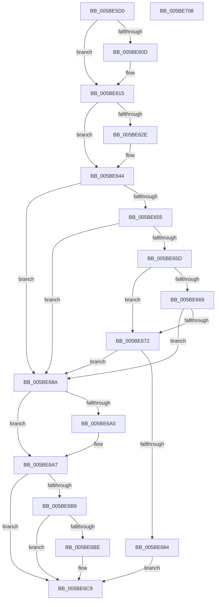

# KeInsertHeadQueue

- RVA: `0x005BE5D0`–`0x005BE709` (길이 `313` bytes)
- VA: `0x00000001405BE5D0`
- 실행 섹션: `.text`
- PDB 이름 있음: `예`; PDB Function 태그: `아니요`
- unwind 정보 RVA: `0x000847EC`
- 디코드: `88`개 명령, `313/313` bytes 표시
- 미해석 바이트: `0` (있으면 어셈블리에 `.byte`로 보존)

> 이 문서는 커널 이미지의 기계어와 PDB 기호를 분석해 생성했습니다. 4번과 5번은 함수 원형과 자료형을 바이너리 사용 방식에서 추정한 C 해석이며 원본 소스 복구 결과는 아닙니다.

## 1. Dependencies

- 직접 호출 지점: **7**; 고유 호출 대상: **7**
- 직접 호출자로 확인된 함수: **0**
- RIP 상대 이미지 참조: **2**

### Outgoing calls
- `0x005BE610` → [KiRaiseIrqlProcessIrqlFlags](../4F/KiRaiseIrqlProcessIrqlFlags_function_004F56FC.md) (function, `0x004F56FC`)
- `0x005BE631` → [KeIsThreadRunning](../39/KeIsThreadRunning_function_00396720.md) (function, `0x00396720`)
- `0x005BE63F` → [EtwTraceEnqueueWork](../39/EtwTraceEnqueueWork_function_0039674C.md) (function, `0x0039674C`)
- `0x005BE647` → [KiAcquireKobjectLockSafe](../25/KiAcquireKobjectLockSafe_function_00251C90.md) (function, `0x00251C90`)
- `0x005BE67B` → [KiWakeQueueWaiter](../34/KiWakeQueueWaiter_function_00344C10.md) (function, `0x00344C10`)
- `0x005BE6C4` → [KiWakeOtherQueueWaiters](../39/KiWakeOtherQueueWaiters_function_003964D0.md) (function, `0x003964D0`)
- `0x005BE6E1` → [KiExitDispatcher](../25/KiExitDispatcher_function_00251CF0.md) (function, `0x00251CF0`)

### Direct callers
- 이 함수 시작 RVA로 연결되는 직접 call은 확인되지 않았습니다. 간접 호출은 완전히 역산할 수 없습니다.

### Static image references
- `0x005BE604` → RVA `0x00FC6D20` (`ALMOSTRO`; read)
- `0x005BE61E` → RVA `0x00FC6B04` (`ALMOSTRO`; read)

## 2. Other-region calls and transfers

- 다른 실행 섹션으로 향하는 call: **0**
- 별도 외부 분기/꼬리 이동을 확인하지 못했습니다.

## 3. Assembly (complete function range)

```asm
005BE5D0  48 8B C4                        mov rax, rsp
005BE5D3  48 89 58 08                     mov qword ptr [rax + 8], rbx
005BE5D7  48 89 68 10                     mov qword ptr [rax + 0x10], rbp
005BE5DB  48 89 70 18                     mov qword ptr [rax + 0x18], rsi
005BE5DF  48 89 78 20                     mov qword ptr [rax + 0x20], rdi
005BE5E3  41 54                           push r12
005BE5E5  41 56                           push r14
005BE5E7  41 57                           push r15
005BE5E9  48 83 EC 30                     sub rsp, 0x30
005BE5ED  48 8B FA                        mov rdi, rdx
005BE5F0  48 8D 71 08                     lea rsi, [rcx + 8]
005BE5F4  48 8B D9                        mov rbx, rcx
005BE5F7  45 0F 20 C7                     mov r15, cr8
005BE5FB  BA 02 00 00 00                  mov edx, 2
005BE600  44 0F 22 C2                     mov cr8, rdx
005BE604  83 3D 15 87 A0 00 00            cmp dword ptr [rip + 0xa08715], 0
005BE60B  74 08                           je 0x1405be615
005BE60D  41 8A CF                        mov cl, r15b
005BE610  E8 E7 70 F3 FF                  call 0x1404f56fc
005BE615  65 4C 8B 34 25 20 00 00 00      mov r14, qword ptr gs:[0x20]
005BE61E  F7 05 DC 84 A0 00 00 00 00 01   test dword ptr [rip + 0xa084dc], 0x1000000
005BE628  49 8B 6E 08                     mov rbp, qword ptr [r14 + 8]
005BE62C  74 16                           je 0x1405be644
005BE62E  48 8B CD                        mov rcx, rbp
005BE631  E8 EA 80 DD FF                  call 0x140396720
005BE636  44 8A C0                        mov r8b, al
005BE639  48 8B CD                        mov rcx, rbp
005BE63C  48 8B D7                        mov rdx, rdi
005BE63F  E8 08 81 DD FF                  call 0x14039674c
005BE644  48 8B CB                        mov rcx, rbx
005BE647  E8 44 36 C9 FF                  call 0x140251c90
005BE64C  44 8B 63 04                     mov r12d, dword ptr [rbx + 4]
005BE650  48 39 36                        cmp qword ptr [rsi], rsi
005BE653  74 35                           je 0x1405be68a
005BE655  8B 43 28                        mov eax, dword ptr [rbx + 0x28]
005BE658  3B 43 2C                        cmp eax, dword ptr [rbx + 0x2c]
005BE65B  73 2D                           jae 0x1405be68a
005BE65D  48 8B 85 E8 00 00 00            mov rax, qword ptr [rbp + 0xe8]
005BE664  48 3B C3                        cmp rax, rbx
005BE667  75 09                           jne 0x1405be672
005BE669  80 BD 83 02 00 00 0F            cmp byte ptr [rbp + 0x283], 0xf
005BE670  74 18                           je 0x1405be68a
005BE672  4C 8B C7                        mov r8, rdi
005BE675  48 8B D3                        mov rdx, rbx
005BE678  49 8B CE                        mov rcx, r14
005BE67B  E8 90 65 D8 FF                  call 0x140344c10
005BE680  84 C0                           test al, al
005BE682  74 06                           je 0x1405be68a
005BE684  48 83 27 00                     and qword ptr [rdi], 0
005BE688  EB 3F                           jmp 0x1405be6c9
005BE68A  8B 53 04                        mov edx, dword ptr [rbx + 4]
005BE68D  8D 42 01                        lea eax, [rdx + 1]
005BE690  89 43 04                        mov dword ptr [rbx + 4], eax
005BE693  48 8D 43 18                     lea rax, [rbx + 0x18]
005BE697  48 8B 08                        mov rcx, qword ptr [rax]
005BE69A  48 39 41 08                     cmp qword ptr [rcx + 8], rax
005BE69E  74 07                           je 0x1405be6a7
005BE6A0  B9 03 00 00 00                  mov ecx, 3
005BE6A5  CD 29                           int 0x29
005BE6A7  48 89 0F                        mov qword ptr [rdi], rcx
005BE6AA  48 89 47 08                     mov qword ptr [rdi + 8], rax
005BE6AE  48 89 79 08                     mov qword ptr [rcx + 8], rdi
005BE6B2  48 89 38                        mov qword ptr [rax], rdi
005BE6B5  85 D2                           test edx, edx
005BE6B7  75 10                           jne 0x1405be6c9
005BE6B9  48 39 36                        cmp qword ptr [rsi], rsi
005BE6BC  74 0B                           je 0x1405be6c9
005BE6BE  48 8B D3                        mov rdx, rbx
005BE6C1  49 8B CE                        mov rcx, r14
005BE6C4  E8 07 7E DD FF                  call 0x1403964d0
005BE6C9  F0 81 23 7F FF FF FF            lock and dword ptr [rbx], 0xffffff7f
005BE6D0  45 33 C9                        xor r9d, r9d
005BE6D3  44 88 7C 24 20                  mov byte ptr [rsp + 0x20], r15b
005BE6D8  33 D2                           xor edx, edx
005BE6DA  49 8B CE                        mov rcx, r14
005BE6DD  45 8D 41 01                     lea r8d, [r9 + 1]
005BE6E1  E8 0A 36 C9 FF                  call 0x140251cf0
005BE6E6  48 8B 5C 24 50                  mov rbx, qword ptr [rsp + 0x50]
005BE6EB  41 8B C4                        mov eax, r12d
005BE6EE  48 8B 6C 24 58                  mov rbp, qword ptr [rsp + 0x58]
005BE6F3  48 8B 74 24 60                  mov rsi, qword ptr [rsp + 0x60]
005BE6F8  48 8B 7C 24 68                  mov rdi, qword ptr [rsp + 0x68]
005BE6FD  48 83 C4 30                     add rsp, 0x30
005BE701  41 5F                           pop r15
005BE703  41 5E                           pop r14
005BE705  41 5C                           pop r12
005BE707  C3                              ret
005BE708  CC                              int3
```

## 4. C-style interpretation (structured pseudocode)

```c
__int64 __fastcall KeInsertHeadQueue(__int64 a1, __int64 a2, __int64 a3, int a4)
{
    __int64 result;
    __int64 v_rsp;
    unsigned __int8 v_stack_m28;
    unsigned __int64 v_stack_p10;
    unsigned __int64 v_stack_p18;
    unsigned __int64 v_stack_p20;
    unsigned __int64 v_stack_p8;

    *(unsigned __int64 *)(v_rsp + 8) = v_rbx;
    *(unsigned __int64 *)(v_rsp + 16) = v_rbp;
    *(unsigned __int64 *)(v_rsp + 24) = v_rsi;
    *(unsigned __int64 *)(v_rsp + 32) = v_rdi;
    v_rsp = (v_rsp) - (48);
    result = v_rsp;
    if ((*(unsigned int *)(v_rip + 10520341)) != 0) {
        a1 = (unsigned __int8)(v_cr8);
        result = KiRaiseIrqlProcessIrqlFlags(a1, 2, a3, a4);
    }
    if (((*(unsigned int *)(v_rip + 10519772)) & (0x1000000ULL)) != 0) {
        a1 = *(unsigned __int64 *)(*(unsigned __int64 *)(gs_base + (0 + 32)) + 8);
        result = KeIsThreadRunning(a1, 2, a3, a4);
        a3 = (unsigned __int8)(result);
        a1 = *(unsigned __int64 *)(*(unsigned __int64 *)(gs_base + (0 + 32)) + 8);
        a2 = a2;
        result = EtwTraceEnqueueWork(a1, a2, a3, a4);
    }
    result = KiAcquireKobjectLockSafe(a1, a2, a3, a4);
    if ((*(unsigned __int64 *)(a1 + 8)) == (a1 + 8)) goto loc_005BE68A;
    if (((unsigned int)((unsigned int)(*(unsigned int *)(a1 + 40)))) >= (*(unsigned int *)(a1 + 44))) goto loc_005BE68A;
    if ((*(unsigned __int64 *)(*(unsigned __int64 *)(*(unsigned __int64 *)(gs_base + (0 + 32)) + 8) + 232)) != a1) goto loc_005BE672;
    if ((*(unsigned __int8 *)(*(unsigned __int64 *)(*(unsigned __int64 *)(gs_base + (0 + 32)) + 8) + 643)) == 15) goto loc_005BE68A;
loc_005BE672:
    result = KiWakeQueueWaiter(*(unsigned __int64 *)(gs_base + (0 + 32)), a1, a2, a4);
    if ((unsigned __int8)(result) == 0) goto loc_005BE68A;
    goto loc_005BE6C9;
loc_005BE68A:
    *(unsigned int *)(a1 + 4) = (unsigned int)((unsigned int)(*(unsigned int *)(a1 + 4)) + 1);
    if ((*(unsigned __int64 *)(*(unsigned __int64 *)(a1 + 24) + 8)) != (a1 + 24)) {
        a1 = 3;
    }
    *(unsigned __int64 *)(a2) = a1;
    *(unsigned __int64 *)(a2 + 8) = a1 + 24;
    *(unsigned __int64 *)(a1 + 8) = a2;
    *(unsigned __int64 *)(a1 + 24) = a2;
    if ((unsigned int)((unsigned int)(*(unsigned int *)(a1 + 4))) != 0) goto loc_005BE6C9;
    result = a1 + 24;
    if ((*(unsigned __int64 *)(a1 + 8)) != (a1 + 8)) {
        a2 = a1;
        a1 = *(unsigned __int64 *)(gs_base + (0 + 32));
        result = KiWakeOtherQueueWaiters(a1, a2, a2, a4);
    }
    a4 = 0;
    v_stack_m28 = (unsigned __int8)(v_cr8);
    a2 = 0;
    result = KiExitDispatcher(*(unsigned __int64 *)(gs_base + (0 + 32)), a2, a4 + 1, a4);
    v_rsp = (v_rsp) + (48);
    return (unsigned int)((unsigned int)((unsigned int)(*(unsigned int *)(a1 + 4))));
}
```

## 5. (Beta) C Style

```c
int64_t KeInsertHeadQueue(void *Arg1, void *Arg2, int64_t Arg3, int32_t Arg4)
{
    uint8_t *arg1 = (uint8_t *)Arg1;
    uint8_t *arg2 = (uint8_t *)Arg2;

    int64_t result;
    int64_t local_rsp;
    uint8_t v_stack_m28;
    uint64_t v_stack_p10;
    uint64_t v_stack_p18;
    uint64_t v_stack_p20;
    uint64_t v_stack_p8;

    *(uint64_t *)(local_rsp + 0x8) = local_rbx;
    *(uint64_t *)(local_rsp + 0x10) = local_rbp;
    *(uint64_t *)(local_rsp + 0x18) = local_rsi;
    *(uint64_t *)(local_rsp + 0x20) = local_rdi;
    local_rsp = (local_rsp) - (48);
    result = local_rsp;
    if ((*(uint32_t *)(v_rip + 0xA08715)) != 0) {
        Arg1 = (uint8_t)(v_cr8);
        result = KiRaiseIrqlProcessIrqlFlags(Arg1, 2, Arg3, Arg4);
    }
    if (((*(uint32_t *)(v_rip + 0xA084DC)) & (0x1000000ULL)) != 0) {
        Arg1 = *(uint64_t *)(*(uint64_t *)(gs_base + (0 + 0x20)) + 0x8);
        result = KeIsThreadRunning(Arg1, 2, Arg3, Arg4);
        Arg3 = (uint8_t)(result);
        Arg1 = *(uint64_t *)(*(uint64_t *)(gs_base + (0 + 0x20)) + 0x8);
        Arg2 = Arg2;
        result = EtwTraceEnqueueWork(Arg1, Arg2, Arg3, Arg4);
    }
    result = KiAcquireKobjectLockSafe(Arg1, Arg2, Arg3, Arg4);
    if ((*(uint64_t *)(arg1 + 0x8)) == (Arg1 + 8)) goto loc_005BE68A;
    if (((uint32_t)((uint32_t)(*(uint32_t *)(arg1 + 0x28)))) >= (*(uint32_t *)(arg1 + 0x2C))) goto loc_005BE68A;
    if ((*(uint64_t *)(*(uint64_t *)(*(uint64_t *)(gs_base + (0 + 0x20)) + 0x8) + 0xE8)) != Arg1) goto loc_005BE672;
    if ((*(uint8_t *)(*(uint64_t *)(*(uint64_t *)(gs_base + (0 + 0x20)) + 0x8) + 0x283)) == 15) goto loc_005BE68A;
loc_005BE672:
    result = KiWakeQueueWaiter(*(uint64_t *)(gs_base + (0 + 0x20)), Arg1, Arg2, Arg4);
    if ((uint8_t)(result) == 0) goto loc_005BE68A;
    goto loc_005BE6C9;
loc_005BE68A:
    *(uint32_t *)(arg1 + 0x4) = (uint32_t)((uint32_t)(*(uint32_t *)(arg1 + 0x4)) + 1);
    if ((*(uint64_t *)(*(uint64_t *)(arg1 + 0x18) + 0x8)) != (Arg1 + 24)) {
        Arg1 = 3;
    }
    *(void **)(arg2) = Arg1;
    *(void **)(arg2 + 0x8) = Arg1 + 24;
    *(void **)(arg1 + 0x8) = Arg2;
    *(void **)(arg1 + 0x18) = Arg2;
    if ((uint32_t)((uint32_t)(*(uint32_t *)(arg1 + 0x4))) != 0) goto loc_005BE6C9;
    result = Arg1 + 24;
    if ((*(uint64_t *)(arg1 + 0x8)) != (Arg1 + 8)) {
        Arg2 = Arg1;
        Arg1 = *(uint64_t *)(gs_base + (0 + 0x20));
        result = KiWakeOtherQueueWaiters(Arg1, Arg2, Arg2, Arg4);
    }
    Arg4 = 0;
    v_stack_m28 = (uint8_t)(v_cr8);
    Arg2 = 0;
    result = KiExitDispatcher(*(uint64_t *)(gs_base + (0 + 0x20)), Arg2, Arg4 + 1, Arg4);
    local_rsp = (local_rsp) + (48);
    return (uint32_t)((uint32_t)((uint32_t)(*(uint32_t *)(arg1 + 0x4))));
}
```

### 관측된 메모리 오프셋

구조체 형식이 확인되지 않은 접근은 인자 기준의 오프셋으로만 기록했습니다.

| 기준 인자 | 오프셋 표현 | 폭 (bit) | 접근 |
|---|---:|---:|---|
| `Arg1` | `+ 0x0` | `32` | `R/W` |
| `Arg1` | `+ 0x0` | `64` | `R` |
| `Arg1` | `+ 0x0` | `64` | `W` |
| `Arg1` | `+ 0x4` | `32` | `R` |
| `Arg1` | `+ 0x4` | `32` | `W` |
| `Arg1` | `+ 0x8` | `64` | `R` |
| `Arg1` | `+ 0x18` | `64` | `R` |
| `Arg1` | `+ 0x28` | `32` | `R` |
| `Arg1` | `+ 0x2C` | `32` | `R` |
| `Arg2` | `+ 0x0` | `64` | `R/W` |
| `Arg2` | `+ 0x0` | `64` | `W` |
| `Arg2` | `+ 0x8` | `64` | `W` |

## 6. Execution-region graph

[열기: 2D/3D 그래프와 함수 탐색 컨트롤 패널](../../../control-panel.html?section=text&rva=0x005BE5D0&view=graph)

- 2D 그래프는 위에서 아래로 흐르고, 3D 그래프는 빈 공간을 드래그해 회전합니다. Shift+드래그는 이동, 휠은 확대·축소, 함수 노드 선택은 대상 보고서 이동입니다.

### Static fallback


