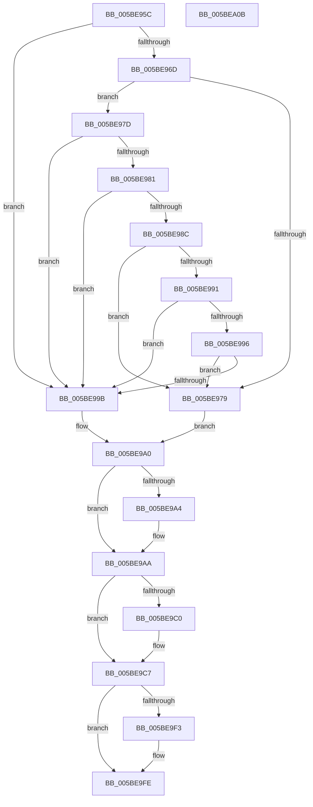

# KeOptimizeSpecCtrlSettings

- RVA: `0x005BE95C`–`0x005BEA0C` (길이 `176` bytes)
- VA: `0x00000001405BE95C`
- 실행 섹션: `.text`
- PDB 이름 있음: `예`; PDB Function 태그: `아니요`
- unwind 정보 RVA: `0x0005CF00`
- 디코드: `50`개 명령, `176/176` bytes 표시
- 미해석 바이트: `0` (있으면 어셈블리에 `.byte`로 보존)

> 이 문서는 커널 이미지의 기계어와 PDB 기호를 분석해 생성했습니다. 4번과 5번은 함수 원형과 자료형을 바이너리 사용 방식에서 추정한 C 해석이며 원본 소스 복구 결과는 아닙니다.

## 1. Dependencies

- 직접 호출 지점: **4**; 고유 호출 대상: **4**
- 직접 호출자로 확인된 함수: **2**
- RIP 상대 이미지 참조: **6**

### Outgoing calls
- `0x005BE9C2` → [KiRaiseIrqlProcessIrqlFlags](../4F/KiRaiseIrqlProcessIrqlFlags_function_004F56FC.md) (function, `0x004F56FC`)
- `0x005BE9CC` → [KeQueryActiveProcessorCountEx](../24/KeQueryActiveProcessorCountEx_function_00249EF0.md) (function, `0x00249EF0`)
- `0x005BE9E5` → [KeIpiGenericCall](../47/KeIpiGenericCall_function_00471720.md) (function, `0x00471720`)
- `0x005BE9F9` → [KiLowerIrqlProcessIrqlFlags](../4F/KiLowerIrqlProcessIrqlFlags_function_004F5698.md) (function, `0x004F5698`)

### Direct callers
- [KiDynamicProcessorInitialization](KiDynamicProcessorInitialization_function_005B7C6C.md) at `0x005B7CE3`
- [IoInitSystemPreDrivers](../../init/C2/IoInitSystemPreDrivers_function_00C2AC3C.md) at `0x00C2B930`

### Static image references
- `0x005BE964` → RVA `0x00FC6A97` (`ALMOSTRO`; read)
- `0x005BE96D` → RVA `0x00FC6A90` (`ALMOSTRO`; read)
- `0x005BE981` → RVA `0x00FC6CEC` (`ALMOSTRO`; read)
- `0x005BE9A4` → RVA `0x00FC6E8C` (`ALMOSTRO`; write)
- `0x005BE9B7` → RVA `0x00FC6D20` (`ALMOSTRO`; read)
- `0x005BE9DA` → RVA `0x005BF5A0` (`KiOptimizeSpecCtrlSettingsWorker`; read)

## 2. Other-region calls and transfers

- 다른 실행 섹션으로 향하는 call: **0**
- 별도 외부 분기/꼬리 이동을 확인하지 못했습니다.

## 3. Assembly (complete function range)

```asm
005BE95C  40 53                           push rbx
005BE95E  48 83 EC 20                     sub rsp, 0x20
005BE962  8A D1                           mov dl, cl
005BE964  80 3D 2C 81 A0 00 00            cmp byte ptr [rip + 0xa0812c], 0
005BE96B  74 2E                           je 0x1405be99b
005BE96D  8B 05 1D 81 A0 00               mov eax, dword ptr [rip + 0xa0811d]
005BE973  0F BA E0 16                     bt eax, 0x16
005BE977  72 04                           jb 0x1405be97d
005BE979  33 C0                           xor eax, eax
005BE97B  EB 23                           jmp 0x1405be9a0
005BE97D  A8 02                           test al, 2
005BE97F  74 1A                           je 0x1405be99b
005BE981  8B 0D 65 83 A0 00               mov ecx, dword ptr [rip + 0xa08365]
005BE987  83 E9 01                        sub ecx, 1
005BE98A  74 0F                           je 0x1405be99b
005BE98C  83 E9 01                        sub ecx, 1
005BE98F  74 E8                           je 0x1405be979
005BE991  83 E9 01                        sub ecx, 1
005BE994  74 05                           je 0x1405be99b
005BE996  83 F9 01                        cmp ecx, 1
005BE999  75 DE                           jne 0x1405be979
005BE99B  B8 01 00 00 00                  mov eax, 1
005BE9A0  84 D2                           test dl, dl
005BE9A2  75 06                           jne 0x1405be9aa
005BE9A4  89 05 E2 84 A0 00               mov dword ptr [rip + 0xa084e2], eax
005BE9AA  44 0F 20 C3                     mov rbx, cr8
005BE9AE  BA 0C 00 00 00                  mov edx, 0xc
005BE9B3  44 0F 22 C2                     mov cr8, rdx
005BE9B7  83 3D 62 83 A0 00 00            cmp dword ptr [rip + 0xa08362], 0
005BE9BE  74 07                           je 0x1405be9c7
005BE9C0  8A CB                           mov cl, bl
005BE9C2  E8 35 6D F3 FF                  call 0x1404f56fc
005BE9C7  B9 FF FF 00 00                  mov ecx, 0xffff
005BE9CC  E8 1F B5 C8 FF                  call 0x140249ef0
005BE9D1  48 8D 54 24 38                  lea rdx, [rsp + 0x38]
005BE9D6  89 44 24 3C                     mov dword ptr [rsp + 0x3c], eax
005BE9DA  48 8D 0D BF 0B 00 00            lea rcx, [rip + 0xbbf]
005BE9E1  89 44 24 38                     mov dword ptr [rsp + 0x38], eax
005BE9E5  E8 36 2D EB FF                  call 0x140471720
005BE9EA  83 3D 2F 83 A0 00 00            cmp dword ptr [rip + 0xa0832f], 0
005BE9F1  74 0B                           je 0x1405be9fe
005BE9F3  44 0F 20 C1                     mov rcx, cr8
005BE9F7  8A D3                           mov dl, bl
005BE9F9  E8 9A 6C F3 FF                  call 0x1404f5698
005BE9FE  0F B6 C3                        movzx eax, bl
005BEA01  44 0F 22 C0                     mov cr8, rax
005BEA05  48 83 C4 20                     add rsp, 0x20
005BEA09  5B                              pop rbx
005BEA0A  C3                              ret
005BEA0B  CC                              int3
```

## 4. C-style interpretation (structured pseudocode)

```c
__int64 __fastcall KeOptimizeSpecCtrlSettings(unsigned __int8 a1)
{
    __int64 result;
    __int64 v_rsp;
    unsigned __int64 v_stack_p10;
    unsigned int v_stack_p14;

    v_rsp = (v_rsp) - (32);
    if ((*(unsigned __int8 *)(v_rip + 10518828)) == 0) goto loc_005BE99B;
    if ((*(unsigned __int8 *)(v_rip + 10518828)) < 0) goto loc_005BE97D;
loc_005BE979:
    result = 0;
    goto loc_005BE9A0;
loc_005BE97D:
    if (((0) & (2)) == 0) goto loc_005BE99B;
    a1 = (unsigned int)(((unsigned int)(*(unsigned int *)(v_rip + 10519397))) - (1));
    if (condition_is_equal) goto loc_005BE99B;
    a1 = (unsigned int)((a1) - (1));
    if (condition_is_equal) goto loc_005BE979;
    a1 = (unsigned int)((a1) - (1));
    if (condition_is_equal) goto loc_005BE99B;
    if (a1 != 1) goto loc_005BE979;
loc_005BE99B:
loc_005BE9A0:
    if (a1 == 0) {
        *(unsigned int *)(v_rip + 10519778) = 1;
    }
    result = 1;
    if ((*(unsigned int *)(v_rip + 10519394)) != 0) {
        a1 = (unsigned __int8)(v_cr8);
        result = KiRaiseIrqlProcessIrqlFlags(a1, 12, a3, a4);
    }
    result = KeQueryActiveProcessorCountEx((unsigned int)(0xFFFFULL), 12, a3, a4);
    v_stack_p14 = (unsigned int)(result);
    v_stack_p10 = (unsigned int)(result);
    result = KeIpiGenericCall(v_rip + 3007, v_stack_p10, a3, a4);
    if ((*(unsigned int *)(v_rip + 10519343)) != 0) {
        a1 = 12;
        a2 = (unsigned __int8)(v_cr8);
        result = KiLowerIrqlProcessIrqlFlags(a1, a2, a3, a4);
    }
    v_rsp = (v_rsp) + (32);
    return (unsigned __int8)(v_cr8);
}
```

## 5. (Beta) C Style

```c
int64_t KeOptimizeSpecCtrlSettings(uint8_t Arg1)
{
    int64_t result;
    int64_t local_rsp;
    uint64_t v_stack_p10;
    uint32_t v_stack_p14;

    local_rsp = (local_rsp) - (32);
    if ((*(uint8_t *)(v_rip + 0xA0812C)) == 0) goto loc_005BE99B;
    if ((*(uint8_t *)(v_rip + 0xA0812C)) < 0) goto loc_005BE97D;
loc_005BE979:
    result = 0;
    goto loc_005BE9A0;
loc_005BE97D:
    if (((0) & (2)) == 0) goto loc_005BE99B;
    Arg1 = (uint32_t)(((uint32_t)(*(uint32_t *)(v_rip + 0xA08365))) - (1));
    if (condition_is_equal) goto loc_005BE99B;
    Arg1 = (uint32_t)((Arg1) - (1));
    if (condition_is_equal) goto loc_005BE979;
    Arg1 = (uint32_t)((Arg1) - (1));
    if (condition_is_equal) goto loc_005BE99B;
    if (Arg1 != 1) goto loc_005BE979;
loc_005BE99B:
loc_005BE9A0:
    if (Arg1 == 0) {
        *(uint32_t *)(v_rip + 0xA084E2) = 1;
    }
    result = 1;
    if ((*(uint32_t *)(v_rip + 0xA08362)) != 0) {
        Arg1 = (uint8_t)(v_cr8);
        result = KiRaiseIrqlProcessIrqlFlags(Arg1, 12, a3, a4);
    }
    result = KeQueryActiveProcessorCountEx((uint32_t)(0xFFFFULL), 12, a3, a4);
    v_stack_p14 = (uint32_t)(result);
    v_stack_p10 = (uint32_t)(result);
    result = KeIpiGenericCall(v_rip + 3007, v_stack_p10, a3, a4);
    if ((*(uint32_t *)(v_rip + 0xA0832F)) != 0) {
        Arg1 = 12;
        a2 = (uint8_t)(v_cr8);
        result = KiLowerIrqlProcessIrqlFlags(Arg1, a2, a3, a4);
    }
    local_rsp = (local_rsp) + (32);
    return (uint8_t)(v_cr8);
}
```

## 6. Execution-region graph

[열기: 2D/3D 그래프와 함수 탐색 컨트롤 패널](../../../control-panel.html?section=text&rva=0x005BE95C&view=graph)

- 2D 그래프는 위에서 아래로 흐르고, 3D 그래프는 빈 공간을 드래그해 회전합니다. Shift+드래그는 이동, 휠은 확대·축소, 함수 노드 선택은 대상 보고서 이동입니다.

### Static fallback


