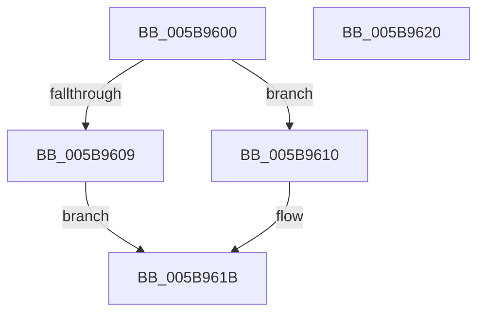

# KeOrAffinityEx

- RVA: `0x005B9600`–`0x005B9621` (길이 `33` bytes)
- VA: `0x00000001405B9600`
- 실행 섹션: `.text`
- PDB 이름 있음: `예`; PDB Function 태그: `아니요`
- unwind 정보 RVA: `0x0005C788`
- 디코드: `10`개 명령, `33/33` bytes 표시
- 미해석 바이트: `0` (있으면 어셈블리에 `.byte`로 보존)

> 이 문서는 커널 이미지의 기계어와 PDB 기호를 분석해 생성했습니다. 4번과 5번은 함수 원형과 자료형을 바이너리 사용 방식에서 추정한 C 해석이며 원본 소스 복구 결과는 아닙니다.

## 1. Dependencies

- 직접 호출 지점: **2**; 고유 호출 대상: **2**
- 직접 호출자로 확인된 함수: **0**
- RIP 상대 이미지 참조: **0**

### Outgoing calls
- `0x005B9609` → [KiOrAffinityExNoResult](../4D/KiOrAffinityExNoResult_function_004D70BC.md) (function, `0x004D70BC`)
- `0x005B9616` → [KiOrAffinityEx](../39/KiOrAffinityEx_function_0039A84C.md) (function, `0x0039A84C`)

### Direct callers
- 이 함수 시작 RVA로 연결되는 직접 call은 확인되지 않았습니다. 간접 호출은 완전히 역산할 수 없습니다.

### Static image references
- 디코드된 RIP-relative 메모리 참조가 없습니다.

## 2. Other-region calls and transfers

- 다른 실행 섹션으로 향하는 call: **0**
- 별도 외부 분기/꼬리 이동을 확인하지 못했습니다.

## 3. Assembly (complete function range)

```asm
005B9600  48 83 EC 28                     sub rsp, 0x28
005B9604  4D 85 C0                        test r8, r8
005B9607  75 07                           jne 0x1405b9610
005B9609  E8 AE DA F1 FF                  call 0x1404d70bc
005B960E  EB 0B                           jmp 0x1405b961b
005B9610  41 B9 14 00 00 00               mov r9d, 0x14
005B9616  E8 31 12 DE FF                  call 0x14039a84c
005B961B  48 83 C4 28                     add rsp, 0x28
005B961F  C3                              ret
005B9620  CC                              int3
```

## 4. C-style interpretation (structured pseudocode)

```c
__int64 __fastcall KeOrAffinityEx(__int64 a1, __int64 a2, __int64 a3)
{
    __int64 result;
    __int64 v_rsp;

    v_rsp = (v_rsp) - (40);
    if (a3 != 0) goto loc_005B9610;
    result = KiOrAffinityExNoResult(a1, a2, a3, a4);
    goto loc_005B961B;
loc_005B9610:
    result = KiOrAffinityEx(a1, a2, a3, 20);
loc_005B961B:
    v_rsp = (v_rsp) + (40);
    return result;
}
```

## 5. (Beta) C Style

```c
int64_t KeOrAffinityEx(int64_t Arg1, int64_t Arg2, int64_t Arg3)
{
    int64_t result;
    int64_t local_rsp;

    local_rsp = (local_rsp) - (40);
    if (Arg3 != 0) goto loc_005B9610;
    result = KiOrAffinityExNoResult(Arg1, Arg2, Arg3, a4);
    goto loc_005B961B;
loc_005B9610:
    result = KiOrAffinityEx(Arg1, Arg2, Arg3, 20);
loc_005B961B:
    local_rsp = (local_rsp) + (40);
    return result;
}
```

## 6. Execution-region graph

[열기: 2D/3D 그래프와 함수 탐색 컨트롤 패널](../../../control-panel.html?section=text&rva=0x005B9600&view=graph)

- 2D 그래프는 위에서 아래로 흐르고, 3D 그래프는 빈 공간을 드래그해 회전합니다. Shift+드래그는 이동, 휠은 확대·축소, 함수 노드 선택은 대상 보고서 이동입니다.

### Static fallback


