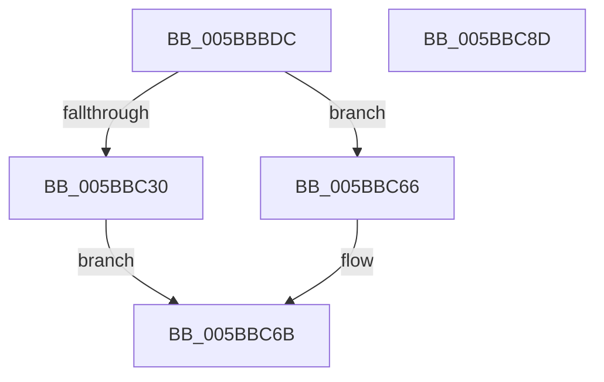

# KeOutPageEnclavePage

- RVA: `0x005BBBDC`–`0x005BBC8E` (길이 `178` bytes)
- VA: `0x00000001405BBBDC`
- 실행 섹션: `.text`
- PDB 이름 있음: `예`; PDB Function 태그: `아니요`
- unwind 정보 RVA: `0x000CA2A8`
- 디코드: `43`개 명령, `178/178` bytes 표시
- 미해석 바이트: `0` (있으면 어셈블리에 `.byte`로 보존)

> 이 문서는 커널 이미지의 기계어와 PDB 기호를 분석해 생성했습니다. 4번과 5번은 함수 원형과 자료형을 바이너리 사용 방식에서 추정한 C 해석이며 원본 소스 복구 결과는 아닙니다.

## 1. Dependencies

- 직접 호출 지점: **4**; 고유 호출 대상: **4**
- 직접 호출자로 확인된 함수: **1**
- RIP 상대 이미지 참조: **2**

### Outgoing calls
- `0x005BBC20` → [memset](../6C/memset_function_006C6C40.md) (function, `0x006C6C40`)
- `0x005BBC58` → [KiEncls](../6B/KiEncls_function_006B1BE0.md) (function, `0x006B1BE0`)
- `0x005BBC5F` → [KiEnclsStatus](../36/KiEnclsStatus_function_00368E1C.md) (function, `0x00368E1C`)
- `0x005BBC75` → [_security_check_cookie](../6A/_security_check_cookie_function_006AC640.md) (function, `0x006AC640`)

### Direct callers
- [sub_006E362E](../6E/Unknown_function_006E362E.md) at `0x006E38E6`

### Static image references
- `0x005BBBF7` → RVA `0x00E0A740` (`.data`; read)
- `0x005BBC25` → RVA `0x00FC6B30` (`ALMOSTRO`; read)

## 2. Other-region calls and transfers

- 다른 실행 섹션으로 향하는 call: **0**
- 별도 외부 분기/꼬리 이동을 확인하지 못했습니다.

## 3. Assembly (complete function range)

```asm
005BBBDC  48 89 5C 24 20                  mov qword ptr [rsp + 0x20], rbx
005BBBE1  55                              push rbp
005BBBE2  56                              push rsi
005BBBE3  57                              push rdi
005BBBE4  48 81 EC B0 01 00 00            sub rsp, 0x1b0
005BBBEB  48 8D AC 24 A0 00 00 00         lea rbp, [rsp + 0xa0]
005BBBF3  48 83 E5 80                     and rbp, 0xffffffffffffff80
005BBBF7  48 8B 05 42 EB 84 00            mov rax, qword ptr [rip + 0x84eb42]
005BBBFE  48 33 C4                        xor rax, rsp
005BBC01  48 89 85 00 01 00 00            mov qword ptr [rbp + 0x100], rax
005BBC08  49 8B F0                        mov rsi, r8
005BBC0B  48 8B FA                        mov rdi, rdx
005BBC0E  48 8B D9                        mov rbx, rcx
005BBC11  33 D2                           xor edx, edx
005BBC13  41 B8 80 00 00 00               mov r8d, 0x80
005BBC19  48 8D 8D 80 00 00 00            lea rcx, [rbp + 0x80]
005BBC20  E8 1B B0 10 00                  call 0x1406c6c40
005BBC25  48 0F BA 25 02 AF A0 00 28      bt qword ptr [rip + 0xa0af02], 0x28
005BBC2E  73 36                           jae 0x1405bbc66
005BBC30  48 83 65 00 00                  and qword ptr [rbp], 0
005BBC35  48 8D 85 80 00 00 00            lea rax, [rbp + 0x80]
005BBC3C  48 83 65 18 00                  and qword ptr [rbp + 0x18], 0
005BBC41  48 8D 55 00                     lea rdx, [rbp]
005BBC45  4C 8B CE                        mov r9, rsi
005BBC48  48 89 45 10                     mov qword ptr [rbp + 0x10], rax
005BBC4C  4C 8B C3                        mov r8, rbx
005BBC4F  48 89 7D 08                     mov qword ptr [rbp + 8], rdi
005BBC53  B9 0B 00 00 00                  mov ecx, 0xb
005BBC58  E8 83 5F 0F 00                  call 0x1406b1be0
005BBC5D  8B C8                           mov ecx, eax
005BBC5F  E8 B8 D1 DA FF                  call 0x140368e1c
005BBC64  EB 05                           jmp 0x1405bbc6b
005BBC66  B8 BB 00 00 C0                  mov eax, 0xc00000bb
005BBC6B  48 8B 8D 00 01 00 00            mov rcx, qword ptr [rbp + 0x100]
005BBC72  48 33 CC                        xor rcx, rsp
005BBC75  E8 C6 09 0F 00                  call 0x1406ac640
005BBC7A  48 8B 9C 24 E8 01 00 00         mov rbx, qword ptr [rsp + 0x1e8]
005BBC82  48 81 C4 B0 01 00 00            add rsp, 0x1b0
005BBC89  5F                              pop rdi
005BBC8A  5E                              pop rsi
005BBC8B  5D                              pop rbp
005BBC8C  C3                              ret
005BBC8D  CC                              int3
```

## 4. C-style interpretation (structured pseudocode)

```c
__int64 __fastcall KeOutPageEnclavePage(__int64 a1, __int64 a2, __int64 a3)
{
    __int64 result;
    __int64 v_rbp;
    __int64 v_rsp;
    unsigned __int64 v_stack_m110;
    unsigned __int64 v_stack_m118;
    unsigned __int64 v_stack_m120;
    unsigned __int64 v_stack_m128;
    unsigned __int64 v_stack_m28;
    unsigned __int64 v_stack_mA8;
    unsigned __int64 v_stack_p20;

    v_stack_p20 = v_rbx;
    v_rsp = (v_rsp) - (432);
    v_rbp = (v_stack_m128) & (-128);
    result = (*(unsigned __int64 *)(v_rip + 8710978)) ^ (v_rsp);
    v_stack_m28 = result;
    a2 = 0;
    result = memset(v_stack_mA8, a2, 128, a4);
    if (condition_is_above_or_equal) goto loc_005BBC66;
    v_stack_m118 = v_stack_mA8;
    v_stack_m120 = 0;
    result = KiEncls(11, v_stack_m128, a1, a3);
    result = KiEnclsStatus((unsigned int)((unsigned int)(result)), v_stack_m128, a1, a3);
    goto loc_005BBC6B;
loc_005BBC66:
loc_005BBC6B:
    a1 = (v_stack_m28) ^ (v_rsp);
    result = _security_check_cookie(a1, v_stack_m128, a1, a3);
    v_rsp = (v_rsp) + (432);
    return result;
}
```

## 5. (Beta) C Style

```c
int64_t KeOutPageEnclavePage(int64_t Arg1, int64_t Arg2, int64_t Arg3)
{
    int64_t result;
    int64_t local_rbp;
    int64_t local_rsp;
    uint64_t v_stack_m110;
    uint64_t v_stack_m118;
    uint64_t v_stack_m120;
    uint64_t v_stack_m128;
    uint64_t v_stack_m28;
    uint64_t v_stack_mA8;
    uint64_t v_stack_p20;

    v_stack_p20 = local_rbx;
    local_rsp = (local_rsp) - (432);
    local_rbp = (v_stack_m128) & (-128);
    result = (*(uint64_t *)(v_rip + 0x84EB42)) ^ (local_rsp);
    v_stack_m28 = result;
    Arg2 = 0;
    result = memset(v_stack_mA8, Arg2, 128, a4);
    if (condition_is_above_or_equal) goto loc_005BBC66;
    v_stack_m118 = v_stack_mA8;
    v_stack_m120 = 0;
    result = KiEncls(11, v_stack_m128, Arg1, Arg3);
    result = KiEnclsStatus((uint32_t)((uint32_t)(result)), v_stack_m128, Arg1, Arg3);
    goto loc_005BBC6B;
loc_005BBC66:
loc_005BBC6B:
    Arg1 = (v_stack_m28) ^ (local_rsp);
    result = _security_check_cookie(Arg1, v_stack_m128, Arg1, Arg3);
    local_rsp = (local_rsp) + (432);
    return result;
}
```

## 6. Execution-region graph

[열기: 2D/3D 그래프와 함수 탐색 컨트롤 패널](../../../control-panel.html?section=text&rva=0x005BBBDC&view=graph)

- 2D 그래프는 위에서 아래로 흐르고, 3D 그래프는 빈 공간을 드래그해 회전합니다. Shift+드래그는 이동, 휠은 확대·축소, 함수 노드 선택은 대상 보고서 이동입니다.

### Static fallback


