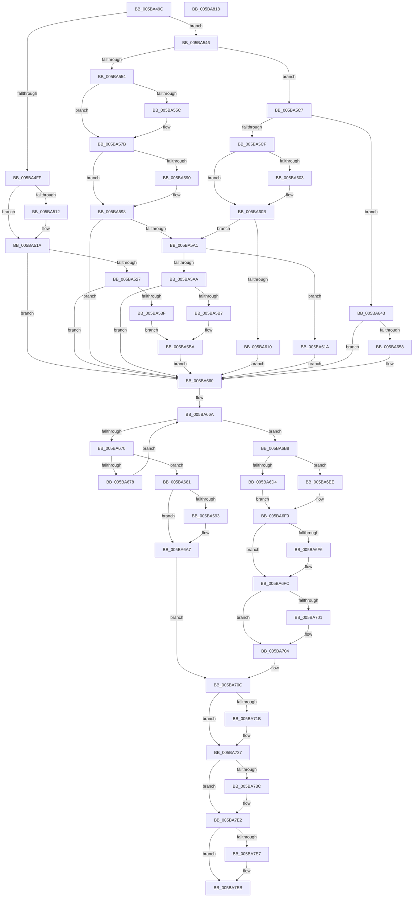

# KePrepareClockTimerForIdle

- RVA: `0x005BA49C`–`0x005BA819` (길이 `893` bytes)
- VA: `0x00000001405BA49C`
- 실행 섹션: `.text`
- PDB 이름 있음: `예`; PDB Function 태그: `아니요`
- unwind 정보 RVA: `0x000C6434`
- 디코드: `222`개 명령, `893/893` bytes 표시
- 미해석 바이트: `0` (있으면 어셈블리에 `.byte`로 보존)

> 이 문서는 커널 이미지의 기계어와 PDB 기호를 분석해 생성했습니다. 4번과 5번은 함수 원형과 자료형을 바이너리 사용 방식에서 추정한 C 해석이며 원본 소스 복구 결과는 아닙니다.

## 1. Dependencies

- 직접 호출 지점: **20**; 고유 호출 대상: **14**
- 직접 호출자로 확인된 함수: **2**
- RIP 상대 이미지 참조: **10**

### Outgoing calls
- `0x005BA4EA` → [RtlGetInterruptTimePrecise](../20/RtlGetInterruptTimePrecise_function_0020A4C0.md) (function, `0x0020A4C0`)
- `0x005BA515` → [KiRaiseIrqlProcessIrqlFlags](../4F/KiRaiseIrqlProcessIrqlFlags_function_004F56FC.md) (function, `0x004F56FC`)
- `0x005BA51A` → [Feature_Servicing_Kernel_ClockTickIdleEstimateFix__private_IsEnabledNoReportingNoInline](../39/Feature_Servicing_Kernel_ClockTickIdleEstimateFix__private_IsEnabledNoReportingNoInline_function_0039CEE8.md) (function, `0x0039CEE8`)
- `0x005BA52D` → [KiSetClockTimerDeadlineNoWake](../4B/KiSetClockTimerDeadlineNoWake_function_004B3DA4.md) (function, `0x004B3DA4`)
- `0x005BA546` → [Feature_Servicing_Kernel_ServerTimerDeadlineCancelFix__private_IsEnabledNoReportingNoInline](Feature_Servicing_Kernel_ServerTimerDeadlineCancelFix__private_IsEnabledNoReportingNoInline_function_005BA2B0.md) (function, `0x005BA2B0`)
- `0x005BA56A` → [KiFindNextTimerDueTime](../5C/KiFindNextTimerDueTime_function_005C5EF8.md) (function, `0x005C5EF8`)
- `0x005BA593` → [KiRaiseIrqlProcessIrqlFlags](../4F/KiRaiseIrqlProcessIrqlFlags_function_004F56FC.md) (function, `0x004F56FC`)
- `0x005BA5AA` → [Feature_Servicing_Kernel_ClockTickIdleEstimateFix__private_IsEnabledNoReportingNoInline](../39/Feature_Servicing_Kernel_ClockTickIdleEstimateFix__private_IsEnabledNoReportingNoInline_function_0039CEE8.md) (function, `0x0039CEE8`)
- `0x005BA5BD` → [KiSetClockTimerDeadlineNoWake](../4B/KiSetClockTimerDeadlineNoWake_function_004B3DA4.md) (function, `0x004B3DA4`)
- `0x005BA5DD` → [KiFindNextTimerDueTime](../5C/KiFindNextTimerDueTime_function_005C5EF8.md) (function, `0x005C5EF8`)
- `0x005BA606` → [KiRaiseIrqlProcessIrqlFlags](../4F/KiRaiseIrqlProcessIrqlFlags_function_004F56FC.md) (function, `0x004F56FC`)
- `0x005BA613` → [KiCancelClockTimerKTimerDeadlines](KiCancelClockTimerKTimerDeadlines_function_005BB5A0.md) (function, `0x005BB5A0`)
- `0x005BA63C` → [KiSetClockTimer](../39/KiSetClockTimer_function_0039DB2C.md) (function, `0x0039DB2C`)
- `0x005BA65B` → [KiRaiseIrqlProcessIrqlFlags](../4F/KiRaiseIrqlProcessIrqlFlags_function_004F56FC.md) (function, `0x004F56FC`)
- `0x005BA68A` → [KiShouldRearmClockTimer](../39/KiShouldRearmClockTimer_function_0039E134.md) (function, `0x0039E134`)
- `0x005BA6A2` → [KiSetNextClockTickDueTime](../23/KiSetNextClockTickDueTime_function_002363F0.md) (function, `0x002363F0`)
- `0x005BA6DB` → [guard_dispatch_icall](../6B/guard_dispatch_icall_function_006BAAD0.md) (function, `0x006BAAD0`)
- `0x005BA722` → [KiLowerIrqlProcessIrqlFlags](../4F/KiLowerIrqlProcessIrqlFlags_function_004F5698.md) (function, `0x004F5698`)
- `0x005BA7DD` → [tlgWriteTransfer_EtwWriteTransfer](../42/tlgWriteTransfer_EtwWriteTransfer_function_004260E0.md) (function, `0x004260E0`)
- `0x005BA7F2` → [_security_check_cookie](../6A/_security_check_cookie_function_006AC640.md) (function, `0x006AC640`)

### Direct callers
- [KePrepareClockTimerForPlatformIdle](KePrepareClockTimerForPlatformIdle_function_005BA820.md) at `0x005BAA0E`
- [sub_006DCEEE](../6D/Unknown_function_006DCEEE.md) at `0x006DD135`

### Static image references
- `0x005BA4BF` → RVA `0x00E0A740` (`.data`; read)
- `0x005BA50A` → RVA `0x00FC6D20` (`ALMOSTRO`; read)
- `0x005BA554` → RVA `0x00FC5030` (`ALMOSTRO`; read)
- `0x005BA61A` → RVA `0x00FC6B3C` (`ALMOSTRO`; read)
- `0x005BA6C1` → RVA `0x00FCF000` (`CACHEALI`; read)
- `0x005BA6C7` → RVA `0x00F21FB0` (`.data`; read)
- `0x005BA6D4` → RVA `0x00E00AE8` (`.data`; read)
- `0x005BA6F6` → RVA `0x00F21F24` (`.data`; read/write)
- `0x005BA72F` → RVA `0x00E070D8` (`.data`; read)
- `0x005BA753` → RVA `0x00048406` (`.rdata`; read)

## 2. Other-region calls and transfers

- 다른 실행 섹션으로 향하는 call: **0**
- 별도 외부 분기/꼬리 이동을 확인하지 못했습니다.

## 3. Assembly (complete function range)

```asm
005BA49C  48 8B C4                        mov rax, rsp
005BA49F  48 89 58 10                     mov qword ptr [rax + 0x10], rbx
005BA4A3  48 89 70 18                     mov qword ptr [rax + 0x18], rsi
005BA4A7  48 89 78 20                     mov qword ptr [rax + 0x20], rdi
005BA4AB  55                              push rbp
005BA4AC  41 54                           push r12
005BA4AE  41 55                           push r13
005BA4B0  41 56                           push r14
005BA4B2  41 57                           push r15
005BA4B4  48 8D 68 C8                     lea rbp, [rax - 0x38]
005BA4B8  48 81 EC 10 01 00 00            sub rsp, 0x110
005BA4BF  48 8B 05 7A 02 85 00            mov rax, qword ptr [rip + 0x85027a]
005BA4C6  48 33 C4                        xor rax, rsp
005BA4C9  48 89 45 00                     mov qword ptr [rbp], rax
005BA4CD  65 48 8B 1C 25 20 00 00 00      mov rbx, qword ptr gs:[0x20]
005BA4D6  4C 8B E9                        mov r13, rcx
005BA4D9  48 89 4C 24 58                  mov qword ptr [rsp + 0x58], rcx
005BA4DE  33 FF                           xor edi, edi
005BA4E0  48 8D 4C 24 50                  lea rcx, [rsp + 0x50]
005BA4E5  48 89 7C 24 50                  mov qword ptr [rsp + 0x50], rdi
005BA4EA  E8 D1 FF C4 FF                  call 0x14020a4c0
005BA4EF  48 83 CE FF                     or rsi, 0xffffffffffffffff
005BA4F3  4C 8B E0                        mov r12, rax
005BA4F6  4C 8B F6                        mov r14, rsi
005BA4F9  40 38 7B 21                     cmp byte ptr [rbx + 0x21], dil
005BA4FD  74 47                           je 0x1405ba546
005BA4FF  45 0F 20 C7                     mov r15, cr8
005BA503  8D 57 0F                        lea edx, [rdi + 0xf]
005BA506  44 0F 22 C2                     mov cr8, rdx
005BA50A  39 3D 10 C8 A0 00               cmp dword ptr [rip + 0xa0c810], edi
005BA510  74 08                           je 0x1405ba51a
005BA512  41 8A CF                        mov cl, r15b
005BA515  E8 E2 B1 F3 FF                  call 0x1404f56fc
005BA51A  E8 C9 29 DE FF                  call 0x14039cee8
005BA51F  85 C0                           test eax, eax
005BA521  0F 85 39 01 00 00               jne 0x1405ba660
005BA527  8D 50 01                        lea edx, [rax + 1]
005BA52A  48 8B CB                        mov rcx, rbx
005BA52D  E8 72 98 EF FF                  call 0x1404b3da4
005BA532  F6 83 C4 95 00 00 01            test byte ptr [rbx + 0x95c4], 1
005BA539  0F 84 21 01 00 00               je 0x1405ba660
005BA53F  BA 02 00 00 00                  mov edx, 2
005BA544  EB 74                           jmp 0x1405ba5ba
005BA546  E8 65 FD FF FF                  call 0x1405ba2b0
005BA54B  48 89 74 24 48                  mov qword ptr [rsp + 0x48], rsi
005BA550  85 C0                           test eax, eax
005BA552  75 73                           jne 0x1405ba5c7
005BA554  39 3D D6 AA A0 00               cmp dword ptr [rip + 0xa0aad6], edi
005BA55A  75 1F                           jne 0x1405ba57b
005BA55C  4C 8D 4C 24 48                  lea r9, [rsp + 0x48]
005BA561  45 33 C0                        xor r8d, r8d
005BA564  49 8B D4                        mov rdx, r12
005BA567  48 8B CB                        mov rcx, rbx
005BA56A  E8 89 B9 00 00                  call 0x1405c5ef8
005BA56F  4C 8B 74 24 48                  mov r14, qword ptr [rsp + 0x48]
005BA574  49 3B C6                        cmp rax, r14
005BA577  4C 0F 42 F0                     cmovb r14, rax
005BA57B  45 0F 20 C7                     mov r15, cr8
005BA57F  BA 0F 00 00 00                  mov edx, 0xf
005BA584  44 0F 22 C2                     mov cr8, rdx
005BA588  39 3D 92 C7 A0 00               cmp dword ptr [rip + 0xa0c792], edi
005BA58E  74 08                           je 0x1405ba598
005BA590  41 8A CF                        mov cl, r15b
005BA593  E8 64 B1 F3 FF                  call 0x1404f56fc
005BA598  4C 3B F6                        cmp r14, rsi
005BA59B  0F 84 BF 00 00 00               je 0x1405ba660
005BA5A1  4C 3B B3 A8 95 00 00            cmp r14, qword ptr [rbx + 0x95a8]
005BA5A8  77 70                           ja 0x1405ba61a
005BA5AA  E8 39 29 DE FF                  call 0x14039cee8
005BA5AF  85 C0                           test eax, eax
005BA5B1  0F 85 A9 00 00 00               jne 0x1405ba660
005BA5B7  8D 50 01                        lea edx, [rax + 1]
005BA5BA  48 8B CB                        mov rcx, rbx
005BA5BD  E8 E2 97 EF FF                  call 0x1404b3da4
005BA5C2  E9 99 00 00 00                  jmp 0x1405ba660
005BA5C7  39 3D 63 AA A0 00               cmp dword ptr [rip + 0xa0aa63], edi
005BA5CD  75 74                           jne 0x1405ba643
005BA5CF  4C 8D 4C 24 48                  lea r9, [rsp + 0x48]
005BA5D4  45 33 C0                        xor r8d, r8d
005BA5D7  49 8B D4                        mov rdx, r12
005BA5DA  48 8B CB                        mov rcx, rbx
005BA5DD  E8 16 B9 00 00                  call 0x1405c5ef8
005BA5E2  4C 8B 74 24 48                  mov r14, qword ptr [rsp + 0x48]
005BA5E7  49 3B C6                        cmp rax, r14
005BA5EA  4C 0F 42 F0                     cmovb r14, rax
005BA5EE  45 0F 20 C7                     mov r15, cr8
005BA5F2  BA 0F 00 00 00                  mov edx, 0xf
005BA5F7  44 0F 22 C2                     mov cr8, rdx
005BA5FB  39 3D 1F C7 A0 00               cmp dword ptr [rip + 0xa0c71f], edi
005BA601  74 08                           je 0x1405ba60b
005BA603  41 8A CF                        mov cl, r15b
005BA606  E8 F1 B0 F3 FF                  call 0x1404f56fc
005BA60B  4C 3B F6                        cmp r14, rsi
005BA60E  75 91                           jne 0x1405ba5a1
005BA610  48 8B CB                        mov rcx, rbx
005BA613  E8 88 0F 00 00                  call 0x1405bb5a0
005BA618  EB 46                           jmp 0x1405ba660
005BA61A  44 8B 0D 1B C5 A0 00            mov r9d, dword ptr [rip + 0xa0c51b]
005BA621  4D 8B C6                        mov r8, r14
005BA624  40 88 7C 24 30                  mov byte ptr [rsp + 0x30], dil
005BA629  49 8B D4                        mov rdx, r12
005BA62C  40 88 7C 24 28                  mov byte ptr [rsp + 0x28], dil
005BA631  48 8B CB                        mov rcx, rbx
005BA634  C7 44 24 20 01 00 00 00         mov dword ptr [rsp + 0x20], 1
005BA63C  E8 EB 34 DE FF                  call 0x14039db2c
005BA641  EB 1D                           jmp 0x1405ba660
005BA643  45 0F 20 C7                     mov r15, cr8
005BA647  BA 0F 00 00 00                  mov edx, 0xf
005BA64C  44 0F 22 C2                     mov cr8, rdx
005BA650  39 3D CA C6 A0 00               cmp dword ptr [rip + 0xa0c6ca], edi
005BA656  74 08                           je 0x1405ba660
005BA658  41 8A CF                        mov cl, r15b
005BA65B  E8 9C B0 F3 FF                  call 0x1404f56fc
005BA660  48 8B CF                        mov rcx, rdi
005BA663  48 8D 93 A4 95 00 00            lea rdx, [rbx + 0x95a4]
005BA66A  48 83 F9 07                     cmp rcx, 7
005BA66E  7D 48                           jge 0x1405ba6b8
005BA670  8A 02                           mov al, byte ptr [rdx]
005BA672  24 03                           and al, 3
005BA674  3C 01                           cmp al, 1
005BA676  74 09                           je 0x1405ba681
005BA678  48 FF C1                        inc rcx
005BA67B  48 83 C2 10                     add rdx, 0x10
005BA67F  EB E9                           jmp 0x1405ba66a
005BA681  45 33 C0                        xor r8d, r8d
005BA684  49 8B D4                        mov rdx, r12
005BA687  48 8B CB                        mov rcx, rbx
005BA68A  E8 A5 3A DE FF                  call 0x14039e134
005BA68F  84 C0                           test al, al
005BA691  74 14                           je 0x1405ba6a7
005BA693  33 D2                           xor edx, edx
005BA695  C7 83 90 95 00 00 02 00 00 00   mov dword ptr [rbx + 0x9590], 2
005BA69F  49 8B CC                        mov rcx, r12
005BA6A2  E8 49 BD C7 FF                  call 0x1402363f0
005BA6A7  48 8B B3 80 95 00 00            mov rsi, qword ptr [rbx + 0x9580]
005BA6AE  48 8B FE                        mov rdi, rsi
005BA6B1  49 2B FC                        sub rdi, r12
005BA6B4  33 D2                           xor edx, edx
005BA6B6  EB 54                           jmp 0x1405ba70c
005BA6B8  65 48 8B 3C 25 20 00 00 00      mov rdi, qword ptr gs:[0x20]
005BA6C1  8B 05 39 49 A1 00               mov eax, dword ptr [rip + 0xa14939]
005BA6C7  44 8B 2D E2 78 96 00            mov r13d, dword ptr [rip + 0x9678e2]
005BA6CE  F6 47 22 01                     test byte ptr [rdi + 0x22], 1
005BA6D2  74 1A                           je 0x1405ba6ee
005BA6D4  48 8B 05 0D 64 84 00            mov rax, qword ptr [rip + 0x84640d]
005BA6DB  E8 F0 03 10 00                  call 0x1406baad0
005BA6E0  33 D2                           xor edx, edx
005BA6E2  88 97 08 96 00 00               mov byte ptr [rdi + 0x9608], dl
005BA6E8  80 67 22 FE                     and byte ptr [rdi + 0x22], 0xfe
005BA6EC  EB 02                           jmp 0x1405ba6f0
005BA6EE  33 D2                           xor edx, edx
005BA6F0  44 39 6F 24                     cmp dword ptr [rdi + 0x24], r13d
005BA6F4  75 06                           jne 0x1405ba6fc
005BA6F6  FF 05 28 78 96 00               inc dword ptr [rip + 0x967828]
005BA6FC  38 57 21                        cmp byte ptr [rdi + 0x21], dl
005BA6FF  74 03                           je 0x1405ba704
005BA701  88 57 21                        mov byte ptr [rdi + 0x21], dl
005BA704  4C 8B 6C 24 58                  mov r13, qword ptr [rsp + 0x58]
005BA709  48 8B FE                        mov rdi, rsi
005BA70C  C6 83 09 96 00 00 01            mov byte ptr [rbx + 0x9609], 1
005BA713  39 15 07 C6 A0 00               cmp dword ptr [rip + 0xa0c607], edx
005BA719  74 0C                           je 0x1405ba727
005BA71B  44 0F 20 C1                     mov rcx, cr8
005BA71F  41 8A D7                        mov dl, r15b
005BA722  E8 71 AF F3 FF                  call 0x1404f5698
005BA727  41 0F B6 C7                     movzx eax, r15b
005BA72B  44 0F 22 C0                     mov cr8, rax
005BA72F  83 3D A2 C9 84 00 05            cmp dword ptr [rip + 0x84c9a2], 5
005BA736  0F 86 A6 00 00 00               jbe 0x1405ba7e2
005BA73C  B9 08 00 00 00                  mov ecx, 8
005BA741  4C 89 64 24 60                  mov qword ptr [rsp + 0x60], r12
005BA746  48 8D 44 24 60                  lea rax, [rsp + 0x60]
005BA74B  48 89 4D A8                     mov qword ptr [rbp - 0x58], rcx
005BA74F  48 89 45 A0                     mov qword ptr [rbp - 0x60], rax
005BA753  48 8D 15 AC DC A8 FF            lea rdx, [rip - 0x572354]
005BA75A  8A 43 21                        mov al, byte ptr [rbx + 0x21]
005BA75D  45 33 C9                        xor r9d, r9d
005BA760  88 44 24 40                     mov byte ptr [rsp + 0x40], al
005BA764  45 33 C0                        xor r8d, r8d
005BA767  48 8D 44 24 40                  lea rax, [rsp + 0x40]
005BA76C  48 89 4D D8                     mov qword ptr [rbp - 0x28], rcx
005BA770  48 89 45 B0                     mov qword ptr [rbp - 0x50], rax
005BA774  8A 83 08 96 00 00               mov al, byte ptr [rbx + 0x9608]
005BA77A  88 44 24 41                     mov byte ptr [rsp + 0x41], al
005BA77E  48 8D 44 24 41                  lea rax, [rsp + 0x41]
005BA783  48 89 45 C0                     mov qword ptr [rbp - 0x40], rax
005BA787  48 8D 44 24 68                  lea rax, [rsp + 0x68]
005BA78C  48 89 45 D0                     mov qword ptr [rbp - 0x30], rax
005BA790  48 8D 44 24 70                  lea rax, [rsp + 0x70]
005BA795  48 89 45 E0                     mov qword ptr [rbp - 0x20], rax
005BA799  48 8D 44 24 78                  lea rax, [rsp + 0x78]
005BA79E  48 89 45 F0                     mov qword ptr [rbp - 0x10], rax
005BA7A2  48 8D 45 80                     lea rax, [rbp - 0x80]
005BA7A6  48 89 44 24 28                  mov qword ptr [rsp + 0x28], rax
005BA7AB  89 4C 24 20                     mov dword ptr [rsp + 0x20], ecx
005BA7AF  48 89 4D E8                     mov qword ptr [rbp - 0x18], rcx
005BA7B3  48 89 4D F8                     mov qword ptr [rbp - 8], rcx
005BA7B7  48 8D 0D 1A C9 84 00            lea rcx, [rip + 0x84c91a]
005BA7BE  48 C7 45 B8 01 00 00 00         mov qword ptr [rbp - 0x48], 1
005BA7C6  48 C7 45 C8 01 00 00 00         mov qword ptr [rbp - 0x38], 1
005BA7CE  48 89 7C 24 68                  mov qword ptr [rsp + 0x68], rdi
005BA7D3  48 89 74 24 70                  mov qword ptr [rsp + 0x70], rsi
005BA7D8  4C 89 74 24 78                  mov qword ptr [rsp + 0x78], r14
005BA7DD  E8 FE B8 E6 FF                  call 0x1404260e0
005BA7E2  4D 85 ED                        test r13, r13
005BA7E5  74 04                           je 0x1405ba7eb
005BA7E7  49 89 75 00                     mov qword ptr [r13], rsi
005BA7EB  48 8B 4D 00                     mov rcx, qword ptr [rbp]
005BA7EF  48 33 CC                        xor rcx, rsp
005BA7F2  E8 49 1E 0F 00                  call 0x1406ac640
005BA7F7  4C 8D 9C 24 10 01 00 00         lea r11, [rsp + 0x110]
005BA7FF  49 8B 5B 38                     mov rbx, qword ptr [r11 + 0x38]
005BA803  49 8B 73 40                     mov rsi, qword ptr [r11 + 0x40]
005BA807  49 8B 7B 48                     mov rdi, qword ptr [r11 + 0x48]
005BA80B  49 8B E3                        mov rsp, r11
005BA80E  41 5F                           pop r15
005BA810  41 5E                           pop r14
005BA812  41 5D                           pop r13
005BA814  41 5C                           pop r12
005BA816  5D                              pop rbp
005BA817  C3                              ret
005BA818  CC                              int3
```

## 4. C-style interpretation (structured pseudocode)

```c
__int64 __fastcall KePrepareClockTimerForIdle(__int64 a1, __int64 a2, int a3)
{
    __int64 result;
    __int64 v_r14;
    __int64 v_rdi;
    __int64 v_rsi;
    __int64 v_rsp;
    unsigned __int8 v_stack_m108;
    unsigned __int8 v_stack_m110;
    unsigned int v_stack_m118;
    unsigned __int64 v_stack_m28;
    unsigned __int64 v_stack_mC0;
    unsigned __int64 v_stack_mC8;
    unsigned __int64 v_stack_mD0;
    unsigned __int64 v_stack_mD8;
    unsigned __int64 v_stack_mE0;
    unsigned __int64 v_stack_mE8;
    unsigned __int64 v_stack_mF0;
    unsigned __int8 v_stack_mF7;
    unsigned __int8 v_stack_mF8;

    *(unsigned __int64 *)(v_rsp + 16) = v_rbx;
    *(unsigned __int64 *)(v_rsp + 24) = v_rsi;
    *(unsigned __int64 *)(v_rsp + 32) = v_rdi;
    v_rsp = (v_rsp) - (272);
    result = (*(unsigned __int64 *)(v_rip + 8716922)) ^ (v_rsp);
    *(unsigned __int64 *)(v_rsp - 56) = result;
    v_stack_mE0 = a1;
    v_rdi = 0;
    v_stack_mE8 = 0;
    result = RtlGetInterruptTimePrecise(v_stack_mE8, a2, a3, a4);
    v_rsi = (v_rsi) | (-1);
    if ((*(unsigned __int8 *)(*(unsigned __int64 *)(gs_base + (0 + 32)) + 33)) == 0) goto loc_005BA546;
    if ((*(unsigned int *)(v_rip + 10536976)) != 0) {
        a1 = (unsigned __int8)(v_cr8);
        result = KiRaiseIrqlProcessIrqlFlags(a1, v_rdi + 15, a3, a4);
    }
    result = Feature_Servicing_Kernel_ClockTickIdleEstimateFix__private_IsEnabledNoReportingNoInline(a1, v_rdi + 15, a3, a4);
    if ((unsigned int)(result) != 0) goto loc_005BA660;
    result = KiSetClockTimerDeadlineNoWake(*(unsigned __int64 *)(gs_base + (0 + 32)), result + 1, a3, a4);
    if (((*(unsigned __int8 *)(*(unsigned __int64 *)(gs_base + (0 + 32)) + 38340)) & (1)) == 0) goto loc_005BA660;
    goto loc_005BA5BA;
loc_005BA546:
    result = Feature_Servicing_Kernel_ServerTimerDeadlineCancelFix__private_IsEnabledNoReportingNoInline(*(unsigned __int64 *)(gs_base + (0 + 32)), 2, a3, a4);
    v_stack_mF0 = v_rsi;
    if ((unsigned int)(result) != 0) goto loc_005BA5C7;
    v_r14 = v_rsi;
    if ((*(unsigned int *)(v_rip + 10529494)) == 0) {
        a4 = v_stack_mF0;
        a3 = 0;
        a2 = result;
        a1 = *(unsigned __int64 *)(gs_base + (0 + 32));
        result = KiFindNextTimerDueTime(a1, a2, a3, a4);
        v_r14 = v_stack_mF0;
        if (result < v_r14) { v_r14 = result; }
    }
    if ((*(unsigned int *)(v_rip + 10536850)) != 0) {
        a1 = (unsigned __int8)(v_rdi + 15);
        result = KiRaiseIrqlProcessIrqlFlags(a1, 15, a3, a4);
    }
    if (v_r14 == v_rsi) goto loc_005BA660;
loc_005BA5A1:
    if (v_r14 > (*(unsigned __int64 *)(*(unsigned __int64 *)(gs_base + (0 + 32)) + 38312))) goto loc_005BA61A;
    result = Feature_Servicing_Kernel_ClockTickIdleEstimateFix__private_IsEnabledNoReportingNoInline(a1, 15, a3, a4);
    if ((unsigned int)(result) != 0) goto loc_005BA660;
loc_005BA5BA:
    result = KiSetClockTimerDeadlineNoWake(*(unsigned __int64 *)(gs_base + (0 + 32)), result + 1, a3, a4);
    goto loc_005BA660;
loc_005BA5C7:
    if ((*(unsigned int *)(v_rip + 10529379)) != 0) goto loc_005BA643;
    a3 = 0;
    result = KiFindNextTimerDueTime(*(unsigned __int64 *)(gs_base + (0 + 32)), result, a3, v_stack_mF0);
    v_r14 = v_stack_mF0;
    if (result < v_stack_mF0) { v_r14 = result; }
    if ((*(unsigned int *)(v_rip + 10536735)) != 0) {
        a1 = 15;
        result = KiRaiseIrqlProcessIrqlFlags(a1, 15, a3, v_stack_mF0);
    }
    if (v_r14 != v_rsi) goto loc_005BA5A1;
    result = KiCancelClockTimerKTimerDeadlines(*(unsigned __int64 *)(gs_base + (0 + 32)), 15, a3, v_stack_mF0);
    goto loc_005BA660;
loc_005BA61A:
    v_stack_m108 = 0;
    v_stack_m110 = 0;
    v_stack_m118 = 1;
    result = KiSetClockTimer(*(unsigned __int64 *)(gs_base + (0 + 32)), result, v_r14, (unsigned int)(*(unsigned int *)(v_rip + 10536219)));
    goto loc_005BA660;
loc_005BA643:
    if ((*(unsigned int *)(v_rip + 10536650)) != 0) {
        a1 = 15;
        result = KiRaiseIrqlProcessIrqlFlags(a1, 15, v_r14, (unsigned int)(*(unsigned int *)(v_rip + 10536219)));
    }
loc_005BA66A:
    if (0 >= 7) goto loc_005BA6B8;
    result = (unsigned __int8)((*(unsigned __int8 *)(*(unsigned __int64 *)(gs_base + (0 + 32)) + 38308)) & (3));
    if (((unsigned __int8)(result)) == 1) goto loc_005BA681;
    a1 = (0) + 1;
    a2 = (*(unsigned __int64 *)(gs_base + (0 + 32)) + 38308) + (16);
    goto loc_005BA66A;
loc_005BA681:
    a3 = 0;
    result = KiShouldRearmClockTimer(*(unsigned __int64 *)(gs_base + (0 + 32)), result, a3, (unsigned int)(*(unsigned int *)(v_rip + 10536219)));
    if ((unsigned __int8)(result) != 0) {
        a2 = 0;
        *(unsigned int *)(*(unsigned __int64 *)(gs_base + (0 + 32)) + 38288) = 2;
        a1 = result;
        result = KiSetNextClockTickDueTime(a1, a2, a3, (unsigned int)(*(unsigned int *)(v_rip + 10536219)));
    }
    v_rdi = (*(unsigned __int64 *)(*(unsigned __int64 *)(gs_base + (0 + 32)) + 38272)) - (result);
    a2 = 0;
    goto loc_005BA70C;
loc_005BA6B8:
    if (((*(unsigned __int8 *)(*(unsigned __int64 *)(gs_base + (0 + 32)) + 34)) & (1)) == 0) goto loc_005BA6EE;
    result = guard_dispatch_icall(a1, a2, a3, (unsigned int)(*(unsigned int *)(v_rip + 10536219)));
    a2 = 0;
    *(unsigned __int8 *)(*(unsigned __int64 *)(gs_base + (0 + 32)) + 38408) = 0;
    goto loc_005BA6F0;
loc_005BA6EE:
    a2 = 0;
loc_005BA6F0:
    if ((*(unsigned int *)(*(unsigned __int64 *)(gs_base + (0 + 32)) + 36)) == ((unsigned int)((unsigned int)(*(unsigned int *)(v_rip + 9861346))))) {
    }
    if ((*(unsigned __int8 *)(*(unsigned __int64 *)(gs_base + (0 + 32)) + 33)) != 0) {
        *(unsigned __int8 *)(*(unsigned __int64 *)(gs_base + (0 + 32)) + 33) = 0;
    }
loc_005BA70C:
    *(unsigned __int8 *)(*(unsigned __int64 *)(gs_base + (0 + 32)) + 38409) = 1;
    if ((*(unsigned int *)(v_rip + 10536455)) != 0) {
        a1 = 15;
        a2 = 15;
        result = KiLowerIrqlProcessIrqlFlags(a1, a2, a3, (unsigned int)(*(unsigned int *)(v_rip + 10536219)));
    }
    result = 15;
    if ((*(unsigned int *)(v_rip + 8702370)) >= = 5) {
        a1 = 8;
        v_stack_mD8 = result;
        result = v_stack_mD8;
        *(unsigned __int64 *)(v_rsp - 56 - 88) = a1;
        *(unsigned __int64 *)(v_rsp - 56 - 96) = result;
        a2 = v_rip - 5710676;
        result = *(unsigned __int8 *)(*(unsigned __int64 *)(gs_base + (0 + 32)) + 33);
        a4 = 0;
        v_stack_mF8 = (unsigned __int8)(result);
        a3 = 0;
        result = v_stack_mF8;
        *(unsigned __int64 *)(v_rsp - 56 - 40) = a1;
        *(unsigned __int64 *)(v_rsp - 56 - 80) = result;
        result = *(unsigned __int8 *)(*(unsigned __int64 *)(gs_base + (0 + 32)) + 38408);
        v_stack_mF7 = (unsigned __int8)(result);
        result = v_stack_mF7;
        *(unsigned __int64 *)(v_rsp - 56 - 64) = result;
        result = v_stack_mD0;
        *(unsigned __int64 *)(v_rsp - 56 - 48) = result;
        result = v_stack_mC8;
        *(unsigned __int64 *)(v_rsp - 56 - 32) = result;
        result = v_stack_mC0;
        *(unsigned __int64 *)(v_rsp - 56 - 16) = result;
        result = v_rsp - 56 - 128;
        v_stack_m110 = result;
        v_stack_m118 = (unsigned int)(a1);
        *(unsigned __int64 *)(v_rsp - 56 - 24) = a1;
        *(unsigned __int64 *)(v_rsp - 56 - 8) = a1;
        a1 = v_rip + 8702234;
        *(unsigned __int64 *)(v_rsp - 56 - 72) = 1;
        *(unsigned __int64 *)(v_rsp - 56 - 56) = 1;
        v_stack_mD0 = *(unsigned __int64 *)(*(unsigned __int64 *)(gs_base + (0 + 32)) + 38272);
        v_stack_mC8 = *(unsigned __int64 *)(*(unsigned __int64 *)(gs_base + (0 + 32)) + 38272);
        v_stack_mC0 = v_r14;
        result = tlgWriteTransfer_EtwWriteTransfer(a1, a2, a3, a4);
    }
    if (v_stack_mE0 != 0) {
        *(unsigned __int64 *)(v_stack_mE0) = *(unsigned __int64 *)(*(unsigned __int64 *)(gs_base + (0 + 32)) + 38272);
    }
    a1 = (*(unsigned __int64 *)(v_rsp - 56)) ^ (v_rsp);
    result = _security_check_cookie(a1, a2, a3, a4);
    return result;
}
```

## 5. (Beta) C Style

```c
int64_t KePrepareClockTimerForIdle(int64_t Arg1, int64_t Arg2, int32_t Arg3)
{
    int64_t result;
    int64_t local_r14;
    int64_t local_rdi;
    int64_t local_rsi;
    int64_t local_rsp;
    uint8_t v_stack_m108;
    uint8_t v_stack_m110;
    uint32_t v_stack_m118;
    uint64_t v_stack_m28;
    uint64_t v_stack_mC0;
    uint64_t v_stack_mC8;
    uint64_t v_stack_mD0;
    uint64_t v_stack_mD8;
    uint64_t v_stack_mE0;
    uint64_t v_stack_mE8;
    uint64_t v_stack_mF0;
    uint8_t v_stack_mF7;
    uint8_t v_stack_mF8;

    *(uint64_t *)(local_rsp + 0x10) = local_rbx;
    *(uint64_t *)(local_rsp + 0x18) = local_rsi;
    *(uint64_t *)(local_rsp + 0x20) = local_rdi;
    local_rsp = (local_rsp) - (272);
    result = (*(uint64_t *)(v_rip + 0x85027A)) ^ (local_rsp);
    *(uint64_t *)(local_rsp - 0x38) = result;
    v_stack_mE0 = Arg1;
    local_rdi = 0;
    v_stack_mE8 = 0;
    result = RtlGetInterruptTimePrecise(v_stack_mE8, Arg2, Arg3, a4);
    local_rsi = (local_rsi) | (-1);
    if ((*(uint8_t *)(*(uint64_t *)(gs_base + (0 + 0x20)) + 0x21)) == 0) goto loc_005BA546;
    if ((*(uint32_t *)(v_rip + 0xA0C810)) != 0) {
        Arg1 = (uint8_t)(v_cr8);
        result = KiRaiseIrqlProcessIrqlFlags(Arg1, local_rdi + 15, Arg3, a4);
    }
    result = Feature_Servicing_Kernel_ClockTickIdleEstimateFix__private_IsEnabledNoReportingNoInline(Arg1, local_rdi + 15, Arg3, a4);
    if ((uint32_t)(result) != 0) goto loc_005BA660;
    result = KiSetClockTimerDeadlineNoWake(*(uint64_t *)(gs_base + (0 + 0x20)), result + 1, Arg3, a4);
    if (((*(uint8_t *)(*(uint64_t *)(gs_base + (0 + 0x20)) + 0x95C4)) & (1)) == 0) goto loc_005BA660;
    goto loc_005BA5BA;
loc_005BA546:
    result = Feature_Servicing_Kernel_ServerTimerDeadlineCancelFix__private_IsEnabledNoReportingNoInline(*(uint64_t *)(gs_base + (0 + 0x20)), 2, Arg3, a4);
    v_stack_mF0 = local_rsi;
    if ((uint32_t)(result) != 0) goto loc_005BA5C7;
    local_r14 = local_rsi;
    if ((*(uint32_t *)(v_rip + 0xA0AAD6)) == 0) {
        a4 = v_stack_mF0;
        Arg3 = 0;
        Arg2 = result;
        Arg1 = *(uint64_t *)(gs_base + (0 + 0x20));
        result = KiFindNextTimerDueTime(Arg1, Arg2, Arg3, a4);
        local_r14 = v_stack_mF0;
        if (result < local_r14) { local_r14 = result; }
    }
    if ((*(uint32_t *)(v_rip + 0xA0C792)) != 0) {
        Arg1 = (uint8_t)(local_rdi + 15);
        result = KiRaiseIrqlProcessIrqlFlags(Arg1, 15, Arg3, a4);
    }
    if (local_r14 == local_rsi) goto loc_005BA660;
loc_005BA5A1:
    if (local_r14 > (*(uint64_t *)(*(uint64_t *)(gs_base + (0 + 0x20)) + 0x95A8))) goto loc_005BA61A;
    result = Feature_Servicing_Kernel_ClockTickIdleEstimateFix__private_IsEnabledNoReportingNoInline(Arg1, 15, Arg3, a4);
    if ((uint32_t)(result) != 0) goto loc_005BA660;
loc_005BA5BA:
    result = KiSetClockTimerDeadlineNoWake(*(uint64_t *)(gs_base + (0 + 0x20)), result + 1, Arg3, a4);
    goto loc_005BA660;
loc_005BA5C7:
    if ((*(uint32_t *)(v_rip + 0xA0AA63)) != 0) goto loc_005BA643;
    Arg3 = 0;
    result = KiFindNextTimerDueTime(*(uint64_t *)(gs_base + (0 + 0x20)), result, Arg3, v_stack_mF0);
    local_r14 = v_stack_mF0;
    if (result < v_stack_mF0) { local_r14 = result; }
    if ((*(uint32_t *)(v_rip + 0xA0C71F)) != 0) {
        Arg1 = 15;
        result = KiRaiseIrqlProcessIrqlFlags(Arg1, 15, Arg3, v_stack_mF0);
    }
    if (local_r14 != local_rsi) goto loc_005BA5A1;
    result = KiCancelClockTimerKTimerDeadlines(*(uint64_t *)(gs_base + (0 + 0x20)), 15, Arg3, v_stack_mF0);
    goto loc_005BA660;
loc_005BA61A:
    v_stack_m108 = 0;
    v_stack_m110 = 0;
    v_stack_m118 = 1;
    result = KiSetClockTimer(*(uint64_t *)(gs_base + (0 + 0x20)), result, local_r14, (uint32_t)(*(uint32_t *)(v_rip + 0xA0C51B)));
    goto loc_005BA660;
loc_005BA643:
    if ((*(uint32_t *)(v_rip + 0xA0C6CA)) != 0) {
        Arg1 = 15;
        result = KiRaiseIrqlProcessIrqlFlags(Arg1, 15, local_r14, (uint32_t)(*(uint32_t *)(v_rip + 0xA0C51B)));
    }
loc_005BA66A:
    if (0 >= 7) goto loc_005BA6B8;
    result = (uint8_t)((*(uint8_t *)(*(uint64_t *)(gs_base + (0 + 0x20)) + 0x95A4)) & (3));
    if (((uint8_t)(result)) == 1) goto loc_005BA681;
    Arg1 = (0) + 1;
    Arg2 = (*(uint64_t *)(gs_base + (0 + 0x20)) + 38308) + (16);
    goto loc_005BA66A;
loc_005BA681:
    Arg3 = 0;
    result = KiShouldRearmClockTimer(*(uint64_t *)(gs_base + (0 + 0x20)), result, Arg3, (uint32_t)(*(uint32_t *)(v_rip + 0xA0C51B)));
    if ((uint8_t)(result) != 0) {
        Arg2 = 0;
        *(uint32_t *)(*(uint64_t *)(gs_base + (0 + 0x20)) + 0x9590) = 2;
        Arg1 = result;
        result = KiSetNextClockTickDueTime(Arg1, Arg2, Arg3, (uint32_t)(*(uint32_t *)(v_rip + 0xA0C51B)));
    }
    local_rdi = (*(uint64_t *)(*(uint64_t *)(gs_base + (0 + 0x20)) + 0x9580)) - (result);
    Arg2 = 0;
    goto loc_005BA70C;
loc_005BA6B8:
    if (((*(uint8_t *)(*(uint64_t *)(gs_base + (0 + 0x20)) + 0x22)) & (1)) == 0) goto loc_005BA6EE;
    result = guard_dispatch_icall(Arg1, Arg2, Arg3, (uint32_t)(*(uint32_t *)(v_rip + 0xA0C51B)));
    Arg2 = 0;
    *(uint8_t *)(*(uint64_t *)(gs_base + (0 + 0x20)) + 0x9608) = 0;
    goto loc_005BA6F0;
loc_005BA6EE:
    Arg2 = 0;
loc_005BA6F0:
    if ((*(uint32_t *)(*(uint64_t *)(gs_base + (0 + 0x20)) + 0x24)) == ((uint32_t)((uint32_t)(*(uint32_t *)(v_rip + 0x9678E2))))) {
    }
    if ((*(uint8_t *)(*(uint64_t *)(gs_base + (0 + 0x20)) + 0x21)) != 0) {
        *(uint8_t *)(*(uint64_t *)(gs_base + (0 + 0x20)) + 0x21) = 0;
    }
loc_005BA70C:
    *(uint8_t *)(*(uint64_t *)(gs_base + (0 + 0x20)) + 0x9609) = 1;
    if ((*(uint32_t *)(v_rip + 0xA0C607)) != 0) {
        Arg1 = 15;
        Arg2 = 15;
        result = KiLowerIrqlProcessIrqlFlags(Arg1, Arg2, Arg3, (uint32_t)(*(uint32_t *)(v_rip + 0xA0C51B)));
    }
    result = 15;
    if ((*(uint32_t *)(v_rip + 0x84C9A2)) >= = 5) {
        Arg1 = 8;
        v_stack_mD8 = result;
        result = v_stack_mD8;
        *(uint64_t *)(local_rsp - 0x38 - 0x58) = Arg1;
        *(uint64_t *)(local_rsp - 0x38 - 0x60) = result;
        Arg2 = v_rip - 5710676;
        result = *(uint8_t *)(*(uint64_t *)(gs_base + (0 + 0x20)) + 0x21);
        a4 = 0;
        v_stack_mF8 = (uint8_t)(result);
        Arg3 = 0;
        result = v_stack_mF8;
        *(uint64_t *)(local_rsp - 0x38 - 0x28) = Arg1;
        *(uint64_t *)(local_rsp - 0x38 - 0x50) = result;
        result = *(uint8_t *)(*(uint64_t *)(gs_base + (0 + 0x20)) + 0x9608);
        v_stack_mF7 = (uint8_t)(result);
        result = v_stack_mF7;
        *(uint64_t *)(local_rsp - 0x38 - 0x40) = result;
        result = v_stack_mD0;
        *(uint64_t *)(local_rsp - 0x38 - 0x30) = result;
        result = v_stack_mC8;
        *(uint64_t *)(local_rsp - 0x38 - 0x20) = result;
        result = v_stack_mC0;
        *(uint64_t *)(local_rsp - 0x38 - 0x10) = result;
        result = local_rsp - 56 - 128;
        v_stack_m110 = result;
        v_stack_m118 = (uint32_t)(Arg1);
        *(uint64_t *)(local_rsp - 0x38 - 0x18) = Arg1;
        *(uint64_t *)(local_rsp - 0x38 - 0x8) = Arg1;
        Arg1 = v_rip + 8702234;
        *(uint64_t *)(local_rsp - 0x38 - 0x48) = 1;
        *(uint64_t *)(local_rsp - 0x38 - 0x38) = 1;
        v_stack_mD0 = *(uint64_t *)(*(uint64_t *)(gs_base + (0 + 0x20)) + 0x9580);
        v_stack_mC8 = *(uint64_t *)(*(uint64_t *)(gs_base + (0 + 0x20)) + 0x9580);
        v_stack_mC0 = local_r14;
        result = tlgWriteTransfer_EtwWriteTransfer(Arg1, Arg2, Arg3, a4);
    }
    if (v_stack_mE0 != 0) {
        *(uint64_t *)(v_stack_mE0) = *(uint64_t *)(*(uint64_t *)(gs_base + (0 + 0x20)) + 0x9580);
    }
    Arg1 = (*(uint64_t *)(local_rsp - 0x38)) ^ (local_rsp);
    result = _security_check_cookie(Arg1, Arg2, Arg3, a4);
    return result;
}
```

## 6. Execution-region graph

[열기: 2D/3D 그래프와 함수 탐색 컨트롤 패널](../../../control-panel.html?section=text&rva=0x005BA49C&view=graph)

- 2D 그래프는 위에서 아래로 흐르고, 3D 그래프는 빈 공간을 드래그해 회전합니다. Shift+드래그는 이동, 휠은 확대·축소, 함수 노드 선택은 대상 보고서 이동입니다.

### Static fallback


