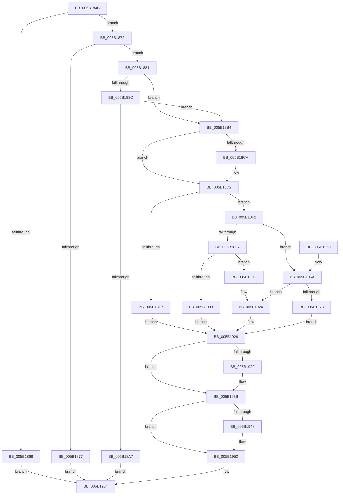

# KeProcessorProfileControlArea

- RVA: `0x005B184C`–`0x005B197F` (길이 `307` bytes)
- VA: `0x00000001405B184C`
- 실행 섹션: `.text`
- PDB 이름 있음: `예`; PDB Function 태그: `아니요`
- unwind 정보 RVA: `0x00090A1C`
- 디코드: `82`개 명령, `307/307` bytes 표시
- 미해석 바이트: `0` (있으면 어셈블리에 `.byte`로 보존)

> 이 문서는 커널 이미지의 기계어와 PDB 기호를 분석해 생성했습니다. 4번과 5번은 함수 원형과 자료형을 바이너리 사용 방식에서 추정한 C 해석이며 원본 소스 복구 결과는 아닙니다.

## 1. Dependencies

- 직접 호출 지점: **5**; 고유 호출 대상: **5**
- 직접 호출자로 확인된 함수: **1**
- RIP 상대 이미지 참조: **1**

### Outgoing calls
- `0x005B189A` → [ExAllocatePool2](../../poolcode/B8/ExAllocatePool2_function_00B820F0.md) (function, `0x00B820F0`)
- `0x005B18CD` → [KiRaiseIrqlProcessIrqlFlags](../4F/KiRaiseIrqlProcessIrqlFlags_function_004F56FC.md) (function, `0x004F56FC`)
- `0x005B18DE` → [KiIsIntelPebsSupported](KiIsIntelPebsSupported_function_005B891C.md) (function, `0x005B891C`)
- `0x005B1936` → [KiLowerIrqlProcessIrqlFlags](../4F/KiLowerIrqlProcessIrqlFlags_function_004F5698.md) (function, `0x004F5698`)
- `0x005B194D` → [ExFreePoolWithTag](../../poolcode/B8/ExFreePoolWithTag_function_00B82870.md) (function, `0x00B82870`)

### Direct callers
- [NtSetSystemInformation](../../page/AF/NtSetSystemInformation_function_00AF4A60.md) at `0x00AF5C22`

### Static image references
- `0x005B18C1` → RVA `0x00FC6D20` (`ALMOSTRO`; read)

## 2. Other-region calls and transfers

- 다른 실행 섹션으로 향하는 call: **2**
  - `0x005B189A` → [ExAllocatePool2](../../poolcode/B8/ExAllocatePool2_function_00B820F0.md) (`.text` → `POOLCODE`)
  - `0x005B194D` → [ExFreePoolWithTag](../../poolcode/B8/ExFreePoolWithTag_function_00B82870.md) (`.text` → `POOLCODE`)
- 별도 외부 분기/꼬리 이동을 확인하지 못했습니다.

## 3. Assembly (complete function range)

```asm
005B184C  48 89 5C 24 08                  mov qword ptr [rsp + 8], rbx
005B1851  48 89 6C 24 10                  mov qword ptr [rsp + 0x10], rbp
005B1856  48 89 74 24 18                  mov qword ptr [rsp + 0x18], rsi
005B185B  57                              push rdi
005B185C  48 83 EC 20                     sub rsp, 0x20
005B1860  48 8B D9                        mov rbx, rcx
005B1863  45 84 C0                        test r8b, r8b
005B1866  74 0A                           je 0x1405b1872
005B1868  B8 22 00 00 C0                  mov eax, 0xc0000022
005B186D  E9 E2 00 00 00                  jmp 0x1405b1954
005B1872  83 FA 10                        cmp edx, 0x10
005B1875  74 0A                           je 0x1405b1881
005B1877  B8 04 00 00 C0                  mov eax, 0xc0000004
005B187C  E9 D3 00 00 00                  jmp 0x1405b1954
005B1881  40 8A 71 08                     mov sil, byte ptr [rcx + 8]
005B1885  33 FF                           xor edi, edi
005B1887  40 84 F6                        test sil, sil
005B188A  74 28                           je 0x1405b18b4
005B188C  BA A0 00 00 00                  mov edx, 0xa0
005B1891  8D 4F 48                        lea ecx, [rdi + 0x48]
005B1894  41 B8 50 50 43 41               mov r8d, 0x41435050
005B189A  E8 51 08 5D 00                  call 0x140b820f0
005B189F  48 8B F8                        mov rdi, rax
005B18A2  48 85 C0                        test rax, rax
005B18A5  75 0D                           jne 0x1405b18b4
005B18A7  48 21 03                        and qword ptr [rbx], rax
005B18AA  B8 9A 00 00 C0                  mov eax, 0xc000009a
005B18AF  E9 A0 00 00 00                  jmp 0x1405b1954
005B18B4  44 0F 20 C5                     mov rbp, cr8
005B18B8  BA 02 00 00 00                  mov edx, 2
005B18BD  44 0F 22 C2                     mov cr8, rdx
005B18C1  83 3D 58 54 A1 00 00            cmp dword ptr [rip + 0xa15458], 0
005B18C8  74 08                           je 0x1405b18d2
005B18CA  40 8A CD                        mov cl, bpl
005B18CD  E8 2A 3E F4 FF                  call 0x1404f56fc
005B18D2  65 4C 8B 04 25 20 00 00 00      mov r8, qword ptr gs:[0x20]
005B18DB  49 8B C8                        mov rcx, r8
005B18DE  E8 39 70 00 00                  call 0x1405b891c
005B18E3  84 C0                           test al, al
005B18E5  75 0B                           jne 0x1405b18f2
005B18E7  48 83 23 00                     and qword ptr [rbx], 0
005B18EB  BB BB 00 00 C0                  mov ebx, 0xc00000bb
005B18F0  EB 34                           jmp 0x1405b1926
005B18F2  40 84 F6                        test sil, sil
005B18F5  74 73                           je 0x1405b196a
005B18F7  49 8B 80 98 8E 00 00            mov rax, qword ptr [r8 + 0x8e98]
005B18FE  48 85 C0                        test rax, rax
005B1901  74 0A                           je 0x1405b190d
005B1903  48 89 03                        mov qword ptr [rbx], rax
005B1906  BB 0A 02 00 C0                  mov ebx, 0xc000020a
005B190B  EB 19                           jmp 0x1405b1926
005B190D  48 8D 47 28                     lea rax, [rdi + 0x28]
005B1911  49 89 B8 98 8E 00 00            mov qword ptr [r8 + 0x8e98], rdi
005B1918  49 89 80 A0 8E 00 00            mov qword ptr [r8 + 0x8ea0], rax
005B191F  48 89 3B                        mov qword ptr [rbx], rdi
005B1922  33 FF                           xor edi, edi
005B1924  33 DB                           xor ebx, ebx
005B1926  83 3D F3 53 A1 00 00            cmp dword ptr [rip + 0xa153f3], 0
005B192D  74 0C                           je 0x1405b193b
005B192F  44 0F 20 C1                     mov rcx, cr8
005B1933  40 8A D5                        mov dl, bpl
005B1936  E8 5D 3D F4 FF                  call 0x1404f5698
005B193B  40 0F B6 CD                     movzx ecx, bpl
005B193F  44 0F 22 C1                     mov cr8, rcx
005B1943  48 85 FF                        test rdi, rdi
005B1946  74 0A                           je 0x1405b1952
005B1948  33 D2                           xor edx, edx
005B194A  48 8B CF                        mov rcx, rdi
005B194D  E8 1E 0F 5D 00                  call 0x140b82870
005B1952  8B C3                           mov eax, ebx
005B1954  48 8B 5C 24 30                  mov rbx, qword ptr [rsp + 0x30]
005B1959  48 8B 6C 24 38                  mov rbp, qword ptr [rsp + 0x38]
005B195E  48 8B 74 24 40                  mov rsi, qword ptr [rsp + 0x40]
005B1963  48 83 C4 20                     add rsp, 0x20
005B1967  5F                              pop rdi
005B1968  C3                              ret
005B1969  CC                              int3
005B196A  48 83 23 00                     and qword ptr [rbx], 0
005B196E  49 83 B8 98 8E 00 00 00         cmp qword ptr [r8 + 0x8e98], 0
005B1976  75 AC                           jne 0x1405b1924
005B1978  BB A0 00 00 C0                  mov ebx, 0xc00000a0
005B197D  EB A7                           jmp 0x1405b1926
```

## 4. C-style interpretation (structured pseudocode)

```c
__int64 __fastcall KeProcessorProfileControlArea(__int64 a1, int a2, unsigned __int8 a3)
{
    __int64 result;
    __int64 v_rbx;
    __int64 v_rdi;
    __int64 v_rsp;
    unsigned __int64 v_stack_p10;
    unsigned __int64 v_stack_p18;
    unsigned __int64 v_stack_p8;

    v_stack_p8 = v_rbx;
    v_stack_p10 = v_rbp;
    v_stack_p18 = v_rsi;
    v_rsp = (v_rsp) - (32);
    if (a3 == 0) goto loc_005B1872;
    goto loc_005B1954;
loc_005B1872:
    if (a2 == 16) goto loc_005B1881;
    goto loc_005B1954;
loc_005B1881:
    v_rdi = 0;
    if ((unsigned __int8)(*(unsigned __int8 *)(a1 + 8)) == 0) goto loc_005B18B4;
    result = ExAllocatePool2(v_rdi + 72, 160, (unsigned int)(0x41435050ULL), a4);
    if (result != 0) goto loc_005B18B4;
    goto loc_005B1954;
loc_005B18B4:
    result = (unsigned int)(0xC000009AULL);
    if ((*(unsigned int *)(v_rip + 10572888)) != 0) {
        a1 = (unsigned __int8)(v_cr8);
        result = KiRaiseIrqlProcessIrqlFlags(a1, 2, (unsigned int)(0x41435050ULL), a4);
    }
    result = KiIsIntelPebsSupported(*(unsigned __int64 *)(gs_base + (0 + 32)), 2, *(unsigned __int64 *)(gs_base + (0 + 32)), a4);
    if ((unsigned __int8)(result) != 0) goto loc_005B18F2;
    goto loc_005B1926;
loc_005B18F2:
    if ((unsigned __int8)(*(unsigned __int8 *)(a1 + 8)) == 0) goto loc_005B196A;
    if (*(unsigned __int64 *)(*(unsigned __int64 *)(gs_base + (0 + 32)) + 36504) == 0) goto loc_005B190D;
    *(unsigned __int64 *)((unsigned int)(0xC00000BBULL)) = *(unsigned __int64 *)(*(unsigned __int64 *)(gs_base + (0 + 32)) + 36504);
    goto loc_005B1926;
loc_005B190D:
    *(unsigned __int64 *)(*(unsigned __int64 *)(gs_base + (0 + 32)) + 36504) = result;
    *(unsigned __int64 *)(*(unsigned __int64 *)(gs_base + (0 + 32)) + 36512) = result + 40;
    *(unsigned __int64 *)((unsigned int)(0xC000020AULL)) = result;
    v_rdi = 0;
loc_005B1924:
    v_rbx = 0;
loc_005B1926:
    result = result + 40;
    if ((*(unsigned int *)(v_rip + 10572787)) != 0) {
        a1 = 2;
        a2 = (unsigned __int8)(v_cr8);
        result = KiLowerIrqlProcessIrqlFlags(a1, a2, *(unsigned __int64 *)(gs_base + (0 + 32)), a4);
    }
    if (0 != 0) {
        a2 = 0;
        a1 = 0;
        result = ExFreePoolWithTag(a1, a2, *(unsigned __int64 *)(gs_base + (0 + 32)), a4);
    }
loc_005B1954:
    v_rsp = (v_rsp) + (32);
    return 0;
loc_005B196A:
    if ((*(unsigned __int64 *)(*(unsigned __int64 *)(gs_base + (0 + 32)) + 36504)) != 0) goto loc_005B1924;
    goto loc_005B1926;
}
```

## 5. (Beta) C Style

```c
int64_t KeProcessorProfileControlArea(void *Arg1, int32_t Arg2, uint8_t Arg3)
{
    uint8_t *arg1 = (uint8_t *)Arg1;

    int64_t result;
    int64_t local_rbx;
    int64_t local_rdi;
    int64_t local_rsp;
    uint64_t v_stack_p10;
    uint64_t v_stack_p18;
    uint64_t v_stack_p8;

    v_stack_p8 = local_rbx;
    v_stack_p10 = local_rbp;
    v_stack_p18 = local_rsi;
    local_rsp = (local_rsp) - (32);
    if (Arg3 == 0) goto loc_005B1872;
    goto loc_005B1954;
loc_005B1872:
    if (Arg2 == 16) goto loc_005B1881;
    goto loc_005B1954;
loc_005B1881:
    local_rdi = 0;
    if ((uint8_t)(*(uint8_t *)(arg1 + 0x8)) == 0) goto loc_005B18B4;
    result = ExAllocatePool2(local_rdi + 72, 160, (uint32_t)(0x41435050ULL), a4);
    if (result != 0) goto loc_005B18B4;
    goto loc_005B1954;
loc_005B18B4:
    result = (uint32_t)(0xC000009AULL);
    if ((*(uint32_t *)(v_rip + 0xA15458)) != 0) {
        Arg1 = (uint8_t)(v_cr8);
        result = KiRaiseIrqlProcessIrqlFlags(Arg1, 2, (uint32_t)(0x41435050ULL), a4);
    }
    result = KiIsIntelPebsSupported(*(uint64_t *)(gs_base + (0 + 0x20)), 2, *(uint64_t *)(gs_base + (0 + 0x20)), a4);
    if ((uint8_t)(result) != 0) goto loc_005B18F2;
    goto loc_005B1926;
loc_005B18F2:
    if ((uint8_t)(*(uint8_t *)(arg1 + 0x8)) == 0) goto loc_005B196A;
    if (*(uint64_t *)(*(uint64_t *)(gs_base + (0 + 0x20)) + 0x8E98) == 0) goto loc_005B190D;
    *(uint64_t *)((uint32_t)(0xC00000BBULL)) = *(uint64_t *)(*(uint64_t *)(gs_base + (0 + 0x20)) + 0x8E98);
    goto loc_005B1926;
loc_005B190D:
    *(uint64_t *)(*(uint64_t *)(gs_base + (0 + 0x20)) + 0x8E98) = result;
    *(uint64_t *)(*(uint64_t *)(gs_base + (0 + 0x20)) + 0x8EA0) = result + 40;
    *(uint64_t *)((uint32_t)(0xC000020AULL)) = result;
    local_rdi = 0;
loc_005B1924:
    local_rbx = 0;
loc_005B1926:
    result = result + 40;
    if ((*(uint32_t *)(v_rip + 0xA153F3)) != 0) {
        Arg1 = 2;
        Arg2 = (uint8_t)(v_cr8);
        result = KiLowerIrqlProcessIrqlFlags(Arg1, Arg2, *(uint64_t *)(gs_base + (0 + 0x20)), a4);
    }
    if (0 != 0) {
        Arg2 = 0;
        Arg1 = 0;
        result = ExFreePoolWithTag(Arg1, Arg2, *(uint64_t *)(gs_base + (0 + 0x20)), a4);
    }
loc_005B1954:
    local_rsp = (local_rsp) + (32);
    return 0;
loc_005B196A:
    if ((*(uint64_t *)(*(uint64_t *)(gs_base + (0 + 0x20)) + 0x8E98)) != 0) goto loc_005B1924;
    goto loc_005B1926;
}
```

### 관측된 메모리 오프셋

구조체 형식이 확인되지 않은 접근은 인자 기준의 오프셋으로만 기록했습니다.

| 기준 인자 | 오프셋 표현 | 폭 (bit) | 접근 |
|---|---:|---:|---|
| `Arg1` | `+ 0x0` | `64` | `R/W` |
| `Arg1` | `+ 0x0` | `64` | `W` |
| `Arg1` | `+ 0x8` | `8` | `R` |

## 6. Execution-region graph

[열기: 2D/3D 그래프와 함수 탐색 컨트롤 패널](../../../control-panel.html?section=text&rva=0x005B184C&view=graph)

- 2D 그래프는 위에서 아래로 흐르고, 3D 그래프는 빈 공간을 드래그해 회전합니다. Shift+드래그는 이동, 휠은 확대·축소, 함수 노드 선택은 대상 보고서 이동입니다.

### Static fallback


