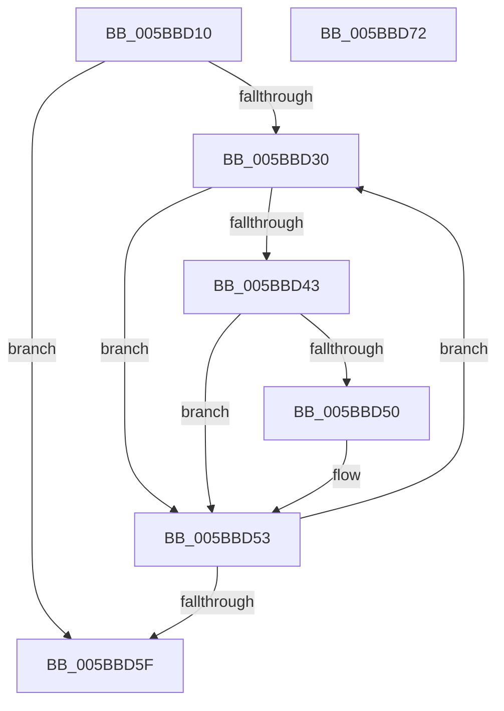

# KeQueryActiveNodeCount

- RVA: `0x005BBD10`–`0x005BBD73` (길이 `99` bytes)
- VA: `0x00000001405BBD10`
- 실행 섹션: `.text`
- PDB 이름 있음: `예`; PDB Function 태그: `아니요`
- unwind 정보 RVA: `0x00060BC4`
- 디코드: `29`개 명령, `99/99` bytes 표시
- 미해석 바이트: `0` (있으면 어셈블리에 `.byte`로 보존)

> 이 문서는 커널 이미지의 기계어와 PDB 기호를 분석해 생성했습니다. 4번과 5번은 함수 원형과 자료형을 바이너리 사용 방식에서 추정한 C 해석이며 원본 소스 복구 결과는 아닙니다.

## 1. Dependencies

- 직접 호출 지점: **1**; 고유 호출 대상: **1**
- 직접 호출자로 확인된 함수: **1**
- RIP 상대 이미지 참조: **2**

### Outgoing calls
- `0x005BBD47` → [KeIsEmptyGroupMask](../25/KeIsEmptyGroupMask_function_002553B0.md) (function, `0x002553B0`)

### Direct callers
- [PpmHeteroHgsCpuSupportedForContainment](../5D/PpmHeteroHgsCpuSupportedForContainment_function_005D86C0.md) at `0x005D86E6`

### Static image references
- `0x005BBD21` → RVA `0x00FC5000` (`ALMOSTRO`; read)
- `0x005BBD33` → RVA `0x00FCF6C0` (`CACHEALI`; read)

## 2. Other-region calls and transfers

- 다른 실행 섹션으로 향하는 call: **0**
- 별도 외부 분기/꼬리 이동을 확인하지 못했습니다.

## 3. Assembly (complete function range)

```asm
005BBD10  48 89 5C 24 08                  mov qword ptr [rsp + 8], rbx
005BBD15  48 89 74 24 10                  mov qword ptr [rsp + 0x10], rsi
005BBD1A  57                              push rdi
005BBD1B  48 83 EC 20                     sub rsp, 0x20
005BBD1F  33 F6                           xor esi, esi
005BBD21  66 3B 35 D8 92 A0 00            cmp si, word ptr [rip + 0xa092d8]
005BBD28  0F B7 FE                        movzx edi, si
005BBD2B  0F B7 DE                        movzx ebx, si
005BBD2E  73 2F                           jae 0x1405bbd5f
005BBD30  0F B7 C3                        movzx eax, bx
005BBD33  48 8D 0D 86 39 A1 00            lea rcx, [rip + 0xa13986]
005BBD3A  48 8B 0C C1                     mov rcx, qword ptr [rcx + rax*8]
005BBD3E  48 85 C9                        test rcx, rcx
005BBD41  74 10                           je 0x1405bbd53
005BBD43  48 83 C1 10                     add rcx, 0x10
005BBD47  E8 64 96 C9 FF                  call 0x1402553b0
005BBD4C  85 C0                           test eax, eax
005BBD4E  75 03                           jne 0x1405bbd53
005BBD50  66 FF C7                        inc di
005BBD53  66 FF C3                        inc bx
005BBD56  66 3B 1D A3 92 A0 00            cmp bx, word ptr [rip + 0xa092a3]
005BBD5D  72 D1                           jb 0x1405bbd30
005BBD5F  48 8B 5C 24 30                  mov rbx, qword ptr [rsp + 0x30]
005BBD64  0F B7 C7                        movzx eax, di
005BBD67  48 8B 74 24 38                  mov rsi, qword ptr [rsp + 0x38]
005BBD6C  48 83 C4 20                     add rsp, 0x20
005BBD70  5F                              pop rdi
005BBD71  C3                              ret
005BBD72  CC                              int3
```

## 4. C-style interpretation (structured pseudocode)

```c
__int64 __fastcall KeQueryActiveNodeCount(void)
{
    __int64 result;
    __int64 v_rbx;
    __int64 v_rdi;
    __int64 v_rsi;
    __int64 v_rsp;
    unsigned __int64 v_stack_p10;
    unsigned __int64 v_stack_p8;

    v_stack_p8 = v_rbx;
    v_stack_p10 = v_rsi;
    v_rsp = (v_rsp) - (32);
    v_rsi = 0;
    if (0 >= (*(unsigned __int16 *)(v_rip + 10523352))) goto loc_005BBD5F;
loc_005BBD30:
    if (*(unsigned __int64 *)(v_rip + 10566022 + 0 * 8) == 0) goto loc_005BBD53;
    a1 = (*(unsigned __int64 *)(v_rip + 10566022 + 0 * 8)) + (16);
    result = KeIsEmptyGroupMask(a1, a2, a3, a4);
    v_rdi = 0;
    if ((unsigned int)(result) == 0) {
        v_rdi = (unsigned __int16)((0) + 1);
    }
    v_rbx = (unsigned __int16)((0) + 1);
    if (((unsigned __int16)(v_rbx)) < (*(unsigned __int16 *)(v_rip + 10523299))) goto loc_005BBD30;
loc_005BBD5F:
    v_rsp = (v_rsp) + (32);
    return (unsigned __int16)(v_rdi);
}
```

## 5. (Beta) C Style

```c
void KeQueryActiveNodeCount(void)
{
    int64_t result;
    int64_t local_rbx;
    int64_t local_rdi;
    int64_t local_rsi;
    int64_t local_rsp;
    uint64_t v_stack_p10;
    uint64_t v_stack_p8;

    v_stack_p8 = local_rbx;
    v_stack_p10 = local_rsi;
    local_rsp = (local_rsp) - (32);
    local_rsi = 0;
    if (0 >= (*(uint16_t *)(v_rip + 0xA092D8))) goto loc_005BBD5F;
loc_005BBD30:
    if (*(uint64_t *)(v_rip + 0xA13986 + 0x0 * 8) == 0) goto loc_005BBD53;
    a1 = (*(uint64_t *)(v_rip + 0xA13986 + 0x0 * 8)) + (16);
    result = KeIsEmptyGroupMask(a1, a2, a3, a4);
    local_rdi = 0;
    if ((uint32_t)(result) == 0) {
        local_rdi = (uint16_t)((0) + 1);
    }
    local_rbx = (uint16_t)((0) + 1);
    if (((uint16_t)(local_rbx)) < (*(uint16_t *)(v_rip + 0xA092A3))) goto loc_005BBD30;
loc_005BBD5F:
    local_rsp = (local_rsp) + (32);
    return (uint16_t)(local_rdi);
}
```

## 6. Execution-region graph

[열기: 2D/3D 그래프와 함수 탐색 컨트롤 패널](../../../control-panel.html?section=text&rva=0x005BBD10&view=graph)

- 2D 그래프는 위에서 아래로 흐르고, 3D 그래프는 빈 공간을 드래그해 회전합니다. Shift+드래그는 이동, 휠은 확대·축소, 함수 노드 선택은 대상 보고서 이동입니다.

### Static fallback


