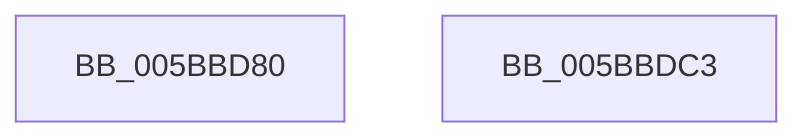

# KeQueryActiveProcessorAffinity

- RVA: `0x005BBD80`–`0x005BBDC4` (길이 `68` bytes)
- VA: `0x00000001405BBD80`
- 실행 섹션: `.text`
- PDB 이름 있음: `예`; PDB Function 태그: `아니요`
- unwind 정보 RVA: `0x0005CF00`
- 디코드: `18`개 명령, `68/68` bytes 표시
- 미해석 바이트: `0` (있으면 어셈블리에 `.byte`로 보존)

> 이 문서는 커널 이미지의 기계어와 PDB 기호를 분석해 생성했습니다. 4번과 5번은 함수 원형과 자료형을 바이너리 사용 방식에서 추정한 C 해석이며 원본 소스 복구 결과는 아닙니다.

## 1. Dependencies

- 직접 호출 지점: **2**; 고유 호출 대상: **2**
- 직접 호출자로 확인된 함수: **0**
- RIP 상대 이미지 참조: **2**

### Outgoing calls
- `0x005BBD9F` → [memset](../6C/memset_function_006C6C40.md) (function, `0x006C6C40`)
- `0x005BBDB2` → [KiCopyAffinityEx](../2C/KiCopyAffinityEx_function_002CE860.md) (function, `0x002CE860`)

### Direct callers
- 이 함수 시작 RVA로 연결되는 직접 call은 확인되지 않았습니다. 간접 호출은 완전히 역산할 수 없습니다.

### Static image references
- `0x005BBDA8` → RVA `0x00FC7120` (`ALMOSTRO`; read)
- `0x005BBDB7` → RVA `0x00FC6A80` (`ALMOSTRO`; read)

## 2. Other-region calls and transfers

- 다른 실행 섹션으로 향하는 call: **0**
- 별도 외부 분기/꼬리 이동을 확인하지 못했습니다.

## 3. Assembly (complete function range)

```asm
005BBD80  40 53                           push rbx
005BBD82  48 83 EC 20                     sub rsp, 0x20
005BBD86  83 61 04 00                     and dword ptr [rcx + 4], 0
005BBD8A  48 8B D9                        mov rbx, rcx
005BBD8D  C7 01 01 00 14 00               mov dword ptr [rcx], 0x140001
005BBD93  33 D2                           xor edx, edx
005BBD95  48 83 C1 08                     add rcx, 8
005BBD99  41 B8 A0 00 00 00               mov r8d, 0xa0
005BBD9F  E8 9C AE 10 00                  call 0x1406c6c40
005BBDA4  0F B7 53 02                     movzx edx, word ptr [rbx + 2]
005BBDA8  4C 8D 05 71 B3 A0 00            lea r8, [rip + 0xa0b371]
005BBDAF  48 8B CB                        mov rcx, rbx
005BBDB2  E8 A9 2A D1 FF                  call 0x1402ce860
005BBDB7  8B 05 C3 AC A0 00               mov eax, dword ptr [rip + 0xa0acc3]
005BBDBD  48 83 C4 20                     add rsp, 0x20
005BBDC1  5B                              pop rbx
005BBDC2  C3                              ret
005BBDC3  CC                              int3
```

## 4. C-style interpretation (structured pseudocode)

```c
__int64 __fastcall KeQueryActiveProcessorAffinity(__int64 a1, int a2)
{
    __int64 result;
    __int64 v_rsp;

    v_rsp = (v_rsp) - (32);
    *(unsigned int *)(a1) = 0x140001ULL;
    a2 = 0;
    a1 = (a1) + (8);
    result = memset(a1, a2, 160, a4);
    result = KiCopyAffinityEx(a1, *(unsigned __int16 *)(a1 + 2), v_rip + 10531697, a4);
    v_rsp = (v_rsp) + (32);
    return (unsigned int)(*(unsigned int *)(v_rip + 10529987));
}
```

## 5. (Beta) C Style

```c
int64_t KeQueryActiveProcessorAffinity(void *Arg1, int32_t Arg2)
{
    uint8_t *arg1 = (uint8_t *)Arg1;

    int64_t result;
    int64_t local_rsp;

    local_rsp = (local_rsp) - (32);
    *(uint32_t *)(arg1) = 0x140001ULL;
    Arg2 = 0;
    Arg1 = (Arg1) + (8);
    result = memset(Arg1, Arg2, 160, a4);
    result = KiCopyAffinityEx(Arg1, *(uint16_t *)(arg1 + 0x2), v_rip + 10531697, a4);
    local_rsp = (local_rsp) + (32);
    return (uint32_t)(*(uint32_t *)(v_rip + 0xA0ACC3));
}
```

### 관측된 메모리 오프셋

구조체 형식이 확인되지 않은 접근은 인자 기준의 오프셋으로만 기록했습니다.

| 기준 인자 | 오프셋 표현 | 폭 (bit) | 접근 |
|---|---:|---:|---|
| `Arg1` | `+ 0x0` | `32` | `W` |
| `Arg1` | `+ 0x2` | `16` | `R` |
| `Arg1` | `+ 0x4` | `32` | `R/W` |

## 6. Execution-region graph

[열기: 2D/3D 그래프와 함수 탐색 컨트롤 패널](../../../control-panel.html?section=text&rva=0x005BBD80&view=graph)

- 2D 그래프는 위에서 아래로 흐르고, 3D 그래프는 빈 공간을 드래그해 회전합니다. Shift+드래그는 이동, 휠은 확대·축소, 함수 노드 선택은 대상 보고서 이동입니다.

### Static fallback


